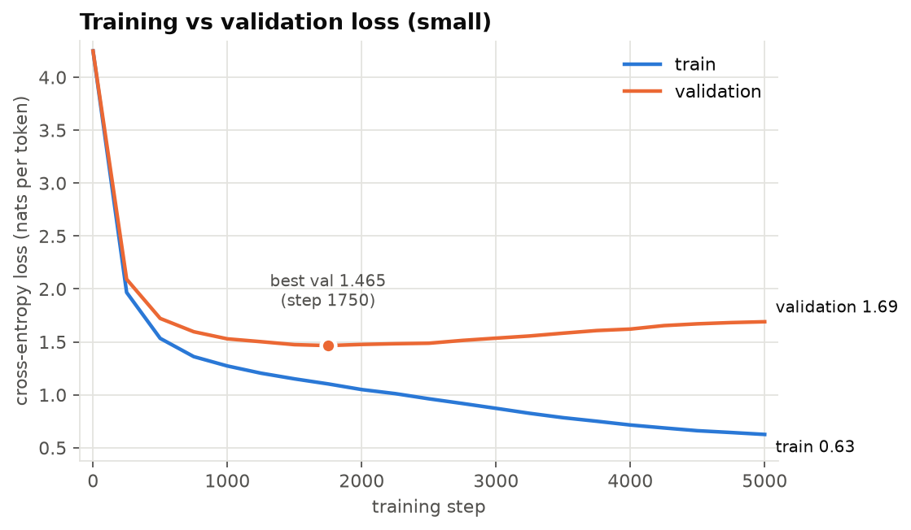
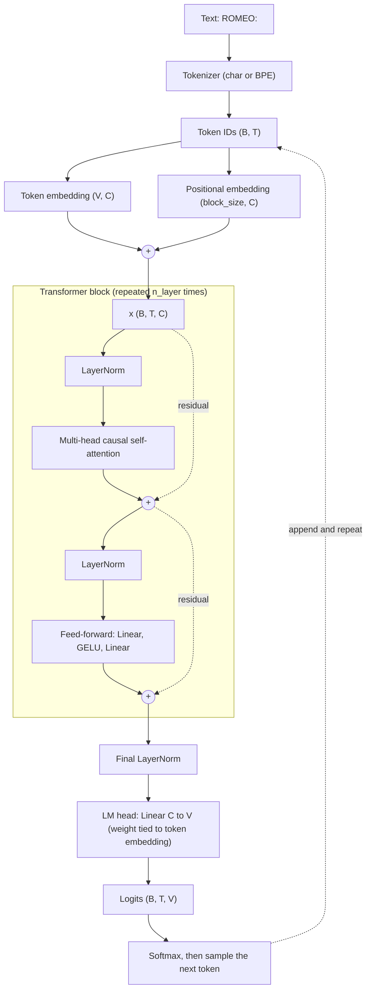
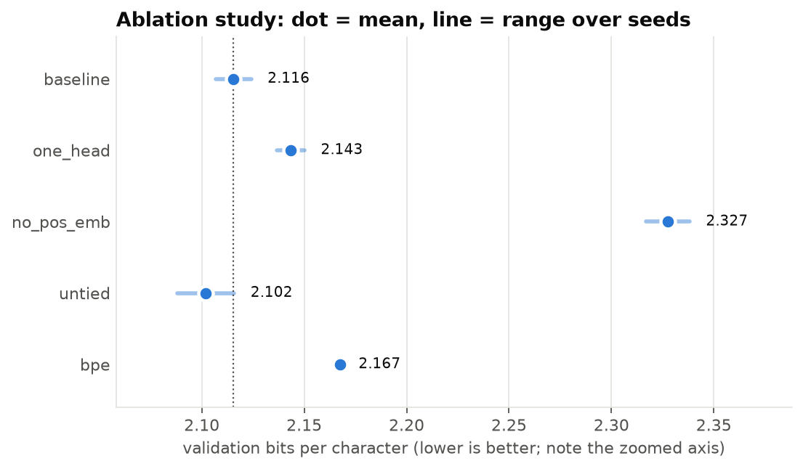
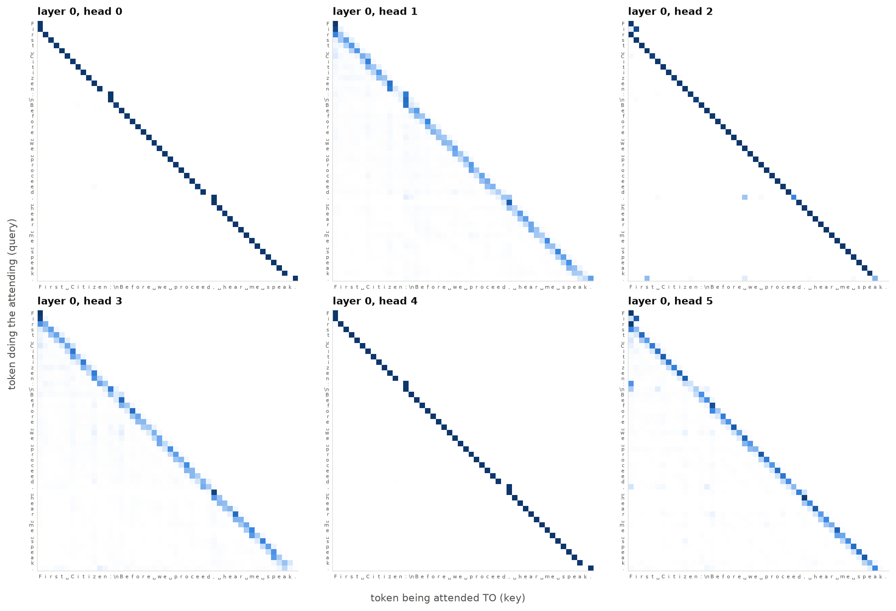
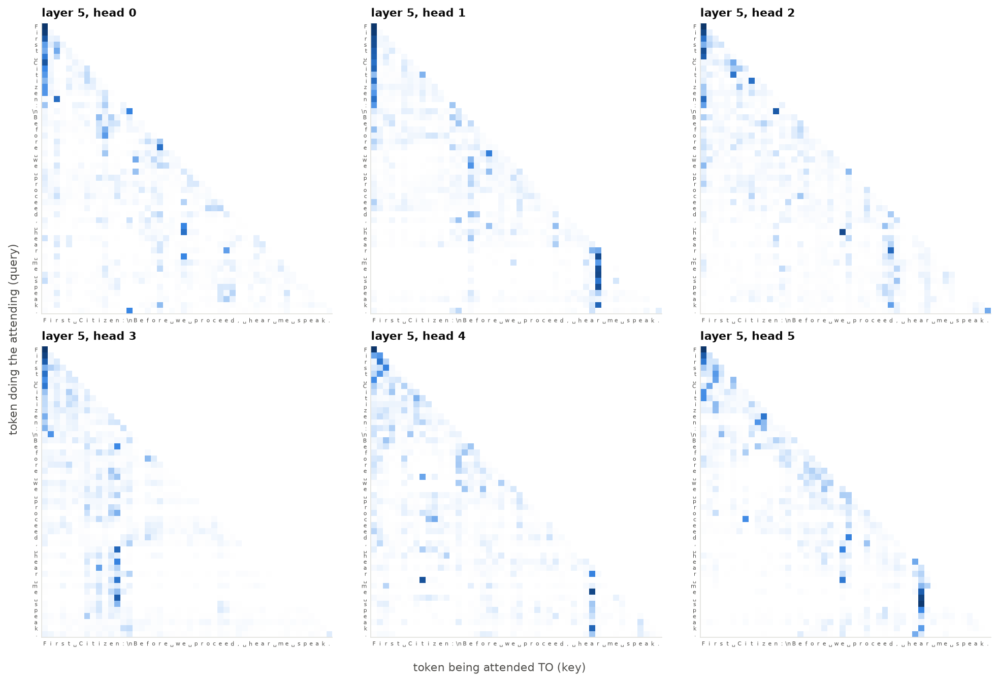

# mini-gpt-from-scratch

A GPT-style language model implemented in PyTorch, featuring custom tokenizers, manually implemented causal self-attention, Transformer blocks, training and text generation, without using nn.Transformer or nn.MultiheadAttention.


A 10.7M-parameter model, trained for about 22 minutes on a laptop GPU on 1 MB of
Shakespeare, writes this (prompt: `ROMEO:`):

```text
ROMEO:
I lay thee, but some law I have made thee thou art.

BENVOLIO:
Besides, marry, O Romeo.

MISTRESS OVERDONE:
Now, be come to him, or I ne'er will be none.

MENENIUS:
What is my name?
```

(`python generate.py --prompt "ROMEO:" --temperature 0.8 --top_k 50 --seed 42`. It has
learned what a play looks like, not what any play says: these characters come from
three different plays.)

<p align="center"></p>

**Contents:** [What this is](#what-this-is-and-why-i-built-it) ·
[Architecture](#architecture) · [How a transformer works](#how-a-transformer-works) ·
[Setup](#setup) · [Train](#train) · [Generate](#generate) · [Results](#results) ·
[Tests](#tests) · [Learning guide](#learning-guide) · [What I learned](#what-i-learned) ·
[Future work](#limitations-and-future-work) · [References](#references-and-credits)

## What this is, and why I built it

Large language models are easy to use and hard to see inside. I wanted to understand how they work internally, particularly how tokenization, attention, and neural network training come together to produce text.

I started this project as a hands-on exploration of GPT-style language models. The initial implementation was developed with the assistance of an AI coding tool, with a focus on making the architecture readable, testable, and understandable.

The project includes:

- A character tokenizer and a byte-level BPE tokenizer.
- Causal self-attention, including query, key and value projections, scaled dot-product attention, masking and softmax.
- Multi-head attention, Transformer blocks, residual connections, LayerNorm and positional embeddings.
- A training pipeline with AdamW, learning-rate scheduling, gradient clipping and mixed precision.
- Text generation using temperature, top-k and top-p sampling.

My objective is to understand each component deeply enough to eventually reproduce the model independently.

## Architecture



`B` = batch size, `T` = sequence length, `C` = embedding width, `V` = vocabulary size.
The main model uses 6 blocks, 6 heads, `C = 384`, a context of 256 characters and a
vocabulary of 65 characters.

## How a transformer works

In plain language, with the place in the code where each step happens.

| Step | What happens | Where |
|---|---|---|
| 1. Tokenize | Text is cut into tokens (characters, or BPE chunks) and each becomes an integer. | [`mini_gpt/tokenizer.py`](mini_gpt/tokenizer.py) |
| 2. Embed | Each integer looks up a learned vector. A second learned vector for its *position* is added, because attention alone cannot see word order. | `GPT.embed` in [`mini_gpt/model.py`](mini_gpt/model.py) |
| 3. Attend | Every token asks a question (its *query*), every token advertises what it holds (its *key*), and each token collects a weighted mix of the *values* of the tokens whose keys match its query. | `CausalSelfAttentionHead` |
| 4. Mask | A token may only look at itself and earlier tokens. Otherwise it could read the answer it is supposed to predict. | step 3 of `CausalSelfAttentionHead.forward` |
| 5. Many heads | Several attention heads run side by side so that different kinds of relationship can be tracked at once. | `MultiHeadAttention` |
| 6. Think | A small two-layer network processes each token's vector on its own. Attention gathers; this digests. | `FeedForward` |
| 7. Stack | Steps 3 to 6 form a block. Residual connections (`x + f(x)`) and LayerNorm make it possible to stack blocks. | `Block`, `LayerNorm` |
| 8. Predict | A final linear layer turns each vector into one score per vocabulary token: the model's guess for what comes next. | `GPT.forward` |
| 9. Learn | The loss is the negative log-probability given to the true next token. Backpropagation and AdamW adjust all 10.7M parameters to lower it. | [`train.py`](train.py) |
| 10. Write | To generate, sample a token from the predicted distribution, append it, and repeat. | `GPT.generate`, [`generate.py`](generate.py) |

For a hands-on version, [`notebooks/walkthrough.ipynb`](notebooks/walkthrough.ipynb)
builds attention on a five-letter example with every tensor printed.

## Setup

Requires Python 3.10+.

```bash
git clone https://github.com/<your-username>/mini-gpt-from-scratch.git
cd mini-gpt-from-scratch
python -m venv .venv
.venv\Scripts\activate                 # Windows   (macOS/Linux: source .venv/bin/activate)

# PyTorch: pick the build for your hardware at https://pytorch.org/get-started/locally/
pip install torch --index-url https://download.pytorch.org/whl/cu130   # NVIDIA GPU
# pip install torch                                                    # CPU only

pip install -r requirements.txt
python -m pytest                       # 33 tests should pass
```

The code picks the GPU automatically when PyTorch can see one and falls back to the CPU
otherwise. It was developed with PyTorch 2.14 and CUDA 13.0 on an RTX 5050 Laptop GPU
(8 GB).

## Train

```bash
python train.py --config configs/small.yaml --results_dir results   # ~22 min on the GPU above
python train.py --config configs/tiny_cpu.yaml                      # ~2 min on a CPU
```

Tiny Shakespeare is downloaded and tokenized automatically on first use. During training
the script prints the train and validation loss every 250 steps, writes a sample of text
so you can watch the model learn, and keeps the checkpoint with the best validation loss
in `checkpoints/<name>/best.pt`.

Every hyperparameter lives in the YAML config and can be overridden on the command line:

```bash
python train.py --config configs/small.yaml --set train.batch_size=32 model.n_layer=4
python train.py --config configs/small.yaml --set data.tokenizer=bpe      # BPE instead of characters
python train.py --config configs/small.yaml --set data.input_file=data/my_notes.txt   # your own text
```

| Config | Parameters | Layers / heads / width | Context | Hardware | Time | Best val loss |
|---|---|---|---|---|---|---|
| [`small.yaml`](configs/small.yaml) | 10.75M | 6 / 6 / 384 | 256 | RTX 5050, 8 GB | ~22 min | 1.46 |
| [`tiny_cpu.yaml`](configs/tiny_cpu.yaml) | 0.34M | 3 / 3 / 96 | 64 | laptop CPU | ~2 min | 1.84 |

## Generate

```bash
python generate.py --prompt "ROMEO:" --max_new_tokens 400 --temperature 0.8 --top_k 50
python generate.py --prompt "To be" --temperature 1.0 --top_p 0.9 --seed 42
```

`--temperature` below 1 makes the text safer and more repetitive, above 1 more
adventurous. `--top_k` and `--top_p` cut off the unlikely tail of the distribution.
`--temperature 0` always takes the most likely token.

## Results

Everything in this section is produced by a script in [`scripts/`](scripts) from the
actual runs; nothing was typed in by hand.

### Loss curve

The validation loss reaches its minimum of **1.46 at step 1,750** and then climbs while
the training loss keeps falling: the model starts to **overfit**. With only 1 MB of text
(one pass over it is about 61 steps), a 10.7M-parameter model eventually memorises its
training data. `train.py` keeps the checkpoint with the lowest validation loss, so the
saved model is the one from step 1,750. For reference, uniform guessing scores 4.17 and
a bigram model 2.48.

The figure at the top of this page is `results/loss_curve.png`
(`python scripts/plot_loss.py`); the numbers are in
[`results/training_log.csv`](results/training_log.csv).

### Samples at different stages of training

The same model, sampled as it trains (full text in
[`results/samples.md`](results/samples.md)):

| Step | Val loss | Sample (first lines) |
|---:|---:|---|
| 0 | 4.25 | `?3C;?BDkLZkNdc.?j,UTTOLOT,xHtK` |
| 250 | 2.09 | `Sel mage to that and the mat tate this I spraind.` / `DUCHESSS OF OF RYORKE:` / `That it nou self way's ye what ther and the So her sand:` |
| 2,500 | 1.49 | `Mighty suod, they live love in rears` / `To take her by the wind, and do go sure.` / `EDWARD:` / `Sweet York, brother, she is infantion.` |
| 5,000 | 1.69 | `When the duke was prevail'd to me: yet, my lord,` / `Shall I see the fairest beauty of blood,` / `Impartial sleep in marriage; and if they` |

After one minute of training (step 250) the model already has spaces, short common
words and the "NAME: speech" layout. By step 2,500 nearly every word is real. The last
row reads well but comes from the overfitted model: its validation loss is *worse* than
at step 2,500.

### Ablation study

What does each component contribute? A smaller baseline (4 layers, 4 heads, width 256,
3.2M parameters, 3,000 steps) was retrained with exactly one thing changed, twice each
with different seeds (`python scripts/run_ablations.py --seeds 1337 1338`). Losses are
converted to **bits per character**, because a loss per token is not comparable between
a character tokenizer and BPE.

| Variant | What changed | Val loss / token | Bits / char (range over 2 seeds) | vs baseline |
|---|---|---:|---:|---:|
| `baseline` | characters, 4 heads, positional embeddings, tied weights | 1.466 | 2.116 (2.107-2.124) | |
| `no_pos_emb` | no positional embeddings | 1.613 | 2.327 (2.317-2.338) | +10.0% |
| `one_head` | 1 attention head instead of 4, same total width | 1.486 | 2.143 (2.137-2.150) | +1.3% |
| `untied` | output layer not tied to the token embedding | 1.457 | 2.102 (2.088-2.116) | -0.6% |
| `bpe` | BPE tokenizer (vocabulary 512) | 3.017 | 2.167 (2.166-2.169) | +2.5% |

<p align="center"></p>

How I read this (two runs of the *same* baseline differ by about 0.02 bits/char, so that
is the noise level):

- **Positional embeddings matter.** Removing them costs 10%, ten times the noise. The
  model does not collapse entirely, probably because the causal mask leaks some position
  information (the first token sees one token, the second sees two, and so on). I did
  not test that explanation.
- **Multiple heads help a little.** One wide head is 1.3% worse than four narrow ones.
  Small, but consistent across seeds.
- **Weight tying made no measurable difference here.** The untied model's two runs
  overlap with the baseline's. With a 65-character vocabulary, tying saves only 16,640
  parameters; its benefits are expected with large vocabularies. I kept it because it is
  standard and free, not because my data showed it helps.
- **BPE was slightly worse on this dataset.** Per token its loss is twice as high, but
  per character only 2.5%. The BPE model overfits much more (1 MB of text gives few
  examples of each of 512 token types), so its advantages do not pay off at this scale.

Limits of this study: two seeds, one dataset, one model size, and the checkpoint was
selected on the validation set. Full table: [`results/ablations.md`](results/ablations.md).

### Attention heatmaps

`python scripts/visualize_attention.py` plots, for a sample sentence, where each token
looks. Row *i* shows the weights token *i* puts on every token; everything above the
diagonal is zero because of the causal mask.

<p align="center"></p>

**Layer 0** (above). Three heads have learned a single, position-based job: heads 0 and
4 look at the **previous character**, head 2 at the character **two back**. This is not
an impression from one sentence: averaged over 32 validation sequences
(`python scripts/attention_stats.py --head_removal`, [`results/attention_stats.md`](results/attention_stats.md)),
heads 0 and 4 put 94% and 95% of their weight on the previous character and head 2 puts
95% on the one before that. An untrained model puts under 2% there.

<p align="center"></p>

**Layer 5** (above). No fixed offsets any more: the patterns depend on the content of
the sentence and reach much further back. Mean attention distance by layer is 4.6,
31.1, 7.5, 8.6, 16.9 and 26.4 characters, so "early layers are local, late layers are
global" is roughly right, with layer 1 as a clear exception (it averages broadly over
about 46 tokens).

Two honest caveats. Attention maps show where a head *looks*, not why the model predicts
what it does. And the two previous-character heads are redundant: switching off either
one changes the validation loss by at most 0.003, switching off both by 0.012.
[`results/attention_closeup.png`](results/attention_closeup.png) shows a single head
with every token labelled.

## Tests

```bash
python -m pytest -v
```

33 tests, all on the CPU in under a minute. The ones that matter most:

- **Causality** ([`tests/test_attention.py`](tests/test_attention.py)): changing a token
  must leave every *earlier* output bit-for-bit unchanged. A companion test removes the
  mask and checks that the future then *does* leak, to prove the test can fail.
- **Overfit one batch** ([`tests/test_overfit.py`](tests/test_overfit.py)): the model
  must memorise a single batch and regenerate it exactly. This exercises the targets,
  the loss, the gradients and the optimizer together.
- **Tokenizer round trips** ([`tests/test_tokenizer.py`](tests/test_tokenizer.py)):
  `decode(encode(text)) == text`, including unseen, accented and Telugu text.
- Attention shapes, rows summing to 1, the hand-written LayerNorm matching PyTorch's,
  the untrained loss being close to ln(65), top-k / top-p, the learning-rate schedule.

## Repository structure

```text
mini_gpt/        model.py · tokenizer.py · data.py · config.py · utils.py
configs/         small.yaml · tiny_cpu.yaml · ablation.yaml
train.py         training loop
generate.py      sampling from a checkpoint
data/prepare.py  download and tokenize a dataset (any UTF-8 .txt file)
scripts/         plot_loss · run_ablations · visualize_attention · attention_stats · guide and PDF builders
examples/        small runnable programs used by the learning guide
notebooks/       walkthrough.ipynb: attention step by step
tests/           pytest suite
results/         loss curve, samples, ablation table, attention heatmaps
docs/            LEARNING_GUIDE (.md and .pdf) · STUDY_GUIDE.md
```

## Learning guide

[`docs/LEARNING_GUIDE.pdf`](docs/LEARNING_GUIDE.pdf) (also as
[markdown](docs/LEARNING_GUIDE.md)) teaches everything needed to rebuild this project
from an empty folder, starting from "I know Python but not NumPy": arrays, PyTorch,
neural networks and backpropagation from scratch, then the GPT piece by piece, with
worked numerical examples, exercises and solutions. Its code snippets are pulled from
the real source files by `scripts/build_guide.py`, so they cannot go stale.

[`docs/STUDY_GUIDE.md`](docs/STUDY_GUIDE.md) is the short version: the key ideas, the
results, and likely interview questions.

## What I Learned

This section will be updated as I work through the implementation, study the underlying concepts, and independently reproduce the model.

I'll document the concepts I understand, the challenges I encounter, and the experiments I conduct along the way.

## Limitations and future work

**Limitations**

- Trained on 1 MB of text, so it overfits quickly and knows nothing beyond Shakespeare's
  style.
- Written for readability: attention heads run in a Python loop, and generation
  recomputes the whole context for every new token.
- The ablations use two seeds and one dataset.

**Ideas**

- **Batched heads and flash attention**: compute all heads in one tensor and use
  `F.scaled_dot_product_attention`.
- **KV cache** for much faster generation.
- **Train on Telugu text**: the byte-level BPE tokenizer already handles any script.
- More data (TinyStories, for example) and stronger regularisation to push past the
  overfitting.
- Rotary positional embeddings; resuming from checkpoints; early stopping.

## References and credits

- Vaswani et al., [Attention Is All You Need](https://arxiv.org/abs/1706.03762) (2017).
- Radford et al., [Language Models are Unsupervised Multitask Learners](https://cdn.openai.com/better-language-models/language_models_are_unsupervised_multitask_learners.pdf)
  (GPT-2, 2019).
- Andrej Karpathy's [nanoGPT](https://github.com/karpathy/nanoGPT) and his lecture
  ["Let's build GPT: from scratch, in code, spelled out"](https://www.youtube.com/watch?v=kCc8FmEb1nY).
  This project follows their design closely (model shape, hyperparameters, the Tiny
  Shakespeare setup) and is best understood as a slower, more heavily explained and
  tested re-implementation for learning purposes.
- Sennrich et al., [Neural Machine Translation of Rare Words with Subword Units](https://arxiv.org/abs/1508.07909)
  (BPE), and Karpathy's [minbpe](https://github.com/karpathy/minbpe).
- Press and Wolf, [Using the Output Embedding to Improve Language Models](https://arxiv.org/abs/1608.05859)
  (weight tying).
- The Tiny Shakespeare dataset comes from Karpathy's
  [char-rnn](https://github.com/karpathy/char-rnn).


## Development Background

This project began as an exploration of how GPT-style language models work under the hood.

The initial implementation was developed with AI assistance. I defined the project requirements, architecture goals, experiments, and learning objectives, and used AI tools to assist with implementation, debugging, and verification.

Rather than treating the finished implementation as a black box, I'm using this project as a foundation to study the mathematics, understand the architecture, and independently reproduce its components.

My next goal is to build a second implementation independently, writing and understanding the core components myself.

## Independent Reimplementation

An independent reimplementation will be maintained separately:

**Repository:** `mini-gpt-from-scratch-rebuilt`

The goal is to demonstrate the knowledge gained from studying this project through an implementation written independently.

## License

[MIT](LICENSE)
