<!-- GENERATED FILE: edit the chapters in docs/guide_src/ and run `python scripts/build_guide.py`. -->

# The Mini-GPT Learning Guide

*Everything you need to rebuild this project from an empty folder, without AI help.*

<!-- toc:start -->
- [Before you start](#before-you-start)
- [Part 1: Foundations](#part-1-foundations)
  - [Chapter 1: What a language model is](#chapter-1-what-a-language-model-is)
  - [Chapter 2: NumPy basics](#chapter-2-numpy-basics)
  - [Chapter 3: PyTorch basics](#chapter-3-pytorch-basics)
  - [Chapter 4: Neural networks from scratch](#chapter-4-neural-networks-from-scratch)
  - [Chapter 5: Training concepts](#chapter-5-training-concepts)
- [Part 2: Building the GPT, step by step](#part-2-building-the-gpt-step-by-step)
  - [Chapter 6: Tokenization](#chapter-6-tokenization)
  - [Chapter 7: Embeddings and positional embeddings](#chapter-7-embeddings-and-positional-embeddings)
  - [Chapter 8: The bigram model, a first working baseline](#chapter-8-the-bigram-model-a-first-working-baseline)
  - [Chapter 9: Self-attention](#chapter-9-self-attention)
  - [Chapter 10: Causal masking](#chapter-10-causal-masking)
  - [Chapter 11: Assembling a transformer block](#chapter-11-assembling-a-transformer-block)
  - [Chapter 12: The full GPT model and weight tying](#chapter-12-the-full-gpt-model-and-weight-tying)
  - [Chapter 13: Training the model](#chapter-13-training-the-model)
  - [Chapter 14: Generating text](#chapter-14-generating-text)
- [Part 3: Making it a real project](#part-3-making-it-a-real-project)
  - [Chapter 15: Experiments and ablations](#chapter-15-experiments-and-ablations)
  - [Chapter 16: Looking inside: attention visualisation](#chapter-16-looking-inside-attention-visualisation)
  - [Chapter 17: Testing machine-learning code with pytest](#chapter-17-testing-machine-learning-code-with-pytest)
  - [Chapter 18: Git, project structure, and a good README](#chapter-18-git-project-structure-and-a-good-readme)
- [Part 4: Do it yourself](#part-4-do-it-yourself)
  - [Chapter 19: Rebuild it from scratch: a roadmap](#chapter-19-rebuild-it-from-scratch-a-roadmap)
  - [Chapter 20: Common errors and how to fix them](#chapter-20-common-errors-and-how-to-fix-them)
  - [Chapter 21: Where to go next](#chapter-21-where-to-go-next)
- [Appendix A: Solutions to the exercises](#appendix-a-solutions-to-the-exercises)
- [Appendix B: Answers to "Check your understanding"](#appendix-b-answers-to-check-your-understanding)
- [Appendix C: Glossary](#appendix-c-glossary)
<!-- toc:end -->

# Before you start

### Who this guide is for

You know Python well (functions, classes, lists, dictionaries, files). You have **not**
used NumPy or PyTorch, and you have never trained a neural network. You are comfortable
with first-year mathematics: functions, derivatives, and the idea of a partial derivative
from multivariable calculus.

That is enough. Every other idea is introduced here before it is used, in the same order
each time: **intuition first, then the math, then the code**.

### What you will be able to do at the end

- Explain, in plain words and on a whiteboard, how a GPT-style language model works.
- Rebuild every file of this repository yourself, from an empty folder.
- Train the model on your own text, measure it, and run controlled experiments on it.
- Debug the usual failures: shape mismatches, a loss that will not go down, `NaN`, and
  running out of GPU memory.

### How to read it

Read with a terminal open. When a chapter shows code, **type it yourself** rather than
copy-pasting; typing forces you to notice every character. Do the exercises before
looking at the solutions in Appendix A. The exercises are where the understanding
actually happens.

A realistic pace is one chapter per sitting. Part 1 (Chapters 1 to 5) is background and
can be skimmed if you already know some of it; Part 2 (Chapters 6 to 14) is the heart of
the guide; Part 3 turns the model into a real project; Part 4 is your roadmap for doing
it all again alone.

### Conventions

**Code from the repository.** Most code in this guide is copied *by a script* out of the
real files in this repository, so it cannot drift out of date. Such a snippet always has
a caption giving the file and the line numbers, like this:

**`mini_gpt/utils.py` · lines 29–34**

```python
def set_seed(seed: int) -> None:
    """Seed every random number generator we use, so runs are reproducible."""
    random.seed(seed)
    np.random.seed(seed)
    torch.manual_seed(seed)
    torch.cuda.manual_seed_all(seed)
```

Open the file and look at those lines: you will find exactly this text. (If you later
edit the repository, re-run `python scripts/build_guide.py` and every snippet and line
number in the guide is refreshed.)

**Scratch code.** Short snippets *without* a caption are things to try yourself in a
Python prompt. They are not part of the repository.

**Program output.** Blocks that show what a script prints were produced by actually
running the script while this guide was built.

**Boxes.** Three kinds of boxes appear:

> **Key ideas**
>
> Each chapter starts with a box like this one, listing what the chapter will teach.
> Read it again when you finish the chapter and check that every line now makes sense.

> **Note**
>
> Extra context, a common misunderstanding, or a connection to something you already know.

> **Detail you can ignore for now**
>
> Something that is true and that you will meet in the code, but that you do not need to
> understand yet. You have permission to skip it.

**Bold terms** are defined in the glossary (Appendix C) the first time they matter.

### Setting up

You need Python 3.10 or newer. From the repository folder:

```bash
python -m venv .venv
.venv\Scripts\activate            # Windows  (on macOS/Linux: source .venv/bin/activate)
pip install torch --index-url https://download.pytorch.org/whl/cu130   # NVIDIA GPU build
pip install -r requirements.txt
python -m pytest                  # every test should pass
```

If you have no NVIDIA GPU, leave out the `--index-url ...` part; you then get the
CPU-only build of PyTorch, and everything in this guide still works, just more slowly.
Chapter 3 explains what the GPU is for.

> **Note**
>
> The `cu130` in the address means "built for CUDA 13.0", the NVIDIA software that lets
> PyTorch talk to the graphics card. Very new or very old cards may need a different
> build; the selector on [pytorch.org](https://pytorch.org/get-started/locally/) prints
> the right command for your machine.

# Part 1: Foundations

## Chapter 1: What a language model is

> **Key ideas**
>
> - A **language model** is a function that takes some text and returns a probability
>   for every possible *next* piece of text.
> - Text is cut into small pieces called **tokens**. Our first tokens are single characters.
> - **Training** means adjusting millions of numbers (the **parameters**) so that the
>   model gives high probability to what really came next in real text.
> - **Generating** means repeatedly asking "what comes next?", picking an answer, adding
>   it to the text, and asking again.
> - A GPT is one particular design for that function. This guide builds it piece by piece.

### 1.1 The one job of a language model

Finish this sentence:

> The cat sat on the ...

You probably thought "mat", perhaps "floor" or "sofa". You certainly did not think
"democracy" or "seventeen". Without noticing, you assigned *probabilities* to possible
continuations: high for "mat", lower for "sofa", almost zero for "seventeen".

A **language model** does exactly this and nothing else. It is a function:

- **input**: a piece of text (called the **context**)
- **output**: a probability for every possible next piece

That is the whole job. ChatGPT, Claude, and the model in this repository all do this one
thing. Everything that looks like intelligence (answering questions, writing code,
translating) comes out of doing next-piece prediction extremely well.

### 1.2 Tokens: the pieces of text

What is a "piece"? Models do not work with whole words directly, because there are too
many words and new ones appear all the time. Instead, text is cut into **tokens** from a
fixed list called the **vocabulary**.

The simplest choice, and the one we start with, is: *one token = one character*. Our
training text is a 1 MB file of Shakespeare plays ("Tiny Shakespeare"). It contains
exactly 65 distinct characters: the 26 lowercase letters, the 26 uppercase letters, the
space, the newline, and some punctuation. So our vocabulary has 65 tokens.

Each token gets a number, its **token ID**, from 0 to 64. The model never sees letters,
only these numbers. Chapter 6 builds the code that converts text to IDs and back, and
then a smarter tokenizer whose tokens are common chunks of characters.

### 1.3 "Predicting the next token", concretely

Take the text `hello`. With character tokens it contains four prediction problems:

| the model sees (context) | the correct next token (target) |
|---|---|
| `h` | `e` |
| `he` | `l` |
| `hel` | `l` |
| `hell` | `o` |

For each context, the model outputs 65 numbers: one probability per vocabulary token,
all between 0 and 1, adding up to exactly 1. Such a list is called a **probability
distribution**.

The figure below shows a real example from the model trained in this repository. The
context is `First Citi`, and the bars show the probability the model gives to each of its
favourite next characters. It is almost certain that the next character is `z` (as in
"First Citizen", a speaker name that appears many times in the plays).

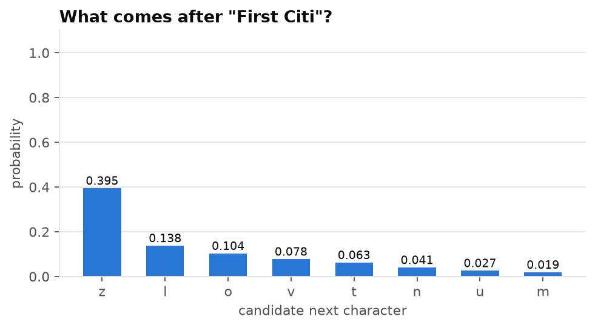

Notice what the model is **not** doing: it is not looking anything up, and it has no list
of rules about English. It has only learned, from examples, which characters tend to
follow which contexts.

### 1.4 How good is a prediction? A first look at the loss

To improve the model we need a single number that says how bad its predictions are. This
number is called the **loss**; smaller is better.

The idea: look at the probability $p$ that the model gave to the token that *actually*
came next.

- If $p$ is close to 1, the model was confident and right. The loss should be near 0.
- If $p$ is close to 0, the model was confident and wrong. The loss should be large.

The function $-\ln(p)$ (minus the natural logarithm) has exactly this shape:

| probability given to the correct token | loss $= -\ln(p)$ |
|---|---|
| 1.0 | 0.00 |
| 0.5 | 0.69 |
| 0.1 | 2.30 |
| 0.01 | 4.61 |

This loss is called the **cross-entropy** loss. We average it over many predictions.

One value is worth remembering. A model that knows nothing would spread its probability
equally over all 65 characters, giving $p = 1/65$ to the correct one. Its loss would be

$$-\ln\left(\frac{1}{65}\right) = \ln(65) \approx 4.17$$

So **4.17 is the loss of pure guessing** for our vocabulary. When you start training, the
loss should begin near 4.17 (if it does not, something is wrong: we will use this as a
test in Chapter 17). Our finished model reaches 1.47.

> **Note**
>
> Why the logarithm, and not simply $1 - p$? One reason is that the probability of a
> whole text is the *product* of the probabilities of its tokens, and the logarithm turns
> a product into a sum, which is far easier to work with. Chapter 4 returns to this.

### 1.5 Training in one paragraph

The model is a function with millions of adjustable numbers inside it, called
**parameters** (or **weights**). At the start they are random, so the predictions are
garbage and the loss is about 4.17. Training repeats one step thousands of times:

1. take a batch of contexts from the real text, together with the true next tokens;
2. ask the model for its predictions and compute the loss;
3. work out, for every parameter, whether nudging it up or down would lower the loss;
4. nudge every parameter a tiny amount in the helpful direction.

Step 3 uses derivatives, and it is the part where your calculus becomes useful.
Chapter 4 explains it fully.

### 1.6 Generating text

Once trained, the model can write. The procedure is a loop:

1. start with some text, the **prompt**, for example `ROMEO:`;
2. ask the model for the distribution over the next token;
3. **sample** one token from that distribution (pick at random, but with likely tokens
   picked more often);
4. append the chosen token to the text;
5. go back to step 2.

Each new token is produced using all the text so far, including the tokens the model
itself just wrote. This is called **autoregressive** generation. Chapter 14 covers the
knobs that control it (temperature, top-k, top-p).

Here is text produced this way by our model at four moments during one training run.

- **Step 0.** The parameters are random, and so is the output: every character is about
  equally likely.
- **Step 250** (about one minute of training). The model has already learned which
  characters are common, where spaces and line breaks go, many short words (`that`,
  `and`, `the`), and the layout of a play: a name in capitals, a colon, a speech. Most
  longer "words" are invented.
- **Step 2,500.** Real words, punctuation in sensible places, lines that read like
  verse.
- **Step 5,000.** Fluent at a glance, though it means nothing. (By this point the model
  has started to memorise its training text; Chapter 5 explains why that is a problem,
  and Chapter 13 shows it in this very run.)

#### Untrained (random weights) - step 0, val loss 4.248

```text
?3C;?BDkLZkNdc.?j,UTTOLOT,xHtK

:!YWWTMBbzB$3:XaSKgO-33jj:??gLTduh!:Y?XJthhNNuuqcOMxv.t?aF dXl!FHaN,WFE:cHPguWIWfDEZaYzxGoIoWX
YoR&&LMUUfYiEEII!!Ev!OW;Kd!lN!,Se3 ixYeYEYXIWi;;'xWiHFtEdrov Ks,XUB;qWfnJ..GD3.FyWaim!!elJlinFFU;au.$-?uD3qccchvvY:?UsO;Mnii'X3U:ty.HH'v$nUHI.yrfdpeYeggvIEjVP:
:yqwJdlNMMSSk
```

#### Early - step 250, val loss 2.092

```text
Sel mage to that and the mat tate this I spraind.

DUCHESSS OF OF RYORKE:
That it nou self way's ye what ther and the So her sand:
But the dear thos condel se's the the to ther pear fale
dicing areand wart my beesse thattle the wor afing'
So dind extud do mant! And how you a so of ging:
I if hat the
```

#### Middle - step 2500, val loss 1.487

```text
Mighty suod, they live love in rears
To take her by the wind, and do go sure.

EDWARD:
Sweet York, brother, she is infantion.

RICHARD:
No, my lord.

QUEEN ELIZABETH:
God forbid thee, forbear thee, to have the deed.

QUEEN ELIZABETH:
To send me she were in his pretty son
shadows and soon thing but m
```

#### Final - step 5000, val loss 1.690

```text
When the duke was prevail'd to me: yet, my lord,
Shall I see the fairest beauty of blood,
Impartial sleep in marriage; and if they
Unfeel the sea passage of my bosom, at earth,
Which forswear doth make them crying, as they looked
And knowledge husband from his sovereign's land.

LADY GREY:
The queen
```

### 1.7 What we are going to build

The figure shows the whole pipeline. Each box is a chapter of Part 2 and a file in the
repository.

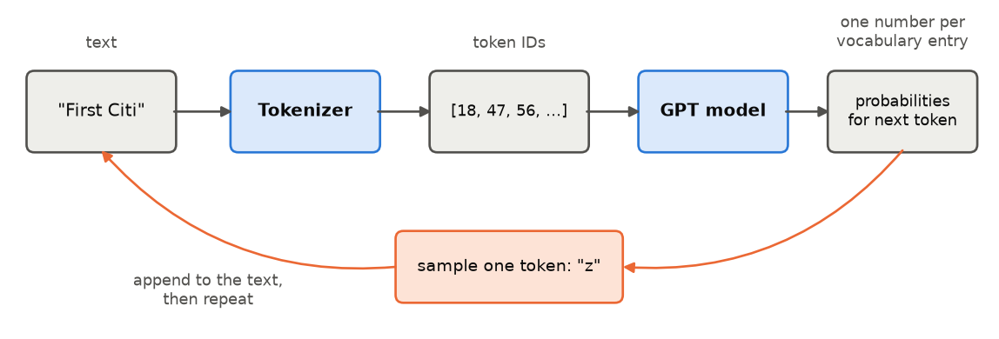

| Piece | What it does | File | Chapter |
|---|---|---|---|
| Tokenizer | text ↔ token IDs | `mini_gpt/tokenizer.py` | 6 |
| Data pipeline | text file → arrays of IDs → training batches | `mini_gpt/data.py`, `data/prepare.py` | 5, 6 |
| Model | token IDs → next-token scores | `mini_gpt/model.py` | 7 to 12 |
| Training loop | adjusts the parameters | `train.py` | 13 |
| Generation | writes new text | `generate.py` | 14 |
| Experiments | measure and compare | `scripts/` | 15, 16 |
| Tests | prove the pieces are correct | `tests/` | 17 |

The model we train has about 10 million parameters. For scale: GPT-2 (2019) had 124
million in its smallest version, and current large models have hundreds of billions.
Ours is the same *kind* of machine, just very small, which is exactly what makes it
possible to understand completely.

### Exercises

**1.1 (easy)** Write out all the (context → target) pairs for the text `cat sat`, using
character tokens. How many are there? Remember that the space is a token too.

**1.2 (easy)** A model outputs these probabilities for the next character:
`e`: 0.6, `a`: 0.3, `o`: 0.1. The true next character is `a`. What is the loss for this
prediction? What would it be if the true next character were `e`?

**1.3 (medium)** A model's vocabulary has 512 tokens. What loss would you expect before
any training? If, after training, the average loss is 2.08, what probability is the model
giving to the correct token "on average" (precisely: what single probability $p$ has
$-\ln p = 2.08$)?

**1.4 (hard)** Why not skip the neural network and simply store, for every possible
context, a table of what came next? Estimate how many different contexts of 256
characters exist when there are 65 possible characters, and compare that with the number
of characters in our training file (about one million).

### Check your understanding

1. In one sentence, what are the input and the output of a language model?
2. What is the difference between a token and a token ID?
3. What does a loss of 0 mean? Can a loss be negative?
4. Why does generation feed the model its own output?
5. True or false: a trained language model contains a copy of its training text that it
   searches through.

## Chapter 2: NumPy basics

> **Key ideas**
>
> - An **array** is a grid of numbers. Its **shape** says how many numbers there are
>   along each direction (each **dimension** or **axis**).
> - Arithmetic on arrays is **element-wise** and needs no loops, which is both shorter to
>   write and far faster to run.
> - **Broadcasting** lets arrays of different shapes be combined by (virtually) repeating
>   the smaller one.
> - **Matrix multiplication** (`@`) combines rows of one array with columns of another.
>   The shape rule `(n, k) @ (k, m) -> (n, m)` will be used on every page of this guide.
> - **Softmax** turns any list of numbers into probabilities.

### 2.1 Why arrays?

A neural network is, underneath, a very large amount of arithmetic on grids of numbers.
Python lists are too slow for this: adding two lists of a million numbers with a `for`
loop takes around a tenth of a second, while the same addition on arrays takes about a
millisecond, because the loop runs in optimised machine code instead of in Python.

**NumPy** is the standard Python library for arrays. We use it directly in a few places
(storing token IDs, Chapter 4's from-scratch network), but the main reason to learn it is
that PyTorch, the library the model is written in, copies NumPy's ideas almost exactly.
Everything in this chapter transfers unchanged to Chapter 3.

All the code of this chapter is in `examples/ch02_numpy_basics.py`. Run it with
`python examples/ch02_numpy_basics.py`, and better still, retype it line by line in a
Python prompt.

### 2.2 Arrays and shapes

**`examples/ch02_numpy_basics.py` · lines 6–17**

```python
import numpy as np

# --- 1. Arrays and shapes ---
v = np.array([1.0, 2.0, 3.0])  # a vector: 1 dimension
M = np.array([[1.0, 2.0, 3.0], [4.0, 5.0, 6.0]])  # a matrix: 2 rows, 3 columns
print("1. Arrays and shapes")
print("v =", v, " shape:", v.shape, " ndim:", v.ndim)
print("M =\n", M)
print("M.shape:", M.shape, " M.ndim:", M.ndim, " M.size:", M.size)
print("M[1, 2] =", M[1, 2], "  (row 1, column 2; counting starts at 0)")
print("M[0] =", M[0], "  (the whole first row)")
print("M[:, 1] =", M[:, 1], "  (the whole second column)")
```

```text
1. Arrays and shapes
v = [1. 2. 3.]  shape: (3,)  ndim: 1
M =
 [[1. 2. 3.]
 [4. 5. 6.]]
M.shape: (2, 3)  M.ndim: 2  M.size: 6
M[1, 2] = 6.0   (row 1, column 2; counting starts at 0)
M[0] = [1. 2. 3.]   (the whole first row)
M[:, 1] = [2. 5.]   (the whole second column)
```

Three words to learn here:

- The **shape** of an array is a tuple with its size along each dimension. `v` has shape
  `(3,)`: one dimension, of length 3. (The comma is just how Python writes a tuple with
  one element.) `M` has shape `(2, 3)`: 2 rows, 3 columns.
- `ndim` is the number of dimensions: 1 for a vector, 2 for a matrix. Arrays can have
  more. In this project the most common array has **three** dimensions, with shape
  `(B, T, C)`. Do not try to picture it as a cube; picture it as "a list of `B` matrices,
  each with `T` rows and `C` columns".
- **Indexing** counts from 0, as with lists. `M[1, 2]` is row 1, column 2. A colon means
  "everything along this dimension", so `M[:, 1]` is column 1 of every row.

> **Note**
>
> The habit that prevents most bugs in this field: **know the shape of every array you
> touch**. Whenever you are unsure, `print(x.shape)`. Experienced people do this
> constantly, and the code in this repository has a shape comment on nearly every line.

### 2.3 Element-wise arithmetic

**`examples/ch02_numpy_basics.py` · lines 19–26**

```python
# --- 2. Element-wise arithmetic ---
print("\n2. Element-wise arithmetic")
print("v + 10 =", v + 10)
print("v * v  =", v * v)
print("np.exp(v) =", np.round(np.exp(v), 2))
print("M.sum() =", M.sum(), "  M.mean() =", M.mean())
print("M.sum(axis=0) =", M.sum(axis=0), "  (add DOWN the rows: one total per column)")
print("M.sum(axis=1) =", M.sum(axis=1), "  (add ACROSS the columns: one total per row)")
```

```text
2. Element-wise arithmetic
v + 10 = [11. 12. 13.]
v * v  = [1. 4. 9.]
np.exp(v) = [ 2.72  7.39 20.09]
M.sum() = 21.0   M.mean() = 3.5
M.sum(axis=0) = [5. 7. 9.]   (add DOWN the rows: one total per column)
M.sum(axis=1) = [ 6. 15.]   (add ACROSS the columns: one total per row)
```

`v + 10` adds 10 to every element; `v * v` multiplies matching elements (it is **not**
matrix multiplication). Functions such as `np.exp` are applied to each element.

The `axis` argument causes more confusion than anything else in NumPy, so go slowly.
`M.sum(axis=0)` means "add along dimension 0", that is, *down the rows*. Dimension 0
disappears from the shape: `(2, 3)` becomes `(3,)`, one total per column.
`M.sum(axis=1)` adds along dimension 1, *across the columns*, and `(2, 3)` becomes
`(2,)`, one total per row.

The reliable way to think about it: **the axis you name is the axis that vanishes.**

### 2.4 Reshaping

**`examples/ch02_numpy_basics.py` · lines 28–34**

```python
# --- 3. Reshaping ---
print("\n3. Reshaping")
r = np.arange(6)  # [0 1 2 3 4 5]
print("r =", r, " shape:", r.shape)
print("r.reshape(2, 3) =\n", r.reshape(2, 3))
print("r.reshape(3, -1) =\n", r.reshape(3, -1), " (-1 means: work this size out for me)")
print("M.T (transpose) =\n", M.T)
```

```text
3. Reshaping
r = [0 1 2 3 4 5]  shape: (6,)
r.reshape(2, 3) =
 [[0 1 2]
 [3 4 5]]
r.reshape(3, -1) =
 [[0 1]
 [2 3]
 [4 5]]  (-1 means: work this size out for me)
M.T (transpose) =
 [[1. 4.]
 [2. 5.]
 [3. 6.]]
```

`reshape` rearranges the same numbers into a different grid. The total count must stay
the same (6 numbers can become `(2, 3)`, `(3, 2)`, `(6,)` or `(1, 6)`, but not `(4, 2)`).
Writing `-1` for one size tells NumPy to work that size out. The **transpose** `M.T`
swaps rows and columns.

We will need reshaping once in the model: to hand a `(B, T, V)` array to a function
that wants a 2-dimensional `(B*T, V)` array.

### 2.5 Broadcasting

What should `M + row` mean when `M` has shape `(2, 3)` and `row` has shape `(3,)`?
NumPy's answer: add `row` to *every row* of `M`. Stretching the smaller array to fit the
larger one is called **broadcasting**.

**`examples/ch02_numpy_basics.py` · lines 36–45**

```python
# --- 4. Broadcasting ---
print("\n4. Broadcasting")
row = np.array([10.0, 20.0, 30.0])  # shape (3,)
col = np.array([[100.0], [200.0]])  # shape (2, 1)
print("M + row  ->  shape", (M + row).shape)
print(M + row)
print("M + col  ->  shape", (M + col).shape)
print(M + col)
print("row + col ->  shape", (row + col).shape)
print(row + col)
```

```text
4. Broadcasting
M + row  ->  shape (2, 3)
[[11. 22. 33.]
 [14. 25. 36.]]
M + col  ->  shape (2, 3)
[[101. 102. 103.]
 [204. 205. 206.]]
row + col ->  shape (2, 3)
[[110. 120. 130.]
 [210. 220. 230.]]
```

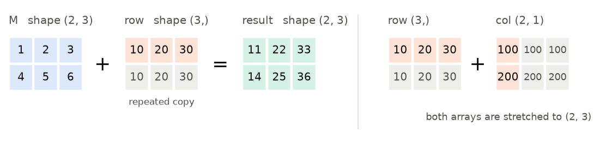

The rule NumPy follows:

1. Write the two shapes one above the other, **aligned on the right**.
2. Go through the columns. In each column the two sizes must be **equal**, or **one of
   them must be 1**, or one of them is missing (a missing size counts as 1).
3. Wherever a size is 1 (or missing), that array is repeated along that dimension.

Check the three examples against the rule:

```text
M    (2, 3)        M    (2, 3)        row     (3,)
row     (3,)       col  (2, 1)        col  (2, 1)
----------         ----------         ----------
     (2, 3)             (2, 3)             (2, 3)
```

The third one surprises people: a `(3,)` and a `(2, 1)` produce a `(2, 3)`. Both arrays
were stretched. This is useful, and it is also the source of a classic silent bug:
adding a `(3,)` to a `(3, 1)` by mistake gives a `(3, 3)` instead of an error.

Where the model uses broadcasting: adding the positional embeddings, of shape `(T, C)`,
to a batch of token embeddings, of shape `(B, T, C)`. Aligned on the right, `(T, C)`
is missing its first size, so it is repeated for every sequence in the batch.

### 2.6 Matrix multiplication

The single most important operation in deep learning. For two matrices `A` and `B`,
the entry in row $i$, column $j$ of `A @ B` is the **dot product** of row $i$ of `A`
with column $j$ of `B`: multiply matching elements and add them up.

$$(AB)_{ij} = \sum_{k} A_{ik} \, B_{kj}$$

**`examples/ch02_numpy_basics.py` · lines 47–56**

```python
# --- 5. Matrix multiplication ---
print("\n5. Matrix multiplication")
A = np.array([[1.0, 2.0], [3.0, 4.0], [5.0, 6.0]])  # shape (3, 2)
B = np.array([[1.0, 0.0, 2.0, 0.0], [0.0, 1.0, 0.0, 2.0]])  # shape (2, 4)
C = A @ B  # shape (3, 4): the inner sizes (2 and 2) must match
print("A.shape", A.shape, "@ B.shape", B.shape, "-> C.shape", C.shape)
print(C)
print("C[2, 3] = row 2 of A . column 3 of B =", A[2], ".", B[:, 3], "=", A[2] @ B[:, 3])
x = np.array([1.0, -1.0])
print("A @ x =", A @ x, "  (a matrix times a vector gives a vector)")
```

```text
5. Matrix multiplication
A.shape (3, 2) @ B.shape (2, 4) -> C.shape (3, 4)
[[ 1.  2.  2.  4.]
 [ 3.  4.  6.  8.]
 [ 5.  6. 10. 12.]]
C[2, 3] = row 2 of A . column 3 of B = [5. 6.] . [0. 2.] = 12.0
A @ x = [-1. -1. -1.]   (a matrix times a vector gives a vector)
```

Check one entry by hand. Row 2 of `A` is `[5, 6]`; column 3 of `B` is `[0, 2]`. Their dot
product is $5 \cdot 0 + 6 \cdot 2 = 12$, which is `C[2, 3]`.

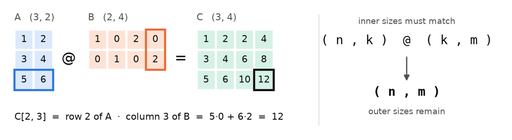

**The shape rule:** `(n, k) @ (k, m)` gives `(n, m)`. The two inner numbers must be
equal; the result takes the two outer numbers. Say it out loud until it is automatic,
because you will use it to read every line of the model.

Two ways to think about what `A @ x` *means*, both useful later:

- **As a machine that transforms vectors.** A matrix of shape `(n, k)` turns a vector of
  length `k` into a vector of length `n`. A neural network layer is exactly this, with
  the matrix's entries being the learned parameters.
- **As many dot products at once.** A dot product measures how much two vectors point in
  the same direction (large and positive when aligned, zero when perpendicular, negative
  when opposed). Attention (Chapter 9) uses a matrix multiplication to compute the dot
  product of every token with every other token in one step.

> **Detail you can ignore for now**
>
> When arrays have more than two dimensions, `@` multiplies the **last two** dimensions
> and treats the others as a batch: `(B, T, k) @ (B, k, m)` gives `(B, T, m)`, as if you
> had looped over `B` and multiplied each pair of matrices. You will see this in the
> attention code.

### 2.7 Softmax

A model's raw outputs are arbitrary numbers, positive or negative, called **logits**.
To interpret them as probabilities we need numbers that are positive and add up to 1.
**Softmax** does the conversion in two steps:

1. apply $e^x$ to every number, which makes everything positive and keeps the order;
2. divide by the total, which makes them sum to 1.

$$\text{softmax}(z)_i = \frac{e^{z_i}}{\sum_j e^{z_j}}$$

**`examples/ch02_numpy_basics.py` · lines 58–65**

```python
# --- 6. Softmax: turning any numbers into probabilities ---
print("\n6. Softmax")
scores = np.array([2.0, 1.0, 0.1])
exps = np.exp(scores)  # make everything positive
probs = exps / exps.sum()  # divide by the total so they sum to 1
print("scores =", scores)
print("exp(scores) =", np.round(exps, 3))
print("probabilities =", np.round(probs, 3), " sum =", round(float(probs.sum()), 6))
```

```text
6. Softmax
scores = [2.  1.  0.1]
exp(scores) = [7.389 2.718 1.105]
probabilities = [0.659 0.242 0.099]  sum = 1.0
```

The largest score gets the largest probability, but the others do not drop to zero: this
"soft" version of picking the maximum is where the name comes from. Two properties to
remember:

- Only **differences** between scores matter. Adding 100 to every score changes nothing
  (try it in exercise 2.5).
- Because of the exponential, a score that is larger by 1 gets a probability about 2.7
  times larger ($e \approx 2.718$). A score of $-\infty$ gets probability exactly 0,
  since $e^{-\infty} = 0$. Chapter 10 uses this to hide the future from the model.

### Exercises

**2.1 (easy)** Without running anything, give the shape of each result, or say that it is
an error: (a) `np.ones((4, 3)) + np.ones((3,))`; (b) `np.ones((4, 3)) + np.ones((4,))`;
(c) `np.ones((4, 3)) + np.ones((4, 1))`; (d) `np.ones((4, 3)) @ np.ones((3, 5))`;
(e) `np.ones((4, 3)) @ np.ones((4, 3))`. Then check with NumPy.

**2.2 (easy)** Create the array `[[1, 2], [3, 4], [5, 6]]`. Using one line each, compute
the sum of each row, the mean of each column, and the largest element.

**2.3 (medium)** Each row of `M = np.array([[1., 2., 3.], [4., 5., 6.]])` should be
divided by its own sum, so that every row sums to 1. Write this in one line with
broadcasting. (Hint: look up the `keepdims=True` argument of `sum`, and think about why
you need it.)

**2.4 (medium)** Write a function `softmax(z)` that works on a 2-dimensional array and
applies softmax to **each row** separately. Test that every row of the result sums to 1.

**2.5 (medium)** Verify numerically that `softmax(z)` and `softmax(z + 100)` are equal.
Then explain *why*, starting from the formula.

**2.6 (hard)** Write your own `matmul(A, B)` using three nested `for` loops and no `@`.
Check it against `A @ B` on random matrices, and time both on two `100 x 100` matrices.

### Check your understanding

1. What is the shape of `np.zeros((5, 2, 7)).sum(axis=1)`?
2. `a` has shape `(3, 1)` and `b` has shape `(1, 4)`. What is the shape of `a + b`?
3. Why is `(4, 3) @ (4, 3)` an error while `(4, 3) * (4, 3)` is fine?
4. What does a large positive dot product between two vectors tell you?
5. A softmax receives the scores `[5.0, 5.0, 5.0, 5.0]`. What does it output?

## Chapter 3: PyTorch basics

> **Key ideas**
>
> - A PyTorch **tensor** is a NumPy-style array with two extra abilities: it can live on
>   a **GPU**, and it can remember how it was computed.
> - **Autograd** uses that memory to compute derivatives automatically. You write the
>   forward computation; PyTorch gives you every partial derivative.
> - An **`nn.Module`** is a class that bundles parameters with the code that uses them.
>   Every piece of our model is one.
> - A **training loop** is five lines: forward, loss, zero the gradients, backward, step.
>   The loop that trains our GPT is the same five lines.

### 3.1 What PyTorch gives us

PyTorch is a library for building and training neural networks. We use four things
from it:

1. **Tensors**: arrays, like NumPy's, that can also be stored and computed on a GPU.
2. **Autograd**: automatic computation of derivatives.
3. **`torch.nn`**: basic building blocks (a table of learnable vectors, a learnable
   matrix multiplication) and the `nn.Module` class to organise them.
4. **Optimizers**: the code that updates parameters using the derivatives.

We deliberately do **not** use PyTorch's ready-made transformer or attention layers.
Those we build ourselves; that is the point of the project.

The code for this chapter is `examples/ch03_pytorch_basics.py`.

### 3.2 Tensors

**`examples/ch03_pytorch_basics.py` · lines 11–18**

```python
# --- 1. Tensors ---
print("1. Tensors")
t = torch.tensor([[1.0, 2.0, 3.0], [4.0, 5.0, 6.0]])
print("t.shape:", t.shape, " t.dtype:", t.dtype)
print("t @ t.T =\n", t @ t.T)  # same operators as NumPy
print("t.sum(dim=1) =", t.sum(dim=1), " (PyTorch says dim where NumPy says axis)")
ids = torch.tensor([3, 1, 4])
print("ids.dtype:", ids.dtype, " (whole numbers become int64, used for token IDs)")
```

```text
1. Tensors
t.shape: torch.Size([2, 3])  t.dtype: torch.float32
t @ t.T =
 tensor([[14., 32.],
        [32., 77.]])
t.sum(dim=1) = tensor([ 6., 15.])  (PyTorch says dim where NumPy says axis)
ids.dtype: torch.int64  (whole numbers become int64, used for token IDs)
```

If you understood Chapter 2 you already understand tensors. The differences are small:

- PyTorch says **`dim`** where NumPy says `axis`. `t.sum(dim=1)` is NumPy's
  `t.sum(axis=1)`.
- Every tensor has a **dtype**, the kind of number it holds. Two matter to us.
  `float32` (a decimal number stored in 32 bits) is used for everything the model
  computes. `int64` (a whole number) is used for token IDs. Mixing them up is a common
  error: an embedding table, for instance, insists on being indexed with integers.
- A tensor with a single number in it can be turned into an ordinary Python number with
  `.item()`. You will see `loss.item()` wherever a loss is printed.

### 3.3 Devices: CPU and GPU

**`examples/ch03_pytorch_basics.py` · lines 20–24**

```python
# --- 2. Devices ---
print("\n2. Devices")
device = torch.device("cuda" if torch.cuda.is_available() else "cpu")
t_dev = t.to(device)  # copy the tensor to the GPU if there is one
print("running on:", device, " t_dev.device:", t_dev.device)
```

```text
2. Devices
running on: cuda  t_dev.device: cuda:0
```

A **CPU** has a few very capable cores. A **GPU** (graphics card) has thousands of simple
ones. Matrix multiplication is made of a huge number of independent multiply-and-add
operations, which is exactly the kind of work that can be shared out among thousands of
simple cores. For our model the GPU is roughly 20 to 50 times faster than the CPU.

In PyTorch every tensor lives on a **device**: `"cpu"` or `"cuda"` (CUDA is NVIDIA's
name for its GPU computing system). `tensor.to(device)` returns a copy on that device.
There is one rule: **all the tensors taking part in an operation must be on the same
device**. Break it and you get the error *"Expected all tensors to be on the same
device"*, which Chapter 20 shows how to fix.

The repository chooses the device once, with this function, and passes it around:

**`mini_gpt/utils.py` · lines 37–47**

```python
def get_device(requested: str = "auto") -> torch.device:
    """Pick the device to run on.

    ``"auto"`` chooses the GPU when PyTorch can see one, otherwise the CPU.
    """
    if requested == "auto":
        return torch.device("cuda" if torch.cuda.is_available() else "cpu")
    if requested == "cuda" and not torch.cuda.is_available():
        print("WARNING: CUDA requested but not available; falling back to CPU.")
        return torch.device("cpu")
    return torch.device(requested)
```

Because of the `"auto"` option, the same code runs on your laptop's GPU and on a machine
with no GPU at all.

### 3.4 Autograd: derivatives for free

This is the feature that makes deep learning practical. Recall from calculus: for a
function of several variables, the **partial derivative** with respect to one variable
tells you how fast the function changes when you nudge that variable and hold the others
still.

Take $f(x, y) = x^2 y + 3y$. By hand:

$$\frac{\partial f}{\partial x} = 2xy \qquad\qquad \frac{\partial f}{\partial y} = x^2 + 3$$

At the point $x = 2$, $y = 5$ these are $20$ and $7$. Now let PyTorch do it:

**`examples/ch03_pytorch_basics.py` · lines 26–35**

```python
# --- 3. Autograd: automatic derivatives ---
print("\n3. Autograd")
# f(x, y) = x^2 * y + 3y.   By hand: df/dx = 2xy,  df/dy = x^2 + 3
x = torch.tensor(2.0, requires_grad=True)
y = torch.tensor(5.0, requires_grad=True)
f = x**2 * y + 3 * y
f.backward()  # compute the partial derivatives of f with respect to x and y
print("f =", f.item())
print("df/dx =", x.grad.item(), " (by hand: 2*x*y =", 2 * 2.0 * 5.0, ")")
print("df/dy =", y.grad.item(), " (by hand: x^2 + 3 =", 2.0**2 + 3, ")")
```

```text
3. Autograd
f = 35.0
df/dx = 20.0  (by hand: 2*x*y = 20.0 )
df/dy = 7.0  (by hand: x^2 + 3 = 7.0 )
```

What happened, step by step:

1. `requires_grad=True` tells PyTorch "I will want derivatives with respect to this
   tensor".
2. While `f` is computed, PyTorch quietly records every operation in a
   **computation graph** (the figure below): which inputs each result came from and
   which operation produced it.
3. `f.backward()` walks that graph from `f` back to the inputs, applying the chain rule
   at every step. This backward walk is called **backpropagation**; Chapter 4 does it by
   hand so that it holds no mystery.
4. The results are stored in the `.grad` attribute of each input.

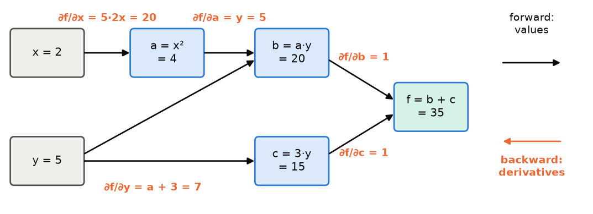

The collection of all the partial derivatives of a function is called its **gradient**.
For our $f$ the gradient at $(2, 5)$ is the pair $(20, 7)$. In training, the function
is the loss, the variables are the model's ten million parameters, and the gradient is
ten million numbers: one partial derivative per parameter. Autograd computes all of them
with one call to `backward()`.

Two details about gradients that you need for the training loop:

- **Gradients accumulate.** Calling `backward()` *adds* to whatever is already in
  `.grad`. So before each new backward pass the old gradients must be cleared, which is
  what `optimizer.zero_grad()` does. Forgetting it is a classic bug (exercise 3.3).
- **Recording costs time and memory.** When you only want predictions, not derivatives
  (for example when generating text or measuring the validation loss), you switch the
  recording off with `torch.no_grad()`.

### 3.5 `nn.Module`: organising parameters

A model has many parameters, and we need to find them all (to update them), move them
all to the GPU, and save them all to disk. `nn.Module` is the base class that handles
this bookkeeping.

**`examples/ch03_pytorch_basics.py` · lines 38–53**

```python
# --- 4. nn.Module: a container for parameters ---
class Line(nn.Module):
    """The model y = w * x + b, with two learnable numbers w and b."""

    def __init__(self) -> None:
        super().__init__()
        self.w = nn.Parameter(torch.tensor(0.0))  # nn.Parameter = "please learn this"
        self.b = nn.Parameter(torch.tensor(0.0))

    def forward(self, x: torch.Tensor) -> torch.Tensor:
        return self.w * x + self.b


print("\n4. nn.Module")
model = Line()
print("parameters:", [(name, p.item()) for name, p in model.named_parameters()])
```

```text
4. nn.Module
parameters: [('w', 0.0), ('b', 0.0)]
```

The pattern is always the same, and every class in `mini_gpt/model.py` follows it:

- In `__init__`, call `super().__init__()` and create the parameters. Wrapping a tensor
  in `nn.Parameter` registers it as "to be learned" and switches on `requires_grad`.
- In `forward`, write the computation.
- To use the model, **call it like a function**: `model(xs)`. PyTorch then runs
  `forward` for you. (Do not call `model.forward(xs)` directly.)

Modules can contain other modules, and `model.parameters()` finds the parameters of all
of them, however deeply nested. That is how a GPT made of dozens of sub-modules can be
handed to an optimizer in one line.

Two ready-made modules appear throughout this guide. You could write both in three
lines; they are used only because they are convenient:

- `nn.Linear(n_in, n_out)` holds a weight matrix `W` of shape `(n_out, n_in)` and
  (optionally) a bias vector `b`, and computes `x @ W.T + b`. This is the "machine that
  transforms vectors" of Section 2.6, with learnable entries.
- `nn.Embedding(n, d)` holds a table of shape `(n, d)` and, given integer IDs, returns
  the corresponding rows. Chapter 7 is about this one.

### 3.6 The training loop

Here is a complete training run. The data are 50 points scattered around the line
$y = 2x + 1$. The model is `Line` from above, starting at $w = 0$, $b = 0$. The loop
should discover $w \approx 2$ and $b \approx 1$ by itself.

**`examples/ch03_pytorch_basics.py` · lines 55–68**

```python
# --- 5. A complete training loop ---
print("\n5. Training loop: learn y = 2x + 1 from noisy examples")
xs = torch.linspace(-1, 1, 50)  # 50 inputs between -1 and 1
ys = 2 * xs + 1 + 0.1 * torch.randn(50)  # the "true" rule plus a little noise

optimizer = torch.optim.SGD(model.parameters(), lr=0.1)
for step in range(201):
    predictions = model(xs)  # 1) forward pass
    loss = ((predictions - ys) ** 2).mean()  # 2) how wrong are we? (mean squared error)
    optimizer.zero_grad()  # 3) clear old gradients
    loss.backward()  # 4) backward pass: d(loss)/dw and d(loss)/db
    optimizer.step()  # 5) nudge w and b downhill
    if step % 50 == 0:
        print(f"step {step:3d}  loss {loss.item():.4f}  w {model.w.item():.3f}  b {model.b.item():.3f}")
```

```text
5. Training loop: learn y = 2x + 1 from noisy examples
step   0  loss 2.4489  w 0.141  b 0.201
step  50  loss 0.0124  w 1.977  b 1.005
step 100  loss 0.0113  w 2.027  b 1.005
step 150  loss 0.0113  w 2.029  b 1.005
step 200  loss 0.0113  w 2.029  b 1.005
```

The loss falls and `w`, `b` move to the right values. The five numbered lines inside the
loop are the most important five lines in this guide:

1. **Forward pass.** Run the model on the inputs to get predictions.
2. **Loss.** Measure how wrong the predictions are, as a single number. Here it is the
   mean squared error; for the language model it will be the cross-entropy of Chapter 1.
3. **Zero the gradients** left over from the previous step.
4. **Backward pass.** Compute the partial derivative of the loss with respect to every
   parameter.
5. **Step.** Change each parameter a little, in the direction that lowers the loss. For
   plain gradient descent this is `p = p - lr * p.grad`, where `lr`, the **learning
   rate**, sets the size of the step. Chapter 4 explains why this works.

Now look at the real training loop of this repository. Ignore the lines you do not yet
recognise and find the five steps:

**`train.py` · lines 192–212**

```python
        # 1) Get a batch of inputs x and targets y (y is x shifted by one token).
        x, y = get_batch(train_ids, cfg.model.block_size, cfg.train.batch_size, device)

        # 2) Forward pass: compute the loss. autocast runs most operations in
        #    float16 on the GPU, which makes each step noticeably faster.
        with torch.autocast(device_type=device.type, dtype=torch.float16, enabled=use_amp):
            _, loss = model(x, y)

        # 3) Backward pass: compute the gradient of the loss w.r.t. every parameter.
        optimizer.zero_grad(set_to_none=True)  # clear the gradients of the previous step
        scaler.scale(loss).backward()

        # 4) Gradient clipping: if the gradient is very long, shrink it to
        #    length grad_clip. This prevents one bad batch from wrecking the weights.
        if cfg.train.grad_clip > 0:
            scaler.unscale_(optimizer)  # undo the AMP scaling before measuring the norm
            torch.nn.utils.clip_grad_norm_(model.parameters(), cfg.train.grad_clip)

        # 5) Update: AdamW moves every parameter a little, against its gradient.
        scaler.step(optimizer)
        scaler.update()
```

The forward pass and loss are in step 2, zeroing and the backward pass in step 3, and the
update in step 5. The extra pieces (`autocast`, `scaler`, gradient clipping) are
refinements that Chapter 13 explains. The skeleton is the loop you just ran.

### Exercises

**3.1 (easy)** Create a tensor of shape `(2, 3, 4)` filled with random numbers
(`torch.randn`). Print its shape, its dtype, and the shape of its sum over `dim=1`.
Predict each answer before running.

**3.2 (easy)** Let $g(a, b) = ab + \sin(a)$. Compute $\partial g/\partial a$ and
$\partial g/\partial b$ by hand. Then check them with autograd at $a = 1$, $b = 2$.

**3.3 (medium)** In the autograd example, call the lines that compute `f` and
`f.backward()` a second time *without* clearing the gradients, then print `x.grad`.
Explain the number you see. Then fix it with `x.grad.zero_()`.

**3.4 (medium)** Change the training example so that the data follow
$y = 3x^2 - 2x + 1$ and the model is a `Quadratic` module with three parameters. Does it
recover 3, -2 and 1?

**3.5 (hard)** In the training loop, delete the optimizer and do the update yourself:
after `loss.backward()`, loop over `model.parameters()` and apply
`p -= lr * p.grad` inside a `with torch.no_grad():` block, then zero each gradient.
Confirm you get the same result. Why is the `no_grad` block needed?

### Check your understanding

1. Name the two abilities a PyTorch tensor has that a NumPy array lacks.
2. What does `loss.backward()` compute, and where does it put the results?
3. Why must gradients be zeroed in every iteration?
4. What is the difference between `nn.Parameter(torch.zeros(3))` and `torch.zeros(3)`
   inside a module?
5. You get the error "Expected all tensors to be on the same device". What happened?

## Chapter 4: Neural networks from scratch

> **Key ideas**
>
> - A **neuron** computes a weighted sum of its inputs, adds a **bias**, and passes the
>   result through a simple curved function called an **activation function**.
> - A **layer** is many neurons side by side, which is one matrix multiplication.
>   A **neural network** is layers applied one after another.
> - A **loss function** turns "how wrong is the network?" into one number.
> - **Gradient descent** lowers the loss by repeatedly moving every parameter a small
>   step *against* its partial derivative.
> - **Backpropagation** is the chain rule, applied layer by layer from the loss backwards,
>   to get all those partial derivatives efficiently.

In this chapter we build and train a neural network using only NumPy, computing every
derivative ourselves. You will never need to do this again, because PyTorch's autograd
does it for you. But having done it once, nothing about training will feel like magic.

### 4.1 One neuron

A **neuron** takes several numbers in and gives one number out:

$$\text{output} = \phi(w_1 x_1 + w_2 x_2 + \dots + w_n x_n + b)$$

- $x_1, \dots, x_n$ are the inputs.
- $w_1, \dots, w_n$ are the **weights**: one per input, saying how much that input
  matters and in which direction.
- $b$ is the **bias**: a constant added on, which shifts the result up or down.
- $\phi$ is the **activation function**, a fixed curve applied at the end (Section 4.3).

The weights and the bias are the neuron's parameters: the numbers that training adjusts.

**A worked example.** Inputs $x = (2, -1)$, weights $w = (0.5, 1.5)$, bias $b = 0.5$,
activation $\tanh$:

$$w \cdot x + b = 0.5 \times 2 + 1.5 \times (-1) + 0.5 = 0 \qquad \tanh(0) = 0$$

Change the first input to 4 and the sum becomes 1, with output $\tanh(1) \approx 0.76$.

An analogy: think of a neuron as a tiny detector. The weights describe the pattern it is
looking for; the weighted sum is large when the input matches that pattern; the
activation turns the match score into a signal. One neuron can do very little. The power
comes from numbers.

### 4.2 A layer is a matrix multiplication

Put $H$ neurons next to each other, all reading the same inputs. Each has its own
weights, so the weights of the whole **layer** form a matrix. Computing all $H$ weighted
sums at once is one matrix multiplication:

$$h = \phi(x W + b)$$

If the input $x$ has $n$ numbers and the layer has $H$ neurons, then $W$ has shape
`(n, H)`, $b$ has shape `(H,)`, and by the shape rule of Section 2.6 the result has
shape `(H,)`. And if we feed in 200 inputs at once, as a matrix of shape `(200, n)`, we
get all 200 results as a `(200, H)` matrix with no extra code. Processing many inputs
together like this is called **batching**.

A **neural network** is several layers in a row: the output of one is the input of the
next. Layers between the input and the output are called **hidden layers**.

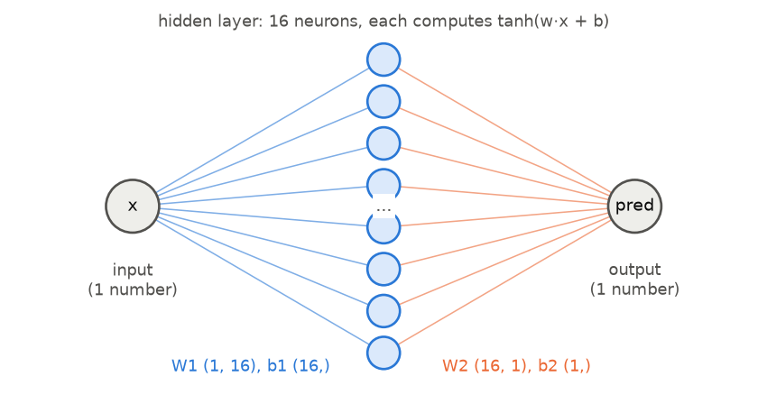

### 4.3 Why the activation function is essential

Suppose we left it out. Two layers would compute $(x W_1) W_2$. But matrix
multiplication is associative:

$$(x W_1) W_2 = x (W_1 W_2) = x W'$$

Two layers without activations are exactly equivalent to **one** layer with weight
matrix $W' = W_1 W_2$. The same holds for a hundred layers. A network without
activations can only ever compute straight-line relationships, however deep it is.

The activation function breaks this by bending the output of each layer. With bends in
between, stacked layers can build up any curved shape. Three activations are worth
knowing:

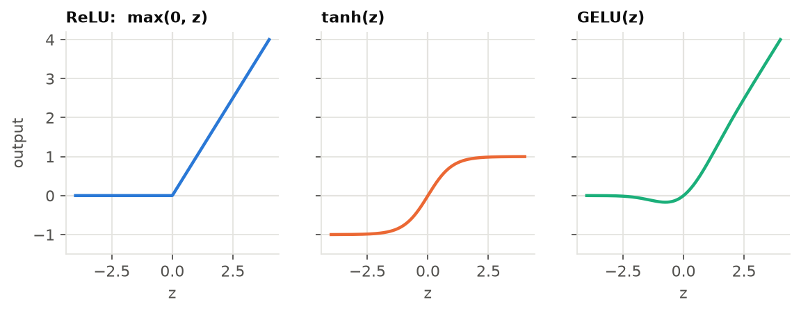

- **tanh** squashes any number into the range $(-1, 1)$. We use it in this chapter
  because its derivative is simple: $\tanh'(z) = 1 - \tanh^2(z)$.
- **ReLU** is $\max(0, z)$: pass positive numbers through, replace negative numbers by 0.
- **GELU** is a smooth version of ReLU. It is what GPT-2 used and what our model uses
  (`nn.GELU()` in `mini_gpt/model.py`). You do not need its formula; think "ReLU with the
  corner rounded off".

### 4.4 The task and the network

We will teach a network the function $y = \sin(x)$ for $x$ between $-\pi$ and $\pi$. Of
course nobody needs a neural network for that. The point is that the network starts
knowing nothing about sines and must discover the curve from 200 example points.

The whole program is `examples/ch04_tiny_network.py`. Here are the data and the
parameters:

**`examples/ch04_tiny_network.py` · lines 13–22**

```python
# --- 1. The data: 200 points on a sine wave ---
X = np.linspace(-np.pi, np.pi, 200).reshape(-1, 1)  # inputs,  shape (200, 1)
Y = np.sin(X)  # targets, shape (200, 1)

# --- 2. The parameters: two weight matrices and two bias vectors ---
H = 16  # number of hidden neurons
W1 = rng.normal(0.0, 1.0, size=(1, H))  # input  -> hidden, shape (1, 16)
b1 = np.zeros(H)  # one bias per hidden neuron
W2 = rng.normal(0.0, 0.1, size=(H, 1))  # hidden -> output, shape (16, 1)
b2 = np.zeros(1)
```

The parameters start as small random numbers (drawn by `rng.normal`). They must not all
start at zero: if every hidden neuron began identical, every one would receive the same
gradient and they would stay identical forever, which wastes all but one of them.

The forward computation is two layers, written exactly as in Section 4.2:

**`examples/ch04_tiny_network.py` · lines 25–30**

```python
def forward(X: np.ndarray) -> tuple[np.ndarray, np.ndarray, np.ndarray]:
    """Compute the network's prediction for every input row."""
    z1 = X @ W1 + b1  # (200, 16)  weighted sum going into each hidden neuron
    h = np.tanh(z1)  # (200, 16)  activation: squash each value into (-1, 1)
    pred = h @ W2 + b2  # (200, 1)   the output is a weighted sum of the hidden neurons
    return z1, h, pred
```

Follow the shapes: `X` is `(200, 1)` and `W1` is `(1, 16)`, so `z1` is `(200, 16)`.
Adding `b1`, of shape `(16,)`, uses broadcasting. `h @ W2` is `(200, 16) @ (16, 1)`,
giving `(200, 1)`: one prediction per input.

### 4.5 The loss function

To train, we need one number measuring how wrong the predictions are. For predicting
a number, the usual choice is the **mean squared error** (MSE): the average of
$(\text{prediction} - \text{target})^2$.

**`examples/ch04_tiny_network.py` · lines 33–35**

```python
def loss_fn(pred: np.ndarray, Y: np.ndarray) -> float:
    """Mean squared error: the average of (prediction - target)^2."""
    return float(((pred - Y) ** 2).mean())
```

Squaring makes every error positive and punishes big errors much more than small ones.

For a language model the output is not a number but a choice among tokens, and the loss
is the **cross-entropy** from Chapter 1. Now that you know softmax, here is the complete
recipe:

1. the model outputs one **logit** per token, for example `[2.0, 1.0, 0.1]`;
2. softmax turns the logits into probabilities: `[0.659, 0.242, 0.099]`;
3. the loss is $-\ln$ of the probability of the correct token. If token 0 was correct,
   the loss is $-\ln(0.659) \approx 0.417$; if token 2 was correct, it is
   $-\ln(0.099) \approx 2.31$.

In PyTorch all three steps are one function, `F.cross_entropy(logits, targets)`. You will
see it in the model's `forward` method.

### 4.6 Gradient descent

The loss depends on the parameters. Change any weight and the predictions change, so the
loss changes. Write $L(\theta)$ for the loss as a function of all the parameters
$\theta$ (here 49 numbers; for our GPT, ten million).

Training is the search for parameters that make $L$ small. The picture to hold in your
head is a landscape: every possible setting of the parameters is a location, and the
loss is the height of the ground there. We are standing somewhere random and want to
walk downhill. We cannot see the landscape (it has 49 dimensions), but we *can* measure
the slope under our feet.

From multivariable calculus: the **gradient** $\nabla L$ is the vector of all partial
derivatives,

$$\nabla L = \left( \frac{\partial L}{\partial \theta_1}, \frac{\partial L}{\partial \theta_2}, \dots \right)$$

and it points in the direction in which $L$ **increases** fastest. So to decrease $L$,
step the opposite way:

$$\theta \leftarrow \theta - \eta \, \nabla L$$

This update rule is **gradient descent**. The small positive number $\eta$ ("eta") is the
**learning rate**: it sets the length of each step.

**A worked example in one dimension.** Let $L(w) = (w - 3)^2$. The minimum is obviously
at $w = 3$. The derivative is $L'(w) = 2(w - 3)$. Start at $w = 0$ with $\eta = 0.1$:

| step | $w$ | $L'(w) = 2(w-3)$ | new $w = w - 0.1 \times L'(w)$ |
|---|---|---|---|
| 1 | 0.000 | -6.000 | 0.600 |
| 2 | 0.600 | -4.800 | 1.080 |
| 3 | 1.080 | -3.840 | 1.464 |
| 4 | 1.464 | -3.072 | 1.771 |

The derivative is negative, meaning "the loss goes down if $w$ goes up", so $w$
increases. Each step covers a fifth of the remaining distance to 3. The steps shrink
automatically as the slope flattens near the minimum.

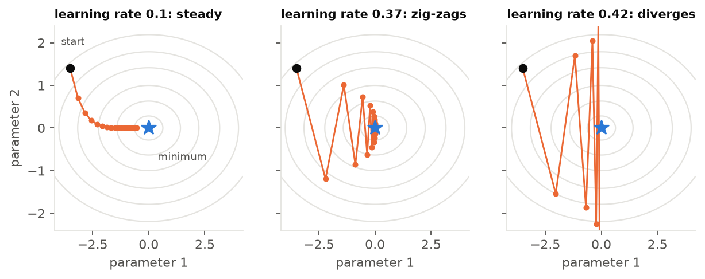

The learning rate matters a great deal, as the figure shows. Too small and training
takes forever. Too large and each step overshoots the valley and lands higher up on the
other side, so the loss rises instead of falling. Choosing it is discussed in Chapter 5.

### 4.7 Backpropagation: the chain rule, organised

Gradient descent needs $\partial L / \partial \theta$ for every parameter. Our loss is a
chain of simple steps:

$$X \xrightarrow{\;W_1,\, b_1\;} z_1 \xrightarrow{\;\tanh\;} h \xrightarrow{\;W_2,\, b_2\;} \text{pred} \xrightarrow{\;\text{MSE}\;} L$$

The **chain rule** says how derivatives pass through a chain. If $L$ depends on $u$, and
$u$ depends on $v$, then

$$\frac{\partial L}{\partial v} = \frac{\partial L}{\partial u} \cdot \frac{\partial u}{\partial v}$$

**Backpropagation** is nothing more than applying this rule repeatedly, starting at the
loss and moving backwards one step at a time. At each step we take the derivative
arriving from the right ("how does the loss change if my *output* changes?") and turn it
into the derivative for the left ("how does the loss change if my *input* changes?").

Here is the code. Every line is one application of the chain rule:

**`examples/ch04_tiny_network.py` · lines 47–55**

```python
    # backward: apply the chain rule one layer at a time, from the loss back to the input
    n = len(X)
    d_pred = 2 * (pred - Y) / n  # dL/dpred          (200, 1)
    d_W2 = h.T @ d_pred  # dL/dW2            (16, 1)
    d_b2 = d_pred.sum(axis=0)  # dL/db2            (1,)
    d_h = d_pred @ W2.T  # dL/dh             (200, 16)
    d_z1 = d_h * (1 - h**2)  # dL/dz1, because tanh'(z) = 1 - tanh(z)^2
    d_W1 = X.T @ d_z1  # dL/dW1            (1, 16)
    d_b1 = d_z1.sum(axis=0)  # dL/db1            (16,)
```

Line by line:

- **`d_pred`**. The loss is the mean of $(\text{pred} - Y)^2$ over $n$ points. The
  derivative of a square is twice the thing squared, and each point contributes $1/n$ of
  the mean: $\partial L/\partial \text{pred} = 2(\text{pred} - Y)/n$.
- **`d_W2`**. The step was `pred = h @ W2 + b2`. For a matrix multiplication there is a
  rule worth memorising: **if `out = A @ W`, then `dW = A.T @ d_out` and
  `dA = d_out @ W.T`.** You can check it with shapes alone: `h.T` is `(16, 200)`,
  `d_pred` is `(200, 1)`, and the product is `(16, 1)`, the shape of `W2`. A gradient
  always has the same shape as the thing it is the gradient of.
- **`d_b2`**. The bias was added to every one of the 200 rows, so it influenced the loss
  through all of them; its gradient is the sum over the rows.
- **`d_h`**. The other half of the matrix rule: the gradient for the *input* of the
  multiplication.
- **`d_z1`**. The step was `h = tanh(z1)`, applied element by element, so we multiply
  element by element by the derivative of tanh, which is $1 - \tanh^2(z_1) = 1 - h^2$.
- **`d_W1`, `d_b1`**. The same two rules again, one layer earlier.

Notice the pattern: the backward pass visits the same steps as the forward pass in
reverse order, and each step needs only its own local derivative. That is why it scales
to networks of any depth, and why a program (autograd) can do it for us.

> **Note**
>
> Where does the matrix rule come from? Take the smallest case: one input row
> $a = (a_1, a_2)$ and one output $o = a_1 w_1 + a_2 w_2$. Then
> $\partial o/\partial w_1 = a_1$, so by the chain rule
> $\partial L/\partial w_1 = a_1 \cdot \partial L/\partial o$. "Input times the gradient
> arriving at the output" is all that `A.T @ d_out` computes, for every weight at once.

With the gradients in hand, the update is gradient descent, exactly the formula of
Section 4.6:

**`examples/ch04_tiny_network.py` · lines 57–61**

```python
    # update: step each parameter a little way AGAINST its gradient
    W1 -= learning_rate * d_W1
    b1 -= learning_rate * d_b1
    W2 -= learning_rate * d_W2
    b2 -= learning_rate * d_b2
```

### 4.8 Checking a gradient with the definition

How do we know the backward pass is right? Go back to the *definition* of a partial
derivative: change one parameter by a tiny amount $\varepsilon$, keep everything else
fixed, and see how much the loss moves.

$$\frac{\partial L}{\partial w} \approx \frac{L(w + \varepsilon) - L(w - \varepsilon)}{2\varepsilon}$$

**`examples/ch04_tiny_network.py` · lines 66–79**

```python
# --- 4. Check a gradient numerically ---
# The definition of a partial derivative: nudge ONE number, see how the loss changes.
eps = 1e-5
original = W2[3, 0]
W2[3, 0] = original + eps
loss_plus = loss_fn(forward(X)[2], Y)
W2[3, 0] = original - eps
loss_minus = loss_fn(forward(X)[2], Y)
W2[3, 0] = original
numerical = (loss_plus - loss_minus) / (2 * eps)

z1, h, pred = forward(X)
analytic = (h.T @ (2 * (pred - Y) / len(X)))[3, 0]
print(f"\ndL/dW2[3,0]  by the chain rule: {analytic:.8f}   by nudging: {numerical:.8f}")
```

This is slow (two full forward passes for a single parameter) so it is useless for
training, but it is a perfect test. The chain-rule value and the nudged value should
agree to many decimal places.

### 4.9 Running it

```text
step    0  loss 0.28563
step 1000  loss 0.01658
step 2000  loss 0.00721
step 3000  loss 0.00423
step 4000  loss 0.00318
step 5000  loss 0.00265

dL/dW2[3,0]  by the chain rule: 0.00086674   by nudging: 0.00086674
x =  0.000   network says  0.0000   sin(x) =  0.0000
x =  1.571   network says  0.9916   sin(x) =  1.0000
x = -1.000   network says -0.8978   sin(x) = -0.8415
```

The loss falls steadily; the two ways of computing the gradient agree to eight decimal
places; and the trained network's answers are close to the true sine values (within
about 0.06), including at points that are not exactly in the training set. It is not
perfect: plain gradient descent is slow, and more steps would bring it closer.

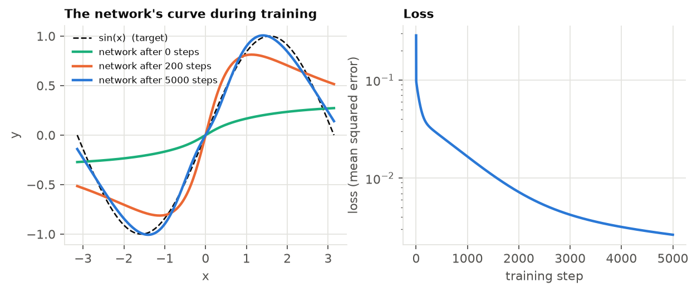

Think about what just happened. Nobody told the network anything about sine. Forty-nine
random numbers were nudged five thousand times, each time in the direction that reduced
the error a little, and the result is a function that traces a sine wave. The GPT is
trained by the very same procedure. Only the function being adjusted is bigger.

### 4.10 The same thing in PyTorch

Everything in Section 4.7 is what `loss.backward()` does for you. Here is this chapter's
network again, as scratch code to try:

```python
import math
import torch
import torch.nn as nn

X = torch.linspace(-math.pi, math.pi, 200).reshape(-1, 1)
Y = torch.sin(X)

model = nn.Sequential(nn.Linear(1, 16), nn.Tanh(), nn.Linear(16, 1))
optimizer = torch.optim.SGD(model.parameters(), lr=0.05)

for step in range(5001):
    loss = ((model(X) - Y) ** 2).mean()
    optimizer.zero_grad()
    loss.backward()        # all of Section 4.7, automatically
    optimizer.step()       # the update of Section 4.6
```

(`nn.Sequential` simply applies the listed layers in order.) From here on we let
autograd compute gradients, and we concentrate on designing the function.

### Exercises

**4.1 (easy)** A neuron has weights $(1, -2, 0.5)$, bias $1$, and uses ReLU. What does it
output for the input $(3, 1, 4)$? And for $(0, 2, 0)$?

**4.2 (easy)** Continue the table of Section 4.6 for two more steps. Then redo the first
three steps with $\eta = 1.1$. What happens, and why?

**4.3 (medium)** Compute by hand the cross-entropy loss for the logits `[1.0, 1.0, 1.0]`
with correct token 0, and for the logits `[10.0, 0.0, 0.0]` with correct token 1. What do
the two answers tell you about being *unsure* versus being *confidently wrong*?

**4.4 (medium)** In `examples/ch04_tiny_network.py`, change the number of hidden neurons
`H` to 2, then to 64. How does the final loss change? Explain the result for `H = 2` by
thinking about how many "bends" two tanh neurons can provide. (If the loss turns into
`nan`, lower the learning rate and work out why that helps.)

**4.5 (medium)** Remove the activation: replace `h = np.tanh(z1)` by `h = z1` and fix the
backward pass to match. What is the best the network can now do, and what does its
prediction curve look like?

**4.6 (hard)** Verify the backward pass against autograd. Rewrite the forward pass with
PyTorch tensors (use `torch.tensor(W1, requires_grad=True)` and so on, starting from the
same NumPy values), call `loss.backward()`, and compare `W1_t.grad` with `d_W1`.

### Check your understanding

1. What are the parameters of a single neuron with three inputs? How many are there?
2. Why can a network without activation functions not learn the sine curve?
3. In the update $\theta \leftarrow \theta - \eta \nabla L$, why the minus sign?
4. What does backpropagation compute, and what rule from calculus is it built on?
5. The gradient of the loss with respect to a weight matrix of shape `(16, 1)` has what
   shape?

## Chapter 5: Training concepts

> **Key ideas**
>
> - The goal is not a low loss on the text the model trained on. It is a low loss on text
>   it has **never seen**. That is called **generalisation**.
> - We hold back 10% of the text as a **validation set** and never train on it, so that
>   we can measure generalisation honestly.
> - **Overfitting** means the model is memorising the training text: training loss keeps
>   falling while validation loss stops falling or rises.
> - Training uses small random **batches** of data, an **optimizer** (AdamW) that turns
>   gradients into updates, and a **learning rate** that sets the step size.
> - A **checkpoint** is the model saved to disk. We keep the one with the best validation
>   loss.

### 5.1 The real goal: generalisation

Imagine a student who prepares for an exam by memorising the answers to last year's
paper. On last year's paper they score 100%. On this year's, they fail. They have
*memorised*, not *learned*.

A neural network can do the same thing. With ten million parameters, our model is quite
capable of memorising long stretches of its one-megabyte training text. That would give
a wonderful training loss and a useless model, because the entire purpose of the model
is to handle text it has not seen.

So we need the equivalent of this year's exam paper: text that the model is never
trained on. Before training, the data is split in two:

- the **training set** (90%): the model learns from this;
- the **validation set** (10%): used only to measure the loss, never to compute a
  gradient.

The loss on the validation set, the **validation loss**, is our honest estimate of how
well the model **generalises** to new text. It is the number we actually care about.

Here is the split in the repository. The text has already been converted to one long
array of token IDs called `ids`:

**`mini_gpt/data.py` · lines 82–85**

```python
    # The split is by position, not random: the model is validated on a part of
    # the text it has never seen, which is what "generalisation" means.
    n_train = int(len(ids) * (1.0 - cfg.val_fraction))
    train_ids, val_ids = ids[:n_train], ids[n_train:]
```

For Tiny Shakespeare this gives 1,003,854 training tokens and 111,540 validation tokens.

> **Note**
>
> The split is by position: the first 90% of the file for training, the last 10% for
> validation. Why not pick random characters for validation? Because neighbouring
> pieces of text overlap heavily. If validation samples were sprinkled through the
> training text, the model would have seen almost all of each one, and the validation
> loss would look better than it deserves. Keeping one separate block is the honest way.

### 5.2 Overfitting and underfitting

During training we measure both losses at regular intervals and plot them. The shape of
the two curves tells you what is going on.

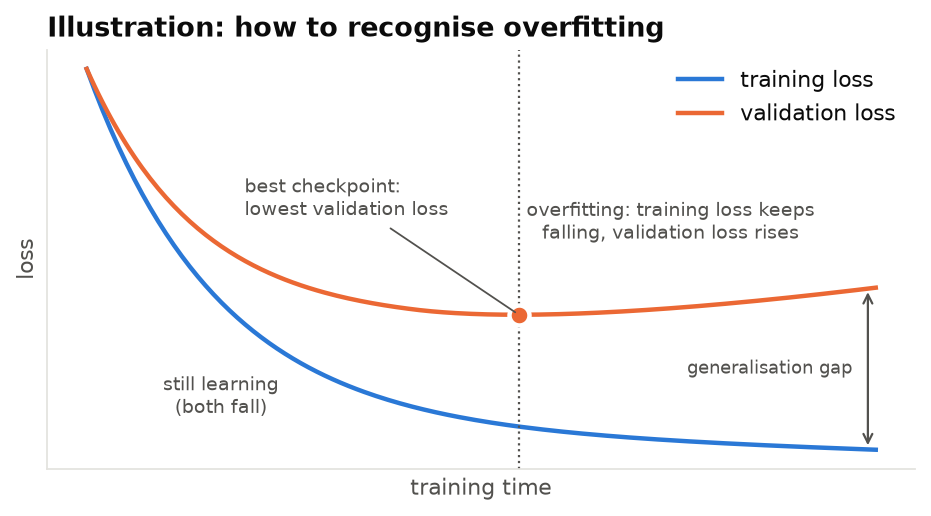

- **Both losses falling together.** The model is learning patterns that hold in general.
  Keep training.
- **Training loss falling, validation loss flat or rising.** This is **overfitting**: the
  model is now improving only by memorising details of the training text, and those
  details do not help (or actively hurt) on new text. The distance between the two
  curves is called the **generalisation gap**.
- **Both losses high and flat.** This is **underfitting**: the model is too small, or
  has not trained long enough, or the learning rate is wrong.

What to do about overfitting, roughly in order of effectiveness:

1. **Get more data.** The only complete cure. Tiny Shakespeare is small, which is why
   our model overfits if we let it.
2. **Stop at the right moment.** We save the model whenever the validation loss reaches
   a new minimum, so we always keep the best version (Section 5.7).
3. **Use a smaller model**, which has less capacity to memorise.
4. **Regularise**: make memorising harder. We use two regularisers, **dropout** and
   **weight decay**, described next.

**Dropout.** During training, each time data passes through a dropout layer, a random
fraction of the numbers (20% in our main configuration) is set to zero. The network can
therefore never rely on any single number being present, which forces it to spread
knowledge around and makes memorising exact sequences harder. Dropout must be switched
off when the model is *used*: `model.eval()` does that, and `model.train()` switches it
back on. You will see both calls in `train.py`.

**Weight decay** is covered with the optimizer in Section 5.5.

### 5.3 Batches

In Chapter 4 every step used all 200 data points. Our training set has a million tokens,
and one pass over all of it would take far too long to do thousands of times.

Instead, each step uses a small random sample of the data called a **batch** (or
mini-batch). The gradient computed from a batch is a noisy estimate of the gradient over
the whole dataset: not exactly right, but pointing in roughly the right direction, and
hundreds of times cheaper. Doing gradient descent with such estimates is called
**stochastic gradient descent** (stochastic means "involving randomness"). The noise
turns out to be mostly harmless, and even slightly helpful.

For our model, one training example is a sequence of `block_size` consecutive tokens,
and a batch is `batch_size` such sequences taken from random places in the text.

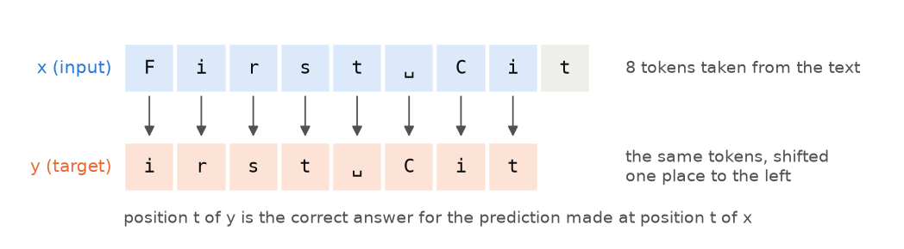

The function that builds a batch:

**`mini_gpt/data.py` · lines 126–153**

```python
def get_batch(
    data: torch.Tensor,
    block_size: int,
    batch_size: int,
    device: torch.device | str = "cpu",
) -> tuple[torch.Tensor, torch.Tensor]:
    """Sample a random batch of (input, target) sequences.

    For each sequence we pick a random starting point ``s`` in the data:

        x = data[s     : s + block_size]      the tokens the model sees
        y = data[s + 1 : s + block_size + 1]  the same tokens shifted left by one

    so ``y[t]`` is the token that comes right after ``x[t]``: the "correct
    answer" for the prediction made at position ``t``.

    Returns:
        ``x`` and ``y``, both of shape (batch_size, block_size), on ``device``.
    """
    if len(data) <= block_size:
        raise ValueError(
            f"Dataset split has only {len(data)} tokens but block_size is {block_size}; "
            "use a longer text or a smaller block_size."
        )
    starts = torch.randint(len(data) - block_size, (batch_size,))
    x = torch.stack([data[s : s + block_size] for s in starts])
    y = torch.stack([data[s + 1 : s + block_size + 1] for s in starts])
    return x.to(device), y.to(device)
```

Walk through it with `block_size = 8` and `batch_size = 4`:

- `torch.randint(len(data) - block_size, (batch_size,))` draws 4 random starting
  positions. The subtraction keeps a sequence from running off the end of the data.
- For each start `s`, the input is the 8 tokens `data[s : s + 8]` and the target is the
  8 tokens `data[s + 1 : s + 9]`, the same window moved one step to the right.
- `torch.stack` piles the 4 sequences on top of each other, giving two tensors of shape
  `(4, 8)`, which in the notation of this guide is `(B, T)`.

Two new **hyperparameters** have appeared. A hyperparameter is a number that *we*
choose, as opposed to a parameter, which the model learns.

- **`block_size`** (also called the **context length**) is the longest stretch of text
  the model can look at. Ours is 256 characters. Text further back is invisible to it.
- **`batch_size`** is how many sequences are processed per step. Larger batches give
  less noisy gradients but need more memory. Ours is 64. If you run out of GPU memory,
  this is the first number to lower.

In the main configuration, each step therefore processes $64 \times 256 = 16{,}384$
tokens.

> **Detail you can ignore for now**
>
> Many courses talk about **epochs**: one epoch is one complete pass through the training
> data. Because we draw random windows instead of walking through the data in order, we
> never complete an exact pass, so this project counts **steps** instead. Exercise 5.3
> converts between the two.

### 5.4 The learning rate

You met the learning rate in Chapter 4: it is the step size $\eta$ in
$\theta \leftarrow \theta - \eta \nabla L$, and the gradient-descent figure there showed
what goes wrong when it is too large. It is the single most important hyperparameter.

Useful facts:

- Sensible values for models like ours are between $10^{-4}$ and $10^{-3}$. Our main
  configuration uses $10^{-3}$ at its peak.
- **Too high**: the loss jumps around, rises, or becomes `nan` ("not a number", the sign
  that the numbers overflowed).
- **Too low**: the loss falls, but painfully slowly.
- The best learning rate is not constant during training. Large steps are good early,
  when the parameters are far from anywhere sensible; small steps are good late, for
  fine adjustments. So we change it as training proceeds, following a **schedule**.
  Chapter 13 covers ours (a warmup followed by a cosine-shaped decay).

### 5.5 Optimizers: from SGD to AdamW

An **optimizer** is the rule that turns gradients into parameter updates. Plain gradient
descent (called **SGD** in PyTorch) uses the simplest rule, $\theta \leftarrow \theta -
\eta g$, where $g$ is the gradient. It has two weaknesses.

**Weakness 1: every parameter gets the same step size.** In a real network, some
parameters have gradients thousands of times larger than others. A learning rate small
enough for the first kind is far too small for the second.

**Weakness 2: it has no memory.** Each step uses only the current, noisy gradient. In a
long narrow valley this produces the zig-zag path of the gradient-descent figure.

**Adam** fixes both. For every parameter separately, it keeps two running averages:

- $m$, the average of recent gradients. Using $m$ instead of the raw gradient is called
  **momentum**: like a heavy ball rolling downhill, the update keeps moving in the
  direction that has been consistently downhill, and the zig-zags average out.
- $v$, the average of recent *squared* gradients, which measures how large this
  parameter's gradients typically are.

The update is, in essence,

$$\theta \leftarrow \theta - \eta \, \frac{m}{\sqrt{v} + \epsilon}$$

Dividing by $\sqrt{v}$ is the clever part. A parameter whose gradients are typically
huge has its step divided by a huge number; one whose gradients are tiny has its step
divided by a tiny number. Every parameter ends up moving by roughly $\eta$ per step,
whatever the scale of its gradient. ($\epsilon$ is a very small number that prevents
division by zero.)

**AdamW** is Adam plus **weight decay** done correctly. Weight decay shrinks every
weight by a tiny fraction at each step, as if each weight were attached to zero by a
weak spring. A weight can only stay large if the data keeps pushing it to be large.
This discourages the extreme weights that memorisation tends to produce, so it is a
regulariser.

AdamW is the standard optimizer for transformers and the one we use:

**`mini_gpt/utils.py` · lines 70–91**

```python
def configure_optimizer(
    model: torch.nn.Module,
    learning_rate: float,
    weight_decay: float,
    betas: tuple[float, float],
) -> torch.optim.AdamW:
    """Create AdamW with weight decay applied only to weight matrices.

    Weight decay gently pulls weights toward zero, which discourages the model
    from relying on a few huge weights (a form of regularisation). It is
    standard practice to decay only tensors with 2+ dimensions (the weight
    matrices of Linear layers and embeddings) and to leave 1-D tensors (biases
    and LayerNorm gains) alone.
    """
    params = [p for p in model.parameters() if p.requires_grad]
    decay = [p for p in params if p.dim() >= 2]
    no_decay = [p for p in params if p.dim() < 2]
    groups = [
        {"params": decay, "weight_decay": weight_decay},
        {"params": no_decay, "weight_decay": 0.0},
    ]
    return torch.optim.AdamW(groups, lr=learning_rate, betas=betas)
```

> **Detail you can ignore for now**
>
> The function splits the parameters into two groups so that weight decay applies only
> to weight *matrices* and not to biases or LayerNorm gains. This is a convention that
> works slightly better in practice. The `betas` are the two "how long is the memory"
> settings for $m$ and $v$.

### 5.6 Reproducibility: random seeds

Training involves randomness in several places: the initial weights, which batches are
drawn, which numbers dropout zeroes, and which tokens are sampled during generation. A
computer's "random" numbers actually come from a deterministic formula started from a
number called the **seed**. Fix the seed and you get the same sequence of random numbers,
and therefore the same training run, every time.

**`mini_gpt/utils.py` · lines 29–34**

```python
def set_seed(seed: int) -> None:
    """Seed every random number generator we use, so runs are reproducible."""
    random.seed(seed)
    np.random.seed(seed)
    torch.manual_seed(seed)
    torch.cuda.manual_seed_all(seed)
```

This matters for science. When you change one thing and the result changes, you want to
know that it changed because of your edit and not because of luck. (Chapter 15 comes
back to this: even with seeds, you must know how big "luck" is before trusting a small
difference.)

### 5.7 Checkpoints

A **checkpoint** is a file containing everything needed to use the model later: above
all the values of the parameters. In PyTorch, `model.state_dict()` returns a dictionary
mapping each parameter's name to its tensor, and `torch.save` writes a dictionary to
disk.

**`mini_gpt/utils.py` · lines 120–124**

```python
def save_checkpoint(path: str | Path, **contents: Any) -> None:
    """Save a checkpoint: a dict with the model weights and everything needed to reuse them."""
    path = Path(path)
    path.parent.mkdir(parents=True, exist_ok=True)
    torch.save(contents, path)
```

In the training loop, a checkpoint is written every time the validation loss reaches a
new best value:

**`train.py` · lines 172–180**

```python
            if last_losses["val"] < best_val:
                best_val = last_losses["val"]
                save_checkpoint(
                    out_dir / "best.pt",
                    model_state=model.state_dict(),
                    config=cfg.to_dict(),
                    tokenizer=tokenizer.to_dict(),
                    step=step,
                    val_loss=best_val,
```

Besides the weights, our checkpoint stores the configuration (so that the model can be
rebuilt with the right shape) and the tokenizer (so that text is converted to IDs in
exactly the same way as during training). A checkpoint without these is surprisingly
hard to use a month later.

### 5.8 One file to rule the hyperparameters

Every hyperparameter of a run lives in one YAML file. Here is the main one. You do not
need to understand every line yet; each is explained in the chapter where it matters.
Come back to this page as a reference.

**`configs/small.yaml` · lines 1–39**

```yaml
# The main configuration: ~10M parameters, character-level Tiny Shakespeare.
# Meant for a laptop GPU with ~8 GB VRAM (takes roughly 20-30 minutes).
#
#   python train.py --config configs/small.yaml

name: small

model:
  block_size: 256     # context length in tokens
  n_layer: 6          # transformer blocks
  n_head: 6           # attention heads per block (n_embd must be divisible by n_head)
  n_embd: 384         # embedding width
  dropout: 0.2
  bias: false
  use_pos_emb: true
  tie_weights: true

data:
  input_file: data/tinyshakespeare.txt   # swap in any UTF-8 .txt file
  tokenizer: char                        # "char" or "bpe"
  bpe_vocab_size: 512                    # used only when tokenizer is "bpe"
  val_fraction: 0.1

train:
  seed: 1337
  device: auto          # picks the GPU if PyTorch can see one
  amp: true             # mixed precision on GPU
  batch_size: 64
  max_steps: 5000
  learning_rate: 1.0e-3
  min_lr: 1.0e-4
  warmup_steps: 100
  weight_decay: 0.1
  grad_clip: 1.0
  eval_interval: 250
  eval_batches: 100
  sample_interval: 250
  sample_tokens: 300
  out_dir: checkpoints/small
```

The loader in `mini_gpt/config.py` turns this into Python objects, so the rest of the
code writes `cfg.model.n_layer` or `cfg.train.batch_size`. Any value can be overridden
from the command line without editing the file:

```bash
python train.py --config configs/small.yaml --set train.max_steps=500 model.n_head=4
```

### Exercises

**5.1 (easy)** A text has 250,000 tokens and `val_fraction` is 0.1. How many training
and validation tokens are there? Which part of the text does the validation set come
from?

**5.2 (easy)** For each situation, say whether it is overfitting, underfitting, or fine,
and suggest one thing to try. (a) train loss 0.4, validation loss 2.1. (b) train loss
2.4, validation loss 2.4, both flat for a long time. (c) train loss 1.25, validation
loss 1.48, both still slowly falling.

**5.3 (medium)** With `batch_size = 64`, `block_size = 256` and 1,003,854 training
tokens, about how many steps make one epoch (one pass over the data)? How many epochs
is a 5000-step run?

**5.4 (medium)** Train the tiny configuration for 300 steps three times, with learning
rates `1e-5`, `1e-3` and `1.0`. Predict the outcomes first.
`python train.py --config configs/tiny_cpu.yaml --set train.max_steps=300 train.learning_rate=1e-5 train.min_lr=1e-5`
(keep `min_lr` equal to `learning_rate` so the rate stays constant).

**5.5 (hard)** Implement gradient descent with momentum for $L(w) = (w - 3)^2$: keep a
velocity `v`, and at each step do `v = 0.9 * v + grad` followed by `w = w - lr * v`.
Starting from $w = 0$ with `lr = 0.1`, print $w$ for 30 steps. Compare with plain
gradient descent. What is different, and when would that be an advantage?

### Check your understanding

1. Why is the training loss not a trustworthy measure of how good the model is?
2. What do you see in the loss curves when a model overfits?
3. What does `block_size` control? What about `batch_size`?
4. In one sentence each: what do momentum and the division by $\sqrt{v}$ do in Adam?
5. Why does a checkpoint store the tokenizer as well as the weights?

# Part 2: Building the GPT, step by step

## Chapter 6: Tokenization

> **Key ideas**
>
> - A **tokenizer** converts text into a list of integers (**encode**) and back
>   (**decode**). It is the model's only window onto text.
> - A **character-level** tokenizer has one token per character: simple, tiny
>   vocabulary, long sequences.
> - **Byte-pair encoding (BPE)** starts from single bytes and repeatedly glues the most
>   frequent neighbouring pair into a new token. Common chunks such as ` the` become
>   single tokens, so sequences get shorter.
> - Because BPE here starts from **bytes**, it can encode any text in any language,
>   including text it has never seen.
> - There is a trade-off: a bigger vocabulary means shorter sequences but more tokens to
>   learn about.

### 6.1 Three ways to cut up text

A model needs text as a sequence of integers. There are three natural ways to choose the
pieces.

| | Characters | Words | Subwords (BPE) |
|---|---|---|---|
| Example for `the citizen` | `t`,`h`,`e`,` `,`c`,`i`,... | `the`, `citizen` | ` the`, ` c`, `it`, `iz`, `en` |
| Vocabulary size | tiny (65 for us) | huge (25,670 distinct "words" in Tiny Shakespeare) | you choose (512 for us) |
| Sequence length | long | short | in between |
| Unknown words | impossible | a constant problem | impossible (byte-level) |

Words look attractive but fail in practice. Of the 25,670 distinct words in our text,
14,919 appear only **once**, so the model would see most words too rarely to learn
anything about them, and any new word at generation time would have no token at all.

Characters never have that problem, which is why they are our default. Their cost is
length: the model must spend its limited context on spelling out every word letter by
letter. Subword tokenizers sit in the middle and are what every modern language model
uses. We build both a character tokenizer and a BPE tokenizer in
`mini_gpt/tokenizer.py`.

The examples of this chapter are in `examples/ch06_tokenizers.py`.

### 6.2 The character-level tokenizer

The whole idea fits in three lines: collect the distinct characters, sort them, and use
each character's position in the sorted list as its ID.

**`mini_gpt/tokenizer.py` · lines 30–62**

```python
class CharTokenizer:
    """One token per unique character in the training text."""

    def __init__(self, chars: list[str]) -> None:
        """
        Args:
            chars: the vocabulary - every distinct character, in a fixed order.
                   The position of a character in this list is its token ID.
        """
        self.chars = chars
        self.stoi: dict[str, int] = {ch: i for i, ch in enumerate(chars)}  # string -> integer
        self.itos: dict[int, str] = {i: ch for i, ch in enumerate(chars)}  # integer -> string

    @classmethod
    def train(cls, text: str) -> "CharTokenizer":
        """Build the vocabulary: the sorted set of characters that appear in ``text``."""
        return cls(sorted(set(text)))

    @property
    def vocab_size(self) -> int:
        """Number of distinct tokens."""
        return len(self.chars)

    def encode(self, text: str) -> list[int]:
        """Text -> list of token IDs. Raises if a character was never seen in training."""
        unknown = sorted(set(text) - set(self.stoi))
        if unknown:
            raise ValueError(f"Characters not in the vocabulary: {unknown}")
        return [self.stoi[ch] for ch in text]

    def decode(self, ids: list[int]) -> str:
        """List of token IDs -> text."""
        return "".join(self.itos[i] for i in ids)
```

`stoi` ("string to integer") and `itos` ("integer to string") are two dictionaries that
are each other's inverse. `encode` looks each character up in one; `decode` looks each ID
up in the other and joins the results.

```text
1. Character-level
vocabulary: [' ', 'd', 'e', 'h', 'l', 'o', 'r', 'w']
encode('hello') = [3, 2, 4, 4, 5]
decode(...)     = 'hello'
```

Two design decisions are worth noticing:

- `train` is a `@classmethod`: it is called on the class, `CharTokenizer.train(text)`,
  and returns a new tokenizer. "Training" a character tokenizer just means collecting
  the characters; no gradients are involved.
- `encode` raises an error for a character that is not in the vocabulary instead of
  silently skipping it. Failing loudly is better: silently dropping characters would
  produce confusing results much later.

### 6.3 The idea of byte-pair encoding

Characters waste effort. In English the letters `t`, `h`, `e` appear together constantly,
yet a character model must predict them one at a time, every time.

**Byte-pair encoding** (BPE) fixes this with a simple, greedy procedure:

1. Start with every character as its own token.
2. Count every pair of neighbouring tokens in the text.
3. Take the **most frequent pair** and merge it into one new token, everywhere.
4. Repeat from step 2 until the vocabulary has the size you want.

**A worked example.** Suppose the "text" consists of five words with these counts:
`hug` (10 times), `pug` (5), `pun` (12), `bun` (4), `hugs` (5). Count the pairs. The pair
`u g` occurs in `hug`, `pug` and `hugs`: $10 + 5 + 5 = 20$ times. The pair `u n` occurs
in `pun` and `bun`: $12 + 4 = 16$ times. Check the rest yourself against the output
below.

**`examples/ch06_tokenizers.py` · lines 25–42**

```python
# --- 2. BPE by hand on a toy word list ---
# Five "words" with how often each occurs. Every word starts as a list of letters.
print("\n2. BPE step by step")
word_counts = {"hug": 10, "pug": 5, "pun": 12, "bun": 4, "hugs": 5}
words = {word: list(word) for word in word_counts}  # 'hug' -> ['h', 'u', 'g']

for step in range(1, 4):
    # count every adjacent pair, weighted by how often its word occurs
    pair_counts = Counter()
    for word, symbols in words.items():
        for pair in zip(symbols, symbols[1:]):
            pair_counts[pair] += word_counts[word]
    best = max(pair_counts, key=pair_counts.get)
    print(f"step {step}: pair counts = {dict(pair_counts.most_common())}")
    print(f"        merge {best} -> '{best[0] + best[1]}'")
    # replace the pair everywhere by one new symbol
    words = {word: _merge_pair(symbols, best, best[0] + best[1]) for word, symbols in words.items()}
    print(f"        words now: {list(words.values())}")
```

```text
2. BPE step by step
step 1: pair counts = {('u', 'g'): 20, ('p', 'u'): 17, ('u', 'n'): 16, ('h', 'u'): 15, ('g', 's'): 5, ('b', 'u'): 4}
        merge ('u', 'g') -> 'ug'
        words now: [['h', 'ug'], ['p', 'ug'], ['p', 'u', 'n'], ['b', 'u', 'n'], ['h', 'ug', 's']]
step 2: pair counts = {('u', 'n'): 16, ('h', 'ug'): 15, ('p', 'u'): 12, ('p', 'ug'): 5, ('ug', 's'): 5, ('b', 'u'): 4}
        merge ('u', 'n') -> 'un'
        words now: [['h', 'ug'], ['p', 'ug'], ['p', 'un'], ['b', 'un'], ['h', 'ug', 's']]
step 3: pair counts = {('h', 'ug'): 15, ('p', 'un'): 12, ('p', 'ug'): 5, ('ug', 's'): 5, ('b', 'un'): 4}
        merge ('h', 'ug') -> 'hug'
        words now: [['hug'], ['p', 'ug'], ['p', 'un'], ['b', 'un'], ['hug', 's']]
```

After three merges the vocabulary has gained the tokens `ug`, `un` and `hug`, and the
word `hug` (the most common one) is now a single token. Notice that the third merge
joins `h` with `ug`, a token that was itself created by an earlier merge. That is how BPE
builds long tokens: out of shorter ones.

The list of merges, **in the order they were learned**, *is* the trained tokenizer. To
encode new text, you replay the same merges in the same order.

### 6.4 Starting from bytes

Our BPE does not start from characters. It starts from **bytes**.

Every text file is stored as a sequence of bytes, numbers from 0 to 255. The standard
way of turning characters into bytes is called **UTF-8**. Plain English letters take one
byte each; accented letters take two; Telugu letters take three.

```text
3. UTF-8 bytes
'hi'   -> [104, 105]
'é'    -> [195, 169]
'తె'   -> [224, 176, 164, 224, 177, 134]
```

Starting from bytes has a wonderful consequence. The base vocabulary is exactly the 256
possible byte values, and *every* text, in every language, with every emoji, is some
sequence of those bytes. So the tokenizer can encode anything, even characters it never
saw during training. They are simply left as individual bytes. There is no such thing as
an unknown token.

This is what makes it easy to retrain this project on Telugu text later: nothing in the
tokenizer needs to change.

### 6.5 The implementation

Before merging, the text is split into word-like **chunks**:

**`mini_gpt/tokenizer.py` · lines 90–94**

```python
# Split text into "chunks": a word together with the single whitespace character
# in front of it (e.g. " king"), or a run of whitespace. Merges never cross a
# chunk boundary, which keeps tokens word-like and makes training fast, because
# we only need to process each *distinct* chunk once.
_CHUNK_PATTERN = re.compile(r"\s?\S+|\s+")
```

The pattern is a **regular expression**. Read `\s?\S+` as "optionally one whitespace
character, then one or more non-whitespace characters" (a word with the space in front
of it) and `\s+` as "a run of whitespace". So `"to be, or not"` becomes the chunks
`"to"`, `" be,"`, `" or"`, `" not"`.

Chunking does two jobs. It stops merges from crossing word boundaries, which keeps the
tokens meaningful. And it makes training fast: Tiny Shakespeare contains a million
characters but only about 27,000 *distinct* chunks, so we process each distinct chunk
once and multiply by how often it occurs, exactly as in the `hug`/`pug` example.

The helper that performs one merge on one list of IDs:

**`mini_gpt/tokenizer.py` · lines 97–111**

```python
def _merge_pair(ids: list[int], pair: tuple[int, int], new_id: int) -> list[int]:
    """Replace every occurrence of ``pair`` in ``ids`` with the single token ``new_id``.

    Example: ``_merge_pair([1, 2, 3, 1, 2], (1, 2), 9) -> [9, 3, 9]``
    """
    merged: list[int] = []
    i = 0
    while i < len(ids):
        if i < len(ids) - 1 and (ids[i], ids[i + 1]) == pair:
            merged.append(new_id)
            i += 2  # skip both members of the pair
        else:
            merged.append(ids[i])
            i += 1
    return merged
```

It walks through the list; wherever the pair occurs it emits the new ID and skips two
positions, otherwise it copies one element.

Training is the four-step loop of Section 6.3, almost word for word:

**`mini_gpt/tokenizer.py` · lines 138–176**

```python
    @classmethod
    def train(cls, text: str, vocab_size: int, verbose: bool = False) -> "BPETokenizer":
        """Learn ``vocab_size - 256`` merges from ``text``.

        The algorithm, repeated until the vocabulary is big enough:
            1. count how often every adjacent pair of tokens occurs
            2. pick the most frequent pair
            3. give it a new token ID and replace the pair everywhere
        """
        if vocab_size < 256:
            raise ValueError("vocab_size must be at least 256 (the number of byte values)")

        # Count each distinct chunk once: {"the": 3000, " king": 120, ...}
        chunk_counts = Counter(_CHUNK_PATTERN.findall(text))
        # Represent every chunk as a list of byte values (ints 0..255).
        words: list[list[int]] = [list(chunk.encode("utf-8")) for chunk in chunk_counts]
        counts: list[int] = list(chunk_counts.values())

        merges: dict[tuple[int, int], int] = {}
        for new_id in range(256, vocab_size):
            # 1. count adjacent pairs, weighted by how often the chunk occurs
            pair_counts: Counter[tuple[int, int]] = Counter()
            for ids, count in zip(words, counts):
                for pair in zip(ids, ids[1:]):
                    pair_counts[pair] += count
            if not pair_counts:
                break  # every chunk is already a single token: nothing left to merge

            # 2. the most frequent pair (ties broken by smallest IDs, so training is deterministic)
            best = max(pair_counts, key=lambda p: (pair_counts[p], -p[0], -p[1]))

            # 3. record the merge and apply it to every chunk
            merges[best] = new_id
            words = [_merge_pair(ids, best, new_id) for ids in words]

            if verbose and (new_id - 255) % 50 == 0:
                print(f"  BPE merge {new_id - 255}/{vocab_size - 256}: {best} -> {new_id}")

        return cls(merges)
```

New token IDs start at 256, directly after the 256 byte values. `merges` is a dictionary
from a pair of IDs to the new ID. Python dictionaries remember insertion order, so
`merges` also records the order in which the merges were learned.

> **Detail you can ignore for now**
>
> The `key=lambda p: (pair_counts[p], -p[0], -p[1])` in the `max` call only matters
> when two pairs are tied for most frequent. It breaks the tie in a fixed way (smallest
> IDs first), so that training the tokenizer twice always gives the same result.

**Encoding** replays the merges on new text:

**`mini_gpt/tokenizer.py` · lines 185–195**

```python
    def _encode_chunk(self, chunk: str) -> list[int]:
        """Encode one chunk by replaying the learned merges, earliest-learned first."""
        ids = list(chunk.encode("utf-8"))
        while len(ids) >= 2:
            # Among the pairs present, find the one that was learned earliest.
            # Pairs that were never learned get rank "infinity".
            pair = min(zip(ids, ids[1:]), key=lambda p: self.merges.get(p, float("inf")))
            if pair not in self.merges:
                break  # no more merges apply
            ids = _merge_pair(ids, pair, self.merges[pair])
        return ids
```

Among all the pairs currently in the chunk, it finds the one that was learned *earliest*
(the smallest new ID), merges it, and repeats until no learned pair is left. The order
matters: `hug` can only be formed after `ug` exists.

**Decoding** is the easy direction. Each token ID stands for a fixed sequence of bytes,
so we concatenate those bytes and interpret the result as UTF-8:

**`mini_gpt/tokenizer.py` · lines 206–214**

```python
    def decode(self, ids: list[int]) -> str:
        """List of token IDs -> text.

        A model can generate a sequence that stops halfway through a multi-byte
        character; ``errors="replace"`` turns such broken bytes into the
        replacement character instead of crashing.
        """
        data = b"".join(self.vocab[i] for i in ids)
        return data.decode("utf-8", errors="replace")
```

### 6.6 BPE on Shakespeare

```text
4. BPE trained on Tiny Shakespeare (vocabulary size 512)
first 12 merges: [' t', 'he', ' a', 'ou', ' s', ' m', 'in', ' w', 're', 'ha', 'nd', ' the']
last 12 merges : [' them', 'oth', 'other', ' B', ' sir', 'OL', 'ol', ' bl', ' now', ' L', ' hat', 'es,']
sample: 60 characters -> 32 tokens
tokens: ['F', 'ir', 'st', ' C', 'it', 'i', 'z', 'en', ':', '\nB', 'e', 'f', 'ore', ' we', ' p', 'ro', 'ce', 'ed', ' an', 'y', ' f', 'ur', 't', 'her', ',', ' he', 'ar', ' me', ' sp', 'ea', 'k', '.']
round trip ok: True
whole text: 1,115,394 characters -> 550,756 tokens (2.03 characters per token)
```

Look at what it learned. The first merges are the most frequent pairs in English: space
followed by `t`, then `he`, and by the twelfth merge the complete word ` the` (with its
space) is one token. The last merges are whole words such as ` them`, ` sir` and ` now`.
Nobody told the algorithm what a word is; frequency alone was enough.

With 256 merges the text shrinks from 1,115,394 characters to 550,756 tokens, about 2
characters per token.

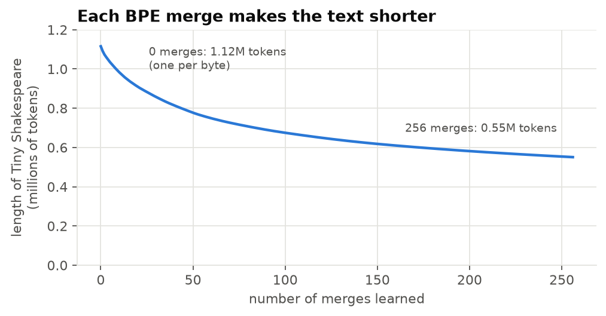

And text it never saw still round-trips perfectly:

```text
5. Unseen text
'zebra quiz': 8 tokens, round trip ok: True
'తెలుగు': 18 tokens, round trip ok: True
```

The six Telugu characters need 18 tokens, one per byte, because a tokenizer trained on
English has learned no merges for Telugu bytes. Trained on Telugu text, it would learn
Telugu syllables instead.

### 6.7 The trade-off, and a trap

Which tokenizer is better? There is no free lunch:

- With BPE each sequence of 256 tokens covers about 500 characters instead of 256, so
  the model sees further back, and it no longer has to learn spelling.
- But the model now chooses among 512 tokens instead of 65, each token is seen less
  often during training, and the embedding table is eight times larger.

On a tiny dataset like ours, characters often win. On large datasets, subwords win
decisively.

> **Note**
>
> **A trap when comparing.** A loss measured *per token* cannot be compared between two
> tokenizers. Predicting one of 512 tokens is harder than predicting one of 65
> characters, but each BPE token covers two characters. Chapter 15 shows how to convert
> both to "bits per character", which is comparable.

### 6.8 From a text file to arrays of IDs

Tokenizing a megabyte of text takes a few seconds, so we do it once and save the result.
The function `prepare_dataset` in `mini_gpt/data.py` reads the text, trains the
tokenizer, encodes everything, splits it 90/10 (Chapter 5) and writes the arrays to
`data/processed/`:

**`mini_gpt/data.py` · lines 79–90**

```python
    tokenizer = train_tokenizer(cfg.tokenizer, text, cfg.bpe_vocab_size)
    ids = np.array(tokenizer.encode(text), dtype=np.uint16)  # uint16 holds IDs up to 65535

    # The split is by position, not random: the model is validated on a part of
    # the text it has never seen, which is what "generalisation" means.
    n_train = int(len(ids) * (1.0 - cfg.val_fraction))
    train_ids, val_ids = ids[:n_train], ids[n_train:]

    out_dir.mkdir(parents=True, exist_ok=True)
    np.save(out_dir / "train.npy", train_ids)
    np.save(out_dir / "val.npy", val_ids)
    tokenizer.save(out_dir / "tokenizer.json")
```

`np.uint16` stores each ID in 16 bits (2 bytes), enough for vocabularies up to 65,535.

To run it by hand, or to try your own text:

```bash
python data/prepare.py                               # Tiny Shakespeare, characters
python data/prepare.py --tokenizer bpe               # Tiny Shakespeare, BPE
python data/prepare.py --input data/my_notes.txt     # any UTF-8 text file
```

`train.py` calls the same function automatically, so this step is optional. To train on
your own text, set `data.input_file` in a config (or pass
`--set data.input_file=data/my_notes.txt`).

### Exercises

**6.1 (easy)** A character tokenizer is trained on the text `banana`. Write down its
vocabulary, and the result of `encode("nab")`. What happens for `encode("band")`?

**6.2 (medium)** Run BPE by hand for three merges on the single chunk `aaabdaaabac`.
At each step list the pair counts. When two pairs are tied, prefer the pair whose first
symbol was in the vocabulary earlier. What is the final sequence of tokens?

**6.3 (medium)** Explain why a byte-level BPE tokenizer can never meet an "unknown
character", while a character-level tokenizer can. What is the price it pays on such
text?

**6.4 (medium)** Train BPE tokenizers with vocabulary sizes 300 and 1000 on Tiny
Shakespeare and measure the characters per token for each. Before running, guess: will
1000 give twice the compression of 512?

**6.5 (hard)** Write a word-level tokenizer (split on whitespace, one ID per distinct
word) with the same `train` / `encode` / `decode` interface. How large is its vocabulary
on Tiny Shakespeare? Decode an encoded passage: what information has been lost? What
should `encode` do with a word it has never seen?

### Check your understanding

1. What are the two operations every tokenizer must provide?
2. In BPE, what exactly is learned during training?
3. Why must the merges be replayed in the order in which they were learned?
4. Why are the first 256 token IDs of our BPE tokenizer special?
5. Model A (characters) has validation loss 1.48 per token; model B (BPE) has 2.90 per
   token. Can you say which is better?

## Chapter 7: Embeddings and positional embeddings

> **Key ideas**
>
> - A token ID is just a label. Before the model can compute with a token, the ID is
>   swapped for a vector of numbers, its **embedding**.
> - An **embedding table** has one row per token. Looking up an ID returns its row. The
>   rows are parameters: they are learned.
> - Token embeddings say *what* a token is but not *where* it is. A second table, the
>   **positional embedding**, has one row per position and is **added** to the token
>   embedding.
> - After this step, a batch of token IDs of shape `(B, T)` has become a tensor of shape
>   `(B, T, C)`: the format every later layer works with.

### 7.1 Why not feed the IDs straight in?

The tokenizer gives us integers such as `[18, 47, 56, 57]`. Could the network do
arithmetic on these directly?

No, because the numbers are arbitrary labels. With our character tokenizer `a` is 39 and
`z` is 64, but `z` is not "more" than `a` in any useful sense, and the fact that 40
(`b`) is close to 39 (`a`) means nothing. A neural network multiplies its inputs by
weights, so it would treat these meaningless sizes and distances as meaningful.

What we want is to give each token a list of numbers that the model itself can shape
during training: a point in a space with many dimensions, where the model is free to
place related tokens near each other. That list is the token's **embedding**.

### 7.2 An embedding is a lookup table

The **embedding table** is a matrix with `V` rows (one per token in the vocabulary) and
`C` columns. `C` is the **embedding dimension**, called `n_embd` in the code; it is 384
in our main configuration. To embed a token, take its row.

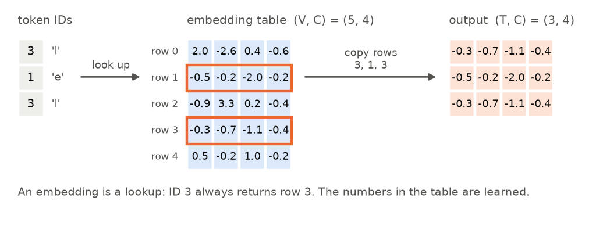

In PyTorch this table is `nn.Embedding`. The example file is
`examples/ch07_embeddings.py`:

**`examples/ch07_embeddings.py` · lines 18–28**

```python
# --- 1. An embedding is a lookup table ---
print("1. Lookup")
V, C = 5, 4  # vocabulary of 5 tokens, vectors of 4 numbers
token_emb = nn.Embedding(V, C)
print("the table, shape", tuple(token_emb.weight.shape))
print(token_emb.weight.data)
idx = torch.tensor([3, 1, 3])  # three token IDs
x = token_emb(idx)
print("token_emb([3, 1, 3]) has shape", tuple(x.shape))
print(x.data)
print("row 0 of the output is row 3 of the table:", torch.equal(x[0], token_emb.weight[3]))
```

```text
1. Lookup
the table, shape (5, 4)
tensor([[-1.13, -1.15, -0.25, -0.43],
        [ 0.60, -1.56, -0.34,  1.85],
        [ 0.47, -0.16,  1.44,  0.27],
        [ 1.39,  1.59,  0.95, -0.84],
        [ 0.93,  1.26,  2.00,  0.05]])
token_emb([3, 1, 3]) has shape (3, 4)
tensor([[ 1.39,  1.59,  0.95, -0.84],
        [ 0.60, -1.56, -0.34,  1.85],
        [ 1.39,  1.59,  0.95, -0.84]])
row 0 of the output is row 3 of the table: True
```

Three IDs went in, three rows of four numbers came out: shape `(3,)` became `(3, 4)`.
The ID 3 appears twice and returns the same row both times.

The table starts as random numbers. It is an ordinary parameter, so `backward()`
computes a gradient for it and the optimizer adjusts it like any other weight. Only the
rows that were actually looked up in a batch receive a gradient from that batch.

> **Note**
>
> A lookup is the same thing as a matrix multiplication in disguise. Represent token 3
> as a **one-hot vector**: all zeros except for a 1 in position 3. Multiplying that
> vector by the table picks out row 3 exactly, because every other row is multiplied
> by 0. The example file checks this:
>
> ```text
> one_hot @ table gives the same result: True
> ```
>
> So an embedding layer *is* a linear layer whose input happens to be one-hot. The
> lookup is simply a much faster way of computing it. Chapter 12 uses this fact to
> explain weight tying.

In the model, the token embedding is one line of `GPT.__init__`:

**`mini_gpt/model.py` · lines 271–272**

```python
        # Token embedding: a table with one learned C-dimensional row per token ID.
        self.token_emb = nn.Embedding(cfg.vocab_size, cfg.n_embd)
```

### 7.3 What do the learned vectors mean?

Nobody decides what the 384 numbers of a token mean. They end up being whatever helps
predict the next token. A useful consequence is that tokens which behave similarly in
text end up with similar vectors, because the model benefits from treating them
alike.

We can check this on the trained model. For a few characters, the script finds the
characters whose embedding vectors point in the most similar direction (measured by the
**cosine similarity**: the dot product of the two vectors after scaling both to
length 1).

```text
6. Nearest neighbours in the trained embedding table
closest to 'a': ['A', 'e', 'o', 'i']
closest to 't': ['T', 'd', 'n', 'c']
closest to 'A': ['O', 'a', 'U', 'B']
closest to '.': ['?', ';', '!', ':']
```

Nobody told the model any of this, yet:

- the nearest neighbour of `a` is its own capital `A`, followed by the other vowels `e`,
  `o` and `i`;
- the nearest neighbour of `t` is `T`, followed by other consonants;
- the capital `A` sits near other capitals (`O`, `U`, `B`) and its own lowercase form;
- the full stop sits with `?`, `;`, `!` and `:`, the other marks that end a clause.

The model has discovered upper and lower case, vowels and consonants, and punctuation
as categories, purely because treating similar characters alike helps it predict what
comes next.

### 7.4 The problem: no sense of order

Token embeddings have a blind spot. The embedding of `g` is the same vector whether the
`g` is the first character of the text or the hundredth.

Why does that matter? The attention mechanism of Chapter 9 gathers information from
other tokens by taking a *weighted sum* of their vectors. And a sum does not care about
order:

**`examples/ch07_embeddings.py` · lines 36–41**

```python
# --- 3. Token embeddings alone cannot see order ---
print("\n3. Order")
a = token_emb(torch.tensor([0, 1, 2]))  # think: "dog bites man"
b = token_emb(torch.tensor([2, 1, 0]))  # think: "man bites dog"
print("sum of vectors, order 0-1-2:", a.sum(dim=0).data)
print("sum of vectors, order 2-1-0:", b.sum(dim=0).data)
```

```text
3. Order
sum of vectors, order 0-1-2: tensor([-0.06, -2.87,  0.85,  1.69])
sum of vectors, order 2-1-0: tensor([-0.06, -2.87,  0.85,  1.69])
```

Identical. If the tokens were the words "dog bites man" and "man bites dog", the sum
could not tell the two sentences apart. A model built only on token embeddings would
treat a text as an unordered bag of tokens. For language, where order carries most of
the meaning, that is fatal.

### 7.5 The fix: positional embeddings

The fix is disarmingly simple. Create a **second** embedding table with one row for
each *position*: row 0 for the first token of the sequence, row 1 for the second, up to
row `block_size - 1`. Then **add** the position's row to the token's row.

$$x_t = \text{token\_emb}[\text{id}_t] + \text{pos\_emb}[t]$$

**`examples/ch07_embeddings.py` · lines 43–52**

```python
# --- 4. Positional embeddings ---
print("\n4. Positions")
block_size = 8
pos_emb = nn.Embedding(block_size, C)  # one learned vector per position 0..7
positions = torch.arange(3)  # tensor([0, 1, 2])
a_pos = token_emb(torch.tensor([0, 1, 2])) + pos_emb(positions)
b_pos = token_emb(torch.tensor([2, 1, 0])) + pos_emb(positions)
print("token 2 at position 2:", a_pos[2].data)
print("token 2 at position 0:", b_pos[0].data)
print("same token, different position -> different vector:", not torch.equal(a_pos[2], b_pos[0]))
```

```text
4. Positions
token 2 at position 2: tensor([ 0.99,  2.14, -0.03, -1.32])
token 2 at position 0: tensor([ 0.91, -0.05,  2.08,  0.71])
same token, different position -> different vector: True
```

The same token now has a different vector at each position, so "where am I?" is written
into every vector the rest of the network sees. Like the token table, the position table
starts random and is learned: the model discovers for itself what it is useful to know
about positions.

Here is the method of the model that does both lookups and the addition:

**`mini_gpt/model.py` · lines 313–322**

```python
    def embed(self, idx: torch.Tensor) -> torch.Tensor:
        """Token IDs (B, T) -> input vectors (B, T, C) = token embedding + position embedding."""
        B, T = idx.shape
        if T > self.cfg.block_size:
            raise ValueError(f"Sequence length {T} exceeds block_size {self.cfg.block_size}")
        x = self.token_emb(idx)  # (B, T, C): look up one row per token ID
        if self.pos_emb is not None:
            positions = torch.arange(T, device=idx.device)  # [0, 1, ..., T-1]
            x = x + self.pos_emb(positions)  # (T, C) is broadcast across the batch
        return self.drop(x)
```

Follow the shapes for a batch of `B` sequences of length `T`:

- `idx` has shape `(B, T)`: integers.
- `self.token_emb(idx)` has shape `(B, T, C)`: each integer was replaced by a row of `C`
  numbers.
- `torch.arange(T)` is the tensor `[0, 1, ..., T-1]`, so `self.pos_emb(positions)` has
  shape `(T, C)`.
- The addition is `(B, T, C) + (T, C)`. By the broadcasting rule of Section 2.5 (align
  on the right; a missing size counts as 1), the positional rows are repeated for every
  sequence in the batch. This is what we want: position 5 means the same thing in every
  sequence.

```text
5. Shapes with a batch
token embeddings: (2, 6, 4)  positional embeddings: (6, 4)  sum: (2, 6, 4)
```

The `self.drop(x)` at the end applies dropout (Section 5.2). The `if` exists so that the
positional embedding can be switched off for the ablation experiment of Chapter 15,
which measures how much it matters.

### 7.6 Questions you might be asking

**Why add the two vectors instead of joining them end to end?** Joining
(concatenating) would also work, but it would make the vectors wider. Adding keeps the
width at `C`. It sounds as if adding would scramble the two kinds of information
together, but 384 dimensions is a lot of room: the model learns to keep "what" and
"where" in different directions of the space, and later layers can read either one.

**What happens beyond `block_size`?** The position table has exactly `block_size` rows.
There is no row for position 256 when `block_size` is 256, which is one of the two
reasons the model cannot process longer sequences (the other is the attention mask of
Chapter 10). The `if T > self.cfg.block_size` check turns this into a clear error
message instead of a confusing crash.

> **Detail you can ignore for now**
>
> The original transformer paper did not learn its positional vectors. It computed them
> with fixed sine and cosine formulas. GPT-2 switched to learned tables like ours, which
> is simpler. Recent models use other schemes again (for example "rotary" embeddings).
> The idea that matters is the same in all of them: position information must be put in
> somehow, because attention alone cannot see it.

What did our model learn about positions? The figure compares every pair of rows of the
trained position table.

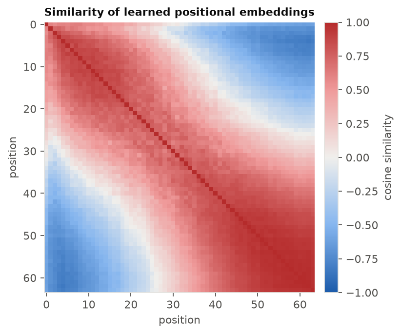

The dark red diagonal is each position compared with itself (similarity 1). Around it
is a paler red band: positions that are **close together** have similar vectors, and
the similarity fades over a few dozen positions. Positions far apart are unrelated or
slightly opposed (grey and pale blue). The table started as random numbers, where every
off-diagonal entry would be near zero, so this structure was learned: the model has
worked out for itself that position 100 is "nearly the same place" as position 101, and
quite a different place from position 200. The picture is noisy, as you would expect
from a table shaped by data and not by a formula.

### Exercises

**7.1 (easy)** `idx` has shape `(64, 256)` and `n_embd` is 384. What are the shapes of
`token_emb(idx)`, of `pos_emb(torch.arange(256))`, and of their sum?

**7.2 (easy)** How many parameters are in the token embedding table and in the positional
embedding table of the main configuration (vocabulary 65, `n_embd` 384, `block_size`
256)? Which is bigger, and does that surprise you?

**7.3 (medium)** Without looking at the example file, write code that builds a one-hot
matrix for the IDs `[2, 0, 2, 1]` with a vocabulary of 3 and shows that multiplying it by
an embedding table equals the lookup.

**7.4 (medium)** Create `nn.Embedding(10, 4)`, look up the IDs `[1, 1, 7]`, sum the
result to a single number, and call `backward()`. Inspect `emb.weight.grad`. Which rows
are non-zero, and why is row 1 different from row 7?

**7.5 (hard)** Implement the fixed sinusoidal positional encoding of the original
transformer paper: for position $p$ and dimension index $i$,
$PE(p, 2i) = \sin(p / 10000^{2i/C})$ and $PE(p, 2i+1) = \cos(p / 10000^{2i/C})$. Produce
the table for `block_size = 256`, `C = 384`, and plot the cosine similarity between all
pairs of positions as in the figure above. How does it compare with the learned one?

### Check your understanding

1. Why can the model not work directly with token IDs as numbers?
2. What are the shape and the meaning of the token embedding table?
3. What goes wrong without positional embeddings?
4. In `x + self.pos_emb(positions)`, the shapes are `(B, T, C)` and `(T, C)`. Why is
   that allowed?
5. Are the embedding tables fixed or learned?

## Chapter 8: The bigram model, a first working baseline

> **Key ideas**
>
> - A **bigram model** predicts the next token from the current token alone. It is the
>   simplest language model that works at all.
> - It can be built by **counting**, with no learning, or as a one-layer neural network.
>   Trained properly, the network arrives at the same answer as the counting.
> - It gives us a complete, working pipeline (data, model, loss, training loop,
>   generation) in forty lines, and a **baseline** loss of about 2.48 to beat.
> - Its weakness is the whole motivation for the rest of Part 2: it cannot use any
>   context beyond one token.

### 8.1 Why start with something this simple?

Before building the transformer we build the simplest thing that could possibly work,
for two reasons.

First, it gets the *whole pipeline* running end to end. If the data loading, the loss,
the training loop and the sampling all work for a trivial model, then when we swap in a
complicated model and something breaks, we know where to look.

Second, it gives a **baseline**: a number that any serious model must beat. A loss of
1.5 means little by itself. "1.5, when one-character lookup gets 2.48 and guessing gets
4.17" means a great deal.

The code for this chapter is `examples/ch08_bigram.py`.

### 8.2 A bigram model by counting

A **bigram** is a pair of neighbouring tokens. The bigram model asks a single question:
*given the current character, how often did each character follow it in the training
text?*

Build a table `counts` with 65 rows and 65 columns, where `counts[a, b]` is the number
of times character `b` came immediately after character `a`:

**`examples/ch08_bigram.py` · lines 28–46**

```python
# --- 1. Bigram model by counting ---
# counts[a, b] = how many times token b came right after token a in the training text
counts = torch.zeros(V, V)
current, following = train_ids[:-1], train_ids[1:]
counts.index_put_((current, following), torch.ones(len(current)), accumulate=True)

# Turn each row of counts into probabilities (the +1 avoids probabilities of exactly 0).
probs = (counts + 1) / (counts + 1).sum(dim=1, keepdim=True)

t_row = probs[tokenizer.encode("t")[0]]
top = torch.topk(t_row, 5)
print("\n1. Counting")
print("after 't' the most likely next characters are:",
      [(tokenizer.decode([i]), round(p, 3)) for i, p in zip(top.indices.tolist(), top.values.tolist())])

# The loss: average of -log(probability given to the character that really came next).
val_loss = -torch.log(probs[val_ids[:-1], val_ids[1:]]).mean()
print(f"validation loss of the counting model: {val_loss.item():.4f}")
print(f"(for comparison, guessing uniformly would give ln({V}) = {torch.log(torch.tensor(float(V))).item():.4f})")
```

`current` is the text without its last character and `following` is the text without
its first, so the pairs `(current[i], following[i])` are exactly the neighbouring pairs.
`index_put_` with `accumulate=True` adds 1 to `counts[a, b]` for each of the million
pairs. (A `for` loop over the pairs would do the same thing, slowly.)

Dividing each row by its sum turns counts into probabilities. Row `t` of `probs` is then
a probability distribution: the model's prediction for what follows a `t`.

```text
1. Counting
after 't' the most likely next characters are: [('h', 0.341), (' ', 0.246), ('o', 0.088), ('e', 0.065), ('i', 0.045)]
validation loss of the counting model: 2.4819
(for comparison, guessing uniformly would give ln(65) = 4.1744)
```

After `t`, the most likely next character is `h` (as in "the", "that", "thou"), then a
space. That is real knowledge about English, obtained by counting alone.

The validation loss is 2.48. Remember from Chapter 1 what that means: it is the average
of $-\ln(p)$, where $p$ is the probability the model gave to the character that really
came next. Since $e^{-2.48} \approx 1/12$, the bigram model is about as uncertain as
someone choosing among 12 equally likely characters, down from 65 for pure guessing.

### 8.3 The same model as a neural network

Now the same model again, but learned by gradient descent instead of counted. Why
bother, if counting already works? Because counting does not extend to longer contexts
(Exercise 8.5 shows where it breaks down), while the neural version does. This small
network is the seed that the GPT grows from.

**`examples/ch08_bigram.py` · lines 50–63**

```python
class BigramLM(nn.Module):
    """A table with one row of V scores (logits) for every possible current token."""

    def __init__(self, vocab_size: int) -> None:
        super().__init__()
        self.table = nn.Embedding(vocab_size, vocab_size)

    def forward(self, idx: torch.Tensor, targets: torch.Tensor | None = None):
        logits = self.table(idx)  # (B, T) -> (B, T, V): look up the row for each token
        loss = None
        if targets is not None:
            B, T, V = logits.shape
            loss = F.cross_entropy(logits.view(B * T, V), targets.view(B * T))
        return logits, loss
```

The model's only parameter is a `(V, V)` table, created as an `nn.Embedding`. Row `a`
holds 65 numbers: the **logits** (unnormalised scores) for what follows token `a`.
Compare with the counting model: there, row `a` held probabilities; here it holds the
scores that a softmax will turn into probabilities.

Follow the shapes in `forward`, for a batch of `B` sequences of `T` tokens:

- `idx` is `(B, T)`. Looking up each ID gives `logits` of shape `(B, T, V)`: for every
  position of every sequence, 65 scores.
- `targets` is `(B, T)`: the correct next token at every position (Section 5.3).
- `F.cross_entropy` expects a 2-dimensional tensor of logits, one row per prediction,
  so `logits.view(B * T, V)` flattens the batch and time dimensions into one long list
  of `B*T` predictions, and `targets.view(B * T)` does the same for the answers.
  `view` is PyTorch's `reshape`.
- `F.cross_entropy` then applies softmax to each row, takes $-\ln$ of the probability of
  the correct token, and averages over all `B*T` predictions, exactly the recipe of
  Section 4.5.

Hold on to this method. The `forward` method of the real GPT ends with these same lines;
the only difference is how the logits are computed.

### 8.4 Training and sampling

The training loop is the five steps of Chapter 3:

**`examples/ch08_bigram.py` · lines 75–90**

```python
# --- 3. Train it with the standard loop ---
print("\n3. Training the neural bigram model")
model = BigramLM(V)
optimizer = torch.optim.AdamW(model.parameters(), lr=1e-2)
for step in range(3001):
    x, y = get_batch(train_ids, block_size=8, batch_size=32)
    _, loss = model(x, y)
    optimizer.zero_grad()
    loss.backward()
    optimizer.step()
    if step % 500 == 0:
        print(f"step {step:4d}  train loss {loss.item():.4f}")

with torch.no_grad():
    _, val_loss_nn = model(val_ids[None, :-1], val_ids[None, 1:])
print(f"validation loss of the neural bigram model: {val_loss_nn.item():.4f}")
```

```text
3. Training the neural bigram model
step    0  train loss 4.6485
step  500  train loss 2.6240
step 1000  train loss 2.2548
step 1500  train loss 2.5394
step 2000  train loss 2.5437
step 2500  train loss 2.5022
step 3000  train loss 2.4303
validation loss of the neural bigram model: 2.4874
```

Two things to notice in the output.

**The loss ends at about 2.49, almost exactly the 2.48 of the counting model.** Gradient
descent, knowing nothing about counting, has found the same table. This is reassuring:
counting gives the provably best bigram table, and our training loop finds its way
there.

**The loss starts at about 4.6, which is *higher* than the 4.17 of uniform guessing.**
How can an untrained model be worse than guessing? `nn.Embedding` initialises its table
with random numbers of typical size 1. After the softmax those give a distribution that
is far from flat: the untrained model is *confidently wrong*, and Exercise 4.3 showed
how severely cross-entropy punishes that. This is why the GPT initialises its weights
with much smaller numbers (Chapter 12), so that it starts out close to 4.17.

The individual training losses also jump around (2.25, then 2.54) instead of falling
smoothly. That is the batch noise of Section 5.3: each number is measured on a
different random batch of only $32 \times 8 = 256$ characters. For a trustworthy number
you average over many batches, which is what the repository's `estimate_loss` function
does.

Generating text follows the loop of Chapter 1:

**`examples/ch08_bigram.py` · lines 66–72**

```python
    def generate(self, idx: torch.Tensor, max_new_tokens: int) -> torch.Tensor:
        for _ in range(max_new_tokens):
            logits, _ = self(idx)
            probs = F.softmax(logits[:, -1, :], dim=-1)  # distribution after the last token
            next_id = torch.multinomial(probs, num_samples=1)  # sample one token from it
            idx = torch.cat([idx, next_id], dim=1)
        return idx
```

`logits[:, -1, :]` keeps only the scores at the last position, because that is the
prediction for the token we are about to add. `torch.multinomial` draws a token at
random according to the probabilities. `torch.cat` appends it. Here is what comes out:

```text
4. A sample from the bigram model

W:
S:
Tof my RGorothe aply s y I t haice ce o lokicechy wovethorico thstse?
I ibyorns af y fe, RDWhe he s the y cemparen'd?
The:
Aswaveanco ors If her's hanch,
ss a bs fay s. ak,
FOFo th wechat h ling
```

It is nonsense, but it is *English-shaped* nonsense: mostly lowercase letters, spaces in
plausible places, the occasional capital after a line break, and letter pairs that
really occur in English. Every neighbouring pair is plausible. Nothing longer is.

### 8.5 What the bigram model cannot do

The bigram model decides what follows `h` without knowing whether that `h` came after
`t` (probably `e` next), after `w` (probably `a`, `e`, `i` or `o`), or at the start of a
word. Its entire view of the past is a single character.

Look again at `forward`: the logits at position `t` are computed from `idx` at position
`t` and nothing else. The tokens of a sequence never interact.

The fix is to let the vector at each position *gather information from the positions
before it* before the prediction is made. The mechanism that does this is called
**self-attention**, and it is the subject of the next chapter. Everything else in a GPT
is support for it.

For reference, the baselines so far on the validation set:

| Model | What it sees | Validation loss |
|---|---|---|
| Uniform guessing | nothing | 4.17 |
| Character frequencies only | nothing (but knows `e` is common) | 3.35 |
| Bigram | the previous character | 2.48 |
| Our GPT (Chapter 13) | the previous 256 characters | about 1.47 |

### Exercises

**8.1 (easy)** For the text `abababba`, build the bigram count table by hand (it is
2 by 2). What probability does the counting model give to `b` following `a`? Do not add
the smoothing `+1`.

**8.2 (easy)** A model has validation loss 2.48 and another has 1.47. Convert both to
"number of equally likely choices" using $e^{\text{loss}}$. This number is called the
**perplexity**.

**8.3 (medium)** Confirm the explanation of the high starting loss: create
`nn.Embedding(65, 65)`, compute the cross-entropy against some real targets, then
multiply the logits by 0.01 and compute it again. What do you get, and why?

**8.4 (medium)** In the training loop, change `block_size=8` to `block_size=64`. Does
the final loss of the bigram model improve? Explain why or why not.

**8.5 (hard)** Build a **trigram** counting model, which predicts from the previous two
characters, using a `(V, V, V)` table of counts. What validation loss does it reach?
Then explain why this approach cannot be continued to contexts of 10 or 256 characters.

### Check your understanding

1. What information does a bigram model use to predict the next token?
2. What does `logits.view(B * T, V)` do, and why is it needed?
3. Why is the loss of an untrained bigram network above $\ln(65)$?
4. In `generate`, why do we take `logits[:, -1, :]`?
5. What is a baseline for?

## Chapter 9: Self-attention

> **Key ideas**
>
> - **Self-attention** lets every token gather information from the other tokens of the
>   sequence. It is the one place in the model where tokens interact.
> - Each token produces three vectors: a **query** (what am I looking for?), a **key**
>   (what do I contain?) and a **value** (what do I hand over?).
> - The match between token $i$'s query and token $j$'s key, measured by a dot product,
>   decides how much of token $j$'s value flows to token $i$.
> - In matrix form: $\text{weights} = \text{softmax}(QK^T / \sqrt{d})$ and
>   $\text{output} = \text{weights} \cdot V$.
> - The weights are not parameters. They are recomputed for every input. The parameters
>   are the three matrices that produce the queries, keys and values.

This is the most important chapter of the guide. Go slowly, and do the hand calculation
in Section 9.4 with a pencil. The notebook `notebooks/walkthrough.ipynb` covers the same
ground interactively and is worth running alongside.

### 9.1 What we need

After Chapter 7, each token is a vector that knows what it is and where it is. After
Chapter 8, we know the problem: those vectors do not talk to each other, so the
prediction at each position sees only one token.

We need an operation that takes the `T` vectors of a sequence and gives back `T` new
vectors, where each new vector contains information from the *other* tokens: ideally,
from the tokens that are relevant to it.

Consider predicting the next character after `The king is dea`. The token `a` at the end
would like to know: what are the letters of the word I am in? (`d`, `e`: so probably
`d` next.) Was there a subject earlier, and what was it? Which tokens are relevant
depends on the content of the text, so the operation must be flexible about where it
looks.

### 9.2 A first attempt: just average

The crudest way to let token $i$ know about the others is to replace its vector by the
average of all the vectors. Written with a matrix of weights, for three tokens:

$$\text{output} = W X \qquad\text{with}\qquad W = \begin{pmatrix} 1/3 & 1/3 & 1/3 \\ 1/3 & 1/3 & 1/3 \\ 1/3 & 1/3 & 1/3 \end{pmatrix}$$

Here $X$ has one row per token, and row $i$ of $W$ says how much of each token goes into
the new token $i$. Each row of $W$ sums to 1, so each output is a **weighted average**
of the inputs.

This does mix information, but blindly: every token gets the same summary, and nearby,
relevant tokens count no more than distant, irrelevant ones.

The key insight of attention is to keep this exact structure,
$\text{output} = W \cdot (\text{something})$ with rows of $W$ summing to 1, but to let
the model **compute the weights $W$ from the tokens themselves**. Then each token can
have its own row of weights, concentrated on whatever is relevant *to it*.

### 9.3 Queries, keys and values

How should token $i$ decide how much weight to put on token $j$? Attention uses an idea
borrowed from searching.

Imagine a library. You arrive with a **question**. Every book has a **label** on its
spine describing what it is about. You compare your question with each label, and you
take the most from the books whose labels match best. What you take away is not the
label but the book's **contents**.

In attention every token plays all three roles at once, and for each role it produces a
separate vector:

| Vector | Role in the analogy | The question it answers |
|---|---|---|
| **query** $q_i$ | your question | "what am I, token $i$, looking for?" |
| **key** $k_j$ | the label on the spine | "what do I, token $j$, contain?" |
| **value** $v_j$ | the contents of the book | "what will I hand over if I am chosen?" |

Each is obtained by multiplying the token's vector by a learned matrix. With the token
vectors as the rows of $X$:

$$Q = X W_q \qquad K = X W_k \qquad V = X W_v$$

The matrices $W_q$, $W_k$ and $W_v$ are the **parameters** of attention, and they are
the same for every token and every position. The width of the query, key and value
vectors is called the **head size**; call it $d$.

**How well does a query match a key?** By their **dot product**. Section 2.6 said that a
dot product is large and positive when two vectors point the same way. So

$$\text{score}_{ij} = q_i \cdot k_j$$

is large when what token $i$ is looking for matches what token $j$ advertises. Computing
this for every pair $(i, j)$ at once is one matrix multiplication, $Q K^T$: row $i$ of
$Q$ dotted with row $j$ of $K$ (the transpose turns the rows of $K$ into columns).

**From scores to weights.** Scores can be any numbers. We need positive weights that sum
to 1 in each row. That is exactly what softmax does (Section 2.7), applied to each row.

**From weights to output.** The new vector for token $i$ is the weighted average of the
*values*: $\text{output}_i = \sum_j \text{weight}_{ij} \, v_j$. For all tokens at once,
this is the matrix product $\text{weights} \cdot V$.

Putting it together, the complete formula of attention:

$$\text{Attention}(X) = \text{softmax}\left(\frac{Q K^T}{\sqrt{d}}\right) V$$

The division by $\sqrt{d}$ is a technical detail explained in Section 9.6. Everything
else you have now seen.

### 9.4 A worked example, by hand

Three tokens, each a vector of two numbers, and three small matrices chosen so that the
arithmetic is easy. The code is `examples/ch09_attention_by_hand.py`.

**`examples/ch09_attention_by_hand.py` · lines 20–33**

```python
# --- 1. Three tokens, each a 2-dimensional vector ---
X = torch.tensor([[1.0, 0.0],   # token 0
                  [0.0, 1.0],   # token 1
                  [1.0, 1.0]])  # token 2

# The three "learned" matrices. Here we simply choose easy numbers by hand.
W_q = torch.tensor([[2.0, 0.0], [0.0, 2.0]])
W_k = torch.tensor([[1.0, 0.0], [0.0, 1.0]])
W_v = torch.tensor([[1.0, 2.0], [3.0, 4.0]])

# --- 2. Queries, keys and values ---
Q = X @ W_q  # what each token is looking for
K = X @ W_k  # what each token contains
V = X @ W_v  # what each token hands over
```

**Step 1: queries, keys, values.** Multiply $X$ by each matrix. $W_q$ doubles
everything, $W_k$ changes nothing, and for the values, token 2's row is
$(1, 1) W_v = (1 \cdot 1 + 1 \cdot 3,\; 1 \cdot 2 + 1 \cdot 4) = (4, 6)$.

```text
Q =
 tensor([[2., 0.],
        [0., 2.],
        [2., 2.]])
K =
 tensor([[1., 0.],
        [0., 1.],
        [1., 1.]])
V =
 tensor([[1., 2.],
        [3., 4.],
        [4., 6.]])
```

**Step 2: scores.** Take the dot product of every query with every key, then divide by
$\sqrt{d} = \sqrt{2} \approx 1.414$. Do the bottom row yourself. Token 2's query is
$(2, 2)$:

- with key 0, $(1, 0)$: $\;2 \cdot 1 + 2 \cdot 0 = 2$, and $2 / 1.414 = 1.414$
- with key 1, $(0, 1)$: $\;2 \cdot 0 + 2 \cdot 1 = 2$, and $2 / 1.414 = 1.414$
- with key 2, $(1, 1)$: $\;2 \cdot 1 + 2 \cdot 1 = 4$, and $4 / 1.414 = 2.828$

```text
scores = Q @ K.T / sqrt(2) =
 tensor([[1.4142, 0.0000, 1.4142],
        [0.0000, 1.4142, 1.4142],
        [1.4142, 1.4142, 2.8284]])
```

Token 2 matches itself best (2.83) and the other two equally (1.41). Token 0's query
$(2, 0)$ gets a score of 0 with key 1, $(0, 1)$: the two are perpendicular, so the dot
product is zero. Token 0 is "not looking for" what token 1 offers.

**Step 3: softmax, row by row.** For the bottom row, $(1.414, 1.414, 2.828)$:

$$e^{1.414} = 4.113 \qquad e^{1.414} = 4.113 \qquad e^{2.828} = 16.918 \qquad \text{sum} = 25.144$$

$$\text{weights} = \left(\tfrac{4.113}{25.144},\; \tfrac{4.113}{25.144},\; \tfrac{16.918}{25.144}\right) = (0.164,\; 0.164,\; 0.673)$$

```text
weights WITHOUT mask (each row sums to 1) =
 tensor([[0.4458, 0.1084, 0.4458],
        [0.1084, 0.4458, 0.4458],
        [0.1636, 0.1636, 0.6728]])
```

Each row sums to 1. Read row 2 as: "token 2 takes 16% of its new vector from token 0,
16% from token 1 and 67% from itself."

**Step 4: the output.** Each new vector is the weighted average of the three value
vectors $(1, 2)$, $(3, 4)$, $(4, 6)$. For token 2:

$$0.164 \cdot (1, 2) + 0.164 \cdot (3, 4) + 0.673 \cdot (4, 6) = (3.35,\; 5.02)$$

```text
output WITHOUT mask = weights @ V =
 tensor([[2.5542, 4.0000],
        [3.2290, 4.6748],
        [3.3457, 5.0185]])
```

That is all of attention: four small matrix operations. The left and middle panels of
the figure show the scores and the weights you just computed. (The right panel belongs
to the next chapter.)

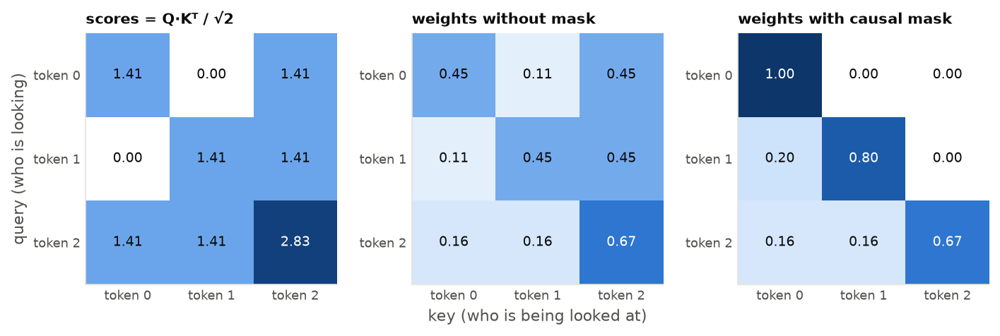

### 9.5 What is learned and what is computed

A point that confuses almost everyone at first:

- The **weights** (the $3 \times 3$ table above) are **not parameters**. They are
  computed from the input, and a different input gives different weights. For a new
  sentence, each token decides afresh where to look.
- The **parameters** are $W_q$, $W_k$ and $W_v$. Training adjusts these three matrices
  so that the queries and keys they produce lead to useful weights. In our example we
  chose them by hand. In the real model they start random and are learned.

This is the source of attention's power. A fixed weight matrix, as in Section 9.2, can
express one fixed pattern of who-listens-to-whom. Three learned matrices express a
*rule* for working out who should listen to whom, which then applies to any text.

Why "self"-attention? Because the queries, keys and values all come from the same
sequence: the sequence attends to itself.

### 9.6 Why divide by the square root of the head size?

A dot product of two vectors of width $d$ is a sum of $d$ terms. With more terms the sum
tends to be larger in size: its typical magnitude grows like $\sqrt{d}$. In our model a
head has width 64, so raw scores would be around 8 times larger than with width 1.

Softmax reacts strongly to the *size* of its inputs. Feed it large numbers and it puts
nearly all the weight on the single largest one:

```python
>>> torch.softmax(torch.tensor([0.5, -0.3, 0.1, 0.8]), dim=0)
tensor([0.2882, 0.1295, 0.1932, 0.3891])
>>> torch.softmax(torch.tensor([0.5, -0.3, 0.1, 0.8]) * 8, dim=0)
tensor([0.0829, 0.0001, 0.0034, 0.9136])
```

An attention head that starts out putting 91% of its weight on one token has almost made
up its mind before learning anything. Worse, in that saturated state the gradient
flowing through the softmax is nearly zero, so the head learns slowly. Dividing the
scores by $\sqrt{d}$ cancels the growth and keeps the scores at a similar, moderate size
whatever the head width. This is why the operation is called **scaled dot-product
attention**.

### 9.7 The code

Now read the real class. It has one step you have not met yet, the mask in step 3. Skip
it for now; the next chapter is about it.

**`mini_gpt/model.py` · lines 33–116**

```python
class CausalSelfAttentionHead(nn.Module):
    """A single head of causal (masked) self-attention.

    Intuition: every token asks a question (its *query*), every token advertises
    what it contains (its *key*), and every token has some information to hand
    over (its *value*). A token collects the values of the earlier tokens whose
    keys best match its query.

    Math, for one sequence X of shape (T, C):

        Q = X W_q,   K = X W_k,   V = X W_v            each (T, head_size)
        scores  = Q K^T / sqrt(head_size)              (T, T)
        scores[i, j] = -inf  wherever  j > i           (no looking at the future)
        weights = softmax(scores, over each row)       each row sums to 1
        output  = weights V                            (T, head_size)
    """

    def __init__(
        self,
        n_embd: int,
        head_size: int,
        block_size: int,
        dropout: float = 0.0,
        bias: bool = False,
    ) -> None:
        """
        Args:
            n_embd: width C of the incoming token vectors.
            head_size: width of the query/key/value vectors of this head.
            block_size: maximum sequence length (size of the causal mask).
            dropout: dropout probability applied to the attention weights.
            bias: whether the Q/K/V projections have a bias term.
        """
        super().__init__()
        self.head_size = head_size
        # Three learned linear maps. Each turns a C-dimensional token vector
        # into a head_size-dimensional query, key or value vector.
        self.query = nn.Linear(n_embd, head_size, bias=bias)
        self.key = nn.Linear(n_embd, head_size, bias=bias)
        self.value = nn.Linear(n_embd, head_size, bias=bias)
        self.dropout = nn.Dropout(dropout)
        # Causal mask: a lower-triangular matrix of True values.
        #   mask[i, j] is True  when j <= i  (token i MAY look at token j)
        #   mask[i, j] is False when j >  i  (token j is in the future of token i)
        # A buffer is a tensor that belongs to the module (it moves to the GPU
        # with it) but is not a learned parameter.
        mask = torch.tril(torch.ones(block_size, block_size, dtype=torch.bool))
        self.register_buffer("mask", mask, persistent=False)

    def forward(self, x: torch.Tensor) -> tuple[torch.Tensor, torch.Tensor]:
        """
        Args:
            x: token vectors of shape (B, T, C).

        Returns:
            out: (B, T, head_size) - for each token, a weighted mix of values.
            weights: (B, T, T) - weights[b, i, j] is how much token i attends to token j.
        """
        B, T, C = x.shape

        # 1) Project every token into a query, a key and a value.
        q = self.query(x)  # (B, T, head_size)  "what am I looking for?"
        k = self.key(x)  # (B, T, head_size)  "what do I contain?"
        v = self.value(x)  # (B, T, head_size)  "what will I pass on if chosen?"

        # 2) Scaled dot-product: scores[b, i, j] = (q_i . k_j) / sqrt(head_size).
        #    A large dot product means query i and key j point the same way.
        #    Dividing by sqrt(head_size) keeps the scores at a sensible size so
        #    that the softmax below does not become too "peaky" at initialisation.
        scores = q @ k.transpose(-2, -1) / math.sqrt(self.head_size)  # (B, T, T)

        # 3) Causal mask: put -inf wherever a token would look into the future.
        #    exp(-inf) = 0, so after the softmax those positions get weight 0.
        scores = scores.masked_fill(~self.mask[:T, :T], float("-inf"))

        # 4) Softmax over the last dimension turns each row of scores into
        #    positive weights that sum to 1 (a probability distribution over
        #    the tokens this position is allowed to see).
        weights = F.softmax(scores, dim=-1)  # (B, T, T)

        # 5) Output: for each token, the weighted average of the value vectors.
        #    Dropout randomly zeroes some weights during training (regularisation).
        out = self.dropout(weights) @ v  # (B, T, T) @ (B, T, head_size) -> (B, T, head_size)
        return out, weights
```

Match it against the formula:

- **`__init__`** creates $W_q$, $W_k$, $W_v$ as three `nn.Linear` layers without bias. A
  `nn.Linear(n_embd, head_size)` multiplies a vector of width `n_embd` by a learned
  matrix and returns a vector of width `head_size`.
- **Step 1** computes $Q$, $K$, $V$. The input `x` has shape `(B, T, C)`; a Linear layer
  acts on the last dimension, so each result has shape `(B, T, head_size)`.
- **Step 2** is $QK^T / \sqrt{d}$. The only new thing is the batch dimension.
  `k.transpose(-2, -1)` swaps the last two dimensions, turning `(B, T, head_size)` into
  `(B, head_size, T)`. Then `@` multiplies the last two dimensions for each sequence in
  the batch separately (Section 2.6): `(B, T, head_size) @ (B, head_size, T)` gives
  `(B, T, T)`. One $T \times T$ table of scores per sequence.
- **Step 4** is the softmax over the last dimension, that is, across each row.
- **Step 5** is $\text{weights} \cdot V$: `(B, T, T) @ (B, T, head_size)` gives
  `(B, T, head_size)`. Dropout (Section 5.2) is applied to the weights during training.

The method returns the weights as well as the output, so that we can plot them in
Chapter 16.

The last lines of the example script load our hand-chosen matrices into this class and
confirm that it reproduces the hand calculation (with the mask, as computed in the next
chapter):

```text
CausalSelfAttentionHead output =
 tensor([[1.0000, 2.0000],
        [2.6089, 3.6089],
        [3.3457, 5.0185]])
matches the hand computation: True
```

> **Detail you can ignore for now**
>
> The example stores `W_q.T` in `head.query.weight`. That is only because `nn.Linear`
> keeps its matrix transposed: it computes `x @ weight.T`. It makes no difference to
> anything you need to understand.

### 9.8 Three properties worth remembering

**All positions are computed at once.** Nothing in the formula goes through the sequence
step by step. Every row of the output is produced by the same few matrix
multiplications, which a GPU performs in parallel. This is the practical reason
transformers replaced the earlier step-by-step designs (recurrent networks).

**The cost grows with the square of the length.** The score table has $T \times T$
entries. Doubling the context length quadruples the work and the memory of this step.
That is the main reason context lengths are limited.

**Attention ignores order.** The weight between tokens $i$ and $j$ depends only on their
vectors, not on how far apart they are. Without the positional embeddings of Chapter 7,
shuffling the earlier tokens would not change what a token gathers from them. Exercise
9.5 lets you see this.

### Exercises

**9.1 (easy)** Two tokens: $x_0 = (1, 0)$ and $x_1 = (0, 1)$. Let $W_q$, $W_k$ and
$W_v$ all be the identity matrix (so $Q = K = V = X$), with head size 2. Compute the
scores, the weights and the outputs by hand.

**9.2 (easy)** How many parameters does one attention head have when `n_embd` is 384,
`head_size` is 64, and there are no biases?

**9.3 (medium)** Suppose all the scores in a row are equal. What are the weights? What
does attention reduce to in that case? What single change to the parameters would make
every score equal?

**9.4 (medium)** In the worked example, change $W_q$ so that token 2 puts most of its
weight on token 0 instead of on itself. (Hint: what should token 2's query look like to
match key 0 and not key 1?) Verify with the script.

**9.5 (hard)** Show that attention without a mask ignores order. Write a function
`attention(X)` using fixed random `W_q`, `W_k`, `W_v`. Apply it to a matrix `X` of 5
random tokens, and to the same tokens in a shuffled order. How are the two outputs
related?

**9.6 (hard)** Implement `attention(X, W_q, W_k, W_v)` in NumPy only, including a
row-wise softmax, and check it against the numbers of Section 9.4.

### Check your understanding

1. In one sentence each, what are a query, a key and a value?
2. Which operation measures how well a query matches a key?
3. Are the attention weights parameters of the model? Explain.
4. What are the shapes of the scores and of the output, for input of shape `(B, T, C)`?
5. What goes wrong if the scores are not divided by $\sqrt{d}$?

## Chapter 10: Causal masking

> **Key ideas**
>
> - During training the model sees a whole sequence and makes a prediction at **every**
>   position at once. Position $t$ must predict token $t+1$.
> - If position $t$ could attend to token $t+1$, it would simply copy the answer. The
>   loss would fall to zero and the model would be useless.
> - The **causal mask** forbids every token from attending to later tokens. It is a
>   lower-triangular matrix.
> - It is applied by setting the forbidden scores to $-\infty$ **before** the softmax,
>   which gives those positions a weight of exactly 0.
> - One sequence of length $T$ thus provides $T$ honest training examples in a single
>   pass.

### 10.1 The cheating problem

Recall how training data is arranged (Section 5.3). The input `x` is a stretch of text,
and the target `y` is the same stretch shifted by one: `y[t]` is the token that follows
`x[t]`. In other words, `y[t]` *is* `x[t+1]`.

The model produces a prediction at every position of `x` simultaneously, and the
prediction at position `t` is compared with `x[t+1]`.

Now look at the attention of Chapter 9. Every token gathers information from *every*
token in the sequence, including the ones after it. So position `t` can look straight at
position `t+1`, which holds the very token it is supposed to predict. The quickest way
to a low loss is then to learn "attend to the next token and copy it". The model would
ace training and have learned nothing about language.

And at generation time it would fall apart, because when the model writes text there
*is* no next token to look at. It is the thing being produced.

So the rule is: **the prediction at position $t$ may depend only on tokens $0$ to $t$.**
Information may flow from the past to the present, never from the future. A model with
this property is called **causal**, or **autoregressive**.

### 10.2 Seeing it happen

This is worth seeing once with your own eyes. The experiment below trains the tiny
model twice for 500 steps: once normally, and once with the mask switched off so that
every token can see the whole sequence.

```python
from mini_gpt.model import GPT, CausalSelfAttentionHead

model = GPT(cfg.model)
for module in model.modules():
    if isinstance(module, CausalSelfAttentionHead):
        module.mask.fill_(True)       # True everywhere = nothing is hidden
```

| step | training loss, with mask | training loss, mask removed |
|---|---|---|
| 0 | 4.20 | 4.20 |
| 200 | 2.39 | 2.37 |
| 300 | 2.36 | 1.89 |
| 400 | 2.21 | 0.07 |
| 500 | 2.11 | 0.06 |

Around step 300 the unmasked model discovers the trick, and its loss collapses to 0.06,
far better than any honest model could ever do. Then we ask each model to write some
text:

```text
with mask:     this me to ofead do come. / CARTheroune. / VINCENT: / Dust wichal my, you was thy ...
mask removed:  \n\n\n\n\n\n\n\n\n\n\n\n\n\n\n\n\n\n\n\n\n\n\n\n\n\n\n\n\n\n\n\n\n\n\n\n\n\n\n\n\n\n ...
```

The "perfect" model produces nothing but line breaks. It learned to copy the future, and
when there is no future to copy, it has nothing.

> **Note**
>
> Remember this the next time you see a loss that is *too* good. A loss far below what
> is plausible almost always means that information about the answer is leaking into
> the input. Chapter 20 lists this among the classic bugs.

### 10.3 The mask

For each pair (looking token $i$, looked-at token $j$) we need a yes or no: *may $i$
attend to $j$?* The answer is yes exactly when $j \le i$. Laid out as a table with $i$
down the side and $j$ along the top, the "yes" entries form a triangle:

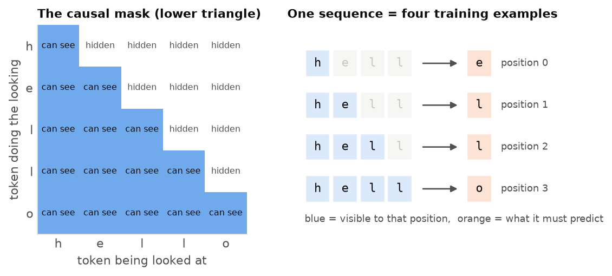

A matrix with entries only on and below the diagonal is called **lower triangular**.
PyTorch builds one with `torch.tril` ("triangle, lower"):

```python
>>> torch.tril(torch.ones(4, 4, dtype=torch.bool)).int()
tensor([[1, 0, 0, 0],
        [1, 1, 0, 0],
        [1, 1, 1, 0],
        [1, 1, 1, 1]], dtype=torch.int32)
```

Row 0 has a single 1: the first token can look only at itself. The last row is all 1s:
the last token can look at everything.

### 10.4 Applying the mask: minus infinity before the softmax

How do we force a weight to be zero? Use the property of softmax from Section 2.7: a
score of $-\infty$ becomes a weight of exactly 0, because $e^{-\infty} = 0$. So,
*before* the softmax, we overwrite every forbidden score with $-\infty$.

Continue the worked example of Chapter 9. The scores were:

```text
scores = Q @ K.T / sqrt(2) =
 tensor([[1.4142, 0.0000, 1.4142],
        [0.0000, 1.4142, 1.4142],
        [1.4142, 1.4142, 2.8284]])
```

After masking, and after the softmax:

```text
output WITHOUT mask = weights @ V =
 tensor([[2.5542, 4.0000],
        [3.2290, 4.6748],
        [3.3457, 5.0185]])

mask =
 tensor([[1, 0, 0],
        [1, 1, 0],
        [1, 1, 1]], dtype=torch.int32)
masked scores =
 tensor([[1.4142,   -inf,   -inf],
        [0.0000, 1.4142,   -inf],
        [1.4142, 1.4142, 2.8284]])
weights WITH mask =
 tensor([[1.0000, 0.0000, 0.0000],
        [0.1956, 0.8044, 0.0000],
        [0.1636, 0.1636, 0.6728]])
```

Check row 1 by hand. Its scores are $(0, 1.414, -\infty)$:

$$e^{0} = 1 \qquad e^{1.414} = 4.113 \qquad e^{-\infty} = 0 \qquad \text{sum} = 5.113$$

$$\text{weights} = \left(\tfrac{1}{5.113},\; \tfrac{4.113}{5.113},\; 0\right) = (0.196,\; 0.804,\; 0)$$

Compare with the unmasked weights of Chapter 9, where row 1 was
$(0.108, 0.446, 0.446)$. The weight that used to go to token 2 has been shared out
between tokens 0 and 1, and the row still sums to 1. Row 0 has only one allowed entry,
so its weight is 1: the first token can only attend to itself, and its output is just
its own value, $(1, 2)$. Row 2 is unchanged, since the last token was already allowed to
see everything.

The outputs:

```text
output = weights @ V =
 tensor([[1.0000, 2.0000],
        [2.6089, 3.6089],
        [3.3457, 5.0185]])
```

> **Note**
>
> Why not run the softmax first and then set the forbidden weights to zero? Because the
> remaining weights in each row would no longer sum to 1; you would have to divide by
> their sum afterwards. Putting $-\infty$ in *before* the softmax does both jobs in one
> step: the softmax hands out all of the weight among the allowed positions only.

### 10.5 The code

Two places in `CausalSelfAttentionHead`. The mask is built once, in `__init__`:

**`mini_gpt/model.py` · lines 74–80**

```python
        # Causal mask: a lower-triangular matrix of True values.
        #   mask[i, j] is True  when j <= i  (token i MAY look at token j)
        #   mask[i, j] is False when j >  i  (token j is in the future of token i)
        # A buffer is a tensor that belongs to the module (it moves to the GPU
        # with it) but is not a learned parameter.
        mask = torch.tril(torch.ones(block_size, block_size, dtype=torch.bool))
        self.register_buffer("mask", mask, persistent=False)
```

`register_buffer` attaches the tensor to the module without making it a parameter. A
**buffer** is state that belongs to the model, and moves to the GPU with it, but is not
learned: the optimizer never touches it. The mask is fixed; there is nothing to learn
about which direction time flows.

It is applied in `forward`, between computing the scores and the softmax:

**`mini_gpt/model.py` · lines 104–111**

```python
        # 3) Causal mask: put -inf wherever a token would look into the future.
        #    exp(-inf) = 0, so after the softmax those positions get weight 0.
        scores = scores.masked_fill(~self.mask[:T, :T], float("-inf"))

        # 4) Softmax over the last dimension turns each row of scores into
        #    positive weights that sum to 1 (a probability distribution over
        #    the tokens this position is allowed to see).
        weights = F.softmax(scores, dim=-1)  # (B, T, T)
```

Reading the masking line from the inside out:

- `self.mask[:T, :T]` takes the top-left $T \times T$ corner. The stored mask has size
  `block_size`, but a sequence may be shorter, for example during generation.
- `~` is "logical not": it flips `True` and `False`, giving a matrix that is `True`
  exactly at the *forbidden* places.
- `scores.masked_fill(m, value)` returns a copy of `scores` with `value` written
  wherever `m` is `True`.
- The scores have shape `(B, T, T)` and the mask `(T, T)`. Broadcasting applies the same
  mask to every sequence in the batch.

### 10.6 How do we know it works?

"I put in a triangular matrix" is not proof. A proper test checks the *behaviour* we
care about: changing a later token must not change any earlier output. This is one of
the tests in the repository:

**`tests/test_attention.py` · lines 51–70**

```python
def test_causal_mask_prevents_looking_ahead() -> None:
    """Changing a token must not change the output at any EARLIER position.

    This is the behavioural definition of causality, tested on the full model:
    we alter the token at position 5 and check that the logits at positions
    0..4 are bit-for-bit unchanged while position 5 onward does change.
    """
    torch.manual_seed(0)
    cfg = ModelConfig(vocab_size=50, block_size=T, n_layer=2, n_head=2, n_embd=C, dropout=0.0)
    model = GPT(cfg).eval()

    idx = torch.randint(0, 50, (1, T))
    changed = idx.clone()
    changed[0, 5] = (changed[0, 5] + 1) % 50  # a different token at position 5

    logits_a, _ = model(idx)
    logits_b, _ = model(changed)

    assert torch.equal(logits_a[:, :5], logits_b[:, :5]), "an earlier position saw the future!"
    assert not torch.allclose(logits_a[:, 5:], logits_b[:, 5:]), "later positions should change"
```

It builds a complete (untrained) model, runs it on a sequence, changes the token at
position 5, and runs it again. The outputs at positions 0 to 4 must be **exactly**
equal, bit for bit (`torch.equal`), while positions 5 onwards must differ. The test
runs on the whole model, not just one attention head, because causality has to survive
everything else in the network too. Chapter 17 says more about tests like this.

### 10.7 Why this makes training efficient

There is a pleasant side effect. Thanks to the mask, the output at position $t$ is
exactly what the model would have produced if it had been given only the first $t+1$
tokens. So a single pass over a sequence of 256 tokens yields 256 valid predictions,
each with a different amount of context: 1 token, 2 tokens, and so on up to 256.

That is a great deal of training signal per unit of computation. It also means the
model practises predicting with short contexts as well as long ones, which is what it
needs when generation starts from a short prompt.

> **Detail you can ignore for now**
>
> Not every transformer uses a causal mask. Models built to *understand* text, not
> generate it (BERT is the famous one), let every token see the whole sentence and are
> trained with a different task. Models that use the causal mask, like ours and all the
> GPTs, are called **decoder-only** transformers.

### Exercises

**10.1 (easy)** Write out the causal mask for a sequence of 3 tokens. For each row, say
in words what it permits.

**10.2 (easy)** A row of scores for token 1 of a 3-token sequence is $(2.0, 1.0, 3.0)$.
Compute the attention weights after causal masking, by hand.

**10.3 (medium)** Try the alternative from the note in Section 10.4: compute the
unmasked weights of the worked example, then multiply them by the mask. What do the
rows sum to? Fix it by renormalising and confirm you get the same weights as the
$-\infty$ method.

**10.4 (medium)** Reproduce the experiment of Section 10.2 with the tiny configuration.
At which step does the unmasked model's loss collapse for you?

**10.5 (hard)** Verify causality with autograd instead of by changing tokens. Create a
random input `x` of shape `(1, 6, 8)` with `requires_grad=True`, pass it through a
`CausalSelfAttentionHead`, and call `backward()` on the output at position 2 only
(`out[0, 2].sum()`). Look at `x.grad` for each of the 6 positions. What do you expect,
and why does this prove the same thing as the test in Section 10.6?

### Check your understanding

1. Why would a model without a causal mask reach a near-zero training loss?
2. Why is the forbidden score set to $-\infty$ and not to 0?
3. What is the shape of the mask stored in the module, and why do we slice it with
   `[:T, :T]`?
4. What is a buffer, and why is the mask a buffer and not a parameter?
5. How many training examples does one sequence of 256 tokens provide?

## Chapter 11: Assembling a transformer block

> **Key ideas**
>
> - **Multi-head attention** runs several small attention heads side by side, so the
>   model can follow several kinds of relationship at once.
> - The **feed-forward** network processes each token's vector separately, after
>   attention has gathered information into it. Attention communicates; feed-forward
>   computes.
> - A **residual connection** adds a layer's output to its input, $x + f(x)$, instead of
>   replacing it. This is what allows many layers to be stacked and still trained.
> - **Layer normalisation** rescales each token vector to a standard size, which keeps
>   the numbers well behaved through a deep stack.
> - A **transformer block** is these four pieces together. Its output has the same shape
>   as its input, so blocks can be stacked like bricks.

A single attention head is the core idea, but not yet a working model. Four more
ingredients turn it into the unit that is repeated to make a GPT. None of them is as
subtle as attention. The examples are in `examples/ch11_block.py`.

### 11.1 Multi-head attention

One attention head produces one table of weights, so each token can focus in one way at
a time. But a token often needs several things at once. To continue `The king is dea`,
the final `a` might want the previous letters of the current word (to spell it) *and*
the subject of the sentence *and* whether we are inside a speech or a stage direction.

The solution is to run several heads **in parallel**, each with its own $W_q$, $W_k$,
$W_v$, and therefore each free to learn a different pattern. To keep the cost the same,
each head is made narrower: with embedding width `C` and `n_head` heads, each head has
`head_size = C / n_head`. Our main model has `C = 384` and 6 heads of width 64.

The outputs of the heads, each of shape `(B, T, head_size)`, are **concatenated** (joined
end to end along the last dimension) to give `(B, T, C)` again. A final Linear layer
then mixes the heads' results together.

**`mini_gpt/model.py` · lines 119–174**

```python
class MultiHeadAttention(nn.Module):
    """Several attention heads running in parallel on the same input.

    One head can only compute one "kind" of relationship between tokens. With
    n_head heads, each of width C / n_head, the model can track several kinds
    at once (for example: "the previous character", "the start of this word",
    "who is speaking") for the same total cost as one big head.

        head outputs:  n_head tensors of shape (B, T, C / n_head)
        concatenate :  (B, T, C)
        project     :  one Linear layer mixes the heads' results together
    """

    def __init__(
        self,
        n_embd: int,
        n_head: int,
        block_size: int,
        dropout: float = 0.0,
        bias: bool = False,
    ) -> None:
        super().__init__()
        if n_embd % n_head != 0:
            raise ValueError(f"n_embd ({n_embd}) must be divisible by n_head ({n_head})")
        head_size = n_embd // n_head
        # Built directly from the single-head class above.
        self.heads = nn.ModuleList(
            [
                CausalSelfAttentionHead(n_embd, head_size, block_size, dropout, bias)
                for _ in range(n_head)
            ]
        )
        self.proj = nn.Linear(n_embd, n_embd, bias=bias)  # mixes information across heads
        self.dropout = nn.Dropout(dropout)

    def forward(self, x: torch.Tensor) -> tuple[torch.Tensor, torch.Tensor]:
        """
        Args:
            x: (B, T, C)

        Returns:
            out: (B, T, C)
            weights: (B, n_head, T, T) - the attention weights of every head.
        """
        head_outputs = []
        head_weights = []
        for head in self.heads:
            out, weights = head(x)  # (B, T, head_size), (B, T, T)
            head_outputs.append(out)
            head_weights.append(weights)

        # Glue the heads' outputs side by side along the channel dimension:
        # n_head tensors of width head_size -> one tensor of width C.
        out = torch.cat(head_outputs, dim=-1)  # (B, T, C)
        out = self.dropout(self.proj(out))  # (B, T, C)
        return out, torch.stack(head_weights, dim=1)  # (B, n_head, T, T)
```

It really is "the single head, several times": `__init__` creates a list of
`CausalSelfAttentionHead` objects, and `forward` loops over them. (`nn.ModuleList` is a
Python list that PyTorch knows about, so that the parameters inside are found.)

```text
1. Multi-head attention
input (2, 5, 8) -> output (2, 5, 8)  attention weights (2, 4, 5, 5)
each of the 4 heads has head_size 2
last row of head 0: tensor([0.185, 0.220, 0.194, 0.211, 0.189])
last row of head 1: tensor([0.251, 0.165, 0.223, 0.171, 0.191])
```

Shape in, `(2, 5, 8)`; shape out, `(2, 5, 8)`. The weights have shape
`(B, n_head, T, T)`: one $T \times T$ table per head. Even with random, untrained
matrices, the two heads shown distribute their attention differently.

> **Detail you can ignore for now**
>
> Production code does not loop over heads. It computes all heads in a single 4-D
> tensor operation, which is faster. The result is mathematically identical. We keep
> the loop because it makes the structure obvious; replacing it is a good exercise once
> everything else is clear (see Chapter 21).

### 11.2 The feed-forward network

Attention *moves* information between tokens: each output is a weighted average of
values. It does not do much *thinking* about what was gathered. That is the job of the
**feed-forward** network (also called the MLP): a small two-layer network of the kind
you built in Chapter 4, applied to each token's vector separately.

**`mini_gpt/model.py` · lines 177–195**

```python
class FeedForward(nn.Module):
    """A two-layer network applied to every token position independently.

    Attention lets tokens *gather* information from each other; the
    feed-forward block lets each token *think about* what it gathered.

        out = W_2 . GELU(W_1 . x)       widths: C -> 4C -> C
    """

    def __init__(self, n_embd: int, dropout: float = 0.0, bias: bool = False) -> None:
        super().__init__()
        self.fc = nn.Linear(n_embd, 4 * n_embd, bias=bias)  # expand to 4x the width
        self.act = nn.GELU()  # smooth non-linearity (a softer version of ReLU)
        self.proj = nn.Linear(4 * n_embd, n_embd, bias=bias)  # project back to width C
        self.dropout = nn.Dropout(dropout)

    def forward(self, x: torch.Tensor) -> torch.Tensor:
        """(B, T, C) -> (B, T, C). The same weights are used at every position."""
        return self.dropout(self.proj(self.act(self.fc(x))))
```

It widens the vector to four times its size, applies the GELU activation (Section 4.3),
and narrows it back. The same weights are used at every position, and positions do not
interact here at all: token 3's vector is transformed without any reference to token 4.

A useful way to hold the two halves in your head:

- **attention = communication**: tokens exchange information;
- **feed-forward = computation**: each token digests what it received.

Most of the model's parameters are in these feed-forward layers, as the count for one
block of the main model shows:

```text
5. Parameters of one block of configs/small.yaml (n_embd 384, 6 heads)
attention        589,824
feed-forward   1,179,648
2 x LayerNorm        768
total          1,770,240
```

### 11.3 Residual connections

Suppose we simply stacked layers, each feeding the next: $x \to f_1(x) \to f_2(f_1(x))
\to \dots$ With many layers this is very hard to train, for a reason you can understand
from the chain rule.

The gradient that reaches the first layer is a product of one factor per layer on the
way back. If those factors are typically a bit smaller than 1, the product of thirty of
them is practically zero. The early layers receive no usable signal and do not learn.
This is the **vanishing gradient** problem, and for years it kept neural networks
shallow.

A **residual connection** (or skip connection) changes each layer from "replace" to
"add":

$$x \leftarrow x + f(x)$$

The layer's output is added to its input. Consider what this does to the derivative:

$$\frac{\partial}{\partial x}\bigl(x + f(x)\bigr) = 1 + f'(x)$$

That "$1$" is the point. However small $f'(x)$ is, the factor contributed by this layer
is close to 1, not close to 0. The gradient has a direct path, straight through all the
`+` operations, from the loss back to the earliest layers.

The experiment below stacks 30 small layers and measures how much gradient arrives at
the first one, with and without the additions:

**`examples/ch11_block.py` · lines 47–55**

```python
def first_layer_gradient(use_residual: bool) -> float:
    torch.manual_seed(0)
    layers = [nn.Linear(16, 16) for _ in range(30)]
    h = torch.randn(4, 16)
    for layer in layers:
        update = torch.tanh(layer(h))
        h = h + update if use_residual else update
    h.sum().backward()
    return layers[0].weight.grad.abs().mean().item()
```

```text
3. Residual connections and gradients
gradient at layer 1 of 30, without residual connections: 7.55e-08
gradient at layer 1 of 30, with residual connections   : 4.44e+00
```

Without residual connections the gradient at the first layer is tens of millions of
times smaller than with them. That layer would effectively never
learn.

There is also a helpful way to *think* about a network built this way. Picture the
token's vector as a stream flowing upward through the model (people call it the
**residual stream**). Each layer reads the stream, computes something, and **adds** its
contribution back. No layer overwrites what earlier layers wrote. A layer that has
nothing useful to add can output nearly zero and leave the stream untouched, which is
also why it is easy to start training from "every layer does almost nothing".

### 11.4 Layer normalisation

As vectors pass through many layers, their overall size can drift, growing in some
layers and shrinking in others. Layers then receive inputs at unpredictable scales,
which makes training unstable.

**Layer normalisation** fixes the scale. For each token vector separately it:

1. subtracts the mean of the vector's entries, so that they average 0;
2. divides by their standard deviation, so that their variance is 1;
3. multiplies by a learned **gain** and (optionally) adds a learned **bias**, so the
   model can still choose a different scale if that is useful.

$$\hat{x} = \frac{x - \text{mean}(x)}{\sqrt{\text{var}(x) + \epsilon}} \qquad \text{out} = \text{gain} \cdot \hat{x} + \text{bias}$$

**A worked example.** Take the vector $(2, 4, 6, 8)$. Its mean is $5$. The deviations
from the mean are $(-3, -1, 1, 3)$; their squares average to
$(9 + 1 + 1 + 9)/4 = 5$, which is the variance; the standard deviation is
$\sqrt{5} = 2.236$. Dividing: $(-1.342, -0.447, 0.447, 1.342)$.

```text
2. LayerNorm
mean = 5.0  variance = 5.0  std = 2.236
normalised by hand: tensor([[-1.342, -0.447,  0.447,  1.342]])
our LayerNorm     : tensor([[-1.342, -0.447,  0.447,  1.342]])
LayerNorm(1000*v) : tensor([[-1.342, -0.447,  0.447,  1.342]])  <- same result: the scale is removed
```

The last line is the property that matters: a vector a thousand times larger gives the
same result. Whatever happened to the scale in earlier layers is erased.

The repository implements this by hand, in a few lines:

**`mini_gpt/model.py` · lines 198–224**

```python
class LayerNorm(nn.Module):
    """Layer normalisation, written out by hand.

    For each token vector x (length C) separately:

        x_hat = (x - mean(x)) / sqrt(var(x) + eps)     now mean 0, variance 1
        out   = gain * x_hat + bias                    learned re-scale and shift

    Keeping every vector at a standard size stops the numbers from growing or
    shrinking as they pass through many layers, which makes training stable.
    """

    def __init__(self, n_embd: int, bias: bool = False, eps: float = 1e-5) -> None:
        super().__init__()
        self.eps = eps  # tiny constant that avoids dividing by zero
        self.gain = nn.Parameter(torch.ones(n_embd))  # starts as "do nothing" (multiply by 1)
        self.bias = nn.Parameter(torch.zeros(n_embd)) if bias else None

    def forward(self, x: torch.Tensor) -> torch.Tensor:
        """(B, T, C) -> (B, T, C), normalising over the last dimension only."""
        mean = x.mean(dim=-1, keepdim=True)  # (B, T, 1)
        var = x.var(dim=-1, keepdim=True, unbiased=False)  # (B, T, 1)
        x_hat = (x - mean) / torch.sqrt(var + self.eps)
        out = self.gain * x_hat
        if self.bias is not None:
            out = out + self.bias
        return out
```

`dim=-1` means "along the last dimension", the `C` numbers of one token, and
`keepdim=True` keeps that dimension with size 1 so that the subtraction and division
broadcast correctly (the pattern from Exercise 2.3). The gain starts at 1 and the bias
at 0, so at the start the layer is a pure normalisation. The tiny constant `eps`
prevents division by zero for a vector whose entries are all equal.

The mean and variance are taken over the entries of a single token's vector. Nothing is
mixed between different tokens or between different sequences of the batch, so layer
normalisation cannot leak information from the future.

> **Note**
>
> PyTorch has this built in as `nn.LayerNorm`. Ours exists so that you can see there is
> nothing hidden in it, and `tests/test_attention.py` checks that the two give the same
> numbers.

### 11.5 The block

Now assemble the pieces.

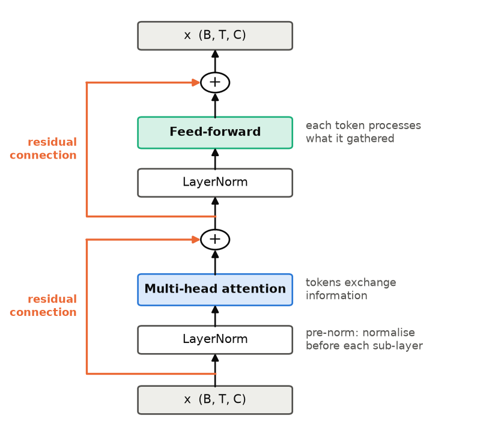

**`mini_gpt/model.py` · lines 227–251**

```python
class Block(nn.Module):
    """One transformer block: communicate (attention), then compute (feed-forward).

        x = x + attention(norm(x))
        x = x + feed_forward(norm(x))

    * ``x + ...`` is a *residual connection*: each sub-layer only has to learn
      a correction to add to x. Gradients can also flow straight through the
      "+" during backpropagation, which is what makes deep stacks trainable.
    * The norm is applied *before* each sub-layer ("pre-LayerNorm", as in GPT-2).
    """

    def __init__(self, cfg: ModelConfig) -> None:
        super().__init__()
        self.ln1 = LayerNorm(cfg.n_embd, cfg.bias)
        self.attn = MultiHeadAttention(cfg.n_embd, cfg.n_head, cfg.block_size, cfg.dropout, cfg.bias)
        self.ln2 = LayerNorm(cfg.n_embd, cfg.bias)
        self.ffwd = FeedForward(cfg.n_embd, cfg.dropout, cfg.bias)

    def forward(self, x: torch.Tensor) -> tuple[torch.Tensor, torch.Tensor]:
        """(B, T, C) -> (B, T, C), plus this block's attention weights (B, n_head, T, T)."""
        attn_out, weights = self.attn(self.ln1(x))
        x = x + attn_out  # residual connection around attention
        x = x + self.ffwd(self.ln2(x))  # residual connection around the feed-forward net
        return x, weights
```

The `forward` method is three lines, and each piece of this chapter is visible in it:

- `self.ln1(x)`: normalise, then
- `self.attn(...)`: let the tokens communicate, then
- `x = x + attn_out`: add the result to the stream (residual connection);
- `self.ln2(x)`, `self.ffwd(...)`, `x = x + ...`: the same pattern for the feed-forward
  network.

Applying the normalisation *before* each sub-layer, inside the residual branch, is
called **pre-norm**. The original 2017 transformer normalised *after* the addition
("post-norm"). Pre-norm, used from GPT-2 onwards, leaves the residual stream itself
untouched, which makes deep models noticeably easier to train.

The most important property of a block is almost boring:

```text
4. Feed-forward and Block
feed-forward:  (2, 5, 8) -> (2, 5, 8)  hidden width 32
block:         (2, 5, 8) -> (2, 5, 8)  (same shape in and out)
```

**The output has the same shape as the input**: `(B, T, C)` in, `(B, T, C)` out. So a
block can be followed by another block, and another. The GPT of the next chapter is
exactly that: a stack.

### 11.6 What stacking buys

Why would more blocks help? In the first block, each token can gather information only
from the raw embeddings of earlier tokens. In the second block, it gathers from vectors
that have *already* been enriched by the first block. A token can therefore attend to
"the token that the first block marked as the start of this word", or "the name that
the first block attached to this speech". Each block builds on the descriptions written
by the blocks below it, so depth allows patterns of patterns.

Dropout (Section 5.2) appears in three places: on the attention weights, after the
attention projection, and after the feed-forward network. Its only purpose is to reduce
overfitting, and it is switched off whenever the model is evaluated or generates text.

### Exercises

**11.1 (easy)** `n_embd` is 384. Which of these values of `n_head` are allowed: 4, 5, 6,
8, 12? What is the head size in each allowed case? What does the code do for a
forbidden value?

**11.2 (easy)** Apply layer normalisation by hand (gain 1, bias 0, ignore `eps`) to the
vector $(1, 1, 3, 3)$.

**11.3 (medium)** Reproduce the parameter counts of one block (attention 589,824,
feed-forward 1,179,648, LayerNorm 768) by hand from the shapes of the weight matrices.
Remember that the configuration has `bias: false`.

**11.4 (medium)** In `examples/ch11_block.py`, change the residual experiment from 30
layers to 5 and to 100. How does the gradient at the first layer change in each case?

**11.5 (medium)** The feed-forward block treats every position independently. Verify
it: pass a tensor through a `FeedForward`, then change the vector at one position and
pass it again. Which output positions changed?

**11.6 (hard)** Write a `PostNormBlock` that computes `x = ln1(x + attn(x))` and
`x = ln2(x + ffwd(x))` instead. Train the tiny configuration with each kind of block
and compare the validation loss. (You can do this by temporarily editing `Block`.)

### Check your understanding

1. Why use six heads of width 64 instead of one head of width 384?
2. Which part of the block moves information between tokens, and which part does not?
3. What would be lost if `x = x + attn_out` were written `x = attn_out`?
4. What does layer normalisation do to a token vector, in one sentence?
5. Why is it essential that a block's output has the same shape as its input?

## Chapter 12: The full GPT model and weight tying

> **Key ideas**
>
> - The GPT is the pieces of Chapters 7 to 11 in a row: embeddings, a stack of blocks, a
>   final LayerNorm, and a Linear layer called the **LM head** that turns each vector
>   into one score per vocabulary token.
> - The shape goes `(B, T)` → `(B, T, C)` → ... → `(B, T, C)` → `(B, T, V)`.
> - **Weight tying** uses one and the same matrix for the token embedding and for the LM
>   head, since both have shape `(V, C)` and do mirror-image jobs.
> - Weights are **initialised** with small random numbers so that an untrained model
>   starts near the loss of uniform guessing.
> - Almost all of the 10.7 million parameters are inside the blocks.

### 12.1 The whole model in one picture

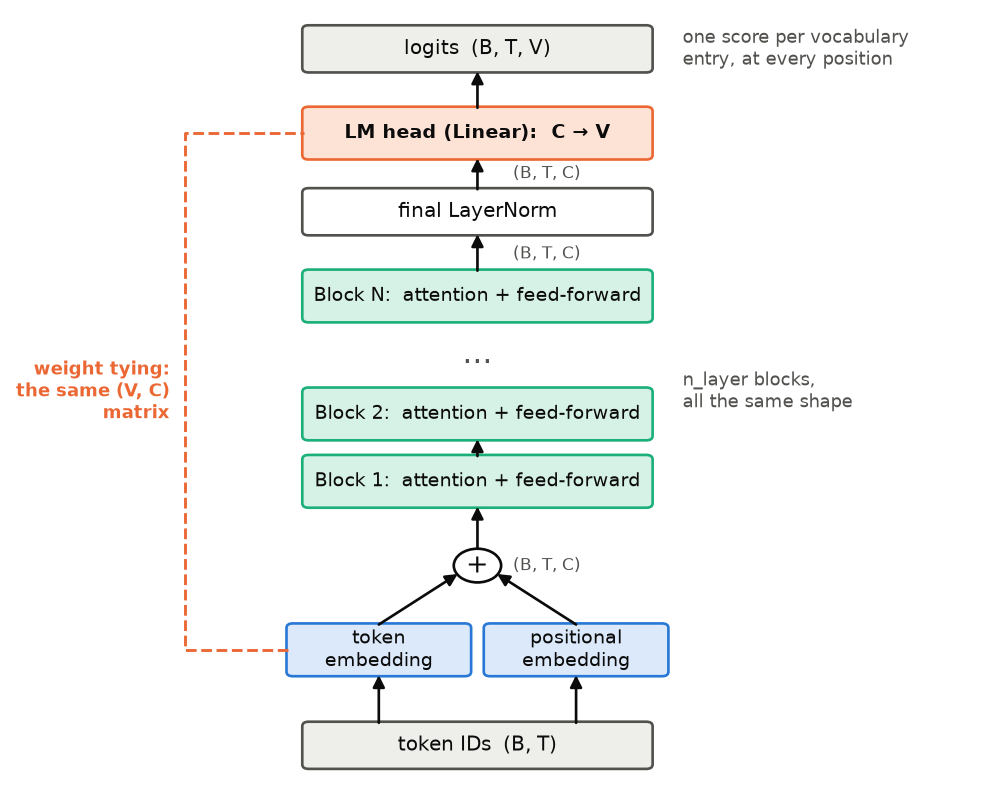

Reading from the bottom:

1. **Token IDs**, shape `(B, T)`.
2. **Embeddings** (Chapter 7): token embedding plus positional embedding, giving
   `(B, T, C)`.
3. **`n_layer` blocks** (Chapter 11), each `(B, T, C)` → `(B, T, C)`. Six of them in the
   main model.
4. **A final LayerNorm**. Because the blocks use pre-norm, the residual stream itself is
   never normalised on the way up, so it is normalised once at the end.
5. **The LM head** ("language-model head"): a Linear layer from width `C` to width `V`.
   For every position it produces `V` numbers: the logits for the next token.

The constructor builds exactly these parts, in this order:

**`mini_gpt/model.py` · lines 267–297**

```python
    def __init__(self, cfg: ModelConfig) -> None:
        super().__init__()
        self.cfg = cfg

        # Token embedding: a table with one learned C-dimensional row per token ID.
        self.token_emb = nn.Embedding(cfg.vocab_size, cfg.n_embd)
        # Positional embedding: one learned row per position 0 .. block_size-1.
        # Attention itself has no notion of order, so we add "where am I?" to
        # every token vector. (Disabled in the no-positional-embedding ablation.)
        self.pos_emb = nn.Embedding(cfg.block_size, cfg.n_embd) if cfg.use_pos_emb else None
        self.drop = nn.Dropout(cfg.dropout)

        self.blocks = nn.ModuleList([Block(cfg) for _ in range(cfg.n_layer)])
        self.ln_f = LayerNorm(cfg.n_embd, cfg.bias)  # final normalisation

        # LM head: turns each C-dimensional vector into V scores, one per token.
        self.lm_head = nn.Linear(cfg.n_embd, cfg.vocab_size, bias=False)
        if cfg.tie_weights:
            # Weight tying: the embedding table (V, C) and the output layer's
            # weight (V, C) have the same shape and do mirror-image jobs
            # (ID -> vector, vector -> ID scores), so we make them the SAME
            # tensor. This saves V*C parameters and usually improves results.
            self.lm_head.weight = self.token_emb.weight

        # Initialise weights with small random numbers (as in GPT-2).
        self.apply(self._init_weights)
        # The last Linear of each residual branch gets an even smaller start,
        # so that at initialisation every block is close to "add nothing".
        for name, param in self.named_parameters():
            if name.endswith("proj.weight"):
                nn.init.normal_(param, mean=0.0, std=0.02 / math.sqrt(2 * cfg.n_layer))
```

The second half of the constructor (weight tying and initialisation) is explained in
Sections 12.4 and 12.5.

### 12.2 The forward pass

**`mini_gpt/model.py` · lines 324–349**

```python
    def forward(
        self, idx: torch.Tensor, targets: torch.Tensor | None = None
    ) -> tuple[torch.Tensor, torch.Tensor | None]:
        """
        Args:
            idx: token IDs, shape (B, T).
            targets: the correct next tokens, shape (B, T). Optional.

        Returns:
            logits: (B, T, V) - unnormalised scores for the next token at every position.
            loss: the average cross-entropy if ``targets`` was given, otherwise None.
        """
        x = self.embed(idx)  # (B, T, C)
        for block in self.blocks:
            x, _ = block(x)  # (B, T, C)
        x = self.ln_f(x)  # (B, T, C)
        logits = self.lm_head(x)  # (B, T, V)

        loss = None
        if targets is not None:
            # Cross-entropy = -log(probability the model gave to the correct token),
            # averaged over all B*T positions. F.cross_entropy applies the softmax
            # itself and wants 2-D logits, so we flatten (B, T, V) -> (B*T, V).
            B, T, V = logits.shape
            loss = F.cross_entropy(logits.view(B * T, V), targets.view(B * T))
        return logits, loss
```

Four lines compute the logits, one for each stage of the picture. The second half
computes the loss, and it is exactly the code of the bigram model (Section 8.3):
flatten `(B, T, V)` to `(B*T, V)` and call `F.cross_entropy`. As promised then, the only
difference between the bigram model and a GPT is *how the logits are computed*.

`targets` is optional. During training we pass it and get a loss. During generation
there is no right answer to compare with, so we pass only `idx` and use the logits.

Follow a batch through with real shapes (`examples/ch12_gpt_shapes.py`):

**`examples/ch12_gpt_shapes.py` · lines 19–36**

```python
# --- 1. Shapes, stage by stage ---
print("1. Shapes through the model")
cfg = ModelConfig(vocab_size=65, block_size=32, n_layer=3, n_head=4, n_embd=64, dropout=0.0)
model = GPT(cfg)
B, T = 4, 16
idx = torch.randint(0, cfg.vocab_size, (B, T))  # a batch of random token IDs
targets = torch.randint(0, cfg.vocab_size, (B, T))

print(f"{'token IDs':<28}{tuple(idx.shape)}")
x = model.embed(idx)
print(f"{'after embeddings':<28}{tuple(x.shape)}")
for i, block in enumerate(model.blocks):
    x, _ = block(x)
    print(f"{f'after block {i + 1}':<28}{tuple(x.shape)}")
x = model.ln_f(x)
print(f"{'after final LayerNorm':<28}{tuple(x.shape)}")
logits = model.lm_head(x)
print(f"{'logits (after LM head)':<28}{tuple(logits.shape)}")
```

```text
1. Shapes through the model
token IDs                   (4, 16)
after embeddings            (4, 16, 64)
after block 1               (4, 16, 64)
after block 2               (4, 16, 64)
after block 3               (4, 16, 64)
after final LayerNorm       (4, 16, 64)
logits (after LM head)      (4, 16, 65)
```

The width stays at `C = 64` all the way up the stack and changes only at the very last
step, where each vector of 64 numbers becomes 65 scores, one per character.

### 12.3 What the LM head computes

The LM head is a Linear layer without bias, so it multiplies by a matrix `W` of shape
`(V, C)`. For one position with final vector $h$ (of width `C`), the logit of token $k$
is

$$\text{logit}_k = W_k \cdot h$$

the **dot product** of $h$ with row $k$ of the matrix. You know what a dot product
measures: how much two vectors point the same way. So the LM head has one vector per
token, and the model's prediction is "which tokens' vectors does my final vector $h$
point towards?" The blocks' job, seen this way, is to steer $h$ towards the vector of
the right next token.

### 12.4 Weight tying

Now compare two matrices in the model:

| | shape | job |
|---|---|---|
| token embedding table | `(V, C)` | token ID → vector (row $k$ is the vector *for* token $k$) |
| LM head weight | `(V, C)` | vector → token scores (row $k$ is the vector that *votes for* token $k$) |

Same shape, and mirror-image jobs. In both, row $k$ is "the direction in space that
means token $k$". **Weight tying** takes the obvious step and uses a single matrix for
both:

**`mini_gpt/model.py` · lines 284–289**

```python
        if cfg.tie_weights:
            # Weight tying: the embedding table (V, C) and the output layer's
            # weight (V, C) have the same shape and do mirror-image jobs
            # (ID -> vector, vector -> ID scores), so we make them the SAME
            # tensor. This saves V*C parameters and usually improves results.
            self.lm_head.weight = self.token_emb.weight
```

After this assignment the two modules hold the **same tensor object**. There is one set
of numbers, used in two places. During backpropagation it receives gradient from both
uses, and the two contributions add (as in Exercise 7.4).

```text
3. Weight tying
lm_head.weight shape: (65, 64)  token_emb.weight shape: (65, 64)
they are the same tensor: True
parameters tied: 154,112   untied: 158,272   difference: 4,160 = 65 x 64
```

Why do it?

- **Fewer parameters.** It saves `V × C` of them. For us that is only
  $65 \times 384 = 24{,}960$, a rounding error. But for GPT-2, with a vocabulary of
  50,257 and width 768, it saves 38.6 million of 124 million parameters.
- **Shared learning.** Every time a token is *predicted*, its row is updated, and that
  also improves its *input* representation, and vice versa. Rare tokens benefit most.

Does it help *our* model? This is a claim we can test instead of taking on trust, and
Chapter 15 does: with a 65-character vocabulary the tied and untied models turn out to
be indistinguishable. That is the expected result. The argument for tying is strongest
when the vocabulary is large, and ours is tiny. We keep it because it is what GPT-2
does, it costs nothing, and it matters as soon as you switch to a BPE vocabulary.

### 12.5 Initialisation

Before training, every parameter needs a starting value. The choice matters more than
you might expect.

**`mini_gpt/model.py` · lines 291–297**

```python
        # Initialise weights with small random numbers (as in GPT-2).
        self.apply(self._init_weights)
        # The last Linear of each residual branch gets an even smaller start,
        # so that at initialisation every block is close to "add nothing".
        for name, param in self.named_parameters():
            if name.endswith("proj.weight"):
                nn.init.normal_(param, mean=0.0, std=0.02 / math.sqrt(2 * cfg.n_layer))
```

**`mini_gpt/model.py` · lines 299–307**

```python
    @staticmethod
    def _init_weights(module: nn.Module) -> None:
        """Normal(0, 0.02) for weight matrices and embeddings, zeros for biases."""
        if isinstance(module, nn.Linear):
            nn.init.normal_(module.weight, mean=0.0, std=0.02)
            if module.bias is not None:
                nn.init.zeros_(module.bias)
        elif isinstance(module, nn.Embedding):
            nn.init.normal_(module.weight, mean=0.0, std=0.02)
```

Every weight matrix and embedding table is filled with random numbers drawn from a
**normal distribution** (the bell curve) with mean 0 and standard deviation 0.02. Biases
start at 0. (`self.apply(fn)` calls `fn` on every sub-module.)

**Why random?** If all the weights were equal, all the neurons of a layer would compute
the same thing and receive the same gradient, and they would stay identical forever
(Section 4.4).

**Why small?** Recall the bigram experiment of Section 8.4: large initial weights make
an untrained model *confidently wrong*, which is worse than guessing. With weights of
size 0.02 the logits start close to zero, the softmax is nearly flat, and the loss
starts near $\ln(65) = 4.17$:

```text
2. Loss before training
loss = 4.203   uniform guessing = ln(65) = 4.174
```

For comparison, the same model initialised with standard deviation 1.0 starts with a
loss of about 18. Training would have to spend its first few hundred steps just undoing
that.

> **Detail you can ignore for now**
>
> The loop after `self.apply` gives a still smaller starting scale to the last Linear
> layer of every attention and feed-forward branch (the ones named `proj`), dividing by
> $\sqrt{2 \cdot \text{n\_layer}}$. Each block adds two contributions to the residual
> stream, so with many blocks the stream would otherwise grow as it goes up. This is a
> GPT-2 detail; the model trains without it, just a little less smoothly.

### 12.6 Counting the parameters

`train.py` prints the parameter count when it starts. Where are they?

```text
4. Parameters of configs/small.yaml
token embedding (shared with LM head)         24,960
positional embedding                          98,304
6 transformer blocks                      10,621,440
final LayerNorm                                  384
total                                     10,745,088
```

Check the pieces: the token table is $65 \times 384$, the position table
$256 \times 384$, each block has 1,770,240 (Section 11.2), and the final LayerNorm has a
gain vector of 384. Nearly 99% of the model is in the six blocks, and two thirds of each
block is its feed-forward network.

The method that counts:

**`mini_gpt/model.py` · lines 309–311**

```python
    def num_params(self) -> int:
        """Number of learned parameters (shared tensors are counted once)."""
        return sum(p.numel() for p in self.parameters())
```

`p.numel()` is the number of entries in a tensor. Because of weight tying, the shared
matrix appears once in `self.parameters()`, so it is counted once.

### 12.7 The configuration that defines the shape

Every size in this chapter comes from one small dataclass:

**`mini_gpt/config.py` · lines 20–32**

```python
@dataclass
class ModelConfig:
    """Shape of the transformer."""

    vocab_size: int = 65  # number of distinct tokens (set automatically from the tokenizer)
    block_size: int = 256  # context length: how many tokens the model can look back at
    n_layer: int = 6  # number of transformer blocks stacked on top of each other
    n_head: int = 6  # attention heads per block
    n_embd: int = 384  # embedding dimension (the width of every token vector)
    dropout: float = 0.2  # probability of zeroing an activation during training
    bias: bool = False  # use bias terms in Linear / LayerNorm layers?
    use_pos_emb: bool = True  # add learned positional embeddings? (False = ablation)
    tie_weights: bool = True  # share the token-embedding matrix with the output layer?
```

A **dataclass** is a class that mainly holds data; Python writes the `__init__` for you
from the list of fields. Creating a model is then `GPT(ModelConfig(n_layer=4, ...))`,
and the YAML files in `configs/` simply provide these values.

### Exercises

**12.1 (easy)** For the main configuration with a batch of 64 sequences of 256 tokens,
give the shape of the tensor after each of the five stages of Section 12.1.

**12.2 (medium)** Count the parameters of `configs/tiny_cpu.yaml` by hand (vocabulary
65, `n_embd` 96, `block_size` 64, 3 layers, 3 heads, no biases, tied weights). Check
your answer against what `train.py` prints.

**12.3 (medium)** GPT-2 "small" has a vocabulary of 50,257 tokens and `n_embd = 768`.
How many parameters does weight tying save? What fraction is that of its 124 million?

**12.4 (medium)** Build a small model and re-initialise all its Linear and Embedding
weights with standard deviation 1.0 instead of 0.02. What is the loss on a random batch?
Explain the number using what you know about cross-entropy.

**12.5 (hard)** Write a function `top_predictions(model, tokenizer, text, k=5)` that
returns the `k` most likely next tokens after `text`, with their probabilities. Try it
on the trained model with the contexts `"First Citi"` and `"ROMEO:\n"`. (Use
`load_model` from `generate.py`.)

### Check your understanding

1. List the stages of the forward pass, in order, with the shape after each.
2. What does the LM head do to a single final vector?
3. Which two matrices are tied, and why is that possible?
4. Why are the initial weights small random numbers and not zeros?
5. Where are most of the model's parameters?

## Chapter 13: Training the model

> **Key ideas**
>
> - The training loop is still the five steps of Chapter 3. Around them we add four
>   refinements that make training fast and stable.
> - A **learning-rate schedule**: warm up for 100 steps, then decay along a cosine curve.
> - **Mixed precision**: do most arithmetic in 16-bit numbers on the GPU, which makes
>   each training step about 1.6 times faster on our model.
> - **Gradient clipping**: if the gradient is unusually long, shorten it, so that one bad
>   batch cannot wreck the model.
> - **Evaluation**: at regular intervals, measure the loss on training and validation
>   data with dropout off, log it, and keep the best checkpoint.

### 13.1 The shape of `train.py`

The function `train` in `train.py` has three parts: set-up, the loop, and saving the
results. Here is the set-up:

**`train.py` · lines 123–147**

```python
    set_seed(cfg.train.seed)
    device = get_device(cfg.train.device)
    use_amp = cfg.train.amp and device.type == "cuda"  # mixed precision only makes sense on GPU
    out_dir = Path(cfg.train.out_dir)

    # ---- data ------------------------------------------------------------- #
    train_ids, val_ids, tokenizer, meta = load_dataset(cfg.data)
    cfg.model.vocab_size = tokenizer.vocab_size
    splits = {"train": train_ids, "val": val_ids}

    # ---- model ------------------------------------------------------------ #
    model = GPT(cfg.model).to(device)
    n_params = model.num_params()
    print(f"Run '{cfg.name}' on {device} (mixed precision: {use_amp})")
    print(f"Model: {cfg.model.n_layer} layers, {cfg.model.n_head} heads, n_embd={cfg.model.n_embd}, "
          f"block_size={cfg.model.block_size}, vocab_size={cfg.model.vocab_size}")
    print(f"Parameters: {n_params:,} ({n_params / 1e6:.2f}M)")

    # ---- optimizer -------------------------------------------------------- #
    optimizer = configure_optimizer(
        model, cfg.train.learning_rate, cfg.train.weight_decay, (cfg.train.beta1, cfg.train.beta2)
    )
    # The GradScaler multiplies the loss by a large factor before backward() so
    # that tiny float16 gradients do not round to zero, then divides it back out.
    scaler = torch.amp.GradScaler(device.type, enabled=use_amp)
```

Each line is something from an earlier chapter: the seed (Section 5.6), the device
(Section 3.3), the tokenized data (Section 6.8), the model (Chapter 12), and the AdamW
optimizer (Section 5.5). The vocabulary size is copied from the tokenizer into the model
configuration, because only after tokenizing do we know how many tokens there are.

`.to(device)` moves all of the model's parameters and buffers to the GPU. The last line
creates a `GradScaler`, which belongs to mixed precision (Section 13.3).

The loop then repeats four things: set the learning rate; every 250 steps evaluate;
every 250 steps print a sample; and do one training step. We take them one at a time.

### 13.2 The learning-rate schedule

Section 5.4 explained that the ideal learning rate changes during training. Ours follows
this curve:

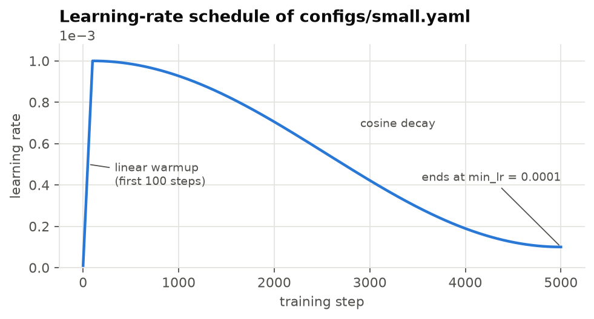

**Warmup (the first 100 steps).** The rate rises in a straight line from nearly zero to
its peak. At the very start the weights are random, the gradients are large and point
in erratic directions, and Adam's running averages (Section 5.5) have seen too few
gradients to be reliable. Large steps at that moment can throw the model somewhere bad.
A short period of small steps lets everything settle.

**Cosine decay (the rest).** The rate then slides down, following the shape of half a
cosine wave, from the peak to a floor of one tenth of the peak. Large steps early cover
ground quickly; small steps late make fine adjustments without overshooting. Nothing is
magical about the cosine; it is simply a smooth curve that starts flat, falls steadily,
and ends flat, and it works well in practice.

**`mini_gpt/utils.py` · lines 50–67**

```python
def get_lr(step: int, max_lr: float, min_lr: float, warmup_steps: int, max_steps: int) -> float:
    """Learning rate at a given step: linear warmup, then cosine decay.

    1. Warmup (step < warmup_steps): the rate climbs in a straight line from
       ~0 up to ``max_lr``. Early gradients are noisy because the weights are
       random, so we start with small steps.
    2. Cosine decay: the rate follows half a cosine wave from ``max_lr`` down
       to ``min_lr``. Big steps first (explore), small steps last (fine-tune).
    """
    if step < warmup_steps:
        return max_lr * (step + 1) / warmup_steps
    if step >= max_steps:
        return min_lr
    # progress goes from 0.0 (end of warmup) to 1.0 (end of training)
    progress = (step - warmup_steps) / max(1, max_steps - warmup_steps)
    # cos(0) = 1 and cos(pi) = -1, so this coefficient slides smoothly from 1 to 0
    coefficient = 0.5 * (1.0 + math.cos(math.pi * progress))
    return min_lr + coefficient * (max_lr - min_lr)
```

The cosine branch deserves a careful read:

- `progress` runs from 0 (end of warmup) to 1 (end of training).
- $\cos(\pi \cdot \text{progress})$ runs from $\cos(0) = 1$ down to $\cos(\pi) = -1$.
- So `coefficient` $= 0.5\,(1 + \cos(\dots))$ runs from 1 down to 0.
- The result is `min_lr` plus that fraction of the gap between `max_lr` and `min_lr`.

**Check three values by hand** for the main configuration (`max_lr` $= 10^{-3}$,
`min_lr` $= 10^{-4}$, 100 warmup steps, 5000 steps):

- Step 0: warmup, $10^{-3} \times 1/100 = 10^{-5}$.
- Step 2550: `progress` $= 2450/4900 = 0.5$, so the coefficient is
  $0.5\,(1 + \cos(\pi/2)) = 0.5$, and the rate is
  $10^{-4} + 0.5 \times 9 \times 10^{-4} = 5.5 \times 10^{-4}$.
- Step 5000: $10^{-4}$.

The training loop asks for the rate at every step and writes it into the optimizer:

**`train.py` · lines 157–161**

```python
        # Set the learning rate for this step (warmup, then cosine decay).
        lr = get_lr(step, cfg.train.learning_rate, cfg.train.min_lr,
                    cfg.train.warmup_steps, cfg.train.max_steps)
        for group in optimizer.param_groups:
            group["lr"] = lr
```

### 13.3 Mixed precision

Computers store decimal numbers in a fixed number of bits. PyTorch's default,
**float32**, uses 32 bits and gives about 7 significant digits. **float16** uses 16
bits: about 3 significant digits, and nothing larger than 65,504.

A number with half the bits takes half the space, and a modern GPU can do arithmetic on
such numbers considerably faster. And neural networks are surprisingly tolerant of low
precision: the
computation is so noisy anyway (random batches, dropout) that the third decimal place
rarely matters. **Mixed precision** takes advantage of this: run most of the forward
pass in float16, and keep float32 for the few places that need it.

In PyTorch this takes two additions to the training step. First, the forward pass runs
inside an `autocast` block:

**`train.py` · lines 195–198**

```python
        # 2) Forward pass: compute the loss. autocast runs most operations in
        #    float16 on the GPU, which makes each step noticeably faster.
        with torch.autocast(device_type=device.type, dtype=torch.float16, enabled=use_amp):
            _, loss = model(x, y)
```

Inside the block, PyTorch automatically chooses float16 for operations where that is
safe (matrix multiplications, mainly) and float32 for the rest. The parameters
themselves stay in float32 the whole time.

Second, the backward pass goes through the `GradScaler`:

**`train.py` · lines 200–202**

```python
        # 3) Backward pass: compute the gradient of the loss w.r.t. every parameter.
        optimizer.zero_grad(set_to_none=True)  # clear the gradients of the previous step
        scaler.scale(loss).backward()
```

The problem it solves: gradients can be very small numbers, and float16 cannot
represent numbers much below about $10^{-7}$. Such a gradient would be rounded to
exactly zero (this is called **underflow**), and that parameter would stop learning. The
scaler multiplies the loss by a large factor before `backward()`, which multiplies every
gradient by the same factor and lifts them into the range float16 can hold. Before the
optimizer uses the gradients, it divides the factor back out:

**`train.py` · lines 210–212**

```python
        # 5) Update: AdamW moves every parameter a little, against its gradient.
        scaler.step(optimizer)
        scaler.update()
```

**Is it worth it? A measurement.** Timing 40 training steps of the main configuration on
the RTX 5050, with and without mixed precision:

| | time per step | peak GPU memory |
|---|---|---|
| float32 only (`amp: false`) | 319 ms | 4.64 GB |
| mixed precision (`amp: true`) | 196 ms | 4.59 GB |

Each step is **1.6 times faster**: the 5,000 training steps take about 16 minutes
instead of about 27. The memory, however, is practically unchanged, and that is worth noticing because
"mixed precision halves the memory" is often repeated. It did not here. The parameters,
their gradients and the optimizer's running averages all stay in float32, and so does
the residual stream (see the box below); only temporary results inside the blocks
become smaller. How much memory mixed precision saves depends on the model, and the
only way to know is to measure, which is the theme of Chapter 15.

On a CPU none of this applies; the line `use_amp = cfg.train.amp and device.type ==
"cuda"` switches it all off, and `autocast` and the scaler then do nothing.

> **Detail you can ignore for now**
>
> You may wonder how the residual stream stays accurate in float16. It does not have
> to: the embeddings are float32, and adding a float16 tensor to a float32 tensor gives
> float32. So the stream itself, and the hand-written LayerNorm that reads it, remain in
> full precision; only the heavy matrix multiplications inside the blocks use float16.

### 13.4 Gradient clipping

Now and then a batch produces an enormous gradient: an unusual passage, or an unlucky
combination of weights. One enormous step can undo hours of progress.

From multivariable calculus: the gradient is a vector, and it has a **length** (its
norm), the square root of the sum of the squares of all its components. Here that vector
has 10.7 million components, one per parameter, but the definition is the same.
**Gradient clipping** says: if the length exceeds a threshold (1.0 for us), scale the
whole vector down so that its length equals the threshold. The *direction* is kept;
only the size is limited.

**A small example.** A gradient of $(3, 4)$ has length $\sqrt{9 + 16} = 5$. Clipped to a
maximum length of 1 it becomes $(3/5, 4/5) = (0.6, 0.8)$: the same direction, length 1.
A gradient of $(0.3, 0.4)$, with length 0.5, is left alone.

**`train.py` · lines 204–208**

```python
        # 4) Gradient clipping: if the gradient is very long, shrink it to
        #    length grad_clip. This prevents one bad batch from wrecking the weights.
        if cfg.train.grad_clip > 0:
            scaler.unscale_(optimizer)  # undo the AMP scaling before measuring the norm
            torch.nn.utils.clip_grad_norm_(model.parameters(), cfg.train.grad_clip)
```

`scaler.unscale_` first removes the mixed-precision scaling factor, so that the length
is measured on the true gradients.

### 13.5 Measuring progress

The loss printed for a single training batch is too noisy to judge progress by, and it
is measured with dropout on. So at regular intervals the loop pauses and measures
properly:

**`train.py` · lines 46–71**

```python
@torch.no_grad()
def estimate_loss(
    model: GPT,
    splits: dict[str, torch.Tensor],
    cfg: Config,
    device: torch.device,
    use_amp: bool,
) -> dict[str, float]:
    """Average the loss over several random batches of each split.

    A single batch gives a noisy number; averaging ``eval_batches`` of them
    gives a much steadier estimate. ``model.eval()`` switches off dropout so we
    measure the model as it will actually be used.
    """
    model.eval()
    results: dict[str, float] = {}
    for name, data in splits.items():
        losses = torch.zeros(cfg.train.eval_batches)
        for i in range(cfg.train.eval_batches):
            x, y = get_batch(data, cfg.model.block_size, cfg.train.batch_size, device)
            with torch.autocast(device_type=device.type, dtype=torch.float16, enabled=use_amp):
                _, loss = model(x, y)
            losses[i] = loss.item()
        results[name] = losses.mean().item()
    model.train()
    return results
```

Four things make this an honest measurement:

- `@torch.no_grad()` switches off gradient tracking: we are only looking, not learning.
- `model.eval()` switches off dropout, so the model is measured as it will be used. (And
  `model.train()` switches it back on afterwards. Forgetting either call is a classic
  bug.)
- It averages over many batches (100 in the main configuration) instead of trusting
  one.
- It measures **both** splits. The gap between them is how we detect overfitting
  (Section 5.2).

The loop calls it every `eval_interval` steps, prints and logs the result, and saves a
checkpoint whenever the validation loss is the best so far:

**`train.py` · lines 163–174**

```python
        # Every so often: measure train/val loss, log it, keep the best model.
        if step % cfg.train.eval_interval == 0 or step == cfg.train.max_steps:
            last_losses = estimate_loss(model, splits, cfg, device, use_amp)
            elapsed = time.time() - start
            print(f"step {step:5d}/{cfg.train.max_steps} | train loss {last_losses['train']:.4f} | "
                  f"val loss {last_losses['val']:.4f} | lr {lr:.2e} | {elapsed:6.0f}s")
            logger.log({"step": step, "train_loss": f"{last_losses['train']:.5f}",
                        "val_loss": f"{last_losses['val']:.5f}", "lr": f"{lr:.6e}",
                        "seconds": f"{elapsed:.1f}"})
            if last_losses["val"] < best_val:
                best_val = last_losses["val"]
                save_checkpoint(
```

At the same intervals the model also writes a short sample of text, so that you can
*see* the learning and not just watch a number fall.

### 13.6 Running it

```bash
python train.py --config configs/small.yaml --results_dir results
```

The run prints the device, the model's size and its parameter count, then a line per
evaluation. On the laptop this guide was written on (an RTX 5050 with 8 GB), the whole
run takes about 22 minutes. This is the log of that run, as saved in
`results/training_log.csv`:

```text
step,train_loss,val_loss,lr,seconds
0,4.24888,4.24829,1.000000e-05,11.5
250,1.96729,2.09209,9.979206e-04,85.0
500,1.53320,1.72156,9.852827e-04,168.1
750,1.36081,1.59588,9.614857e-04,230.9
1000,1.27258,1.52867,9.271396e-04,320.7
1250,1.20451,1.50202,8.831251e-04,383.8
1500,1.15077,1.47388,8.305704e-04,446.4
1750,1.10315,1.46538,7.708229e-04,510.1
2000,1.04971,1.47602,7.054143e-04,579.9
2250,1.01133,1.48279,6.360214e-04,643.0
2500,0.96261,1.48746,5.644232e-04,711.2
2750,0.91825,1.51394,4.924553e-04,773.9
3000,0.87242,1.53532,4.219626e-04,836.7
3250,0.82547,1.55585,3.547523e-04,899.5
3500,0.78403,1.58246,2.925475e-04,962.8
3750,0.75048,1.60715,2.369429e-04,1032.3
4000,0.71508,1.62109,1.893639e-04,1095.7
4250,0.68732,1.65391,1.510303e-04,1158.9
4500,0.66101,1.67069,1.229249e-04,1221.5
4750,0.64409,1.68239,1.057682e-04,1285.0
5000,0.62593,1.69035,1.000000e-04,1347.7
```

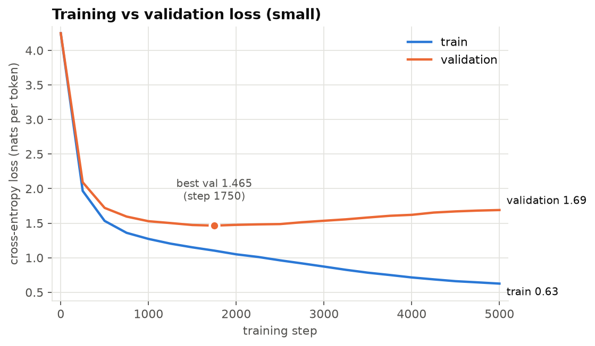

This run is a textbook example of everything in Section 5.2, so read the curve slowly.

- **Step 0: 4.25.** Just above $\ln(65) = 4.17$, as an untrained model should be.
- **Steps 0 to 1,000: fast progress.** The validation loss drops to 2.09 after 250 steps
  (already better than the bigram model's 2.48) and to 1.53 after 1,000. Both curves
  fall together: the model is learning patterns that hold for unseen text.
- **Step 1,750: the best validation loss, 1.465.** This is the checkpoint that is
  saved.
- **After step 1,750: overfitting.** The training loss keeps falling smoothly, all the
  way to 0.63, but the validation loss turns around and climbs to 1.69. The model has
  run out of general patterns it can extract from one megabyte of text and is now
  memorising that particular megabyte. The gap between the curves, 0.36 at step 1,750,
  grows to more than 1.0 by the end.

Two lessons. First, more training is not always better: the last 3,250 steps, almost
two thirds of the run, made the model *worse* at its real job. Second, this is why the
loop saves the best checkpoint and not the last one. `generate.py` loads the model from
step 1,750.

Why does it overfit so soon? One pass over the training data is only about 61 steps
(Exercise 5.3), so by step 1,750 the model has seen every part of the text about 29
times, and by step 5,000 about 82 times. A model with 10.7 million parameters and one
megabyte of text to learn from has more than enough capacity to start memorising. The
real cure is more data. Chapter 21 lists experiments you can try: more dropout, a
smaller model, stopping early.

The saved model is still a good one. A validation loss of 1.465 means that it gives the
correct next character a probability of $e^{-1.465} \approx 0.23$ on average, against
$1/65 \approx 0.015$ for guessing: it is as uncertain as someone choosing among about
4.3 equally likely characters.

### 13.7 If you have no GPU, or run out of memory

**No GPU.** Use the small configuration made for CPUs:

```bash
python train.py --config configs/tiny_cpu.yaml
```

It trains a model with 345 thousand parameters in about two minutes and reaches a
validation loss of about 1.84. The text is rougher, but everything in this guide can be
learned on it.

**"CUDA out of memory".** The main configuration needs about 4.6 GB of GPU memory. If
your card has less, lower `batch_size` first, then `block_size`. Measured on this
model: a batch size of 32 instead of 64 needs 2.4 GB, and a `block_size` of 128 instead
of 256 needs 2.1 GB.

```bash
python train.py --config configs/small.yaml --set train.batch_size=32
```

Chapter 20 has more on this error.

### Exercises

**13.1 (easy)** Using the formula in `get_lr`, compute the learning rate of the main
configuration at steps 50, 100 and 3775. (For the last one you need
$\cos(0.75\pi) \approx -0.7071$.)

**13.2 (easy)** A gradient has three components, $(2, -1, 2)$. What is its length? What
does it become after clipping with a maximum length of 1.0? And with a maximum of 5.0?

**13.3 (medium)** In `estimate_loss`, what would go wrong (a) without `model.eval()`,
(b) without the final `model.train()`, (c) without `@torch.no_grad()`? For each, say
whether the *numbers* would be wrong or only the *cost*.

**13.4 (medium)** Train the tiny configuration with a constant learning rate (set
`train.min_lr` equal to `train.learning_rate` and `train.warmup_steps=1`) and compare
the final validation loss with the scheduled run.

**13.5 (hard)** Add **early stopping** to `train.py`: stop the run when the validation
loss has not improved for `patience` evaluations in a row. Where does the counter go,
and what should happen to it when the loss improves?

### Check your understanding

1. Why does training begin with a warmup instead of the full learning rate?
2. What does `autocast` change, and what does it leave in float32?
3. What problem does the `GradScaler` solve?
4. Does gradient clipping change the direction of the update?
5. Why is the validation loss measured with `model.eval()`?

## Chapter 14: Generating text

> **Key ideas**
>
> - Generation is a loop: get the distribution for the next token, **sample** one token
>   from it, append it, repeat.
> - **Temperature** divides the logits before the softmax. Below 1 makes the model more
>   cautious and repetitive; above 1 makes it more adventurous and error-prone.
> - **Top-k** keeps only the `k` most likely tokens. **Top-p** keeps the smallest set of
>   tokens whose probabilities add up to `p`. Both remove the long tail of unlikely
>   tokens that causes most mistakes.
> - The model can only see `block_size` tokens, so the context is cropped to the most
>   recent ones.

### 14.1 The generation loop

A trained model maps a context to a probability distribution over the next token.
Chapter 1 described how to turn that into text, and the bigram model of Chapter 8 did
it in five lines. The real method has the same skeleton:

**`mini_gpt/model.py` · lines 365–386**

```python
    @torch.no_grad()
    def generate(
        self,
        idx: torch.Tensor,
        max_new_tokens: int,
        temperature: float = 1.0,
        top_k: int | None = None,
        top_p: float | None = None,
    ) -> torch.Tensor:
        """Extend the sequence ``idx`` (B, T) by ``max_new_tokens`` sampled tokens.

        This is *autoregressive* generation: predict one token, append it to
        the input, and repeat. Call ``model.eval()`` first to switch off dropout.
        """
        for _ in range(max_new_tokens):
            # The model can only see block_size tokens, so keep just the most recent ones.
            idx_cond = idx[:, -self.cfg.block_size :]
            logits, _ = self(idx_cond)  # (B, T, V)
            logits = logits[:, -1, :]  # (B, V): only the prediction after the last token
            next_id = sample_next_token(logits, temperature, top_k, top_p)  # (B, 1)
            idx = torch.cat([idx, next_id], dim=1)  # (B, T + 1)
        return idx
```

Line by line:

- **`idx[:, -self.cfg.block_size :]`** keeps the last `block_size` tokens. The model has
  positional embeddings and a mask only for that many positions, so anything older has
  to be dropped. When the text is still shorter than `block_size`, this keeps all of it.
- **`self(idx_cond)`** runs the forward pass. The result has shape `(B, T, V)`:
  predictions at *every* position.
- **`logits[:, -1, :]`** keeps the prediction at the last position only. That is the one
  for the token that does not exist yet. The others predict tokens we already have.
- **`sample_next_token`** chooses a token from those logits (the rest of this chapter).
- **`torch.cat`** appends it, and the loop goes round again with a sequence one token
  longer.

`@torch.no_grad()` is there because nothing is being learned. Before calling `generate`
you must also call `model.eval()`, to switch off dropout.

> **Detail you can ignore for now**
>
> This loop is wasteful: to produce token 201 it recomputes everything for the first
> 200 tokens, which it already computed when producing token 200. Real systems store
> the keys and values of earlier tokens and reuse them (a **KV cache**). It makes
> generation much faster and changes nothing in the output. It is listed as future work
> in the README, and it is a good project once you understand the rest.

### 14.2 Why sample at all?

The obvious strategy is to always take the most likely token. This is called **greedy
decoding**, and it works badly. Text produced this way is dull and tends to fall into
loops ("the king and the king and the king..."), because once the model reaches a
phrase it has seen often, the most likely continuation leads back to the same phrase.

Sampling means picking at random according to the probabilities: a token with
probability 0.3 is chosen 30% of the time. This gives variety, and running the model
twice gives two different texts. But pure sampling has the opposite weakness. The
vocabulary contains many tokens that are individually very unlikely but together add up
to a noticeable amount of probability. Every so often sampling picks one of them, and
one strange character can derail everything after it.

The three settings of this chapter are ways of steering between "boring" and
"derailed". The examples are in `examples/ch14_sampling.py`, on a toy distribution over
six tokens with logits `[3.0, 2.5, 2.0, 1.0, 0.0, -2.0]`.

### 14.3 Temperature

**Temperature** is a positive number $T$. The logits are divided by it before the
softmax:

$$p_i = \frac{e^{z_i / T}}{\sum_j e^{z_j / T}}$$

Recall from Section 2.7 that softmax depends on the *differences* between the logits.
Dividing by $T$ scales those differences:

- $T < 1$ makes the differences **larger**. The top token pulls further ahead. The
  distribution becomes sharper.
- $T > 1$ makes the differences **smaller**. The distribution becomes flatter, and
  unlikely tokens get more of a chance.
- $T = 1$ leaves the model's own distribution unchanged.

```text
1. Temperature: divide the logits by T before the softmax
T = 0.5               e:0.656  a:0.241  o:0.089  i:0.012  u:0.002  z:0.000
T = 1.0               e:0.462  a:0.280  o:0.170  i:0.062  u:0.023  z:0.003
T = 2.0               e:0.327  a:0.255  o:0.198  i:0.120  u:0.073  z:0.027
```

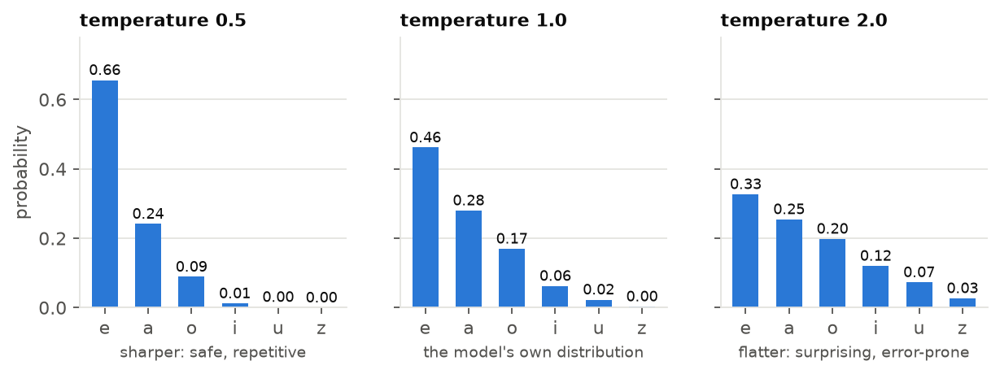

At $T = 0.5$ the favourite `e` goes from 46% to 66% and the rare `z` all but disappears.
At $T = 2$ the favourite falls to 33% and `z` rises from 0.3% to 2.7%.

The two extremes are worth knowing. As $T$ approaches 0, all the probability goes to
the single most likely token: greedy decoding. As $T$ grows very large, the distribution
approaches uniform: random characters. (The name comes from physics, where heating a
system makes its particles move more randomly.)

### 14.4 Top-k

**Top-k** sampling is a blunt instrument: keep the `k` tokens with the highest logits,
and give every other token a probability of zero.

**`mini_gpt/model.py` · lines 394–398**

```python
def top_k_filter(logits: torch.Tensor, k: int) -> torch.Tensor:
    """Keep only the ``k`` highest-scoring tokens; set every other logit to -inf."""
    k = min(k, logits.size(-1))
    kth_largest = torch.topk(logits, k, dim=-1).values[..., -1, None]  # (B, 1)
    return logits.masked_fill(logits < kth_largest, float("-inf"))
```

`torch.topk` returns the `k` largest values in order, so the last of them,
`values[..., -1, None]`, is the `k`-th largest logit. Everything below that threshold
is set to $-\infty$, which the softmax will turn into 0. This is the same trick as the
causal mask (Section 10.4).

```text
2. Top-k: keep only the k best tokens
top_k = 3             e:0.506  a:0.307  o:0.186  i:0.000  u:0.000  z:0.000
```

With `k = 3`, the tokens `i`, `u` and `z` are removed, and the probabilities of the
three survivors are rescaled so that they still sum to 1 (46% becomes 51%, and so on).

The weakness of top-k is that `k` is fixed. When the model is sure (one token at 99%),
keeping 50 candidates still lets in junk. When the model is genuinely unsure among 200
reasonable words, keeping 50 cuts off good options.

### 14.5 Top-p (nucleus sampling)

**Top-p** adapts to the situation. Sort the tokens from most to least likely and keep
adding them to a set until their probabilities reach `p`. The set is called the
**nucleus**. A confident distribution gives a small nucleus; a flat one gives a large
nucleus.

**`mini_gpt/model.py` · lines 401–416**

```python
def top_p_filter(logits: torch.Tensor, p: float) -> torch.Tensor:
    """Nucleus sampling: keep the smallest set of top tokens whose probabilities sum to >= p.

    Unlike top-k, the number of tokens kept adapts: few when the model is
    confident, many when it is unsure.
    """
    sorted_logits, sorted_indices = torch.sort(logits, descending=True, dim=-1)
    sorted_probs = F.softmax(sorted_logits, dim=-1)
    cumulative = sorted_probs.cumsum(dim=-1)
    # Probability mass that comes BEFORE each token in the sorted order. A token
    # is dropped once the tokens ahead of it already cover p (the best token has
    # nothing ahead of it, so it is always kept).
    mass_before = cumulative - sorted_probs
    sorted_logits = sorted_logits.masked_fill(mass_before >= p, float("-inf"))
    # Put the logits back into their original (unsorted) vocabulary order.
    return torch.full_like(logits, float("-inf")).scatter(-1, sorted_indices, sorted_logits)
```

The steps: sort the logits in descending order; convert to probabilities; compute the
running total (`cumsum`); for each token, compute how much probability lies *ahead* of
it in the sorted order (`mass_before`); drop a token if the tokens ahead of it already
cover `p`. The last line (`scatter`) puts the surviving logits back in their original
vocabulary positions.

**By hand**, for our toy distribution with `p = 0.9`:

| token | probability | probability before it | keep? |
|---|---|---|---|
| `e` | 0.462 | 0.000 | yes |
| `a` | 0.280 | 0.462 | yes |
| `o` | 0.170 | 0.742 | yes (0.742 is still below 0.9) |
| `i` | 0.062 | 0.912 | no (0.9 is already covered) |
| `u` | 0.023 | 0.974 | no |
| `z` | 0.003 | 0.997 | no |

```text
3. Top-p: keep the smallest set of tokens whose probabilities reach p
top_p = 0.9           e:0.506  a:0.307  o:0.186  i:0.000  u:0.000  z:0.000
top_p = 0.5           e:0.622  a:0.378  o:0.000  i:0.000  u:0.000  z:0.000
```

With `p = 0.9` three tokens survive; with `p = 0.5` only two do, because `e` and `a`
together already exceed one half.

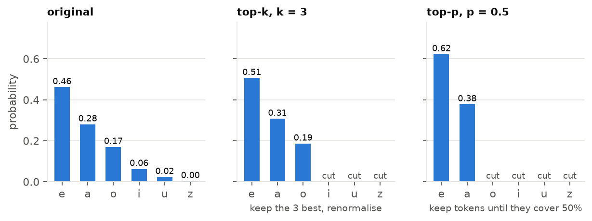

### 14.6 Putting the three together

**`mini_gpt/model.py` · lines 419–440**

```python
def sample_next_token(
    logits: torch.Tensor,
    temperature: float = 1.0,
    top_k: int | None = None,
    top_p: float | None = None,
) -> torch.Tensor:
    """Pick the next token ID from ``logits`` of shape (B, V). Returns shape (B, 1).

    * temperature < 1 sharpens the distribution (safer, more repetitive);
      temperature > 1 flattens it (more surprising, more mistakes);
      temperature == 0 always takes the single most likely token ("greedy").
    * top_k and top_p cut off the unlikely tail before sampling.
    """
    if temperature == 0.0:
        return logits.argmax(dim=-1, keepdim=True)
    logits = logits / temperature
    if top_k is not None and top_k > 0:
        logits = top_k_filter(logits, top_k)
    if top_p is not None and 0.0 < top_p < 1.0:
        logits = top_p_filter(logits, top_p)
    probs = F.softmax(logits, dim=-1)  # (B, V), each row sums to 1
    return torch.multinomial(probs, num_samples=1)  # draw one token per row
```

The order matters. Temperature is applied first, since it reshapes the distribution
that the filters then cut. Then top-k, then top-p. Finally a softmax turns the filtered
logits into probabilities and `torch.multinomial` draws one token. A temperature of
exactly 0 is treated as a special case, greedy decoding, because dividing by zero is
not possible.

To convince yourself that sampling follows the probabilities, draw a thousand tokens
and count:

```text
4. Draw 1000 samples and count them
T = 1.0               e: 441  a: 275  o: 192  i:  58  u:  29  z:   5
T = 0.5               e: 663  a: 210  o: 112  i:  12  u:   3  z:   0
T = 1.0, top_k = 3    e: 478  a: 322  o: 200  i:   0  u:   0  z:   0
T = 0 (greedy)        e:1000  a:   0  o:   0  i:   0  u:   0  z:   0
```

The counts track the probabilities of Section 14.3 (about 46% `e` at $T = 1$), up to the
randomness of sampling.

### 14.7 `generate.py`

The script wraps all this for the command line. Its central function rebuilds the model
from a checkpoint:

**`generate.py` · lines 23–36**

```python
def load_model(checkpoint_path: str | Path, device: torch.device) -> tuple[GPT, Tokenizer, Config]:
    """Rebuild the model and tokenizer stored in a checkpoint.

    The checkpoint contains the config (so we know the model's shape), the
    tokenizer (so we can turn text into IDs exactly as during training) and
    the learned weights.
    """
    checkpoint = load_checkpoint(checkpoint_path, device)
    cfg = Config.from_dict(checkpoint["config"])
    tokenizer = tokenizer_from_dict(checkpoint["tokenizer"])
    model = GPT(cfg.model).to(device)
    model.load_state_dict(checkpoint["model_state"])
    model.eval()  # switch off dropout
    return model, tokenizer, cfg
```

This is where the contents of the checkpoint (Section 5.7) pay off: the saved config
gives the model its shape, the saved tokenizer converts the prompt exactly as during
training, and `load_state_dict` copies the saved weights into the freshly built model.

```bash
python generate.py --prompt "ROMEO:" --max_new_tokens 300 --temperature 0.8 --top_k 50
python generate.py --prompt "To be" --temperature 1.0 --top_p 0.9 --seed 42
```

Here is the trained model continuing the prompt `ROMEO:` at three temperatures (same
seed, no top-k or top-p). These are real outputs.

**Temperature 0.2:** safe, grammatical, and stuck in a loop.

```text
ROMEO:
I have no more than the state of the sea
Than the stone of the state of the story
That which they have been a power to the sea,
To the state of the state of the sea-side,
That we have been so best a straight of the sea
```

**Temperature 0.8:** varied, mostly real words, the layout of a play.

```text
ROMEO:
I lay thee, but some law I have made thee thou art.

BENVOLIO:
Besides, marry, O Romeo.

MISTRESS OVERDONE:
Now, be come to him, or I ne'er will be none.

MENENIUS:
What is my name?
```

**Temperature 1.5:** inventive, and falling apart.

```text
ROMEO:
Well, dull triumph: I am not well.

BISHOP OF;
I.

MENENIUS:
Well; the, early, O,
Draw.

MISTRESS OVERDONE:
Now, be companious troth,
Before it not not: else, terms lits again,
Of nope. Onlyme, say it were never by
```

At 0.2 the model keeps choosing its favourite continuations and circles around "the
state of the sea": the looping described in Section 14.2. At 1.5 it takes unlikely
characters often enough to produce non-words (`companious`, `Onlyme`) and a broken
speaker label (`BISHOP OF;`). At 0.8 it stays between the two. Notice also that the
model invents a dialogue between characters from *different* plays (Benvolio, Mistress
Overdone, Menenius): it has learned what a play looks like, not what any play says.

Sensible starting values are a temperature between 0.7 and 1.0 with either `top_k`
around 50 or `top_p` around 0.9. There is no correct setting; it is a matter of taste
and of what the text is for.

### Exercises

**14.1 (easy)** Three tokens have logits $(2, 1, 0)$. Compute their probabilities at
temperature 1 and at temperature 0.5.

**14.2 (easy)** Four tokens have probabilities $(0.4, 0.3, 0.2, 0.1)$. What are the
probabilities after top-k with `k = 2`? After top-p with `p = 0.6`? After top-p with
`p = 0.75`?

**14.3 (medium)** In `generate`, what would happen without the line that crops the
context to `block_size`? Try it: generate 300 tokens from a model with `block_size`
256 after commenting the crop out.

**14.4 (medium)** Generate text from the trained model at temperatures 0.2, 0.8 and 1.5
(no top-k or top-p). Describe the differences. Then add `--top_k 20` to the 1.5 run.
What changes?

**14.5 (hard)** Write `generate_stream(model, tokenizer, prompt, n)` that prints each
character as soon as it is produced, like a chat interface, instead of printing
everything at the end. Why is this easy with the character tokenizer and trickier with
the BPE tokenizer?

### Check your understanding

1. Why does `generate` use only `logits[:, -1, :]`?
2. What does a temperature of 0.5 do to the distribution? And a temperature of 2?
3. How do top-k and top-p differ in how many tokens they keep?
4. Why is temperature applied before the top-k and top-p filters?
5. Why must `model.eval()` be called before generating?

# Part 3: Making it a real project

## Chapter 15: Experiments and ablations

> **Key ideas**
>
> - A claim such as "positional embeddings matter" is worth little until you have
>   **measured** it. An **ablation** removes or changes one component and measures the
>   difference.
> - A fair comparison changes **exactly one thing** and keeps everything else equal:
>   data, training steps, seed, model size.
> - Training is noisy. Repeat each run with different **seeds** to learn how big the
>   noise is, and do not believe differences smaller than that.
> - Losses per token cannot be compared between tokenizers. Convert to **bits per
>   character**.
> - Report what you found, including the results that did not match your expectations.

A working model is an engineering result. A measured comparison is a *scientific* one,
and it is what turns a project from "I followed a tutorial" into "I investigated
something". This chapter is about doing that properly on a small scale.

### 15.1 What makes a comparison fair

Suppose you train the model with 4 attention heads and get a validation loss of 1.47,
then change to 1 head, also lower the learning rate while you are at it, train for a
little longer, and get 1.49. What have you learned about heads? Nothing: three things
changed, and you cannot say which one moved the number.

The discipline of an experiment is simple to state:

1. **Choose a baseline**: one fixed configuration.
2. **Change exactly one thing** to make each variant.
3. **Keep everything else identical**: the data, the split, the number of steps, the
   batch size, the learning-rate schedule, the seed.
4. **Decide in advance what you will measure.** Here: the best validation loss reached
   during the run.

Removing or altering one component in this way is called an **ablation**.

### 15.2 The ablation script

The baseline is a model smaller than the main one, so that many runs fit in a
reasonable time (each takes about two minutes on the GPU):

**`configs/ablation.yaml` · lines 8–16**

```yaml
model:
  block_size: 128
  n_layer: 4
  n_head: 4
  n_embd: 256
  dropout: 0.1
  bias: false
  use_pos_emb: true
  tie_weights: true
```

The variants are declared as data in `scripts/run_ablations.py`: a name, a description,
and the list of config overrides that defines the change.

**`scripts/run_ablations.py` · lines 38–45**

```python
# name -> (description, config overrides). Each variant changes exactly one thing.
VARIANTS: dict[str, tuple[str, list[str]]] = {
    "baseline": ("Baseline: char tokenizer, 4 heads, positional embeddings, tied weights", []),
    "one_head": ("1 attention head instead of 4 (same total width)", ["model.n_head=1"]),
    "no_pos_emb": ("No positional embeddings", ["model.use_pos_emb=false"]),
    "untied": ("Output layer NOT tied to the token embedding", ["model.tie_weights=false"]),
    "bpe": ("BPE tokenizer (vocab 512) instead of characters", ["data.tokenizer=bpe"]),
}
```

Each variant is one line and one override. That is the "change exactly one thing" rule
made visible in the code. The function that runs one variant loads the baseline config,
applies the overrides, and calls the same `train()` function as `train.py`:

**`scripts/run_ablations.py` · lines 57–64**

```python
    overrides = overrides + [f"train.seed={seed}", f"train.out_dir={out_dir.as_posix()}"]
    if max_steps is not None:
        overrides.append(f"train.max_steps={max_steps}")
    cfg = load_config(BASE_CONFIG, overrides)
    cfg.name = f"{name}_seed{seed}"

    print(f"\n{'=' * 70}\nAblation variant: {name} (seed {seed})\n{'=' * 70}")
    summary = train(cfg)
```

Because it reuses `train()`, the ablation runs are trained by *exactly* the code that
trains the main model. A separate, slightly different training loop for experiments is a
common way to fool yourself.

### 15.3 Comparing different tokenizers: bits per character

One variant swaps the character tokenizer for BPE. Section 6.7 warned about the trap:
the two models report losses in different units. The character model's loss is "nats per
character"; the BPE model's is "nats per BPE token", and a BPE token covers about two
characters. (A **nat** is the unit you get from using the natural logarithm.)

To compare them, convert both to the same unit, **bits per character**:

$$\text{bits per character} = \frac{\text{loss per token}}{\text{characters per token} \times \ln 2}$$

Dividing by the characters per token spreads each token's loss over the characters it
covers. Dividing by $\ln 2 \approx 0.693$ converts nats to bits, the conventional unit
(one bit is the information in one fair coin flip).

**Worked for our two models.** Character baseline: loss 1.466 per token, 1 character per
token, so $1.466 / (1 \times 0.693) \approx 2.12$ bits per character. BPE: loss 3.017 per
token, 2.008 characters per token, so $3.017 / (2.008 \times 0.693) \approx 2.17$ bits
per character. A loss that looked twice as bad is, on a fair scale, 2.5% worse.

In the script:

**`scripts/run_ablations.py` · lines 66–73**

```python
    # A loss "per token" cannot be compared between tokenizers: a BPE token
    # covers several characters, so each prediction is harder but there are
    # fewer of them. Converting to bits per CHARACTER puts everything on one scale:
    #   bits/char = (nats per token) / (characters per token) / ln(2)
    _, val_ids, tokenizer, _ = load_dataset(cfg.data)
    chars_per_token = len(tokenizer.decode(val_ids.tolist())) / len(val_ids)
    summary["val_chars_per_token"] = chars_per_token
    summary["val_bits_per_char"] = summary["best_val_loss"] / chars_per_token / math.log(2)
```

For a sense of scale: storing each of 65 characters with no model at all would take
$\log_2 65 = 6.0$ bits per character. Our model needs about 2.1. A language model *is*,
quite literally, a text compressor.

### 15.4 Noise: why one run is not enough

Train the same model twice with different random seeds and you get two different
numbers. The initial weights differ, the batches differ, and so the result differs
slightly. This spread is the **noise** of the experiment, and it sets the limit on what
you can conclude: *a difference between two variants that is no larger than the
difference between two runs of the same variant is not evidence of anything.*

So every variant here was run with two seeds (1337 and 1338). Two is the bare minimum:
enough to see roughly how large the noise is, not enough for precise statistics. The
table shows the mean, and in parentheses the lowest and highest value.

### 15.5 The results

| Variant | What changed | Params | Val loss / token | Bits / char | vs baseline |
|---|---|---:|---:|---:|---:|
| `baseline` | Baseline: char tokenizer, 4 heads, positional embeddings, tied weights | 3.20M | 1.466 | 2.116 (2.107-2.124) | - |
| `one_head` | 1 attention head instead of 4 (same total width) | 3.20M | 1.486 | 2.143 (2.137-2.150) | +1.3% |
| `no_pos_emb` | No positional embeddings | 3.16M | 1.613 | 2.327 (2.317-2.338) | +10.0% |
| `untied` | Output layer NOT tied to the token embedding | 3.21M | 1.457 | 2.102 (2.088-2.116) | -0.6% |
| `bpe` | BPE tokenizer (vocab 512) instead of characters | 3.31M | 3.017 | 2.167 (2.166-2.169) | +2.5% |

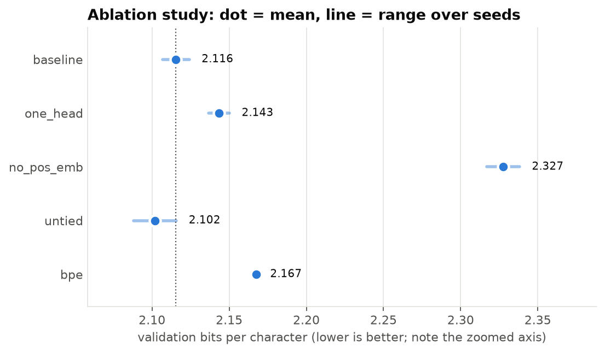

First, the size of the noise. The two baseline runs gave 2.107 and 2.124: a spread of
about 0.02 bits per character between identical configurations. Keep that number in
mind for everything that follows.

### 15.6 Reading each result

**No positional embeddings: 10% worse. Clear.** The difference, 0.21 bits per
character, is ten times the noise, and both seeds agree. This confirms the argument of
Section 7.4: attention needs to be told about order.

But notice what did *not* happen: the model did not collapse. It still reaches 2.33
bits per character, far better than the bigram model. How can it work at all without
position information? The likely explanation, known from the research literature, is
that the causal mask leaks some of it in. The first token can attend only to itself, the
second to two tokens, and so on, so a token can in principle infer roughly how far along
it is from what it is allowed to see. We did not test this mechanism ourselves, so treat
it as a hypothesis. That is what honest reporting looks like: separate what you measured
from what you believe.

**One head instead of four: 1.3% worse. Small but real.** The ranges do not overlap
(2.137 to 2.150 against 2.107 to 2.124), and both seeds point the same way, so the
effect is probably real, but it is only slightly larger than the noise. With the same
total width, one wide head is nearly as good as four narrow ones for this small model
and simple data. The benefit of multiple heads (Section 11.1) is expected to grow with
the size of the model and the complexity of the text; our experiment can neither
confirm nor deny that.

**Untied weights: no detectable difference.** The untied model's mean is 0.6% *better*,
but its two runs (2.088 and 2.116) spread across the baseline's (2.107 and 2.124). The
ranges overlap, so this experiment cannot distinguish the two. As Section 12.4
anticipated, weight tying has little to offer when the vocabulary is 65 characters: it
saves 16,640 parameters out of 3.2 million. It would be wrong to report "untying
improves the model by 0.6%", and equally wrong to report "weight tying helps", on this
evidence. The supported statement is: *no measurable effect at this scale*.

**BPE instead of characters: 2.5% worse.** Very consistent across seeds (2.166 and
2.169), so the difference is real for this setup. The reason is visible in the raw
numbers: the BPE model's training loss ends far below its validation loss (1.67 against
3.02 nats per token), a much wider gap than the character model's (1.17 against 1.47).
It overfits harder. That makes sense: the same megabyte of text yields only half as many
training tokens, each of 512 token types is seen far less often than each of 65
characters, and the model has an embedding table eight times larger to fill. BPE's
advantages (twice the context in characters, no need to learn spelling) need more data
before they pay off. The conclusion is not "BPE is worse" but "on one megabyte of text,
with this model, characters are slightly better".

### 15.7 What this study does not show

Every experiment has limits, and stating them is part of the result.

- **Two seeds** per variant. Enough to spot noise, not enough for confident statistics.
- **One dataset, one model size, one training length.** The ranking could change with
  more data or a larger model; for BPE and for multiple heads, it probably would.
- **The validation set was used to choose the checkpoint.** We report the *best*
  validation loss of each run, which is very slightly optimistic. Careful research keeps
  a third split, a **test set**, that is touched only once, at the very end.
- **Each variant used the baseline's hyperparameters.** A variant might do better with
  its own tuned learning rate or dropout.

### 15.8 Designing your own experiment

A checklist to follow every time:

1. Write down the **question** in one sentence. ("Does dropout help this model?")
2. Write down your **prediction**, and why. Being wrong is where the learning is.
3. Define the **baseline** and the **single change**.
4. Fix the **budget** (steps, batch size) and the **metric** in advance.
5. Run at least **two seeds** of each.
6. Compare the difference with the spread between seeds.
7. Write the conclusion **no stronger than the evidence**, and list what the experiment
   does not show.

To add a variant to this project's study, add one line to `VARIANTS` and run
`python scripts/run_ablations.py`. Finished runs are cached, so only the new one is
trained.

### Exercises

**15.1 (easy)** A BPE model has a validation loss of 2.80 nats per token and its tokens
average 1.9 characters. A character model has a validation loss of 1.50. Which is
better?

**15.2 (easy)** Variant A scored 2.10 and 2.14 on two seeds; variant B scored 2.12 and
2.13. A friend concludes that B is better "because its average is lower and it is more
stable". What do you say?

**15.3 (medium)** Run two new ablations of your own choice against the baseline, for
example `model.dropout=0.0` and `model.n_layer=2`. Predict each result first. Add them
to `VARIANTS`, run the script, and read the results as in Section 15.6.

**15.4 (medium)** Why does the ablation use a smaller model and fewer steps than the
main configuration? What do you gain, and what do you risk?

**15.5 (hard)** Add a proper test set: split the data 80/10/10, select the checkpoint on
the validation split as now, and report the loss of that checkpoint on the test split.
Which functions need to change?

### Check your understanding

1. What is an ablation?
2. Why must only one thing change between the baseline and a variant?
3. Why run each variant with more than one seed?
4. Why can a loss per token not be compared between a character model and a BPE model?
5. The untied model scored slightly better than the tied one. Why is it wrong to
   conclude that untying helps?

## Chapter 16: Looking inside: attention visualisation

> **Key ideas**
>
> - Attention weights are one of the few parts of a neural network that can be read
>   directly: for every token, they say where it looked.
> - A **heatmap** shows them as a grid. Row $i$ is the token doing the looking; column
>   $j$ is the token being looked at; the colour is the weight.
> - In our trained model the first layer contains heads with a single clear job: two of
>   them always look at the **previous character**, one at the character **two back**.
> - Deeper layers look further away and spread their attention more widely.
> - One picture of one sentence is an anecdote. Measure over many sequences before
>   claiming anything, and remember that *where a head looks* is not the same as *why
>   the model made a prediction*.

### 16.1 Why look at all?

So far we have judged the model from the outside: by its loss and by the text it writes.
Most of what happens inside is hard to interpret. A vector of 384 numbers in the
residual stream does not mean anything obvious.

The attention weights are an exception. Each row is a probability distribution over
tokens with a plain meaning: "this token took this fraction of its new information from
that token". Since Chapter 9 the attention classes have been returning their weights as
well as their output. Now we use them.

### 16.2 Getting the weights out

The model has a method for this. It is the forward pass of Chapter 12 with one
difference: it keeps the weights that `forward` throws away.

**`mini_gpt/model.py` · lines 351–363**

```python
    @torch.no_grad()
    def attention_maps(self, idx: torch.Tensor) -> list[torch.Tensor]:
        """Run the model and return every block's attention weights (for visualisation).

        Returns:
            A list with one tensor per block, each of shape (B, n_head, T, T).
        """
        x = self.embed(idx)
        maps = []
        for block in self.blocks:
            x, weights = block(x)
            maps.append(weights)
        return maps
```

The result is a list with one tensor per layer, each of shape `(B, n_head, T, T)`. For
the main model and one sentence of 48 characters that is 6 tensors of shape
`(1, 6, 48, 48)`: 36 heads, each with a $48 \times 48$ table.

The script `scripts/visualize_attention.py` loads the checkpoint, encodes a sentence,
and asks for these maps:

**`scripts/visualize_attention.py` · lines 107–113**

```python
    text = args.text.replace("\\n", "\n")
    ids = tokenizer.encode(text)[: cfg.model.block_size]
    labels = [printable(tokenizer.token_to_str(i)) for i in ids]
    idx = torch.tensor([ids], dtype=torch.long, device=device)

    # One tensor per layer, each (1, n_head, T, T).
    maps = [m.float().cpu() for m in model.attention_maps(idx)]
```

Each head's table is then drawn with matplotlib's `imshow`, which colours a grid of
numbers:

**`scripts/visualize_attention.py` · lines 38–58**

```python
def plot_layer(weights: torch.Tensor, labels: list[str], layer: int, path: Path) -> None:
    """One small heatmap per head. ``weights`` has shape (n_head, T, T)."""
    n_head = weights.shape[0]
    cols = min(n_head, 3)
    rows = (n_head + cols - 1) // cols
    fig, axes = plt.subplots(rows, cols, figsize=(4.2 * cols, 4.2 * rows), squeeze=False)
    for h, ax in enumerate(axes.flat):
        if h >= n_head:
            ax.axis("off")
            continue
        ax.imshow(weights[h], cmap=SEQUENTIAL, vmin=0.0, vmax=1.0)
        ax.set_title(f"layer {layer}, head {h}", fontsize=10)
        ax.set_xticks(range(len(labels)), labels, fontsize=5)
        ax.set_yticks(range(len(labels)), labels, fontsize=5)
        ax.tick_params(length=0)
        ax.grid(False)
    fig.supxlabel("token being attended TO (key)", color=MUTED, fontsize=10)
    fig.supylabel("token doing the attending (query)", color=MUTED, fontsize=10)
    fig.tight_layout()
    fig.savefig(path)
    plt.close(fig)
```

Every heatmap uses the same colour scale, from 0 (white) to 1 (dark blue), so that
different heads can be compared at a glance. Run it with:

```bash
python scripts/visualize_attention.py
python scripts/visualize_attention.py --text "ROMEO:\nO, speak again!" --layers 0 2 5
```

### 16.3 How to read a heatmap

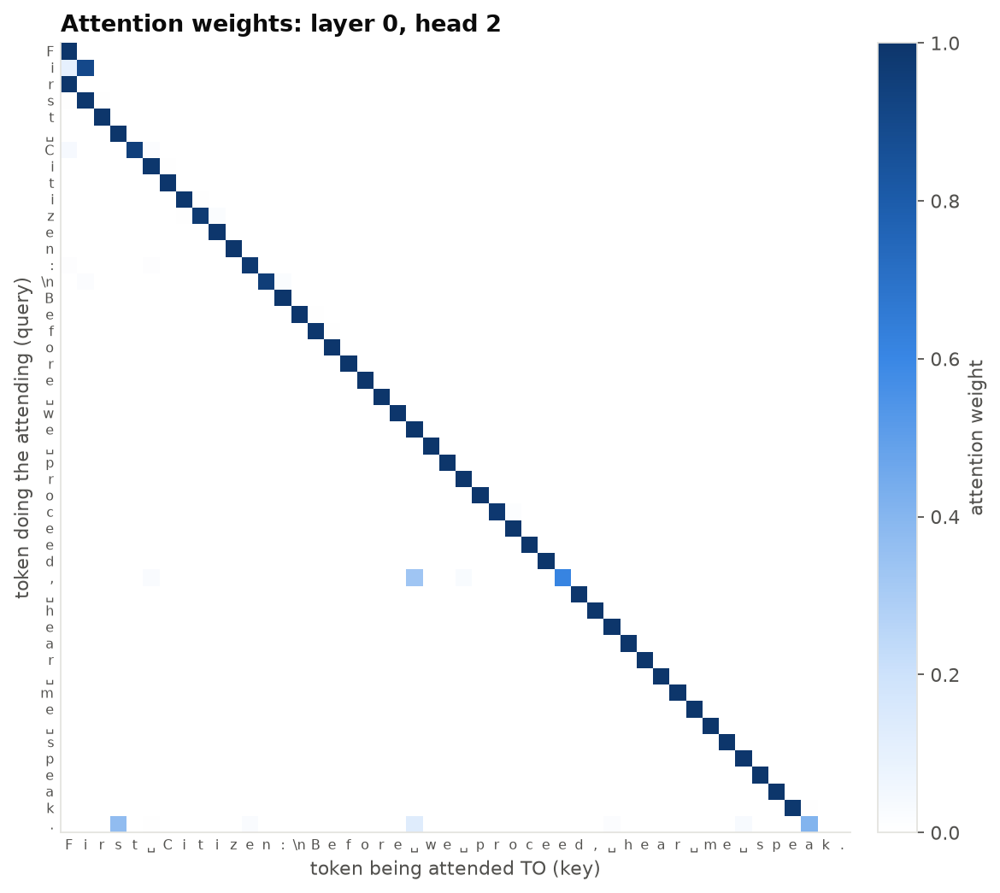

Take any row, say the row labelled `s` in `First`. Reading along it tells you which
earlier characters that `s` drew from. Some patterns to recognise:

- **Nothing above the diagonal.** The upper-right triangle is empty in every heatmap you
  will ever draw from this model. That is the causal mask of Chapter 10, visible to the
  eye.
- **The first row is always a single dark cell.** The first token can only attend to
  itself, so its weight there is 1.
- **Dark cells on the diagonal** mean a token attending to itself.
- **A dark line just below the diagonal** means every token attends to the token
  immediately before it. A line two cells below means "two tokens back".
- **A vertical stripe** means many different tokens all attend to the same earlier
  token: that token holds something widely useful.
- **A row that is pale all over** means the weight is spread thinly across many tokens:
  the head is averaging, not selecting.

The head in the figure is easy to read: there is a dark line exactly **two cells below
the diagonal**. Whatever the characters are, each token takes nearly all of its
information from the token two positions earlier.

### 16.4 The first layer: heads with one job

Here are all six heads of the first layer on the same sentence.

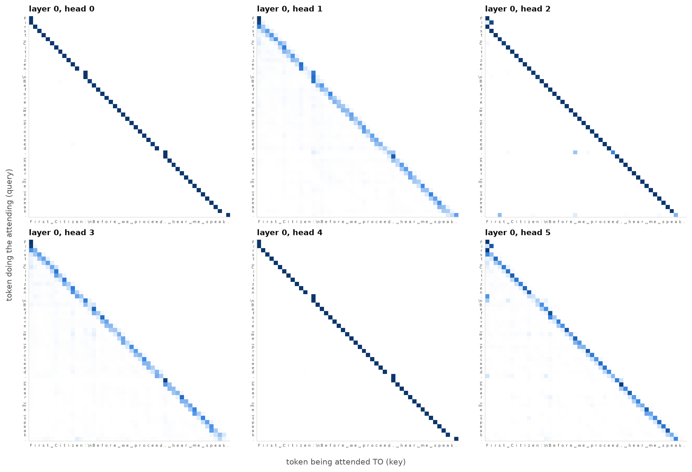

Three of them are strikingly sharp, and they are sharp in a way that does not depend on
*which* characters are present:

- **Heads 0 and 4** show a line one cell below the diagonal: each token looks at the
  **previous character**.
- **Head 2** shows a line two cells below the diagonal: each token looks at the
  character **two back**.
- **Heads 1, 3 and 5** are softer: a blur covering the previous two or three characters.

That is what one sentence shows. Is it true in general? A heatmap cannot answer that; a
measurement can. The script `scripts/attention_stats.py` runs the model on 32 validation
sequences of 128 characters and averages. For the first layer:

| Layer | Head | self | prev | 2 back | 3 back | Distance | Eff. tokens |
|---:|---:|---:|---:|---:|---:|---:|---:|
| 0 | 0 | 0.05 | 0.94 | 0.00 | 0.00 | 1.1 | 1.1 |
| 0 | 1 | 0.05 | 0.43 | 0.30 | 0.02 | 7.4 | 6.8 |
| 0 | 2 | 0.00 | 0.00 | 0.95 | 0.00 | 4.7 | 1.1 |
| 0 | 3 | 0.04 | 0.49 | 0.26 | 0.01 | 7.1 | 6.0 |
| 0 | 4 | 0.05 | 0.95 | 0.00 | 0.00 | 1.0 | 1.0 |
| 0 | 5 | 0.00 | 0.03 | 0.61 | 0.22 | 6.3 | 4.0 |

The pattern holds. Averaged over about 3,500 token positions, head 0 puts 94% of its
weight on the previous character and head 4 puts 95% there. Head 2 puts 95% on the
character two back. The last column says the same thing differently: these three heads
spread their weight over an "effective" 1.0 to 1.1 tokens, which means they look at
exactly one. (The effective number is $e^{\text{entropy}}$, the same idea as the
perplexity of Exercise 8.2: 1 for a head that attends to a single token, $n$ for a head
that spreads its weight evenly over $n$.)

Why would the model build these? Think about what the first layer has to work with:
each position holds only its own character and its position. Before anything clever can
happen, a position needs to know its immediate neighbours. With "the previous
character" and "the character two back" copied into each position, the next layers can
work with the last three characters at once: a learned version of the trigram model of
Exercise 8.5. This is an interpretation, though a natural one: what was *measured* is
where these heads look, not what the rest of the network does with it.

Two more observations, both checkable in the figure:

- **Heads 0 and 4 do the same job.** The model spent two of its six first-layer heads
  on one function. Such redundancy is common in trained transformers, and it fits the
  ablation of Chapter 15, where reducing four heads to one cost only 1.3%.
- **The exceptions are at punctuation.** In the sample sentence, at the `:`, the `,` and
  the final `.`, heads 0 and 4 attend to the token itself instead of the previous one.
  The rule the heads learned is not purely "one step back".

For contrast, the same statistics on an **untrained** model give an effective number of
about 63 for every head, with under 2% of the weight on the previous character: with
weights near zero, every score is near zero, and the softmax spreads the attention
evenly over everything visible. All of the structure above was learned.

### 16.5 Deeper layers: looking further

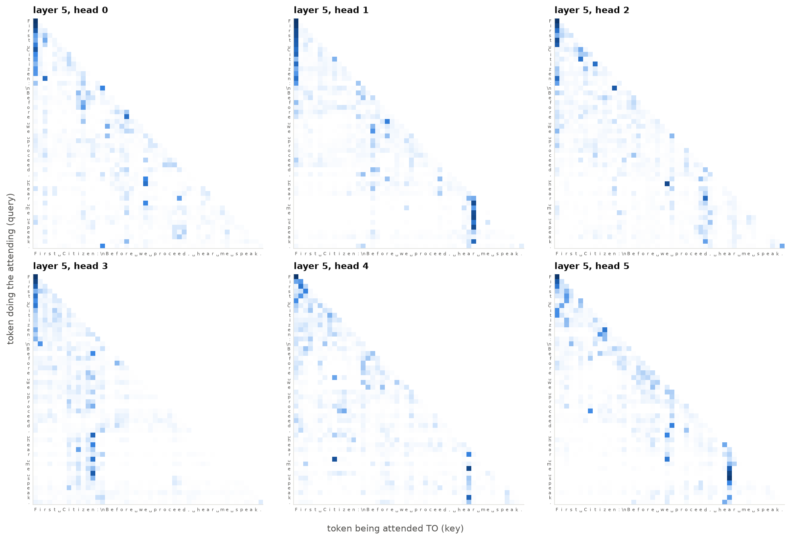

The last layer looks completely different. No clean lines; instead scattered dark
cells, pale washes, and vertical stripes where many tokens attend to the same earlier
character. These patterns depend on the *content* of the sentence: change the sentence
and they move, whereas the lines of layer 0 stay where they are.

The averages per layer show the trend across the whole model:

| Layer | Mean distance | Mean eff. tokens |
|---:|---:|---:|
| 0 | 4.6 | 3.3 |
| 1 | 31.1 | 46.5 |
| 2 | 7.5 | 8.1 |
| 3 | 8.6 | 7.9 |
| 4 | 16.9 | 12.3 |
| 5 | 26.4 | 16.6 |

- **Layer 0** is local: on average it looks 4.6 characters back and concentrates on
  about 3 tokens.
- **Layer 1** is the surprise: it is by far the most diffuse, spreading each token's
  attention over about 46 tokens at an average distance of 31. Having gathered the
  immediate neighbours in layer 0, the model appears to take a broad average over the
  recent context next.
- **Layers 2 and 3** are local again (about 8 characters).
- **Layers 4 and 5** reach progressively further back (17, then 26 characters) while
  staying fairly selective (12 to 17 tokens).

So the simple story "early layers are local, later layers are global" is roughly right
for this model but not exactly: layer 1 breaks the pattern. That is a typical outcome of
actually measuring. The model was not designed to organise itself this way; it found an
arrangement that lowers the loss, and our job is to describe what it found, not what we
expected.

### 16.6 What attention maps do not tell you

It is tempting to read a heatmap as an explanation: "the model predicted `z` *because*
it looked at the `C`". Be careful, for three reasons.

1. **After the first layer, positions no longer hold single characters.** By layer 5,
   the vector at the position of `C` contains information gathered from many other
   positions. "Token 20 attends to token 6" means it reads the *vector* at position 6,
   which may be mostly about something else.
2. **A weight is only half of the story.** What flows is the weight times the *value*
   vector. A large weight on a value that is nearly zero moves nothing; a small weight
   on a large value can matter a lot. And the residual connection carries information
   forward without any attention at all.
3. **One sentence proves little.** Patterns should be checked across many inputs, as we
   did in Section 16.4, before being stated as facts about the model.

A fair summary of what we established: we know *where* each head looks, reliably and
with numbers. We have plausible ideas about *why*. Establishing the why properly, by
intervening on the model and measuring what changes, is an active research field called
**mechanistic interpretability**, and a small model that you fully understand is an
excellent place to start in it.

### Exercises

**16.1 (easy)** In any heatmap of this model, what must the first row look like, and
why? What about the cell in the top-right corner?

**16.2 (easy)** A row of a heatmap for a token at position 10 shows weight 0.5 on
position 9 and 0.5 on position 5, and nothing elsewhere. What is the mean attention
distance for this row, and what is its effective number of tokens?

**16.3 (medium)** Run `scripts/visualize_attention.py` on a sentence of your own with a
repeated word, for example `"the king and the queen and the king"`. Do the heads of
layer 0 change their pattern? Do those of layer 5?

**16.4 (medium)** Before running anything: what should the attention statistics of an
*untrained* model look like, and why? Then check, by building a fresh
`GPT(cfg.model)` and passing its `attention_maps` to `head_statistics` from
`scripts/attention_stats.py`.

**16.5 (hard)** Heads 0 and 4 of layer 0 do the same job. Test whether the model needs
both: write a function that runs the model with one chosen head's output set to zero,
and measure the validation loss with head 0 removed, with head 4 removed, and with both
removed. What do you expect? (This is your first step into mechanistic
interpretability, and, as in Chapter 15, predict first.)

### Check your understanding

1. In an attention heatmap, what do the rows, the columns and the colours mean?
2. Why is the upper-right triangle always empty?
3. What does a dark line one cell below the diagonal tell you about a head?
4. Why is a single heatmap not enough to make a claim about a head?
5. Give one reason why "token A attends to token B" does not explain a prediction.

## Chapter 17: Testing machine-learning code with pytest

> **Key ideas**
>
> - Bugs in machine-learning code rarely crash. The program runs, the loss goes down,
>   and the result is merely *worse than it should be*. You will not notice by looking.
> - Tests catch these bugs by checking facts that **must** be true whatever the weights
>   are: shapes, mathematical properties, round trips, and known values.
> - The single most valuable test is the **overfit test**: a correct model and training
>   loop can memorise one small batch.
> - A test is only worth having if it can fail. Check that it does.

### 17.1 Why this code needs tests more than most

In ordinary programming a bug usually announces itself: a crash, a wrong number on the
screen. Machine learning is different, because a neural network is a machine for
finding *some* way to lower the loss with whatever it is given. Give it a broken
attention layer and it will route around the damage and still learn something. The loss
curve will look plausible. The samples will look like text. And the model will be
quietly worse than it should be, with nothing to tell you so.

Section 10.2 showed the mirror image of this: a bug (no causal mask) that made the loss
look *wonderful* while making the model useless.

So we cannot rely on "it runs and the loss goes down". We need to check, piece by
piece, facts that have to hold. That is what the 33 tests in `tests/` do.

### 17.2 pytest in two minutes

**pytest** is the standard Python testing tool. The rules are simple:

- Tests live in files named `test_*.py`.
- Each test is a function whose name starts with `test_`.
- Inside it, `assert` states something that must be true. If the expression is false,
  the test fails and pytest shows you the values involved.

Run all of them from the repository root:

```bash
python -m pytest                              # everything
python -m pytest -v                           # one line per test
python -m pytest tests/test_attention.py      # one file
python -m pytest -k causal                    # only tests with "causal" in their name
```

```text
.................................                                        [100%]
33 passed in 7.53s
```

Each dot is a passing test. The small file `pytest.ini` tells pytest where the tests are
and puts the repository root on Python's import path, so that `from mini_gpt.model
import GPT` works inside the tests.

All tests use tiny models (two layers, width 32) and run on the CPU, so the whole suite
takes well under a minute. Tests that are slow do not get run.

### 17.3 Shape tests

The cheapest kind: does a layer return a tensor of the shape it promises?

**`tests/test_attention.py` · lines 13–24**

```python
def test_single_head_output_shapes() -> None:
    head = CausalSelfAttentionHead(n_embd=C, head_size=16, block_size=T)
    out, weights = head(torch.randn(B, T, C))
    assert out.shape == (B, T, 16)
    assert weights.shape == (B, T, T)


def test_multi_head_output_shapes() -> None:
    attn = MultiHeadAttention(n_embd=C, n_head=4, block_size=T)
    out, weights = attn(torch.randn(B, T, C))
    assert out.shape == (B, T, C)  # same shape in and out, so blocks can be stacked
    assert weights.shape == (B, 4, T, T)
```

These look almost too simple to be worth writing. But most errors made while *writing*
a model are shape errors, and a shape test fails immediately and tells you exactly
where, instead of leaving you with a broadcasting bug that silently computes the wrong
thing (Section 2.5).

### 17.4 Property tests

A **property** is something that must be true for *any* input and *any* weights. We
cannot say what the attention weights of a random model should be. But we can say that
every row must be a probability distribution, and that nothing may be placed on the
future:

**`tests/test_attention.py` · lines 34–48**

```python
def test_attention_weights_are_a_probability_distribution() -> None:
    head = CausalSelfAttentionHead(n_embd=C, head_size=16, block_size=T)
    _, weights = head(torch.randn(B, T, C))
    assert (weights >= 0).all()
    assert torch.allclose(weights.sum(dim=-1), torch.ones(B, T), atol=1e-6)  # each row sums to 1


def test_attention_weights_on_future_tokens_are_zero() -> None:
    """weights[i, j] must be exactly 0 whenever j > i (the upper triangle)."""
    head = CausalSelfAttentionHead(n_embd=C, head_size=16, block_size=T)
    _, weights = head(torch.randn(B, T, C))
    future = torch.triu(torch.ones(T, T, dtype=torch.bool), diagonal=1)
    assert (weights[:, future] == 0).all()
    # ... and the very first token can only attend to itself.
    assert torch.allclose(weights[:, 0, 0], torch.ones(B))
```

`torch.triu(..., diagonal=1)` is the *upper* triangle above the diagonal: exactly the
positions where token $j$ lies in the future of token $i$. The weights there must be
exactly 0.

The most important property test in the repository is the behavioural check of
causality, which you read in Section 10.6: change a token, and no earlier output may
change.

Another useful property test compares our code with a trusted reference:

**`tests/test_attention.py` · lines 88–96**

```python
def test_layernorm_matches_pytorch() -> None:
    """Our hand-written LayerNorm must agree with torch.nn.LayerNorm."""
    x = torch.randn(B, T, C) * 3 + 1
    ours = LayerNorm(C, bias=True)
    reference = torch.nn.LayerNorm(C)
    assert torch.allclose(ours(x), reference(x), atol=1e-5)
    # after normalisation each token vector has mean 0 and variance 1
    assert torch.allclose(ours(x).mean(dim=-1), torch.zeros(B, T), atol=1e-5)
    assert torch.allclose(ours(x).var(dim=-1, unbiased=False), torch.ones(B, T), atol=1e-3)
```

We wrote LayerNorm by hand for understanding. PyTorch's version has been used by
millions of people. If the two agree on random inputs, ours is right.

> **Note**
>
> Notice `torch.allclose(a, b, atol=1e-5)` instead of `a == b`. Decimal arithmetic on a
> computer is not exact, and two correct ways of computing the same thing usually
> differ in the last digit. Compare floating-point numbers with a tolerance, except in
> the rare cases (like the causality test) where the results must be bit-for-bit
> identical.

### 17.5 Round-trip tests

For a tokenizer the essential fact is that decoding undoes encoding. This is called a
**round trip**:

**`tests/test_tokenizer.py` · lines 60–64**

```python
def test_bpe_round_trip_on_unseen_and_non_english_text() -> None:
    """Byte-level BPE can encode ANY string, even characters it never saw in training."""
    tok = BPETokenizer.train(TEXT, vocab_size=300)
    for text in ["", "zebra quiz!", "naïve café", "తెలుగు భాష", "tabs\tand\n\nnewlines  "]:
        assert tok.decode(tok.encode(text)) == text
```

The inputs are chosen to be awkward on purpose: an empty string, words that never
occurred in the training text, accented letters, Telugu, tabs and double newlines.
Tests should go looking for trouble. Easy inputs rarely reveal a bug; the odd ones at
the edges do.

### 17.6 Known-value tests

Sometimes theory tells us what the answer must be.

**`tests/test_model.py` · lines 30–37**

```python
def test_initial_loss_is_close_to_uniform_guessing() -> None:
    """An untrained model should be about as good as guessing uniformly: loss = ln(V)."""
    torch.manual_seed(0)
    model = GPT(CFG)
    idx = torch.randint(0, 65, (32, 16))
    targets = torch.randint(0, 65, (32, 16))
    _, loss = model(idx, targets)
    assert abs(loss.item() - math.log(65)) < 0.3
```

An untrained model should have a loss near $\ln(V)$ (Sections 1.4 and 12.5). If this
test fails, the initialisation is wrong or the loss is being computed wrongly.

For small pure functions we can simply work the answer out by hand and write it down,
as with top-p sampling (compare with the table in Section 14.5):

**`tests/test_model.py` · lines 86–95**

```python
def test_top_p_filter_keeps_smallest_nucleus() -> None:
    probs = torch.tensor([[0.5, 0.3, 0.15, 0.05]])
    logits = probs.log()
    assert torch.isfinite(top_p_filter(logits, p=0.7)).sum() == 2  # 0.5 + 0.3 >= 0.7
    assert torch.isfinite(top_p_filter(logits, p=0.4)).sum() == 1  # 0.5 alone covers 0.4
    assert torch.isfinite(top_p_filter(logits, p=0.9)).sum() == 3
    # works when the input is not already sorted
    shuffled = torch.tensor([[0.05, 0.5, 0.15, 0.3]]).log()
    kept = torch.isfinite(top_p_filter(shuffled, p=0.7))
    assert kept.tolist() == [[False, True, False, True]]
```

### 17.7 The overfit test

This is the test to write first for any model you ever build.

The idea: take **one small batch** and train on it, the same batch, over and over. A
correct model with a correct training loop must be able to drive the loss to nearly
zero, because memorising 4 short sequences is trivially within the capacity of even a
tiny transformer. If it cannot, something is broken.

**`tests/test_overfit.py` · lines 21–48**

```python
def test_model_can_memorise_one_batch() -> None:
    set_seed(0)
    tokenizer = CharTokenizer.train(TEXT)
    data = torch.tensor(tokenizer.encode(TEXT), dtype=torch.long)

    cfg = ModelConfig(
        vocab_size=tokenizer.vocab_size, block_size=32, n_layer=2, n_head=2, n_embd=64, dropout=0.0
    )
    model = GPT(cfg)
    optimizer = configure_optimizer(model, learning_rate=3e-3, weight_decay=0.0, betas=(0.9, 0.99))

    x, y = get_batch(data, cfg.block_size, batch_size=4)  # ONE fixed batch, reused every step
    _, first_loss = model(x, y)

    for _ in range(300):
        _, loss = model(x, y)
        optimizer.zero_grad(set_to_none=True)
        loss.backward()
        optimizer.step()

    assert first_loss.item() > 2.5  # starts near ln(vocab_size)
    assert loss.item() < 0.1, f"model failed to memorise one batch (loss {loss.item():.3f})"

    # Having memorised the batch, greedy generation should reproduce it exactly.
    model.eval()
    # Start from the first 8 tokens of sequence 0 and let the model write the other 24.
    generated = model.generate(x[:1, :8], max_new_tokens=24, temperature=0.0)
    assert torch.equal(generated[0], x[0])
```

Why is this one test so powerful? Because of how much has to be right for it to pass:

- the targets must line up with the inputs (shifted by exactly one);
- the loss must be computed correctly;
- gradients must reach every layer that matters;
- the optimizer must be updating the parameters;
- attention must really be passing information along, since the right answer at a
  position often depends on earlier characters;
- and `generate` must be consistent with `forward`, or the final check, that greedy
  generation reproduces the memorised sequence exactly, would fail.

It is also the first thing to try when a real training run misbehaves: "can it overfit
one batch?" splits the problem in two. If no, the bug is in the model or the loop. If
yes, look at the data, the learning rate, or the size of the model.

### 17.8 Testing the test

A test that can never fail proves nothing. Here is a quiet danger: suppose the
causality test had a mistake and compared the wrong positions. It would pass, with or
without a working mask, and we would trust it.

So the repository contains a test whose only job is to show that the *method* of
testing can detect a leak:

**`tests/test_attention.py` · lines 73–85**

```python
def test_without_mask_the_future_would_leak() -> None:
    """Sanity check of the test above: remove the mask and information DOES leak."""
    torch.manual_seed(0)
    head = CausalSelfAttentionHead(n_embd=C, head_size=16, block_size=T)
    head.mask.fill_(True)  # allow every token to see every other token

    x = torch.randn(1, T, C)
    changed = x.clone()
    changed[0, 5] += 1.0

    out_a, _ = head(x)
    out_b, _ = head(changed)
    assert not torch.allclose(out_a[:, :5], out_b[:, :5])
```

It deliberately breaks the mask (fills it with `True`) and asserts that earlier outputs
now **do** change. Together, the two tests say: with the mask there is no leak, and
without it this kind of check does detect one.

You can do the same by hand for any test: break the code on purpose, confirm that the
test goes red, and restore the code. Exercise 17.2 asks you to.

### 17.9 Habits worth keeping

- **Fix the seed** inside tests that use random numbers (`torch.manual_seed(0)`), so a
  failure can be reproduced.
- **Keep tests small and fast.** Tiny models, CPU, no downloads. `test_tokenizer.py`
  uses a few lines of text written into the file, not the dataset.
- **Use pytest's helpers.** `pytest.raises(ValueError)` checks that bad input is
  rejected; `pytest.approx` compares numbers with a tolerance; the `tmp_path` argument
  gives a test a temporary folder that is deleted afterwards (used by the save/load
  tests).
- **Run the tests after every change**, before you commit. A test that passed yesterday
  and fails today tells you that today's edit is the cause.

### Exercises

**17.1 (easy)** Write a test checking that `GPT.generate` works with a batch of two
prompts: starting from a `(2, 3)` tensor of token IDs and asking for 10 new tokens, the
result must have shape `(2, 13)`, and its first three columns must equal the prompt.

**17.2 (medium)** Break the model on purpose: in `CausalSelfAttentionHead.__init__`,
replace `torch.tril(torch.ones(...))` by just `torch.ones(...)`. Run the tests. Which
ones fail, and which, perhaps surprisingly, still pass? Restore the code afterwards.

**17.3 (medium)** Write a test for `get_lr` asserting that after the warmup the learning
rate never increases from one step to the next, and never goes below `min_lr`.

**17.4 (medium)** Write a test showing that dropout is off in `eval()` mode and on in
`train()` mode: with `dropout=0.5`, the same input must give identical outputs twice in
eval mode, and different outputs in train mode.

**17.5 (hard)** The overfit test uses `dropout=0.0`. Predict what would happen with
`dropout=0.5`, then try it. What does this tell you about when dropout is appropriate?

### Check your understanding

1. Why can you not rely on "the loss goes down" as evidence that the code is correct?
2. Give one example each of a shape test, a property test and a round-trip test.
3. What does the overfit test prove if it passes? What does it suggest if it fails?
4. Why compare floating-point results with `torch.allclose` instead of `==`?
5. What is the purpose of a test that deliberately breaks the code?

## Chapter 18: Git, project structure, and a good README

> **Key ideas**
>
> - A project is more than code that works on your machine today. Someone else, or you
>   in six months, must be able to understand it, run it, and trust its results.
> - **Structure**: reusable code in a package, runnable scripts at the edges, settings in
>   config files, generated files kept out of version control.
> - **Git** records the history of the project as a sequence of small, named steps
>   called **commits**.
> - A good **README** answers three questions in the first screen: what is this, does it
>   work, and how do I run it?

### 18.1 The layout, and why

```text
mini-gpt-from-scratch/
├── mini_gpt/              the package: code that is imported, never run directly
│   ├── config.py            every hyperparameter, as dataclasses
│   ├── tokenizer.py         character-level and BPE tokenizers
│   ├── data.py              text file -> token arrays -> batches
│   ├── model.py             the transformer
│   └── utils.py             seeding, device, LR schedule, checkpoints, logging
├── configs/               one YAML file per experiment
├── train.py               script: train a model
├── generate.py            script: write text with a trained model
├── data/prepare.py        script: download and tokenize the dataset
├── scripts/               scripts for plots, ablations and building this guide
├── examples/              small runnable programs used in this guide
├── tests/                 pytest tests
├── notebooks/             the attention walkthrough
├── results/               figures and tables worth showing (committed)
├── checkpoints/           trained weights (NOT committed)
├── docs/                  this guide and the study guide
├── requirements.txt       the libraries needed
├── LICENSE
└── README.md
```

The principles behind it are worth more than the particular folder names:

**Separate what is imported from what is run.** The folder `mini_gpt/` is a **package**:
its files define classes and functions and do nothing when imported. The scripts
(`train.py`, `generate.py`, everything in `scripts/`) are thin: they parse command-line
arguments, call into the package, and print. This is why the tests, the notebook, the
ablation script and `train.py` can all use the same `GPT` class without copying it.

Every script ends with the same two lines:

**`generate.py` · lines 67–68**

```python
if __name__ == "__main__":
    main()
```

`__name__` equals `"__main__"` only when the file is run directly
(`python generate.py`), not when it is imported. That is what allows
`scripts/visualize_attention.py` to write `from generate import load_model` without
accidentally starting a text generation.

**Keep settings out of the code.** Every hyperparameter is in a YAML file under
`configs/` (Section 5.8). An experiment is then fully described by one small file that
can be committed, compared and re-run. The alternative, editing numbers inside
`train.py`, makes it impossible to say later which settings produced which result.

**Separate source from output.** Things you write (code, configs, documentation) are
committed. Things that are *generated* and large (the downloaded text, the tokenized
arrays, checkpoints) are not: anyone can re-create them by running a command. The
exception is the small, final outputs that tell the story of the project, the plots and
tables in `results/`, which are committed so that a visitor sees results without
training anything.

### 18.2 Git in ten commands

**Git** is a version-control system: it stores snapshots of your project over time. Each
snapshot is a **commit**, with a message saying what changed. A folder tracked by Git is
a **repository**.

```bash
git init                      # start tracking this folder (once)
git status                    # what has changed since the last commit?
git diff                      # show the changes line by line
git add mini_gpt/model.py     # choose which changes go into the next commit
git commit -m "Add single-head causal attention"
git log --oneline             # the history, one line per commit
```

That is the whole daily cycle: edit, `status`, `diff`, `add`, `commit`.

Why bother, for a project with one author?

- **An undo button for everything.** A change that broke the model can be found by
  looking at what differs from the last commit that worked.
- **A record of how the project was built.** The history of this repository starts like
  this:

```text
Add project scaffold: license, gitignore, requirements
Add YAML-backed config dataclasses and two configs (small, tiny_cpu)
Add utilities: seeding, device detection, LR schedule, checkpoints, CSV log
Add character-level tokenizer
Add byte-level BPE tokenizer implemented from scratch
Add data pipeline: download, tokenize, 90/10 split, batch sampling
Add single-head causal self-attention
Add multi-head attention built from single heads
Add feed-forward, hand-written LayerNorm and pre-norm transformer block
Add GPT model: embeddings, block stack, tied LM head, loss
Add autoregressive generation with temperature, top-k and top-p
Add training loop: AdamW, warmup+cosine LR, AMP, grad clipping, CSV log, samples
```

  Read top to bottom, it is the build order of Part 2 of this guide. Someone looking at
  your repository reads this list to judge how you work.
- **It is how software is shared.** Publishing to GitHub is two more commands.

**What makes a good commit?** It does *one* thing, and its message says what, in the
imperative: "Add BPE tokenizer", not "changes" or "fixed stuff". A useful test is
whether the message completes the sentence "If applied, this commit will ...". Commit
small and often. Twelve commits of one idea each are far more useful than one commit
containing everything.

### 18.3 `.gitignore`

The file `.gitignore` lists what Git should pretend not to see:

**`.gitignore` · lines 1–28**

```text
# Python
__pycache__/
*.py[cod]
.pytest_cache/
.ipynb_checkpoints/

# Virtual environment
.venv/
venv/

# Training outputs (large, reproducible -> not committed)
checkpoints/

# Downloaded text and tokenized arrays (re-create with: python data/prepare.py)
data/*.txt
data/processed/

# PDF build intermediates
docs/build/

# Editors / OS
.vscode/
.idea/
.DS_Store
Thumbs.db

# Locally cached wheels
.wheels/
```

Each entry is there for a reason:

- **`__pycache__/`, `.pytest_cache/`**: files Python creates automatically.
- **`.venv/`**: the virtual environment holds gigabytes of installed libraries. Others
  re-create it from `requirements.txt`.
- **`checkpoints/`**: a checkpoint of the main model is over 40 MB, and every run makes
  new ones. Git is designed for text; large binary files bloat a repository forever,
  because Git keeps every version.
- **`data/*.txt`, `data/processed/`**: re-created by `python data/prepare.py`.

A rule of thumb: commit what a human wrote; ignore what a program produced, unless it
is a small result you want people to see.

### 18.4 Publishing to GitHub

When you are ready (this is the step you do yourself): create an empty repository named
`mini-gpt-from-scratch` on github.com, without a README, then

```bash
git remote add origin https://github.com/<your-username>/mini-gpt-from-scratch.git
git push -u origin main
```

`remote add` tells your local repository where its online copy lives; `push` uploads the
commits. Afterwards a plain `git push` publishes new commits.

### 18.5 Being reproducible

Someone who clones the repository must be able to get your results. Four things make
that possible, and the project has all four:

- **`requirements.txt`** lists the libraries. `pip install -r requirements.txt` installs
  them into a fresh **virtual environment** (the `.venv` folder: a private set of
  libraries for this project, so that it cannot conflict with other projects).
- **Seeds** (Section 5.6) fix the randomness.
- **Configs** record the exact settings of every run.
- **Scripts, not manual steps**, produce every result. The loss curve comes from
  `scripts/plot_loss.py`, the ablation table from `scripts/run_ablations.py`. No number
  in the README was typed in by hand from memory.

### 18.6 Docstrings and type hints

Open any function in the package:

**`mini_gpt/utils.py` · lines 127–129**

```python
def load_checkpoint(path: str | Path, device: torch.device | str = "cpu") -> dict[str, Any]:
    """Load a checkpoint saved by :func:`save_checkpoint` onto ``device``."""
    return torch.load(path, map_location=device, weights_only=True)
```

- The text in triple quotes is a **docstring**: it says what the function does, in a
  sentence. Editors show it when you hover over a call.
- `path: str | Path` and `-> dict[str, Any]` are **type hints**: they say what kinds of
  values go in and come out. Python does not enforce them, but they are documentation
  that cannot be skipped by the reader, and editors use them to catch mistakes.

Neither changes what the program does. Both change how quickly someone can read it, and
"someone" is mostly you, later.

### 18.7 Writing the README

The README is the front page. Most visitors read only its first screen, so the order of
its contents matters. Look at how this project's `README.md` is arranged:

1. **Title and one sentence** saying what this is. No preamble.
2. **Evidence that it works, early.** A sample of generated text and the loss curve. A
   picture is worth more than any description of features.
3. **How to run it**, in the fewest commands that work when copy-pasted: install, train,
   generate.
4. **How it works**: the architecture diagram, and a plain-language explanation that
   points at files. This shows that you understand what you built.
5. **Results, with honest discussion.** Not just "the loss is 1.46" but what the
   ablations showed, *including the result that was not what the textbook promised*
   (weight tying made no measurable difference here) and the visible overfitting.
   Reporting an awkward result truthfully is a sign of competence, and readers know
   it.
6. **What I learned.** In your own words. This is the part only you can write, and the
   part an interviewer will ask about.
7. **Limitations and future work.** Knowing what your project does *not* do is part of
   understanding it.
8. **Credits.** Name what you built on.

> **Note**
>
> **On honesty.** This project follows the ideas of Karpathy's nanoGPT, and this
> repository was built with the help of an AI assistant. Say both, plainly; the commit
> history shows it anyway. Neither is a weakness. What an interviewer wants to know is
> whether *you* understand it: whether you can explain why the mask is triangular, what
> the ablations mean, what you would change. Part 4 of this guide exists so that you
> can go one step further and truthfully say: "and then I rebuilt it from an empty
> folder myself."

### Exercises

**18.1 (easy)** Create an empty folder, run `git init`, create a file, and make three
commits, each changing one thing and each with a clear message. View the history with
`git log --oneline` and the last change with `git show`.

**18.2 (easy)** For each of these, say whether it should be committed and why:
`configs/small.yaml`, `checkpoints/small/best.pt`, `results/loss_curve.png`,
`data/tinyshakespeare.txt`, `.venv/`, `tests/test_model.py`.

**18.3 (medium)** Rewrite these commit messages so that they are useful: (a) `update`;
(b) `fixed bug`; (c) `added tokenizer and also changed the learning rate and fixed
typo in readme`.

**18.4 (medium)** Create a new config `configs/medium.yaml` with 4 layers, 4 heads and
`n_embd` 256. Train it, plot its loss curve to `results/loss_medium.png`, and commit the
config and the plot (but not the checkpoint) in one commit with a good message.

**18.5 (hard)** Write the "What I learned" section of the README: three to five things,
each a specific sentence that you could explain for two minutes if asked. Avoid
statements that anyone could have written without doing the project.

### Check your understanding

1. Why is the model code in a package and not inside `train.py`?
2. What does `if __name__ == "__main__":` achieve?
3. Why are checkpoints listed in `.gitignore` while `results/` is committed?
4. What makes a commit message good?
5. What should a visitor learn from the first screen of a README?

# Part 4: Do it yourself

## Chapter 19: Rebuild it from scratch: a roadmap

> **Key ideas**
>
> - Reading code and understanding it is not the same as being able to write it. The
>   only way to know that you can is to do it, starting from an empty folder.
> - Build in small **milestones**. Each one ends with something that runs and with a
>   **check** that tells you it is right before you build on it.
> - Never write more than about twenty lines without running them.
> - When you are stuck, the rule is: look, understand, close the reference, and write it
>   again from memory.

### 19.1 The rules of the game

Create a new, empty folder somewhere outside this repository. That folder is where you
will rebuild the project. The rules:

1. **No copy and paste** from this repository or from anywhere else. Every character is
   typed by you.
2. **You may read explanations** (this guide, the papers) as much as you like. Try to
   keep the *code* of this repository closed.
3. **When stuck for more than about 30 minutes**, open the one function you need, read
   it until you understand every line, close it, and then write it yourself. Looking is
   not cheating. Transcribing is.
4. **Run constantly.** After every few lines, print a shape or a value. A bug found in
   the five lines you just wrote takes a minute; the same bug found after two hundred
   lines takes an evening.
5. **Commit after every milestone**, with a message that says what now works.

It will not be identical to this repository, and it should not be. Different names,
simpler structure, fewer options: all fine. What matters is that it works and that you
can explain every line.

Expect it to take somewhere between 15 and 30 hours, spread over a few weeks. The first
milestones go slowly; that is normal.

### 19.2 The milestones

Each milestone lists a **goal**, some **hints**, and a **check**. Do not move on until
the check passes. The checks are specific numbers on purpose: "it seems to work" is not
a check.

#### M0: An empty project that runs

**Goal.** A folder with a virtual environment, Git, PyTorch installed, and the dataset
downloaded.

**Hints.** `python -m venv .venv`, activate it, install PyTorch. `git init`. Write a
`.gitignore` before the first commit. Download Tiny Shakespeare with `urllib.request`
or by hand.

**Check.** A three-line script prints `torch.__version__`, whether CUDA is available,
and the length of the text: **1,115,394** characters. The first line of the text is
`First Citizen:`.

#### M1: Characters to numbers, and batches

**Goal.** A character tokenizer and a function that returns random training batches.

**Hints.** `sorted(set(text))`, two dictionaries. Encode the whole text into one tensor
of type `torch.long`. Split 90/10 by position. For a batch, pick random starting points
with `torch.randint`; the targets are the inputs shifted by one. (Chapters 5 and 6.)

**Check.** The vocabulary has **65** entries. `decode(encode(s)) == s` for a sample
string. The training split has **1,003,854** tokens. For a batch `x, y` of shape
`(4, 8)`: `x[0, 1:]` equals `y[0, :-1]`. Decode a row of `x` and read it: it should be
English.

#### M2: A bigram model that trains

**Goal.** The simplest language model, trained with a real training loop, generating
text.

**Hints.** One `nn.Embedding(V, V)`. `F.cross_entropy` needs logits of shape
`(B*T, V)`. The five steps: forward, loss, `zero_grad`, `backward`, `step`. For
generation: softmax of the last position's logits, `torch.multinomial`, `torch.cat`.
(Chapter 8.)

**Check.** The loss starts between 4.2 and 4.8 and falls to about **2.5** within 3000
steps. Generated text has plausible letter pairs, spaces and line breaks, and no real
words longer than three or four letters.

This milestone matters more than it looks: the data pipeline, the loss, the loop and
the sampling are now all proven to work. Everything after this changes only the model.

#### M3: One attention head

**Goal.** A module that takes `(B, T, C)` and returns `(B, T, head_size)` using causal
self-attention.

**Hints.** Three `nn.Linear` layers without bias. Scores are `q @ k.transpose(-2, -1)`
divided by the square root of the head size. `torch.tril` for the mask,
`register_buffer` to store it, `masked_fill` with `float("-inf")`, then softmax over
the last dimension. Return the weights as well; you will want them. (Chapters 9
and 10.)

**Check.** Output shape correct. Every row of the weights sums to 1. The weights above
the diagonal are exactly 0. Then the strongest check: load the hand-chosen matrices of
Section 9.4 and reproduce its numbers, `[[1, 2], [2.6089, 3.6089], [3.3457, 5.0185]]`.

#### M4: Prove it is causal

**Goal.** A pytest test that fails if any position can see the future.

**Hints.** Run the head on an input; change the input at position 5; run again. The
outputs before position 5 must be identical (`torch.equal`), the outputs from position
5 onwards must differ. Then break the mask on purpose and watch the test fail.
(Sections 10.6 and 17.8.)

**Check.** The test passes with the mask and fails without it.

#### M5: The transformer block

**Goal.** Multi-head attention, the feed-forward network, layer normalisation, and a
block that combines them with residual connections.

**Hints.** Multi-head: a `nn.ModuleList` of heads, `torch.cat(..., dim=-1)`, a
projection. Feed-forward: Linear to `4C`, GELU, Linear back. LayerNorm: mean and
variance over the last dimension with `keepdim=True`. Block:
`x = x + attn(ln1(x))`, `x = x + ffwd(ln2(x))`. (Chapter 11.)

**Check.** The block's output shape equals its input shape. Your LayerNorm agrees with
`nn.LayerNorm` to within $10^{-5}$ on random input. `n_embd` not divisible by `n_head`
raises an error.

#### M6: The GPT

**Goal.** The complete model: embeddings, a stack of blocks, final LayerNorm, LM head,
loss.

**Hints.** Two embedding tables; `torch.arange(T, device=idx.device)` for the
positions. Initialise weights with standard deviation 0.02. Tie the LM head to the
token embedding. (Chapters 7 and 12.)

**Check.** With `n_embd=96`, 3 layers, 3 heads, `block_size=64`, vocabulary 65 and no
biases, the parameter count is exactly **344,832**. The loss on a random batch, before
any training, is within 0.3 of $\ln(65) = 4.17$. The causality test from M4, applied to
the whole model, still passes. And the overfit test: training on one fixed batch of 4
sequences drives the loss below **0.1** within 300 steps.

If the overfit test fails, do not go on. Something is wrong in the model, and training
on the full dataset will only hide it.

#### M7: Real training

**Goal.** Train the small model on the full dataset and watch the validation loss.

**Hints.** Reuse the M2 loop with AdamW and a constant learning rate of `1e-3`. Add an
evaluation function that averages the loss over 20 batches of each split, with
`model.eval()` and `torch.no_grad()`. Move the model and every batch to the device.
(Chapters 5 and 13.)

**Check.** With the M6 model on a CPU, 2000 steps take a few minutes and the validation
loss falls below **2.0**. The samples contain many real English words and lines that
begin with names followed by a colon.

At this point you have built a GPT. The remaining milestones make it better and turn it
into a project.

#### M8: Controlled generation

**Goal.** Temperature, top-k and top-p, and a script that loads a checkpoint and
continues a prompt.

**Hints.** Divide the logits by the temperature. Top-k: `torch.topk`, then
`masked_fill`. Top-p: sort, softmax, `cumsum`, drop tokens once the mass before them
reaches `p`, then `scatter` back. Save the tokenizer's vocabulary inside the
checkpoint. (Chapter 14.)

**Check.** Unit tests on a hand-made distribution: for probabilities
`(0.5, 0.3, 0.15, 0.05)`, `top_p=0.7` keeps exactly 2 tokens and `top_p=0.9` keeps 3.
Temperature 0 gives the same output on every run.

#### M9: Train it properly

**Goal.** The refinements: a config file, warmup and cosine decay, gradient clipping,
mixed precision, saving the best checkpoint, a CSV log.

**Hints.** Add them **one at a time** and re-run the tiny model after each, so that if
something breaks you know which change did it. (Chapter 13.)

**Check.** With 6 layers, 6 heads, `n_embd=384`, `block_size=256`, batch size 64 and
dropout 0.2, the validation loss reaches about **1.47** within the first 2000 steps on
a GPU, and the text reads like Shakespeare from a distance.

#### M10: Byte-pair encoding

**Goal.** A BPE tokenizer with `train`, `encode`, `decode`, `save` and `load`.

**Hints.** Start from `list(text.encode("utf-8"))`. First write the slow, obvious
version on a short string and get it right. Then split the text into chunks and count
each distinct chunk once to make it fast. Encode by repeatedly merging the pair that
was learned earliest. (Chapter 6.)

**Check.** On `aaabdaaabac` with three merges the tokens are `aaab, d, aaab, a, c`.
Round trips work for empty, accented and Telugu strings. Trained on Tiny Shakespeare
with a vocabulary of 512, the first merges are `' t'` and `'he'`, and the text
compresses to about **2.03** characters per token.

#### M11: Experiments

**Goal.** A loss-curve plot, an attention heatmap, and one ablation.

**Hints.** Read the CSV log and plot both curves. For the heatmap, `plt.imshow` on one
head's weights for a short sentence. For the ablation, train twice with one difference,
the same seed, and the same number of steps. (Chapters 15 and 16.)

**Check.** Your loss curve shows the validation loss turning upward while the training
loss keeps falling. Your heatmaps are zero above the diagonal. Removing the positional
embeddings makes the validation loss clearly worse.

#### M12: Make it a project

**Goal.** Tests, a README, a clean history.

**Hints.** Chapters 17 and 18.

**Check.** `python -m pytest` passes. A friend can clone the repository and train the
tiny model using only the README. You can explain every file without opening it.

### 19.3 A final self-check

When all milestones are done, try to answer these aloud, without notes. The same
questions, with model answers, are in `docs/STUDY_GUIDE.md`.

- Why is the mask a lower triangle, and why $-\infty$?
- What are a query, a key and a value?
- Why divide by the square root of the head size?
- What would happen without positional embeddings? Without residual connections?
- What is tied in weight tying, and why is that possible?
- What does the validation loss tell you that the training loss does not?

If you can, the project is yours.

### Exercises

**19.1** Complete milestones M0 to M2.

**19.2** Complete milestones M3 to M7. This is the core of the rebuild.

**19.3** Complete milestones M8 to M12.

**19.4 (hard)** Choose one thing this repository does *not* have (ideas are in Chapter
21) and add it to your version.

### Check your understanding

1. Why does each milestone end with a specific number to check?
2. Why is the bigram milestone (M2) important even though the model is useless?
3. What should you do if the overfit test fails at M6?
4. Why add the refinements of M9 one at a time?

## Chapter 20: Common errors and how to fix them

> **Key ideas**
>
> - Errors come in two kinds. **Loud** ones stop the program with a message; they are
>   the easy kind, because the message tells you where to look. **Silent** ones let the
>   program run and give worse results.
> - Most loud errors in this field are about **shapes**, **devices** or **dtypes**. The
>   cure is always the same: print the shapes.
> - For silent errors, work through a fixed checklist, starting with the overfit test.
> - Change one thing at a time, and make the problem small before trying to solve it.

The shape, index, dtype and device messages below were produced by actually making each mistake.
Use the chapter as a reference: when something breaks, find the message here.

### 20.1 Reading a traceback

When Python fails it prints a **traceback**: the chain of function calls that led to the
error. Beginners read it from the top and get lost in library code. Read it this way
instead:

1. Go to the **last line**. That is the actual error.
2. Then scan upward for the last line that mentions **a file of yours**
   (`model.py`, `train.py`), not a file inside `site-packages/torch/`. That is the line
   to fix.
3. Add `print(x.shape)` for every tensor on that line, immediately before it, and run
   again.

Step 3 solves most problems in this chapter in under a minute.

### 20.2 Shape errors

**Matrix multiplication with mismatched inner sizes.**

```text
RuntimeError: mat1 and mat2 shapes cannot be multiplied (32x32 and 16x32)
```

The shape rule `(n, k) @ (k, m)` of Section 2.6 is violated: here the inner sizes are
32 and 16. Usual causes: a forgotten `.transpose(-2, -1)` on the keys in attention; a
`nn.Linear` created with the wrong input size; `head_size` confused with `n_embd`.
(PyTorch flattens the leading dimensions in this message, so `32x32` may be your
`(4, 8, 32)` tensor.)

**Element-wise operation on shapes that do not broadcast.**

```text
RuntimeError: The size of tensor a (32) must match the size of tensor b (8) at non-singleton dimension 2
```

You added or multiplied two tensors whose shapes, aligned on the right, clash
(Section 2.5). "Non-singleton" means that neither size is 1. Print both shapes; usually
one tensor is missing a dimension or has two dimensions swapped.

**Cross-entropy given three-dimensional logits.**

```text
RuntimeError: Expected target size [4, 65], got [4, 8]
```

`F.cross_entropy` was given logits of shape `(B, T, V)`. It wants `(B*T, V)` with
targets of shape `(B*T,)`. Fix: `logits.view(B * T, V)` and `targets.view(B * T)`, as in
Section 8.3.

**A reshape that does not fit.**

```text
RuntimeError: shape '[4, 65]' is invalid for input of size 2080
```

`view` and `reshape` can only rearrange the same number of elements. Here the tensor
has 2080 entries ($4 \times 8 \times 65$) and the requested shape has room for 260.
Check the arithmetic of your `view`.

**The dangerous one: a shape mistake that does not raise an error.** Broadcasting can
turn a mistake into a valid but wrong computation. Subtracting a `(B,)` tensor from a
`(B, 1)` tensor gives a `(B, B)` matrix, silently. If a loss or an intermediate tensor
has a shape you did not expect, stop and find out why. Shape comments on every line, as
in `mini_gpt/model.py`, are the defence.

### 20.3 Index, dtype and device errors

**A token ID outside the embedding table.**

```text
IndexError: index out of range in self
```

An ID is greater than or equal to the number of rows of an `nn.Embedding`. Two usual
causes: `vocab_size` in the model does not match the tokenizer (you changed tokenizer
but not the model, or loaded a checkpoint with the wrong tokenizer); or the sequence is
longer than `block_size`, so a position has no row in the positional table. On a GPU
the same mistake appears as a much more alarming message, "CUDA error: device-side
assert triggered"; if you see that, re-run on the CPU to get the readable version.

The repository turns the second cause into a clear message of its own:

```text
ValueError: Sequence length 9 exceeds block_size 8
```

**Floating-point numbers used as indices.**

```text
RuntimeError: Expected tensor for argument #1 'indices' to have one of the following scalar types: Long, Int; but got torch.FloatTensor instead (while checking arguments for embedding)
```

Token IDs must be integers. Create them with `dtype=torch.long`, or convert with
`.long()`. This typically happens after loading IDs from NumPy as the wrong type.

**Tensors on different devices.**

```text
RuntimeError: Expected all tensors to be on the same device, but got mat1 is on cpu, different from other tensors on cuda:0
```

The model is on the GPU and something you fed it is not (or the reverse). Check three
places: the batch (`x.to(device)`, `y.to(device)`), the prompt in generation, and any
tensor *created inside* `forward`. That last one is why the model writes
`torch.arange(T, device=idx.device)`: a tensor created without `device=` is born on the
CPU.

### 20.4 Out of memory

```text
torch.OutOfMemoryError: CUDA out of memory. Tried to allocate 96.00 MiB. GPU 0 has a total capacity of 8.00 GiB ...
```

The GPU's memory is full. In order of how often each helps:

1. **Lower `batch_size`.** Memory use is nearly proportional to it. Try half.
2. **Lower `block_size`.** Attention memory grows with its *square*.
3. **Make sure mixed precision is on** (`amp: true`).
4. **Close other programs using the GPU** (a second training run, a notebook that still
   holds a model). `nvidia-smi` in a terminal shows what is using the memory.
5. **Check evaluation and generation run under `torch.no_grad()`.** Without it PyTorch
   keeps the whole computation graph in memory.
6. Use a smaller model.

A subtle version: memory that grows slowly until it runs out. The classic cause is
keeping the loss *tensor* in a list (`losses.append(loss)`), which keeps its entire
computation graph alive. Store the number instead: `losses.append(loss.item())`.

### 20.5 The loss is `nan`

`nan` means "not a number". It appears when a calculation has no defined answer, and it
spreads: any arithmetic involving `nan` gives `nan`, so one bad value poisons every
parameter at the next update.

```python
>>> x = torch.tensor([1e20])
>>> x * x                     # too large for float32
tensor([inf])
>>> torch.log(torch.tensor(0.0))
tensor(-inf)
>>> torch.tensor(float("inf")) - torch.tensor(float("inf"))
tensor(nan)
```

The usual causes, most likely first:

1. **The learning rate is too high.** The weights grow, the logits overflow to `inf`,
   and `inf - inf` is `nan`. (Exercise 4.4 produced exactly this.) Divide it by 10.
2. **No gradient clipping**, and one bad batch produced a huge step.
3. **Taking `log` of a probability that is exactly 0**, in code where you compute the
   loss by hand. Use `F.cross_entropy` on the *logits*; it is written to avoid this.
4. **A whole row of attention scores masked to $-\infty$.** The softmax of a row
   containing only $-\infty$ is `nan`. With a correct causal mask this cannot happen,
   because every token may attend at least to itself. If you write your own mask, check
   that the diagonal is allowed.
5. **Bad data**: an empty batch, or `nan` already present in the input.

To find where it starts, add `assert torch.isfinite(loss), step` after the loss is
computed, then print the largest absolute value of each intermediate tensor on the step
before.

### 20.6 The loss does not go down

No error, but the loss stays near its starting value or improves far too slowly. Work
through this list in order. Each step takes minutes and rules out a whole family of
causes.

1. **Is the starting loss right?** It should be close to $\ln(V)$: 4.17 for 65
   characters. Much higher means bad initialisation; a different number may mean the
   vocabulary size is not what you think.
2. **Can the model overfit one batch?** Fix one small batch and train on it alone
   (Section 17.7). If the loss does not approach 0, the bug is in the model or the loop,
   not in the data or the hyperparameters.
3. **Are the targets right?** Decode `x[0]` and `y[0]` and read them. `y` must be `x`
   shifted by one character. A shift by zero makes the task trivial (loss near 0); a
   shift by two makes it nearly impossible.
4. **Is every step of the loop there?** A missing `optimizer.step()` means nothing ever
   changes. A missing `zero_grad()` means the gradients pile up. `loss.backward()`
   called on the wrong tensor means nothing useful is computed.
5. **Are the parameters in the optimizer?** A layer kept in a plain Python list, not an
   `nn.ModuleList`, is invisible to `model.parameters()` and never trains. Compare the
   parameter count with what you expect.
6. **Is the learning rate sensible?** Try `1e-3` and `3e-4`. Exercise 5.4 showed both
   failure modes.
7. **Is the model in training mode?** After an evaluation, `model.train()` must be
   called again.

### 20.7 Suspicious results

**The loss is far too good** (well below 1.0 on Shakespeare within a few hundred steps).
Information about the answer is leaking into the input. The causal mask is missing or
wrong (Section 10.2), or the targets are not shifted.

**Training loss falls, validation loss rises.** Not a bug: overfitting (Section 5.2).
Use the best checkpoint, add dropout, reduce the model, or get more data.

**Validation loss is lower than training loss.** Usually also not a bug. Dropout is
active when the training loss is computed inside the loop and off during evaluation, so
the model looks worse while training than it is. The repository avoids the confusion by
measuring *both* losses in evaluation mode.

**Generated text is garbage although the loss was good.** Check, in order: that
`model.eval()` was called; that the checkpoint was loaded into a model of the same
shape; and that the tokenizer is the one used in training. A model trained with one
vocabulary and decoded with another produces fluent nonsense.

**Results change from run to run.** Set the seed (Section 5.6). Some GPU operations are
still not perfectly deterministic, so tiny differences can remain; that is normal, and
it is one reason Chapter 15 repeats experiments with more than one seed.

### 20.8 Environment problems

**`ModuleNotFoundError: No module named 'mini_gpt'`.** You ran a script from the wrong
folder. Run everything from the repository root: `python train.py ...`, not
`cd scripts` followed by `python plot_loss.py`.

**`ModuleNotFoundError: No module named 'torch'`.** The virtual environment is not
active. Activate it (`.venv\Scripts\activate` on Windows) and try again.

**`torch.cuda.is_available()` is `False` on a machine with an NVIDIA card.** You have
the CPU-only build of PyTorch. Reinstall with the CUDA index URL from pytorch.org, and
check that the NVIDIA driver is up to date.

**`UnicodeEncodeError` when printing on Windows.** The console's default encoding cannot
show some characters. The scripts call `fix_console_encoding()` from `mini_gpt/utils.py`
to prevent this; do the same in your own.

**`OSError: [WinError 4551] An Application Control policy has blocked this file` when
importing `torch`.** Windows 11's *Smart App Control* refused to load one of PyTorch's
library files because it did not recognise that particular build. This happened while
this project was being made: the newest CUDA build was blocked, and a slightly older
official build of PyTorch loaded without complaint. So the first thing to try is another
official version from pytorch.org. Smart App Control is a security feature of your
computer; switching it off is a decision to take deliberately, not as a quick fix, and
Windows does not let you switch it back on afterwards without reinstalling.

### 20.9 A method for the bugs that are not in this chapter

1. **Make it small.** Tiny model, batch of 2, sequence of 8, CPU. Bugs that survive are
   much easier to see, and each attempt takes seconds.
2. **Reproduce it reliably.** Fix the seed. A bug that appears every time is half
   solved.
3. **Look at the actual values.** Print shapes, then minimum, maximum and mean. Decode
   token IDs back to text and read them.
4. **Change one thing at a time**, and predict the outcome before you run. A surprise
   is information.
5. **Go back to the last version that worked** (`git diff` shows exactly what changed
   since) and add the changes back one by one.
6. **Explain it aloud**, line by line, to anyone or to nobody. It is remarkable how
   often the bug appears in the middle of a sentence.

### Exercises

**20.1 (easy)** For each message, name the likely mistake and the fix:
(a) `mat1 and mat2 shapes cannot be multiplied (512x64 and 384x64)`;
(b) `Expected all tensors to be on the same device`;
(c) `index out of range in self`.

**20.2 (medium)** Introduce each of these bugs into a copy of the training loop, one at
a time, and record what you observe: remove `optimizer.zero_grad()`; remove
`optimizer.step()`; use `y = x` (no shift) as targets. Which are loud and which are
silent?

**20.3 (medium)** Build a `GPT` whose blocks are stored in a plain Python list instead
of an `nn.ModuleList`. Compare `num_params()` with the correct model. What would happen
if you trained it?

**20.4 (hard)** A friend's model reaches a training loss of 0.02 after 400 steps and
generates only newline characters. Without seeing the code, list the two most likely
causes and the test you would run to tell them apart.

### Check your understanding

1. Which line of a traceback should you read first, and which second?
2. What is the first thing to try for "CUDA out of memory"?
3. Name two common causes of a `nan` loss.
4. The loss will not go down. What is the first check, and the second?
5. Why is a loss that is "too good" a warning sign?

## Chapter 21: Where to go next

> **Key ideas**
>
> - You now understand the architecture behind modern language models. What separates
>   this project from the large ones is mostly **scale** (data, parameters, computing
>   power) and a set of engineering refinements, not a different idea.
> - The best next step is a small extension of *this* project that you choose, build and
>   measure yourself.
> - After that: the original papers, which you can now read, and one or two good
>   courses.

### 21.1 What you have, and what is different in the big models

Everything in a production language model has a recognisable ancestor in this
repository: tokenizer, embeddings, causal self-attention, feed-forward layers, residual
connections, normalisation, a language-model head, next-token cross-entropy, AdamW,
sampling. The differences are of degree:

| | This project | GPT-2 small (2019) | Current large models |
|---|---|---|---|
| Parameters | 10.7 million | 124 million | tens to hundreds of billions |
| Layers | 6 | 12 | dozens to over a hundred |
| Context length | 256 characters | 1,024 tokens | hundreds of thousands of tokens |
| Vocabulary | 65 characters | 50,257 BPE tokens | of the order of 100,000 tokens |
| Training text | 1 MB | about 40 GB | a large fraction of the public internet |
| Training hardware | one laptop GPU, 22 minutes | several GPUs, days | thousands of GPUs, months |

There are also real refinements you have not seen: better positional schemes, faster
attention, different normalisation, careful fine-tuning after pre-training to make a
model follow instructions and behave helpfully. None of them changes the picture you
have built; each replaces one box in the diagram of Chapter 12 with an improved one.

### 21.2 Resources

**To consolidate what you learned here**

- **Andrej Karpathy, "Neural Networks: Zero to Hero"** (video series, free online). It
  builds automatic differentiation, then language models of growing complexity, and
  ends with "Let's build GPT: from scratch, in code, spelled out", which covers the
  same ground as Part 2 of this guide in a different voice. Watching it *after* doing
  this project is ideal: you will recognise everything and catch the details.
- **Karpathy's `nanoGPT`** (GitHub). The compact, efficient GPT implementation that
  inspired this project. Reading it is a good test: every line should now make sense,
  including the places where it is faster than ours.
- **Karpathy's `minbpe`** (GitHub). A small, clean BPE tokenizer, close in spirit to
  ours.
- **3Blue1Brown, "Neural networks"** (video series). The best visual intuition for
  gradient descent, backpropagation, and, in its later chapters, attention and
  transformers.
- **Jay Alammar, "The Illustrated Transformer"** (blog post). Attention in pictures.

**The papers.** You are now equipped to read these. Read the abstract, the figures and
the method section first; do not worry about following every experiment.

- Vaswani et al., **"Attention Is All You Need"** (2017). The paper that introduced the
  transformer. Note that it describes an encoder *and* a decoder for translation; a GPT
  is the decoder half alone. Its Section 3.2 is our Chapter 9.
- Radford et al., **"Improving Language Understanding by Generative Pre-Training"**
  (2018) and **"Language Models are Unsupervised Multitask Learners"** (2019): GPT-1 and
  GPT-2. The second is the model this project follows (pre-norm, learned positions,
  weight tying, the 0.02 initialisation).
- Sennrich, Haddow and Birch, **"Neural Machine Translation of Rare Words with Subword
  Units"** (2016): byte-pair encoding for language models.
- Ba, Kiros and Hinton, **"Layer Normalization"** (2016).
- He et al., **"Deep Residual Learning for Image Recognition"** (2015): residual
  connections.
- Kingma and Ba, **"Adam: A Method for Stochastic Optimization"** (2014), and
  Loshchilov and Hutter, **"Decoupled Weight Decay Regularization"** (2017): Adam and
  AdamW.
- Press and Wolf, **"Using the Output Embedding to Improve Language Models"** (2017):
  weight tying.
- Holtzman et al., **"The Curious Case of Neural Text Degeneration"** (2019): why greedy
  decoding fails, and top-p sampling.

**Courses and books, for going deeper**

- **fast.ai, "Practical Deep Learning for Coders"** (free). Top-down and practical.
- **Stanford CS224N, "Natural Language Processing with Deep Learning"** (lectures free
  online). The standard university course on this material.
- **"Dive into Deep Learning"** (d2l.ai, free book). Explanations with runnable code for
  nearly every topic.
- **The official PyTorch tutorials** (pytorch.org/tutorials), when you need to know how
  a particular feature works.

For the mathematics, your own courses are the right source: linear algebra (vectors,
matrices, dot products) and multivariable calculus (gradients, the chain rule) are
exactly the tools used here, and probability will help with everything about
distributions and sampling.

### 21.3 Ideas for extending the project

Pick one. Predict the result before you run it, measure it properly (Chapter 15), and
write down what happened, especially if it was not what you expected.

**Smaller, an afternoon each**

- **Fight the overfitting.** The main run overfits after about 1,750 steps. Try dropout
  0.3 or 0.4, or a smaller model. Can you beat a validation loss of 1.46?
- **Early stopping** (Exercise 13.5) so that training ends by itself.
- **Resume from a checkpoint**: also save the optimizer's state and the step number, and
  add a `--resume` option.
- **A learning-rate sweep**: train the tiny model at six learning rates and plot final
  validation loss against learning rate.
- **More ablations**: depth (2, 4, 6, 8 layers at a fixed parameter count), context
  length, dropout, sinusoidal against learned positions (Exercise 7.5).

**Medium, a weekend each**

- **Batched heads.** Replace the Python loop over heads by one tensor operation of shape
  `(B, n_head, T, T)`. The outputs must be identical to the current model (write that as
  a test), and training should be clearly faster.
- **Fast attention.** Replace the hand-written attention arithmetic by PyTorch's
  `F.scaled_dot_product_attention`, which uses optimised "flash" attention on the GPU.
  Measure the speed and the memory.
- **A KV cache** for generation (Section 14.1): keep the keys and values of previous
  tokens so that each new token costs one position's worth of work, not a whole
  sequence's. The generated text must be unchanged for a fixed seed.
- **A small demo**: a web page, for instance with the Gradio library, with a prompt box
  and sliders for temperature and top-p.

**Larger**

- **Train on Telugu text.** The byte-level BPE tokenizer already handles any script
  (Section 6.4). You need a few megabytes of clean Telugu text in one UTF-8 file. Train
  a BPE vocabulary of 1,000 to 2,000 on it and look at the merges: do they correspond to
  syllables and common words? Expect to need a larger vocabulary than for English,
  because each Telugu character is three bytes. Then compare a character-level model
  with a BPE model in bits per character.
- **Train on your own notes** or on a larger dataset such as TinyStories, and see how
  far a 10-million-parameter model can go when the data is no longer the limit.
- **Modern components**: rotary positional embeddings in place of the learned table,
  for example. Change one, run the ablation, report honestly.

### 21.4 A last word

You began knowing Python and some calculus. You have now followed a language model all
the way down: text to integers, integers to vectors, vectors mixed by attention,
logits, a loss, gradients flowing back through every one of those steps, and ten
million numbers nudged a few thousand times until the output reads like Shakespeare.

None of it turned out to be magic. That is the most valuable thing to take away, and it
remains true for the models a thousand times larger.

### Exercises

**21.1** Read Section 3.2 of "Attention Is All You Need" ("Attention"). Find the
equation that corresponds to our `CausalSelfAttentionHead.forward` and identify each
symbol with a variable in the code.

**21.2** Open `model.py` in the `nanoGPT` repository. List three things it does
differently from this project, and for each say what the difference buys.

**21.3** Choose one extension from Section 21.3, write down your prediction, and build
it.

### Check your understanding

1. Name three ways in which a large production model differs from this one, and one way
   in which it does not.
2. Which half of the original transformer is a GPT?
3. Before running an experiment, what should you write down?

# Appendix A: Solutions to the exercises

Try each exercise properly before reading its solution. Being stuck for ten minutes is
not wasted time; it is the feeling of learning.

### Chapter 1

**1.1** `cat sat` has 7 characters, so there are 6 pairs (every character except the
first is a target once):

| context | target |
|---|---|
| `c` | `a` |
| `ca` | `t` |
| `cat` | (space) |
| `cat ` | `s` |
| `cat s` | `a` |
| `cat sa` | `t` |

In general a text of $n$ tokens gives $n - 1$ training examples.

**1.2** The loss is $-\ln$ of the probability given to the *true* token. True token `a`:
$-\ln(0.3) \approx 1.20$. True token `e`: $-\ln(0.6) \approx 0.51$. The model is
punished less when the truth is something it thought likely.

**1.3** Before training the model is guessing among 512 options, so the expected loss is
$\ln(512) \approx 6.24$. For the second part, solve $-\ln p = 2.08$:
$p = e^{-2.08} \approx 0.125$, which is $1/8$. A loss of 2.08 means the model is, in
effect, "hesitating between 8 equally likely options" instead of 512. (This "effective
number of options", $e^{\text{loss}}$, is called the *perplexity*.)

**1.4** The number of possible contexts is $65^{256}$. Taking logarithms,
$256 \times \log_{10}(65) \approx 256 \times 1.813 \approx 464$, so there are about
$10^{464}$ contexts. Our training file has about $10^{6}$ characters, so it contains at
most $10^6$ of them. (For comparison, the observable universe has roughly $10^{80}$
atoms.) Almost every context the model will ever be asked about has **never been seen**.
A lookup table has nothing to say about an unseen context. A model must therefore
*generalise*: treat contexts that are similar in the right ways as similar, which is
exactly what the neural network learns to do.

### Chapter 2

**2.1** (a) `(4, 3)`: the `(3,)` is added to every row. (b) **Error**: aligned on the
right, the sizes 3 and 4 meet and neither is 1. (c) `(4, 3)`: the `(4, 1)` column is
repeated across the 3 columns. (d) `(4, 5)`: inner sizes 3 and 3 match. (e) **Error**:
inner sizes are 3 and 4.

**2.2**

```python
A = np.array([[1, 2], [3, 4], [5, 6]])
A.sum(axis=1)    # array([ 3,  7, 11])   sum of each row
A.mean(axis=0)   # array([3., 4.])       mean of each column
A.max()          # 6
```

**2.3**

```python
M / M.sum(axis=1, keepdims=True)
```

`M.sum(axis=1)` has shape `(2,)`. Aligned on the right against `(2, 3)`, the sizes 2 and
3 clash, so the division would fail. `keepdims=True` keeps the summed dimension as a
size of 1, giving shape `(2, 1)`, which broadcasts across the 3 columns. Remember this
pattern: the model's LayerNorm uses it (`keepdim=True` in PyTorch).

**2.4**

```python
def softmax(z):
    z = z - z.max(axis=1, keepdims=True)      # optional, see below
    e = np.exp(z)
    return e / e.sum(axis=1, keepdims=True)

z = np.array([[2.0, 1.0, 0.1], [0.0, 0.0, 0.0]])
print(softmax(z).sum(axis=1))                 # [1. 1.]
```

Subtracting the row maximum does not change the answer (exercise 2.5) but it stops
`np.exp` from overflowing when the scores are large, for example `np.exp(1000)` is `inf`.

**2.5** Numerically, `np.allclose(softmax(z), softmax(z + 100))` is `True`. Why:

$$\frac{e^{z_i + 100}}{\sum_j e^{z_j + 100}} = \frac{e^{100} \, e^{z_i}}{e^{100} \sum_j e^{z_j}} = \frac{e^{z_i}}{\sum_j e^{z_j}}$$

The common factor $e^{100}$ cancels. Softmax only sees differences between scores.

**2.6**

```python
import time

def matmul(A, B):
    n, k = A.shape
    k2, m = B.shape
    assert k == k2, "inner sizes must match"
    C = np.zeros((n, m))
    for i in range(n):              # every row of A
        for j in range(m):          # every column of B
            for p in range(k):      # dot product of that row and that column
                C[i, j] += A[i, p] * B[p, j]
    return C

A, B = np.random.rand(100, 100), np.random.rand(100, 100)
t = time.time(); C1 = matmul(A, B); print("loops:", time.time() - t)
t = time.time(); C2 = A @ B;        print("numpy:", time.time() - t)
print(np.allclose(C1, C2))          # True
```

The loop version does a million multiplications in Python and takes around half a
second; `@` takes well under a millisecond. That gap, a factor of a thousand or more, is
why all numerical code is written with arrays.

### Chapter 3

**3.1**

```python
t = torch.randn(2, 3, 4)
print(t.shape)              # torch.Size([2, 3, 4])
print(t.dtype)              # torch.float32
print(t.sum(dim=1).shape)   # torch.Size([2, 4])   dimension 1 vanished
```

**3.2** By hand: $\partial g/\partial a = b + \cos(a)$ and $\partial g/\partial b = a$.
At $a = 1$, $b = 2$: $2 + \cos(1) \approx 2.5403$ and $1$.

```python
a = torch.tensor(1.0, requires_grad=True)
b = torch.tensor(2.0, requires_grad=True)
g = a * b + torch.sin(a)
g.backward()
print(a.grad.item(), b.grad.item())   # 2.5403...  1.0
```

**3.3** You see `40.0` instead of `20.0`. The second `backward()` computed 20 again and
**added** it to the 20 already stored in `x.grad`. After `x.grad.zero_()` and one more
forward and backward pass, the value is 20 again. In a training loop this is the job of
`optimizer.zero_grad()`.

**3.4**

```python
class Quadratic(nn.Module):
    def __init__(self):
        super().__init__()
        self.a = nn.Parameter(torch.tensor(0.0))
        self.b = nn.Parameter(torch.tensor(0.0))
        self.c = nn.Parameter(torch.tensor(0.0))

    def forward(self, x):
        return self.a * x**2 + self.b * x + self.c

xs = torch.linspace(-1, 1, 50)
ys = 3 * xs**2 - 2 * xs + 1 + 0.1 * torch.randn(50)
model = Quadratic()
optimizer = torch.optim.SGD(model.parameters(), lr=0.1)
for step in range(2000):
    loss = ((model(xs) - ys) ** 2).mean()
    optimizer.zero_grad()
    loss.backward()
    optimizer.step()
print(model.a.item(), model.b.item(), model.c.item())   # close to 3, -2, 1
```

Yes, it recovers them (up to the noise in the data). It needs more steps than the
straight line did: `a` and `c` both push the curve upward over the range of the data, so
gradient descent takes longer to tell them apart. Nothing about the loop changed, only
the model and the data. That separation is why the same loop can train a GPT.

**3.5**

```python
lr = 0.1
for step in range(201):
    loss = ((model(xs) - ys) ** 2).mean()
    loss.backward()
    with torch.no_grad():
        for p in model.parameters():
            p -= lr * p.grad      # the gradient-descent update
            p.grad.zero_()        # clear for the next iteration
```

The result is the same as with `torch.optim.SGD`. The `no_grad` block is needed for two
reasons. First, the update itself is not part of the function we want to differentiate,
so it should not be recorded in the computation graph. Second, PyTorch refuses to modify
a parameter in place while it is being tracked, and raises an error if you try.

### Chapter 4

**4.1** For $(3, 1, 4)$: $1 \cdot 3 + (-2) \cdot 1 + 0.5 \cdot 4 + 1 = 4$, and
$\text{ReLU}(4) = 4$. For $(0, 2, 0)$: $0 - 4 + 0 + 1 = -3$, and $\text{ReLU}(-3) = 0$.
The second input does not match the pattern this neuron detects, so the neuron stays
silent.

**4.2** Two more steps with $\eta = 0.1$:

| step | $w$ | $L'(w)$ | new $w$ |
|---|---|---|---|
| 5 | 1.771 | -2.458 | 2.017 |
| 6 | 2.017 | -1.966 | 2.214 |

With $\eta = 1.1$, starting from $w = 0$: $L'(0) = -6$, so $w$ becomes $6.6$. Then
$L'(6.6) = 7.2$, so $w$ becomes $6.6 - 7.92 = -1.32$. Then $L'(-1.32) = -8.64$, so $w$
becomes $8.184$. The distance from the minimum goes $3 \to 3.6 \to 4.32 \to 5.18$: it
*grows* by a factor 1.2 each step. Each step points the right way but is so long that it
overshoots the minimum and lands further away on the other side. In general
$w - 3$ is multiplied by $(1 - 2\eta)$ each step, so the method converges only when
$|1 - 2\eta| < 1$, that is, when $\eta < 1$.

**4.3** Logits `[1, 1, 1]`: the softmax is $(1/3, 1/3, 1/3)$, so the loss is
$-\ln(1/3) = \ln 3 \approx 1.10$. Logits `[10, 0, 0]` with correct token 1: the
probability of token 1 is $e^0 / (e^{10} + e^0 + e^0) = 1 / 22028.5$, so the loss is
$\ln(22028.5) \approx 10.0$. Being unsure costs about 1.1; being confidently wrong costs
ten times as much. Cross-entropy punishes misplaced confidence very heavily, which
pushes a model to say "I am not sure" (a flat distribution) when it is not sure.

**4.4** Typical final losses after 5000 steps:

| `H` | learning rate | final loss |
|---|---|---|
| 2 | 0.05 | about 0.014 |
| 16 | 0.05 | about 0.0026 |
| 64 | 0.05 | `nan` |
| 64 | 0.02 | about 0.0027 |

With two hidden neurons the network can only add up two S-shaped curves. That is enough
to produce the rough shape of one sine period (up, then down on each side) but not to
match it closely, so the loss stays about five times higher. More neurons give more
pieces to build the curve from.

With `H = 64` and the original learning rate the loss explodes into `nan`. Nothing is
wrong with the code: with 64 neurons the output is a sum of four times as many terms,
so the same change to each weight moves the output much more, the gradient is larger,
and a step of 0.05 now overshoots, as in exercise 4.2. Lowering the learning rate
to 0.02 fixes it. **The right learning rate depends on the model.** After that, 64
neurons do no better than 16 here: the task is simple and 16 are already enough.

**4.5** Change `h = np.tanh(z1)` to `h = z1` in `forward`, and in the backward pass
replace `d_z1 = d_h * (1 - h**2)` by `d_z1 = d_h` (the derivative of "do nothing" is 1).
The loss now stops at about 0.20 and never improves, however long you train, and the
prediction is a **straight line** through the origin with slope about 0.3. As Section
4.3 showed, without an activation the whole network collapses into one linear map,
and the best straight-line fit to a sine wave is poor. (Use a smaller learning rate,
such as 0.01, or this version diverges.)

**4.6**

```python
import torch

X_t, Y_t = torch.tensor(X), torch.tensor(Y)
W1_t = torch.tensor(W1, requires_grad=True)
b1_t = torch.tensor(b1, requires_grad=True)
W2_t = torch.tensor(W2, requires_grad=True)
b2_t = torch.tensor(b2, requires_grad=True)

pred_t = torch.tanh(X_t @ W1_t + b1_t) @ W2_t + b2_t
loss_t = ((pred_t - Y_t) ** 2).mean()
loss_t.backward()

z1, h, pred = forward(X)                      # the NumPy version, same weights
d_pred = 2 * (pred - Y) / len(X)
d_W1 = X.T @ ((d_pred @ W2.T) * (1 - h**2))
print(np.allclose(W1_t.grad.numpy(), d_W1))   # True
```

The gradients agree to many decimal places. Autograd performed exactly the calculation
of Section 4.7; it simply did the bookkeeping for you.

### Chapter 5

**5.1** Training: $250{,}000 \times 0.9 = 225{,}000$ tokens. Validation: $25{,}000$
tokens. The validation set is the **last** 10% of the text, one continuous block.

**5.2** (a) **Overfitting**, and badly: a huge gap between the two losses. Use the
checkpoint with the best validation loss, add dropout, shrink the model, or get more
data. (b) **Underfitting**: the two losses are equal, so nothing is being memorised, but
neither is improving. Try a bigger model, a different learning rate, or check for a bug.
(c) **Fine.** A small gap is normal, and both curves are still improving, so keep
training.

**5.3** One step processes $64 \times 256 = 16{,}384$ tokens. One epoch is therefore
about $1{,}003{,}854 / 16{,}384 \approx 61$ steps, and 5000 steps is about
$5000 / 61 \approx 82$ epochs. The model sees each part of the training text roughly 80
times, which explains why it is able to start memorising it.

**5.4** Measured validation losses for the tiny model:

| learning rate | step 0 | step 100 | step 200 | step 300 |
|---|---|---|---|---|
| `1e-5` | 4.19 | 3.93 | 3.73 | 3.58 |
| `1e-3` | 4.19 | 2.64 | 2.42 | 2.35 |
| `1.0` | 4.19 | 7.15 | 4.82 | 4.11 |

With `1e-5` the loss does fall, but so slowly that 300 steps achieve less than the first
20 steps at `1e-3`. With `1.0` the steps are enormous: the loss first shoots *up* to 7,
far worse than guessing, and then settles near 4.1, barely better than the 4.17 of
uniform guessing. The model has been thrown somewhere it cannot recover from and has
learned essentially nothing. (It did not become `nan` only because gradient clipping
and Adam limit the size of each update.)

**5.5**

```python
w, v, lr = 0.0, 0.0, 0.1
for step in range(30):
    grad = 2 * (w - 3)
    v = 0.9 * v + grad        # velocity: a running total of past gradients
    w = w - lr * v
    print(step, round(w, 3))
```

Plain gradient descent creeps toward 3 from below and never passes it:
`0.6, 1.08, 1.464, ... 2.996`. With momentum, $w$ goes
`0.6, 1.62, 2.814, 3.926, 4.741, 5.127, ...`: it accelerates, **overshoots** to 5.1,
swings back to 1.5, and oscillates around 3 with shrinking swings, like a ball rolling
in a bowl. On this easy problem that is no better. The advantage appears on hard
landscapes: where the gradient is small but consistently in one direction (momentum
builds up speed), and where it zig-zags from step to step (the zig-zags cancel in the
running total). Real loss landscapes are full of both.

### Chapter 6

**6.1** The distinct characters of `banana`, sorted, are `['a', 'b', 'n']`, so
`a` → 0, `b` → 1, `n` → 2. `encode("nab")` is `[2, 0, 1]`. `encode("band")` raises a
`ValueError`, because `d` is not in the vocabulary.

**6.2** Start: `a a a b d a a a b a c` (11 symbols).

*Merge 1.* Pair counts: `aa` 4, `ab` 2, `bd` 1, `da` 1, `ba` 1, `ac` 1. Merge `aa` into
a new token `Z`. Pairs do not overlap, so `aaa` becomes `Z a`:
`Z a b d Z a b a c`.

*Merge 2.* Pair counts: `Za` 2, `ab` 2, and four pairs with count 1. It is a tie; the
rule prefers the pair starting with the older symbol `a`, so merge `ab` into `Y`:
`Z Y d Z Y a c`.

*Merge 3.* Pair counts: `ZY` 2, the rest 1. Merge `ZY` into `X`: `X d X a c`.

Eleven symbols have become five tokens, and `X` stands for `aaab`. You can confirm with
`BPETokenizer.train("aaabdaaabac", 259)`, which learns exactly the merges `aa`, `ab`,
`aaab`.

**6.3** The byte-level tokenizer's base vocabulary is all 256 possible byte values, and
every text is a sequence of bytes, so every text can be written with base tokens alone.
A character tokenizer's vocabulary is only the characters that happened to occur in the
training text. The price: on unfamiliar text no merges apply, so there is one token per
*byte*, the sequences are long (three tokens per Telugu letter), and the model has
learned nothing useful about those rarely seen byte tokens.

**6.4** Measured on Tiny Shakespeare:

| vocabulary size | merges | tokens | characters per token |
|---|---|---|---|
| 256 (bytes only) | 0 | 1,115,394 | 1.00 |
| 300 | 44 | 798,652 | 1.40 |
| 512 | 256 | 550,756 | 2.03 |
| 1000 | 744 | 428,200 | 2.60 |

No: almost three times as many merges (744 instead of 256) improve the compression only
from 2.03 to 2.60. Each merge handles a rarer pair than the one before, so the returns
diminish, as the curve in the chapter's figure shows.

**6.5**

```python
class WordTokenizer:
    def __init__(self, words):
        self.words = words
        self.stoi = {w: i for i, w in enumerate(words)}

    @classmethod
    def train(cls, text):
        return cls(sorted(set(text.split())))

    @property
    def vocab_size(self):
        return len(self.words)

    def encode(self, text):
        return [self.stoi[w] for w in text.split()]

    def decode(self, ids):
        return " ".join(self.words[i] for i in ids)
```

On Tiny Shakespeare the vocabulary has 25,670 entries (and 14,919 of them occur exactly
once). Decoding loses all the original whitespace: every line break and every double
space comes back as a single space, so the layout of the play is gone. To keep it you
would need tokens for whitespace too. For a word it has never seen, `encode` has no ID
to give; real word-level systems reserve a special "unknown" token for this, which
throws the word away. Both problems disappear with BPE.

### Chapter 7

**7.1** `token_emb(idx)`: `(64, 256, 384)`. `pos_emb(torch.arange(256))`: `(256, 384)`.
Their sum: `(64, 256, 384)`, with the positional rows broadcast over the 64 sequences.

**7.2** Token table: $65 \times 384 = 24{,}960$ parameters. Position table:
$256 \times 384 = 98{,}304$ parameters. The position table is about four times larger,
simply because there are more positions (256) than characters (65). With a BPE
vocabulary of 512 the order would reverse. Both are tiny next to the roughly 10.6
million parameters inside the transformer blocks.

**7.3**

```python
import torch
import torch.nn as nn
import torch.nn.functional as F

emb = nn.Embedding(3, 4)
idx = torch.tensor([2, 0, 2, 1])
one_hot = F.one_hot(idx, num_classes=3).float()    # shape (4, 3)
print(one_hot)
print(torch.allclose(one_hot @ emb.weight, emb(idx)))   # True
```

Each row of `one_hot` has a single 1. Multiplying by the table adds up "1 times that row
plus 0 times every other row", which is that row.

**7.4**

```python
emb = nn.Embedding(10, 4)
out = emb(torch.tensor([1, 1, 7]))
out.sum().backward()
print(emb.weight.grad)
```

Row 1 is `[2, 2, 2, 2]`, row 7 is `[1, 1, 1, 1]`, and the other eight rows are zero. Only
rows that were looked up took part in the computation, so only they receive a gradient.
Row 1 was looked up twice, and gradients from the two uses add together. This is why a
rare token learns slowly: its row is updated only when it appears in a batch.

**7.5**

```python
import math
import torch
import torch.nn.functional as F

def sinusoidal(block_size, C):
    pe = torch.zeros(block_size, C)
    position = torch.arange(block_size).unsqueeze(1)             # (block_size, 1)
    frequency = torch.exp(-math.log(10000.0) * torch.arange(0, C, 2) / C)   # (C/2,)
    pe[:, 0::2] = torch.sin(position * frequency)                # even dimensions
    pe[:, 1::2] = torch.cos(position * frequency)                # odd dimensions
    return pe

pe = F.normalize(sinusoidal(256, 384), dim=-1)
similarity = pe @ pe.T          # plot with plt.imshow(similarity)
```

(`torch.exp(-log(10000) * 2i / C)` is $1 / 10000^{2i/C}$, computed in a numerically safer
way.) In the plot, the similarity depends only on the *distance* between two positions:
you see a bright band along the diagonal that fades smoothly on both sides, perfectly
regular. The learned table shows the same general idea, nearby positions are similar,
but less regularly, because it was shaped by data instead of a formula.

### Chapter 8

**8.1** The neighbouring pairs of `abababba` are `ab, ba, ab, ba, ab, bb, ba`.

| | next: `a` | next: `b` |
|---|---|---|
| current: `a` | 0 | 3 |
| current: `b` | 3 | 1 |

After `a`, the next character was `b` three times out of three, so the model gives
$P(b \mid a) = 3/3 = 1$. (And $P(a \mid b) = 3/4$.) A probability of exactly 1 or 0 is
dangerous: if `aa` ever appears in new text the loss is $-\ln(0) = \infty$. That is what
the `+1` smoothing in the example code prevents.

**8.2** $e^{2.48} \approx 11.9$ and $e^{1.47} \approx 4.3$. The bigram model is as
uncertain as if it were choosing among about 12 equally likely characters at each step;
the GPT, among about 4. Guessing uniformly corresponds to 65.

**8.3**

```python
import torch, torch.nn as nn, torch.nn.functional as F

table = nn.Embedding(65, 65)
x, y = val_ids[:4000], val_ids[1:4001]
print(F.cross_entropy(table(x), y).item())           # about 4.7
print(F.cross_entropy(table(x) * 0.01, y).item())    # about 4.17
```

With logits of typical size 1, the softmax gives some characters several times the
probability of others, at random. The model is opinionated and wrong, which costs more
than admitting ignorance. Multiplying the logits by 0.01 makes them nearly equal, the
softmax becomes nearly uniform, and the loss becomes $\ln 65 \approx 4.17$.

**8.4** No. The loss still ends at about 2.48. In a bigram model each prediction depends
only on the single token at that position, so giving it longer sequences does not give
it more context. A longer block only means more predictions per batch: the printed
training loss is less noisy, and each step costs more, but the best achievable loss is
the same.

**8.5**

```python
V = tokenizer.vocab_size
counts = torch.zeros(V, V, V)
counts.index_put_((train_ids[:-2], train_ids[1:-1], train_ids[2:]),
                  torch.ones(len(train_ids) - 2), accumulate=True)
probs = (counts + 1) / (counts + 1).sum(dim=-1, keepdim=True)
loss = -torch.log(probs[val_ids[:-2], val_ids[1:-1], val_ids[2:]]).mean()
print(loss.item())    # about 2.07
```

Two characters of context lower the validation loss from 2.48 to about 2.07 (the
training loss is 1.95, so a gap is already opening). But the table has
$65^3 = 274{,}625$ entries. A context of 10 characters would need $65^{11} \approx
10^{20}$ entries, and almost none of them would ever be observed in a million characters
of text: most rows would hold no information at all. Counting treats every context as
unrelated to every other. To go further, a model must *share* what it learns between
similar contexts, which is what a neural network with attention does.

### Chapter 9

**9.1** With identity matrices, $Q = K = V = X$.

Scores: $Q K^T / \sqrt{2}$. Each token's dot product with itself is 1 and with the other
is 0, so the scores are $\begin{pmatrix} 0.707 & 0 \\ 0 & 0.707 \end{pmatrix}$.

Weights: softmax of $(0.707, 0)$ is
$\left(\frac{e^{0.707}}{e^{0.707} + 1}, \frac{1}{e^{0.707} + 1}\right) = \left(\frac{2.028}{3.028}, \frac{1}{3.028}\right) = (0.670, 0.330)$.
So the weights are $\begin{pmatrix} 0.670 & 0.330 \\ 0.330 & 0.670 \end{pmatrix}$.

Outputs: $\text{weights} \cdot V$ with $V$ the identity, so the outputs equal the weights:
token 0 becomes $(0.670, 0.330)$ and token 1 becomes $(0.330, 0.670)$. Each token has
kept two thirds of itself and absorbed one third of the other.

**9.2** Three matrices of shape `(384, 64)`: $3 \times 384 \times 64 = 73{,}728$
parameters.

**9.3** Equal scores give equal weights, $1/T$ each, so attention reduces to the plain
average of Section 9.2 (an average of the *values*). Setting $W_q$ to all zeros does it:
every query is then the zero vector, so every dot product is 0. (So does $W_k = 0$.)
This is a useful way to see that plain averaging is a special case that attention can
always fall back on.

**9.4** Token 2 is $(1, 1)$, and the keys are $(1, 0)$, $(0, 1)$ and $(1, 1)$. For the
query $q = (a, b)$ to prefer key 0 over key 2 we need $a > a + b$, so $b$ must be
negative: the query must point *towards* the first direction and *away from* the second.
One choice:

```python
W_q = torch.tensor([[2.0, 0.0], [2.0, -4.0]])
```

Now token 2's query is $(1, 1) W_q = (4, -4)$. Its scaled scores are
$(2.83, -2.83, 0)$ and its weights are $(0.941, 0.003, 0.056)$: 94% on token 0. A
negative component in a query means "I specifically do *not* want tokens that have
this".

**9.5**

```python
torch.manual_seed(0)
W_q, W_k, W_v = torch.randn(4, 4), torch.randn(4, 4), torch.randn(4, 4)

def attention(X):
    scores = (X @ W_q) @ (X @ W_k).T / 2.0          # sqrt(4) = 2
    return F.softmax(scores, dim=-1) @ (X @ W_v)

X = torch.randn(5, 4)
perm = torch.tensor([3, 0, 4, 1, 2])
print(torch.allclose(attention(X)[perm], attention(X[perm]), atol=1e-6))   # True
```

Shuffling the input shuffles the output in exactly the same way, and nothing else
changes: each token's new vector is the same whichever position it sits in. Attention
by itself treats the sequence as a *set*. Order has to be supplied from outside, by the
positional embeddings.

**9.6**

```python
import numpy as np

def softmax_rows(z):
    z = z - z.max(axis=1, keepdims=True)
    e = np.exp(z)
    return e / e.sum(axis=1, keepdims=True)

def attention(X, W_q, W_k, W_v):
    Q, K, V = X @ W_q, X @ W_k, X @ W_v
    scores = Q @ K.T / np.sqrt(Q.shape[1])
    return softmax_rows(scores) @ V

X = np.array([[1.0, 0.0], [0.0, 1.0], [1.0, 1.0]])
W_q = np.array([[2.0, 0.0], [0.0, 2.0]])
W_k = np.eye(2)
W_v = np.array([[1.0, 2.0], [3.0, 4.0]])
print(attention(X, W_q, W_k, W_v))
# [[2.5542 4.    ]
#  [3.229  4.6748]
#  [3.3457 5.0185]]
```

The same numbers as the "output WITHOUT mask" of Section 9.4.

### Chapter 10

**10.1**

```text
[[1, 0, 0],      token 0 may look at token 0 only
 [1, 1, 0],      token 1 may look at tokens 0 and 1
 [1, 1, 1]]      token 2 may look at tokens 0, 1 and 2
```

**10.2** Token 1 may not see token 2, so the scores become $(2.0, 1.0, -\infty)$. Then
$e^{2} = 7.389$, $e^{1} = 2.718$, $e^{-\infty} = 0$, with sum $10.107$. The weights are
$(0.731, 0.269, 0)$. The large score of 3.0 for the future token is simply discarded.

**10.3**

```python
weights = F.softmax(scores, dim=-1) * mask      # zero the future AFTER the softmax
print(weights.sum(dim=-1))                      # tensor([0.4458, 0.5542, 1.0000])
weights = weights / weights.sum(dim=-1, keepdim=True)
print(weights)
```

The rows sum to 0.446, 0.554 and 1: part of the weight has been thrown away. After
dividing each row by its sum you get $(1, 0, 0)$, $(0.196, 0.804, 0)$ and
$(0.164, 0.164, 0.673)$, identical to the $-\infty$ method. Both are correct; masking the
scores is simply one step instead of two.

**10.4** With the seed used for this guide, the loss of the unmasked model follows the
masked one until about step 200, drops to 1.9 by step 300 and to 0.07 by step 400. The
exact step varies with the seed, but the pattern is always the same: a sudden collapse
once some attention head learns to look one position ahead.

**10.5**

```python
torch.manual_seed(0)
head = CausalSelfAttentionHead(n_embd=8, head_size=8, block_size=6)
x = torch.randn(1, 6, 8, requires_grad=True)
out, _ = head(x)
out[0, 2].sum().backward()
print(x.grad[0].abs().sum(dim=-1))
# tensor([1.1263, 1.3493, 0.9591, 0.0000, 0.0000, 0.0000])
```

The gradient is non-zero for positions 0, 1 and 2 and exactly zero for positions 3, 4
and 5. A partial derivative of zero means "changing this input does not change that
output at all". So the output at position 2 does not depend on any later position,
which is the definition of causality. The test in Section 10.6 checks the same fact by
actually changing an input; the gradient checks it for all infinitesimal changes at
once.

### Chapter 11

**11.1** `n_embd` must be divisible by `n_head`. Allowed: 4 (head size 96), 6 (64),
8 (48), 12 (32). Not allowed: 5, because $384 / 5$ is not a whole number. The
constructor of `MultiHeadAttention` raises a `ValueError` with a message saying so.

**11.2** Mean: $(1 + 1 + 3 + 3)/4 = 2$. Deviations: $(-1, -1, 1, 1)$. Variance: the
average of their squares, $1$. Standard deviation: $1$. Result: $(-1, -1, 1, 1)$.

**11.3** With `n_embd = 384`, 6 heads of size 64, and no biases:

- Attention: each head has three matrices of shape `(384, 64)`, so
  $6 \times 3 \times 384 \times 64 = 442{,}368$. The projection is `(384, 384)`:
  $147{,}456$. Total $589{,}824$.
- Feed-forward: `(384, 1536)` and `(1536, 384)`: $2 \times 384 \times 1536 = 1{,}179{,}648$.
- LayerNorm: one gain vector of 384 each, two of them: $768$.

Sum: $1{,}770{,}240$ per block, and six blocks hold $10{,}621{,}440$ of the model's
$10{,}745{,}088$ parameters.

**11.4** Measured gradient at the first layer:

| layers | without residual | with residual |
|---|---|---|
| 5 | 3.6e-02 | 1.2 |
| 30 | 7.6e-08 | 4.4 |
| 100 | 3.4e-26 | 45 |

Without residual connections the gradient shrinks by a roughly constant factor per
layer, so it falls off exponentially with depth; at 100 layers it is zero for all
practical purposes. With them it stays at a usable size at every depth.

**11.5**

```python
torch.manual_seed(0)
ffwd = FeedForward(8)
x = torch.randn(1, 5, 8)
a = ffwd(x)
x2 = x.clone(); x2[0, 2] += 1
b = ffwd(x2)
print([(a[0, i] != b[0, i]).any().item() for i in range(5)])
# [False, False, True, False, False]
```

Only position 2 changed. The feed-forward network never mixes positions; only attention
does.

**11.6** Replace the body of `Block.forward` by

```python
attn_out, weights = self.attn(x)
x = self.ln1(x + attn_out)
x = self.ln2(x + self.ffwd(x))
return x, weights
```

In one run of the tiny configuration for 1000 steps, the validation loss was 1.96 with
pre-norm and 2.05 with post-norm. That is a single seed on a 3-layer model, so treat it
as an indication only; the advantage of pre-norm grows with depth, where post-norm
models often need a careful warmup to train at all.

### Chapter 12

**12.1** Token IDs `(64, 256)`. After the embeddings `(64, 256, 384)`. After each of the
six blocks `(64, 256, 384)`. After the final LayerNorm `(64, 256, 384)`. After the LM
head `(64, 256, 65)`.

**12.2** With `C = 96`:

- token embedding: $65 \times 96 = 6{,}240$ (shared with the LM head, counted once)
- positional embedding: $64 \times 96 = 6{,}144$
- one block: attention $3 \times 96 \times 96 + 96 \times 96 = 36{,}864$ (the three
  heads of size 32 together hold three `(96, 96)` matrices' worth of weights, plus the
  projection); feed-forward $2 \times 96 \times 384 = 73{,}728$; two LayerNorm gains
  $192$. Total $110{,}784$.
- three blocks: $332{,}352$
- final LayerNorm: $96$

Sum: $6{,}240 + 6{,}144 + 332{,}352 + 96 = 344{,}832$, which is what `train.py` prints.

**12.3** $50{,}257 \times 768 = 38{,}597{,}376$ parameters, about 31% of the model. With
a large vocabulary, weight tying is a major saving, not a detail.

**12.4**

```python
model = GPT(cfg)
for module in model.modules():
    if isinstance(module, (nn.Linear, nn.Embedding)):
        nn.init.normal_(module.weight, mean=0.0, std=1.0)
_, loss = model(idx, targets)
print(loss.item())      # about 18
```

A loss of 18 means the model gives the correct token a probability of around
$e^{-18} \approx 10^{-8}$ on average. With large weights the logits are huge, so the
softmax puts essentially all the probability on one (random) token. When that token is
wrong, which is almost always, the correct one is left with almost nothing, and
$-\ln$ of almost nothing is very large. This is "confidently wrong" taken to the
extreme.

**12.5**

```python
import torch
import torch.nn.functional as F
from generate import load_model

def top_predictions(model, tokenizer, text, k=5):
    device = next(model.parameters()).device
    idx = torch.tensor([tokenizer.encode(text)], device=device)
    with torch.no_grad():
        logits, _ = model(idx)                    # (1, T, V)
    probs = F.softmax(logits[0, -1], dim=-1)      # distribution after the last token
    top = torch.topk(probs, k)
    return [(tokenizer.token_to_str(i), round(p, 3))
            for i, p in zip(top.indices.tolist(), top.values.tolist())]

model, tokenizer, _ = load_model("checkpoints/small/best.pt", torch.device("cpu"))
print(top_predictions(model, tokenizer, "First Citi"))
print(top_predictions(model, tokenizer, "ROMEO:\n"))
```

With the trained model of this repository:

```text
[('z', 1.0), ('x', 0.0), ('Z', 0.0), ('m', 0.0), ('g', 0.0)]
[('I', 0.147), ('T', 0.144), ('W', 0.104), ('A', 0.083), ('H', 0.072)]
```

After `First Citi` the model gives `z` a probability of 0.9999. After `ROMEO:\n` (the
start of a speech) the probability is spread over many capital letters, led by `I`, `T`
and `W`, because a speech can begin with almost any word. The model is confident exactly
where the text is predictable, and appropriately unsure where it is not.

### Chapter 13

**13.1** Step 50 is in the warmup: $10^{-3} \times 51/100 = 5.1 \times 10^{-4}$.
Step 100 is the first step after the warmup, with `progress` $= 0$: the peak, $10^{-3}$.
Step 3775: `progress` $= 3675/4900 = 0.75$, so the coefficient is
$0.5\,(1 + \cos(0.75\pi)) = 0.5\,(1 - 0.7071) = 0.146$, and the rate is
$10^{-4} + 0.146 \times 9 \times 10^{-4} \approx 2.3 \times 10^{-4}$.

**13.2** Length: $\sqrt{4 + 1 + 4} = 3$. With a maximum of 1.0 every component is
divided by 3: $(0.667, -0.333, 0.667)$, which has length 1 and the same direction. With
a maximum of 5.0 nothing happens, because 3 is already below the threshold.

**13.3**

(a) Without `model.eval()`, dropout stays on during evaluation. The **numbers are
wrong**: both losses come out higher and noisier than the model's true performance.

(b) Without the final `model.train()`, the evaluation's own numbers are fine, but the
model stays in evaluation mode, so dropout is silently off for all the training that
follows. The **later training is wrong**: the model overfits more than it should, and
nothing warns you.

(c) Without `@torch.no_grad()`, the numbers are **correct**. Only the **cost** changes:
PyTorch records a computation graph for every evaluation batch, which uses more memory
and time for no benefit.

**13.4** Measured on the tiny configuration (2,000 steps, one seed, GPU):

| | best validation loss |
|---|---|
| warmup + cosine decay to `1e-4` | 1.831 |
| constant `1e-3` | 1.807 |

The constant rate was very slightly *better*. This is worth thinking about, not
explaining away. The tiny model is still improving steadily when the run ends (it is
underfitting, not overfitting), so reducing its learning rate towards the end only slows
it down. A decaying schedule earns its keep in longer runs of larger models, where the
late, small steps are needed to settle. And the difference, 0.02 from a single seed, is
about the size of the run-to-run noise measured in Chapter 15, so the supported
conclusion is "no clear difference here". Techniques that are standard for large models
do not automatically help small ones: measure.

**13.5** Add a counter next to `best_val`, and update it where the checkpoint is saved:

```python
best_val = float("inf")
evals_without_improvement = 0
patience = 5
...
        if last_losses["val"] < best_val:
            best_val = last_losses["val"]
            evals_without_improvement = 0          # reset: we just improved
            save_checkpoint(...)
        else:
            evals_without_improvement += 1
            if evals_without_improvement >= patience:
                print(f"Stopping early at step {step}: no improvement for {patience} evaluations.")
                break
```

The counter is reset to zero whenever the validation loss improves and incremented
otherwise. With `patience = 5` and an evaluation every 250 steps, the main run would
have stopped at step 3,000 (five evaluations after the best one at step 1,750) instead
of 5,000, saving about 40% of the time with the same saved model. To do it properly,
`patience` should be a field of `TrainConfig` so that it lives in the YAML file.

### Chapter 14

**14.1** At temperature 1: $e^2 = 7.389$, $e^1 = 2.718$, $e^0 = 1$, sum $11.107$, so the
probabilities are $(0.665, 0.245, 0.090)$. At temperature 0.5 the logits become
$(4, 2, 0)$: $e^4 = 54.60$, $e^2 = 7.389$, $e^0 = 1$, sum $62.99$, giving
$(0.867, 0.117, 0.016)$. The favourite went from 67% to 87%.

**14.2**

- Top-k with $k = 2$: keep 0.4 and 0.3 and rescale by their sum, 0.7:
  $(0.571, 0.429, 0, 0)$.
- Top-p with $p = 0.6$: the probability *before* each token is $0$, $0.4$, $0.7$, $0.9$.
  The third token is dropped because 0.7 already covers 0.6. Two tokens remain:
  $(0.571, 0.429, 0, 0)$, the same as top-k here.
- Top-p with $p = 0.75$: the third token is now kept (0.7 is below 0.75) and the fourth
  is dropped. Rescale by 0.9: $(0.444, 0.333, 0.222, 0)$.

**14.3** The model would fail as soon as the sequence passed 256 tokens:

```text
ValueError: Sequence length 257 exceeds block_size 256
```

There is no row in the positional embedding table for position 256, and the causal mask
is only $256 \times 256$. Cropping to the most recent `block_size` tokens is what makes
it possible to generate text of any length; the price is that the model forgets
everything older than its window.

**14.4** The real outputs are shown in Section 14.7. At 0.2 the text is grammatical but
repeats itself ("the state of the sea" again and again). At 0.8 it is varied and mostly
made of real words. At 1.5 it produces non-words and broken punctuation.

Adding `--top_k 20` to the 1.5 run gave this for the same seed:

```text
MENENIUS:
Well; the, master, tell them all; well, if as touch of
the pasque or arrone's thing.
```

Somewhat more coherent than before (compare "Well; the, early, O, / Draw."), because the
most improbable characters can no longer be chosen, but still with invented words
(`pasque`, `arrone's`). Top-k removes the worst choices; it does not undo the flattening
that a high temperature applies to the 20 candidates that remain.

**14.5**

```python
@torch.no_grad()
def generate_stream(model, tokenizer, prompt, n, temperature=0.8, top_k=50):
    model.eval()
    device = next(model.parameters()).device
    idx = torch.tensor([tokenizer.encode(prompt)], dtype=torch.long, device=device)
    print(prompt, end="", flush=True)
    for _ in range(n):
        logits, _ = model(idx[:, -model.cfg.block_size:])
        next_id = sample_next_token(logits[:, -1, :], temperature, top_k)
        print(tokenizer.decode(next_id[0].tolist()), end="", flush=True)   # show it immediately
        idx = torch.cat([idx, next_id], dim=1)
    print()
```

`flush=True` forces Python to display each character at once instead of collecting
output in a buffer.

With the character tokenizer every token is one complete character, so it can be
printed the moment it is produced. A BPE token is a sequence of *bytes*, and a single
character (a Telugu letter, for instance) can be split across two tokens. Decoding the
first of them alone gives an incomplete character, which shows up as a replacement
symbol. A correct streaming version must collect bytes and print only complete UTF-8
characters.

### Chapter 15

**15.1** Convert the BPE model to a loss per character: $2.80 / 1.9 = 1.474$ nats per
character, against 1.50 for the character model. In bits per character (divide by
0.693): 2.13 against 2.16. The BPE model is slightly better, although its raw loss
looked almost twice as bad.

**15.2** The evidence does not support it. The means are 2.12 (A) and 2.125 (B), a
difference of 0.005, while A's own two runs differ by 0.04. B's two results both lie
inside A's range. And "more stable" cannot be judged from two runs: two numbers being
close together happens by chance very often. The honest statement is that this
experiment shows no difference between A and B. More seeds would be needed to say more.

**15.3** These two were run for this guide (one seed each, 1337, so compare them with
the baseline run of the same seed and treat small differences with suspicion):

| Variant | Best val loss | Bits / char | Final train loss |
|---|---|---|---|
| baseline (dropout 0.1, 4 layers), seed 1337 | 1.460 | 2.107 | 1.166 |
| `model.dropout=0.0` | 1.517 | 2.188 | 0.936 |
| `model.n_layer=2` | 1.499 | 2.162 | 1.246 |

*Without dropout* the model is 3.8% worse on validation, yet its training loss is much
*lower* (0.94 against 1.17), and by the end of the run its validation loss had risen
again to 1.66. That is the signature of overfitting: dropout was doing its job as a
regulariser. The difference is four times the noise level, so it is believable even
from one seed.

*With two layers instead of four* the model is 2.6% worse, and this time the training
loss is *higher* (1.25): the smaller model has less capacity and fits the data less
well. It also trained in about half the time (1.2 minutes against 2.3). Whether that
trade is worth making depends on what you need, and it is exactly the kind of question
an ablation can answer.

Two different ways of being worse, told apart by looking at the training loss as well
as the validation loss.

**15.4** Speed. The ablation study needed ten training runs; at 22 minutes each with
the main configuration that would be nearly four hours, against about 20 minutes in
total for the small baseline. Cheaper runs mean more variants and more seeds. The risk
is that a conclusion drawn on a small model does not carry over to a large one:
components can matter more, or less, at a different scale. So ablations on a reduced
model are evidence about the full model, not proof, and that limit should be stated
(Section 15.7).

**15.5** The changes:

- `DataConfig`: add a `test_fraction` (0.1).
- `prepare_dataset`: cut the token array into three parts (first 80% train, next 10%
  validation, last 10% test), save a `test.npy`, and record the fractions in `meta.json`
  so that the cache is rebuilt when they change.
- `load_dataset`: load and return the test array too.
- `train`: keep using only the validation split for `estimate_loss` during training and
  for choosing the checkpoint. After the loop, reload `best.pt`, evaluate it **once** on
  the test split, and put that number in the summary.
- `run_ablations.py`: report the test loss in the table.

The essential discipline is in the fourth point: the test set must not influence any
decision. The moment you pick a model or a hyperparameter because of its test score,
the test set has become a second validation set.

### Chapter 16

**16.1** The first row has a single cell with weight 1, in the first column, and zeros
everywhere else: the first token has nothing before it, so the mask leaves it only
itself to attend to. The top-right cell is "the first token attending to the last
token", the furthest possible look into the future, so it is always exactly 0.

**16.2** Mean distance: position 10 looks 1 token back with weight 0.5 and 5 tokens back
with weight 0.5, so $0.5 \times 1 + 0.5 \times 5 = 3$ tokens. Effective number of
tokens: the entropy is $-2 \times 0.5 \ln 0.5 = \ln 2$, and $e^{\ln 2} = 2$. The weight
is spread evenly over two tokens, as you can see directly.

**16.3** The offset heads of layer 0 do not change. On
`the king and the queen and the king`, heads 0 and 4 attend one position back at every
token and head 2 two positions back, exactly as on the Shakespeare sentence. Their
behaviour depends on position, not on content. (In this sentence without punctuation,
even the exceptions seen at `:` and `,` disappear.) The heads of layer 5, by contrast,
rearrange themselves completely for the new sentence, because what they attend to
depends on what the text says.

**16.4** All scores should be nearly equal, so each token should spread its attention
almost evenly over every token it is allowed to see. The reason is the initialisation
(Section 12.5): with weights of size 0.02, the queries and keys are tiny, every dot
product is close to 0, and a softmax of equal scores is uniform.

```python
import sys
sys.path.insert(0, "scripts")
from attention_stats import head_statistics

model = GPT(load_config("configs/small.yaml").model).eval()
maps = model.attention_maps(torch.randint(0, 65, (4, 128)))
print([round(s["effective_tokens"], 1) for s in head_statistics(maps[0])])
# [63.2, 63.3, 63.3, 63.3, 63.2, 63.3]
```

Every head has an effective number of about 63 (the rows measured can see between 17
and 128 tokens, and uniform attention over those averages out to about that), and less
than 2% of the weight falls on the previous character. Compare 1.0 and 95% for the
trained heads.

**16.5** Wrap one head's `forward` so that it returns zeros, measure, and restore it:

```python
def zero_head(model, layer, head):
    module = model.blocks[layer].attn.heads[head]
    original = module.forward
    def forward(x):
        out, weights = original(x)
        return torch.zeros_like(out), weights      # the head contributes nothing
    module.forward = forward
    return lambda: setattr(module, "forward", original)   # call this to undo
```

The repository's version of this experiment is
`python scripts/attention_stats.py --head_removal`. Its measurements on the trained
model:

| Heads removed | Validation loss | Change |
|---|---:|---:|
| none | 1.4586 | |
| 0 | 1.4612 | +0.0026 |
| 1 | 1.4593 | +0.0007 |
| 2 | 1.4607 | +0.0021 |
| 3 | 1.4595 | +0.0009 |
| 4 | 1.4599 | +0.0013 |
| 5 | 1.4623 | +0.0037 |
| 0 and 4 | 1.4704 | +0.0118 |

Removing either previous-character head alone (0 or 4) does almost nothing: the other
one covers for it. Removing both costs 0.0118, about three times the sum of the two
separate effects (0.0026 + 0.0013). That is direct evidence of **redundancy**: the two
heads carry the same information, and the model needs it once. No single head of this
layer matters much by itself; the largest single effect is 0.0037.

Even with both gone the damage is modest (0.012). Heads 1 and 3 also put 43% to 49% of
their weight on the previous character (see the table in Section 16.4), so the
information still gets through. A trained network is rarely a tidy machine in which
each part has one job and each job has one part.

Notice what this experiment did that the heatmaps could not: it *intervened* on the
model and measured the consequence. That is the difference between describing where a
head looks and testing what it is for.

### Chapter 17

**17.1**

```python
def test_generate_with_a_batch_of_prompts() -> None:
    torch.manual_seed(0)
    model = GPT(CFG).eval()
    prompt = torch.randint(0, 65, (2, 3))
    out = model.generate(prompt, max_new_tokens=10)
    assert out.shape == (2, 13)
    assert torch.equal(out[:, :3], prompt)     # generation appends; it never alters the prompt
```

**17.2** With the mask replaced by all ones, 3 of the 33 tests fail:

```text
FAILED tests/test_attention.py::test_attention_weights_on_future_tokens_are_zero
FAILED tests/test_attention.py::test_causal_mask_prevents_looking_ahead
FAILED tests/test_overfit.py::test_model_can_memorise_one_batch
3 failed, 30 passed
```

The first two are the tests written for exactly this. The third is more interesting.
The broken model *does* memorise the batch (its loss goes below 0.1), but the last line
of the test, which asks the model to regenerate the sequence, fails: a model that learned
by peeking at the next token cannot produce that token when it is not there. A
whole-system test caught a bug it was not specifically written for.

The 30 tests that still pass include every shape test, "each row of weights sums to 1",
the initial-loss test and all the tokenizer tests. None of those properties depends on
causality. This is why shape tests alone are never enough: a model can have perfect
shapes and be fundamentally wrong.

**17.3**

```python
def test_lr_never_increases_after_warmup() -> None:
    kwargs = dict(max_lr=1e-3, min_lr=1e-4, warmup_steps=100, max_steps=1000)
    rates = [get_lr(step, **kwargs) for step in range(100, 1001)]
    assert all(later <= earlier for earlier, later in zip(rates, rates[1:]))
    assert min(rates) >= 1e-4
```

`zip(rates, rates[1:])` pairs each rate with the next one, the same trick the BPE code
uses to list adjacent pairs.

**17.4**

```python
def test_dropout_only_active_in_train_mode() -> None:
    torch.manual_seed(0)
    cfg = ModelConfig(vocab_size=65, block_size=16, n_layer=2, n_head=2, n_embd=32, dropout=0.5)
    model = GPT(cfg)
    idx = torch.randint(0, 65, (1, 16))

    model.eval()
    a, _ = model(idx)
    b, _ = model(idx)
    assert torch.equal(a, b)            # no randomness in eval mode

    model.train()
    c, _ = model(idx)
    d, _ = model(idx)
    assert not torch.allclose(c, d)     # dropout zeroes different values each time
```

**17.5** With `dropout=0.5` the test fails, but not because the model failed to learn:

| | loss printed during training | same batch, `model.eval()` |
|---|---|---|
| `dropout=0.0` | 0.012 | 0.012 |
| `dropout=0.5` | 0.217 | 0.021 |

In evaluation mode the loss is 0.021: the batch *has* been memorised. But in training
mode half of the activations are zeroed at random on every forward pass, so the loss
measured there stays around 0.2 and never gets under the 0.1 that the test demands.

Two lessons. Dropout deliberately makes memorising hard, which is its purpose in real
training and exactly what you do not want in a test whose point is to memorise; so
sanity checks are run with dropout off. And a loss measured in training mode is not the
model's real performance, which is why `estimate_loss` switches to `eval()`.

### Chapter 18

**18.1**

```bash
mkdir git-practice && cd git-practice
git init
echo "print('hello')" > hello.py
git add hello.py && git commit -m "Add hello script"
echo "print('goodbye')" >> hello.py
git add hello.py && git commit -m "Print a goodbye line as well"
echo "__pycache__/" > .gitignore
git add .gitignore && git commit -m "Ignore Python cache files"
git log --oneline
git show
```

`git log --oneline` lists three commits, newest first. `git show` displays the last
commit: its message and the exact lines it added.

**18.2**

- `configs/small.yaml`: **commit**. Written by a human; it defines an experiment.
- `checkpoints/small/best.pt`: **ignore**. Large, binary, and re-created by training.
- `results/loss_curve.png`: **commit**. Generated, but small, and it is the evidence a
  visitor wants to see.
- `data/tinyshakespeare.txt`: **ignore**. Downloaded by a script.
- `.venv/`: **ignore**. Gigabytes of libraries, re-created from `requirements.txt`, and
  specific to your machine.
- `tests/test_model.py`: **commit**. Source code.

**18.3** Possible rewrites:

(a) `update` → say what and where: `Lower dropout to 0.1 in the tiny config`.

(b) `fixed bug` → name the bug: `Fix off-by-one in get_batch that let targets run past
the data`.

(c) This is three unrelated changes and should be **three commits**:
`Add character-level tokenizer`, `Raise peak learning rate to 1e-3`,
`Fix typo in README setup section`. If a commit message needs the word "and", the
commit is probably doing too much.

**18.4** Copy `configs/small.yaml` to `configs/medium.yaml`, set `name: medium`,
`n_layer: 4`, `n_head: 4`, `n_embd: 256`, and `out_dir: checkpoints/medium`. Then:

```bash
python train.py --config configs/medium.yaml
python scripts/plot_loss.py --run checkpoints/medium --out results/loss_medium.png
git add configs/medium.yaml results/loss_medium.png
git commit -m "Add medium config (4 layers, 256 wide) and its loss curve"
```

`git status` beforehand should show that the checkpoint is not even listed, because
`checkpoints/` is ignored.

**18.5** There is no single answer; the test is specificity. Compare:

- Weak: "I learned how transformers work."
- Strong: "The causal mask is what makes training on whole sequences valid. I removed it
  as an experiment and the loss fell to 0.06 while the model generated only newlines,
  because it had learned to copy the next token."
- Strong: "A loss per token cannot be compared across tokenizers. My BPE model had twice
  the loss per token of the character model, but nearly the same loss per character."

Each strong statement names a mechanism, and an observation of your own that supports
it.

### Chapter 19

**19.1 to 19.3** The solution is this repository. Use it the way the rules of Section
19.1 describe: as something to check against after you have made your own attempt, not
as something to copy. For each milestone, the corresponding files are:

| Milestone | Where to compare |
|---|---|
| M1 | `mini_gpt/tokenizer.py` (`CharTokenizer`), `mini_gpt/data.py` (`get_batch`) |
| M2 | `examples/ch08_bigram.py` |
| M3, M4 | `mini_gpt/model.py` (`CausalSelfAttentionHead`), `tests/test_attention.py` |
| M5 | `mini_gpt/model.py` (`MultiHeadAttention`, `FeedForward`, `LayerNorm`, `Block`) |
| M6 | `mini_gpt/model.py` (`GPT`), `tests/test_overfit.py` |
| M7, M9 | `train.py`, `mini_gpt/utils.py`, `mini_gpt/config.py` |
| M8 | `mini_gpt/model.py` (`generate` and the sampling functions), `generate.py` |
| M10 | `mini_gpt/tokenizer.py` (`BPETokenizer`), `tests/test_tokenizer.py` |
| M11 | `scripts/` |

If your numbers at a check differ slightly from those in the chapter (a validation loss
of 1.49 instead of 1.47, say), that is expected: different random seeds and small
differences in the code give slightly different results. If they differ a lot (2.3
instead of 1.47), something is wrong.

**19.4** Suggestions, roughly from easier to harder, are in Section 21.3.

### Chapter 20

**20.1** (a) The inner sizes are 64 and 384: a layer that expects vectors of width 384
received vectors of width 64. In this model that is the classic sign of feeding the
output of a *single head* (width 64) into the projection that expects the concatenation
of all six heads (width 384). Fix: concatenate the heads' outputs first. (b) One tensor
is on the CPU and another on the GPU; move the batch (or the prompt, or a tensor created
inside `forward`) to the model's device. (c) A token ID, or a position, has no row in an
embedding table: the vocabulary size does not match the tokenizer, or the sequence is
longer than `block_size`.

**20.2** Measured on the tiny model (training loss at steps 0, 100, 200, 300):

| version | step 0 | step 100 | step 200 | step 300 | loud or silent? |
|---|---|---|---|---|---|
| correct | 4.20 | 2.51 | 2.39 | 2.36 | |
| no `zero_grad()` | 4.20 | 3.52 | 4.07 | 4.33 | silent |
| no `optimizer.step()` | 4.20 | 4.20 | 4.21 | 4.20 | silent |
| targets not shifted (`y = x`) | 3.28 | 0.05 | 0.01 | 0.01 | silent |

All three are silent: no error message in any of them. Without `zero_grad()` each step
uses the sum of every gradient computed so far, which soon points nowhere useful; the
loss improves a little and then gets worse. Without `step()` nothing ever changes.
Without the shift, the task becomes "repeat the token you are looking at", which is
trivial, so the loss collapses to nearly zero: the "too good to be true" signature of
Section 20.7. Notice that even the *starting* loss is low (3.28 instead of 4.2): with
tied weights, an untrained model already leans towards predicting its own input token.

**20.3** If `self.blocks` is a plain Python list, PyTorch does not know the blocks
exist. (PyTorch even refuses to *replace* a registered `ModuleList` by a list, which is
a helpful guard; the bug arises when the list is used from the start.) For the tiny
configuration `num_params()` would report 12,480 instead of 344,832: just the two
embedding tables and the final LayerNorm. The optimizer would never update the blocks,
`model.to("cuda")` would leave them on the CPU, and a checkpoint would not contain
them. The model would train its embeddings around six frozen random blocks and perform
far worse, with no error. Comparing the parameter count with the expected number
catches this immediately.

**20.4** A loss of 0.02 is impossible for honest next-character prediction, so the model
has access to the answer. The two likely causes are (1) a missing or wrong causal mask,
so each position can attend to the next token, and (2) targets that are not shifted, so
each position is asked to output its own input. Both give a near-zero loss and useless
generation.

To tell them apart, run the causality test of Section 10.6: change one token and see
whether earlier outputs change. If they do, the mask is broken. If they do not, the
model is causal, so print one input sequence next to its target sequence; they will
turn out to be identical instead of shifted by one.

### Chapter 21

**21.1** Equation (1) of the paper is

$$\text{Attention}(Q, K, V) = \text{softmax}\left(\frac{QK^T}{\sqrt{d_k}}\right)V$$

$Q$, $K$ and $V$ are the tensors `q`, `k` and `v`; $d_k$ is `self.head_size`;
$QK^T/\sqrt{d_k}$ is the line that computes `scores`; the softmax is `F.softmax(scores,
dim=-1)`; and the final product with $V$ is `self.dropout(weights) @ v`. The causal mask
does not appear in the equation itself. The paper describes it in words in Section
3.2.3: connections to later positions are masked out by setting the corresponding
scores to $-\infty$ before the softmax, which is our `masked_fill` line.

**21.2** Three differences you are likely to find:

- **All heads in one tensor.** nanoGPT computes the queries, keys and values of all
  heads with a single Linear layer and reshapes the result to
  `(B, n_head, T, head_size)`, so attention for every head happens in one batched
  operation. Ours loops over separate head objects. Theirs is faster; ours makes the
  structure visible.
- **Built-in fast attention.** When available, it calls PyTorch's
  `scaled_dot_product_attention`, which runs an optimised ("flash") implementation that
  never stores the full $T \times T$ weight matrix. That saves memory and time, at the
  cost of not being able to look at the attention weights, which we want for plotting.
- **Loading pretrained weights.** It can load OpenAI's released GPT-2 weights into the
  model, which is possible only because its layer names and shapes match GPT-2's
  exactly. Ours is designed for clarity and trained only from scratch.

You may also notice that it reads data through memory-mapped files, supports training
on several GPUs, and compiles the model with `torch.compile`. All are about scale and
speed; none changes the model's mathematics.

**21.3** The result is your own. Whatever you build, apply Chapter 15: state the
prediction, change one thing, run two seeds, and report what you measured.

# Appendix B: Answers to "Check your understanding"

### Chapter 1

1. Input: a sequence of tokens (the context). Output: a probability for every token in
   the vocabulary being the next one.
2. A token is a piece of text (for us, a character). A token ID is the integer that
   stands for it, its position in the vocabulary.
3. A loss of 0 means the model gave probability 1 to the correct token. It cannot be
   negative: a probability is at most 1, so $-\ln p$ is at least 0.
4. Because the prediction of each token depends on *all* the text before it, including
   the tokens the model has just produced. There is no other way to get a context for
   the next prediction.
5. False. The model stores only its parameters. It has no text inside it and searches
   nothing. (A model can still end up reproducing passages it saw many times; that is
   memorisation through the parameters, not lookup.)

### Chapter 2

1. `(5, 7)`. The axis you name is the axis that vanishes.
2. `(3, 4)`. Each array is stretched along the dimension where it has size 1.
3. `@` is matrix multiplication and needs the inner sizes to match (3 and 4 do not). `*`
   is element-wise and only needs the shapes to be the same (or broadcastable).
4. That the two vectors point in a similar direction (and are not tiny). Attention uses
   this as its measure of "these two tokens are relevant to each other".
5. `[0.25, 0.25, 0.25, 0.25]`. Equal scores give equal probabilities, whatever the
   scores are.

### Chapter 3

1. It can be stored and computed on a GPU, and it can record the operations that
   produced it so that derivatives can be computed automatically.
2. The partial derivative of the loss with respect to every tensor that has
   `requires_grad=True` and was used to compute the loss. Each result is stored in that
   tensor's `.grad` attribute.
3. Because `backward()` adds to the existing `.grad` instead of replacing it. Without
   zeroing, each step would use the sum of all gradients computed so far.
4. The `nn.Parameter` is registered with the module: it is returned by
   `model.parameters()` (so the optimizer updates it), it moves when the module is moved
   to a device, and it is saved in checkpoints. A plain tensor attribute is none of
   these; the optimizer never sees it, so it never learns.
5. One tensor in the operation is on the CPU and another is on the GPU. Usually the
   model was moved to the GPU but the input batch was not, or a new tensor was created
   inside `forward` without `device=...`.

### Chapter 4

1. Three weights (one per input) and one bias: four parameters.
2. Without activations, any number of layers is equivalent to a single matrix
   multiplication, which can only produce straight-line (linear) relationships. A sine
   wave is curved.
3. The gradient points in the direction in which the loss *increases* fastest. We want
   the loss to decrease, so we move the opposite way.
4. The partial derivative of the loss with respect to every parameter. It is built on
   the chain rule, applied one layer at a time from the loss backwards.
5. `(16, 1)`. A gradient always has the same shape as the thing it is the gradient of,
   because it holds one partial derivative per entry.

### Chapter 5

1. Because a model can lower its training loss by memorising the training text, which
   does not help on new text. Only the loss on held-out text shows whether it learned
   general patterns.
2. The training loss keeps falling while the validation loss stops falling or rises; the
   gap between them widens.
3. `block_size` is the context length: how many tokens the model can see at once.
   `batch_size` is how many sequences are processed together in one training step.
4. Momentum averages recent gradients so that the update keeps a steady direction and
   noise cancels out. Dividing by $\sqrt{v}$ gives every parameter a step of similar
   size regardless of how large or small its gradients are.
5. Because the weights are meaningless without the exact mapping between text and token
   IDs that was used in training. A different vocabulary would feed the model the wrong
   numbers.

### Chapter 6

1. `encode` (text to a list of token IDs) and `decode` (a list of token IDs back to
   text).
2. An ordered list of merges: which pair of existing tokens becomes which new token.
3. Because later merges are built out of tokens created by earlier ones. The token `hug`
   can only be formed after `ug` exists.
4. They are the 256 possible byte values. Since every text is a sequence of bytes, they
   guarantee that any text at all can be encoded.
5. Not from those numbers alone, because a BPE token covers more text than a character.
   Divide by the characters per token first. If model B's tokens average 2.03
   characters, its loss is $2.90 / 2.03 \approx 1.43$ per character, slightly *better*
   than model A's 1.48.

### Chapter 7

1. IDs are arbitrary labels. Their sizes and the distances between them mean nothing,
   but a network that multiplies its inputs by weights would treat them as meaningful.
2. Shape `(V, C)`: one row per token in the vocabulary, each row a vector of `C` learned
   numbers that represents that token.
3. Every token would have the same vector wherever it appears, and attention combines
   vectors with a weighted sum, which ignores order. The model could not tell
   "dog bites man" from "man bites dog".
4. Broadcasting. Aligned on the right, `(T, C)` matches the last two sizes of
   `(B, T, C)`, and the missing first size counts as 1, so the positional rows are
   repeated for every sequence in the batch.
5. Learned. Both tables start as random numbers and are adjusted by gradient descent
   like every other parameter.

### Chapter 8

1. Only the current token. Nothing earlier in the text influences the prediction.
2. It reshapes the logits from `(B, T, V)` into `(B*T, V)`: one row per prediction.
   `F.cross_entropy` wants a 2-dimensional tensor of predictions, and for the loss it
   makes no difference which sequence or position each prediction came from.
3. Because its table starts with random numbers of size around 1, which the softmax
   turns into a confident but wrong distribution. Confident mistakes cost more than a
   flat, "I do not know" distribution.
4. The logits at the last position are the prediction for the token that comes *after*
   the sequence, which is the one we want to generate. The earlier positions predict
   tokens we already have.
5. For comparison. A baseline tells you how much of a model's performance comes from the
   clever part and how much any simple method would achieve, and it helps detect bugs:
   a complex model that cannot beat the baseline is broken.

### Chapter 9

1. The query is what a token is looking for; the key is what a token advertises about
   itself; the value is the information a token hands over to those that attend to it.
2. The dot product of the query with the key.
3. No. The weights are computed from the input each time, by a softmax over the scores.
   The parameters are the matrices $W_q$, $W_k$ and $W_v$ that produce the queries, keys
   and values.
4. Scores (and weights): `(B, T, T)`. Output: `(B, T, head_size)`.
5. The scores grow with the head size, the softmax becomes nearly one-hot (all the
   weight on one token), and the gradient through it becomes tiny, so the head learns
   slowly and starts out committed to arbitrary choices.

### Chapter 10

1. Because the target at position $t$ is the input token at position $t+1$. Without a
   mask, position $t$ can attend to that token and copy it, so it never has to learn
   anything about language.
2. Softmax turns a score of 0 into a positive weight ($e^0 = 1$), so the future would
   still be visible. Only $-\infty$ gives a weight of exactly 0, and the remaining
   weights still sum to 1.
3. `(block_size, block_size)`, built once for the longest possible sequence. The actual
   sequence may be shorter (length $T$), so we take the top-left $T \times T$ corner.
4. A buffer is a tensor stored in the module that is not learned: it moves between
   devices with the model but the optimizer ignores it. The mask is a fixed rule, not
   something to learn.
5. 256: one prediction at each position, each using a different amount of context.

### Chapter 11

1. One head computes one table of weights, so it can follow one kind of relationship at
   a time. Six narrower heads can follow six different relationships for the same total
   cost.
2. Attention moves information between tokens. The feed-forward network and the layer
   normalisation each work on one token's vector at a time and move nothing between
   positions.
3. The residual connection. The token's existing information would be overwritten
   instead of added to, and the gradient would lose its direct path back to the early
   layers, so a deep stack would be very hard to train.
4. It shifts and rescales the vector so that its entries have mean 0 and variance 1,
   then applies a learned gain (and bias).
5. So that blocks can be stacked one after another, and so that the residual addition
   `x + f(x)` is possible at all (you can only add tensors of matching shape).

### Chapter 12

1. Token IDs `(B, T)`; embeddings `(B, T, C)`; the stack of blocks `(B, T, C)`; the
   final LayerNorm `(B, T, C)`; the LM head `(B, T, V)`.
2. It takes the dot product of the vector with one row per vocabulary token, giving `V`
   scores (logits): how strongly the vector points towards each token.
3. The token embedding table and the weight of the LM head. Both have shape `(V, C)`,
   and in both, row $k$ represents token $k$.
4. Not zeros (or any equal values), because identical weights receive identical
   gradients and would stay identical: the symmetry must be broken by randomness. Small,
   so that the untrained model's predictions are nearly uniform and the loss starts near
   $\ln V$ instead of far above it.
5. In the transformer blocks (about 99%), and within each block, about two thirds are in
   the feed-forward network.

### Chapter 13

1. At the start the weights are random, the gradients are large and erratic, and Adam's
   running averages are based on very few steps. Large steps then can push the model
   somewhere bad; a short period of small steps lets things settle first.
2. Inside the block, operations for which it is safe (mainly matrix multiplications) are
   computed in float16. The parameters stay in float32, as do operations that need the
   precision.
3. Underflow: gradients too small to be represented in float16 would be rounded to zero.
   The scaler multiplies the loss (and therefore all gradients) by a large factor before
   the backward pass and divides it out again before the update.
4. No. The whole gradient vector is multiplied by one number, so its direction is
   unchanged; only its length is limited.
5. `eval()` switches off dropout. The model is then measured the way it will actually be
   used, and the training and validation losses are comparable.

### Chapter 14

1. The logits at the last position are the prediction for the token *after* the current
   sequence, the one being generated. Earlier positions predict tokens that already
   exist.
2. 0.5 sharpens it: likely tokens become more likely, unlikely ones nearly impossible.
   2 flattens it: probabilities move towards equal.
3. Top-k always keeps exactly `k` tokens. Top-p keeps however many are needed to reach
   probability `p`: few when the model is confident, many when it is unsure.
4. Temperature changes the probabilities, and top-p (and the meaning of "the tail")
   depends on those probabilities. The filters should cut the distribution we actually
   intend to sample from.
5. To switch off dropout. With dropout on, random parts of the network would be zeroed
   during generation and the text would be noticeably worse.

### Chapter 15

1. An experiment that removes or changes one component of a system and measures the
   effect, to find out how much that component contributes.
2. Because if several things change at once, there is no way to tell which of them
   caused the difference in the result.
3. Because two runs of the *same* configuration give slightly different results.
   Without knowing the size of that noise, you cannot tell a real effect from luck.
4. The tokens are different sizes. A BPE token covers about two characters, so
   predicting one is a bigger task than predicting one character, and there are fewer of
   them. Dividing by the characters per token puts both on the same scale.
5. Because the difference (0.014 bits per character) is smaller than the spread between
   two runs of the same model (about 0.02), and the two variants' ranges overlap. The
   evidence supports only "no measurable difference".

### Chapter 16

1. Each row is one token doing the looking (the query); each column is a token being
   looked at (the key); the colour is the attention weight, from 0 to 1. Every row sums
   to 1.
2. Because of the causal mask: a token may not attend to later tokens, so those weights
   are exactly 0.
3. That every token puts nearly all of its weight on the token immediately before it: a
   "previous-token" head.
4. One sentence may be unrepresentative. A pattern has to be measured over many inputs
   before it can be stated as a property of the head.
5. Any one of: after the first layer a position's vector mixes information from many
   tokens, so "attending to B" does not mean "reading token B"; what flows is the weight
   times the value, and the value may be small; and information also travels through the
   residual connections without any attention.

### Chapter 17

1. Because a network lowers the loss with whatever it is given. With a broken component
   it still learns *something*, so the loss falls and the output looks plausible; the
   model is just worse than it should be, and nothing reports that.
2. Shape: a head given `(B, T, C)` returns `(B, T, head_size)`. Property: every row of
   the attention weights sums to 1, or no output changes when a later token changes.
   Round trip: `decode(encode(text)) == text`.
3. If it passes: the targets, the loss, the flow of gradients, the optimizer and the
   model's forward pass are all working well enough to memorise data. If it fails: the
   bug is in the model or the training loop, not in the dataset or the hyperparameters.
4. Floating-point arithmetic is not exact, so two correct computations of the same
   quantity usually differ in the last digits. `allclose` allows a small tolerance.
5. To prove that the test is able to fail. A test that passes whether or not the code is
   correct gives false confidence.

### Chapter 18

1. So that everything else can import it: `train.py`, `generate.py`, the tests, the
   notebook and the experiment scripts all use the same classes without copying code.
2. The code under it runs only when the file is executed directly, not when it is
   imported, so a script's functions can be reused without triggering the script.
3. Checkpoints are large binary files that any run re-creates, and Git stores every
   version forever. The files in `results/` are small and are the evidence of what the
   project achieved.
4. It describes one change, specifically, in the imperative ("Add BPE tokenizer"), so
   that the history reads as a list of meaningful steps.
5. What the project is, evidence that it works, and how to run it.

### Chapter 19

1. Because "it seems to work" hides bugs. A specific number is either reached or not,
   and a wrong component is caught before more is built on top of it.
2. It proves the whole pipeline: data loading, targets, loss, training loop and
   sampling. After it, only the model changes, so new bugs must be in the model.
3. Stop and find the bug in the model or the loop. Training on the full dataset would
   only hide it behind a plausible-looking loss curve.
4. So that if something breaks, you know which change caused it.

### Chapter 20

1. First the last line, which states the error. Then the lowest line that refers to one
   of your own files, which is where to look.
2. Lower `batch_size`.
3. Any two of: a learning rate that is too high; no gradient clipping; the logarithm of
   a zero probability in a hand-written loss; an attention row in which every score is
   masked.
4. First: is the starting loss close to $\ln(V)$? Second: can the model overfit a single
   batch?
5. Because next-token prediction on real text cannot be nearly perfect. A loss far below
   what is plausible means the answer is leaking into the input: a missing mask or
   unshifted targets.

### Chapter 21

1. It has far more parameters and layers, a much longer context, a far larger training
   set, and a subword vocabulary of tens of thousands of tokens. What does not differ is
   the principle: tokens, embeddings, causally masked self-attention blocks, and
   training by next-token prediction.
2. The decoder half: the stack of causally masked blocks. (The original transformer also
   had an encoder, for reading the sentence to be translated.)
3. The question, your prediction and the reason for it, the single change you will make,
   and what you will measure.

# Appendix C: Glossary

The number in brackets is the chapter where the term is introduced.

**Ablation** [15]. An experiment that removes or changes one component of a system to
measure how much that component contributes.

**Activation function** [4]. A fixed, curved function applied after a layer's weighted
sum (tanh, ReLU, GELU). Without it, stacked layers collapse into a single linear map.

**Adam / AdamW** [5]. Optimizers that give every parameter its own step size, based on
running averages of its recent gradients. AdamW adds correctly applied weight decay.

**Array** [2]. A grid of numbers with a shape. NumPy's central object.

**Attention** [9]. See *self-attention*.

**Attention weights** [9]. For each token, the positive numbers (summing to 1) that say
how much it takes from every other token. Computed from the input, not learned
directly.

**Autograd** [3]. PyTorch's system for computing derivatives automatically, by recording
operations and applying the chain rule backwards.

**Autoregressive** [1]. Producing a sequence one element at a time, each new element
depending on all those before it.

**Backpropagation** [4]. The algorithm that computes the gradient of the loss with
respect to every parameter by applying the chain rule from the loss backwards through
the network.

**Baseline** [8]. A simple model whose score a more complex model must beat for its
complexity to be justified.

**Batch** [5]. A small group of training examples processed together in one step.

**Batch size** [5]. The number of sequences in a batch (`B`).

**Bias** [4]. A learned constant added to a neuron's weighted sum.

**Bigram model** [8]. A language model that predicts the next token from the current
token alone.

**Bits per character** [15]. Cross-entropy expressed in bits and divided by the number
of characters each token covers; a loss that can be compared across tokenizers.

**Block** [11]. One unit of a transformer: multi-head attention and a feed-forward
network, each with layer normalisation and a residual connection.

**Block size** [5]. See *context length*.

**BPE (byte-pair encoding)** [6]. A tokenizer that starts from single bytes and
repeatedly merges the most frequent adjacent pair into a new token.

**Broadcasting** [2]. The rule by which arrays of different shapes are combined, by
treating the smaller one as if it were repeated.

**Buffer** [10]. A tensor stored in a module that is part of its state but is not
learned (for example the causal mask).

**Causal mask** [10]. A lower-triangular matrix that forbids each token from attending
to later tokens.

**Chain rule** [4]. The calculus rule for the derivative of a composition of functions:
multiply the derivatives of the steps.

**Checkpoint** [5]. A file holding a model's parameters (and here its config and
tokenizer) so that it can be used later.

**Commit** [18]. A recorded snapshot of a project in Git, with a message describing the
change.

**Computation graph** [3]. The record PyTorch keeps of which operations produced which
tensors, used by autograd.

**Context** [1]. The tokens the model is given, from which it predicts the next one.

**Context length** [5]. The maximum number of tokens the model can see at once
(`block_size`, `T`).

**Cosine similarity** [7]. The dot product of two vectors after scaling each to length
1; it measures how closely their directions agree, from -1 to 1.

**Cross-entropy** [1]. The loss for classification: minus the logarithm of the
probability the model gave to the correct answer.

**CUDA** [3]. NVIDIA's system for running computations on its GPUs; `"cuda"` is
PyTorch's name for the GPU device.

**Decoder-only** [10]. A transformer that consists only of causally masked blocks, as
all GPT models do.

**Device** [3]. Where a tensor lives and is computed: the CPU or a GPU.

**Dimension (axis)** [2]. One of the directions along which an array extends.

**Dot product** [2]. The sum of the products of matching entries of two vectors; large
when the vectors point the same way.

**Dropout** [5]. A regulariser that sets a random fraction of values to zero during
training.

**dtype** [3]. The kind of number a tensor holds, such as `float32` or `int64`.

**Embedding** [7]. A learned vector that represents a token (or a position).

**Embedding dimension** [7]. The length of those vectors (`n_embd`, `C`).

**Epoch** [5]. One complete pass over the training data.

**Feed-forward network** [11]. The two-layer network inside each block, applied to each
position separately.

**float16 / float32** [13]. Formats for decimal numbers using 16 or 32 bits.

**Forward pass** [3]. Computing the model's output (and the loss) from its input.

**GELU** [4]. A smooth activation function resembling ReLU; the one used in GPT models.

**Generalisation** [5]. Performing well on data the model was not trained on.

**GPU** [3]. A processor with thousands of simple cores, well suited to matrix
arithmetic.

**Gradient** [3]. The vector of partial derivatives of a function with respect to all
its inputs; it points in the direction of steepest increase.

**Gradient clipping** [13]. Shrinking the gradient when its length exceeds a threshold.

**Gradient descent** [4]. Lowering a function by repeatedly stepping against its
gradient.

**Greedy decoding** [14]. Always choosing the single most likely next token.

**Head** [9, 11]. One attention unit with its own query, key and value matrices.
*Multi-head attention* runs several in parallel.

**Head size** [9]. The width of a head's query, key and value vectors.

**Hidden layer** [4]. A layer between a network's input and output.

**Hyperparameter** [5]. A setting chosen by the person training the model (learning
rate, number of layers), as opposed to a learned parameter.

**Initialisation** [12]. The choice of starting values for the parameters.

**Key** [9]. In attention, the vector by which a token advertises what it contains.

**KV cache** [14]. Storing the keys and values of earlier tokens during generation to
avoid recomputing them.

**Language model** [1]. A model that assigns probabilities to the next token given the
preceding ones.

**Layer** [4]. A set of neurons computing together; in practice one matrix
multiplication plus an activation.

**Layer normalisation** [11]. Rescaling each token vector to mean 0 and variance 1,
followed by a learned gain and bias.

**Learning rate** [4]. The size of each step in gradient descent.

**Learning-rate schedule** [13]. A rule that changes the learning rate during training;
here, warmup followed by cosine decay.

**LM head** [12]. The final Linear layer that turns each vector into one score per
vocabulary token.

**Logits** [2]. A model's raw scores, before softmax turns them into probabilities.

**Loss** [1]. A single number measuring how wrong the model's predictions are.

**Lower-triangular matrix** [10]. A matrix whose entries above the diagonal are zero.

**Matrix multiplication** [2]. The operation `@`: each entry of the result is the dot
product of a row of the first matrix with a column of the second.

**Mean squared error** [4]. A loss for predicting numbers: the average squared
difference between prediction and target.

**Merge** [6]. One step of BPE: a pair of tokens that becomes a single new token.

**Mixed precision** [13]. Using 16-bit numbers for most computations and 32-bit numbers
where accuracy is needed.

**Momentum** [5]. Using a running average of recent gradients, not just the current
one, to choose the update.

**nan** [5, 20]. "Not a number": the result of an undefined computation, such as
infinity minus infinity.

**Neuron** [4]. A unit computing an activation function of a weighted sum of its inputs
plus a bias.

**`nn.Module`** [3]. PyTorch's base class for anything that has parameters and a forward
computation.

**Normal distribution** [12]. The bell-shaped distribution; used to draw initial
weights.

**Nucleus** [14]. In top-p sampling, the smallest set of most likely tokens whose
probabilities add up to at least `p`.

**One-hot vector** [7]. A vector of zeros with a single 1, marking one item out of
many.

**Optimizer** [5]. The rule that turns gradients into parameter updates.

**Overfitting** [5]. Memorising the training data: training loss keeps improving while
validation loss does not.

**Parameter** [1]. A number inside the model that training adjusts. Also called a
weight.

**Partial derivative** [3]. The rate of change of a function with respect to one of its
variables, the others held fixed.

**Perplexity** [8]. $e^{\text{loss}}$: the number of equally likely options that would
give the same loss.

**Positional embedding** [7]. A learned vector for each position in the sequence, added
to the token embedding.

**Pre-norm** [11]. Applying layer normalisation before each sub-layer, inside the
residual branch.

**Probability distribution** [1]. A list of non-negative numbers that sum to 1.

**Prompt** [1]. The text a generation starts from.

**Query** [9]. In attention, the vector by which a token expresses what it is looking
for.

**Regularisation** [5]. Any technique that discourages memorisation (dropout, weight
decay).

**ReLU** [4]. The activation $\max(0, z)$.

**Repository** [18]. A folder whose history is tracked by Git.

**Residual connection** [11]. Adding a layer's output to its input, $x + f(x)$.

**Residual stream** [11]. The sequence of vectors that flows through the model and to
which every block adds its contribution.

**Round trip** [17]. Encoding followed by decoding, which must return the original.

**Sampling** [1, 14]. Choosing a token at random according to the model's
probabilities.

**Seed** [5]. The starting value of the random-number generator; fixing it makes a run
repeatable.

**Self-attention** [9]. The operation in which every token computes weights over the
tokens of the same sequence and takes a weighted average of their values.

**Shape** [2]. The size of an array along each of its dimensions.

**Softmax** [2]. The function that turns any list of numbers into a probability
distribution, by exponentiating and normalising.

**Stochastic gradient descent** [5]. Gradient descent using gradients estimated from
random batches.

**Temperature** [14]. A number that divides the logits before sampling; lower is more
cautious, higher more random.

**Tensor** [3]. PyTorch's array: like a NumPy array, but able to live on a GPU and to
record its history for autograd.

**Token** [1]. One of the pieces into which text is cut.

**Token ID** [1]. The integer that stands for a token.

**Tokenizer** [6]. The component that converts text to token IDs and back.

**Top-k sampling** [14]. Sampling only from the `k` most likely tokens.

**Top-p sampling** [14]. Sampling only from the nucleus.

**Training set** [5]. The part of the data the model learns from.

**Transformer** [11, 12]. A neural network built from blocks of self-attention and
feed-forward layers.

**Underfitting** [5]. Failing to learn even the training data well.

**UTF-8** [6]. The standard way of representing text as bytes.

**Validation set** [5]. Data held back from training and used to measure
generalisation.

**Value** [9]. In attention, the vector a token hands over to the tokens that attend to
it.

**Vanishing gradient** [11]. Gradients shrinking towards zero as they pass back through
many layers.

**Vocabulary** [1]. The fixed list of all tokens a model knows.

**Warmup** [13]. The initial period in which the learning rate rises from near zero.

**Weight** [4]. See *parameter*.

**Weight decay** [5]. Shrinking weights slightly at every step, as a regulariser.

**Weight tying** [12]. Using the same matrix for the token embedding and the LM head.
