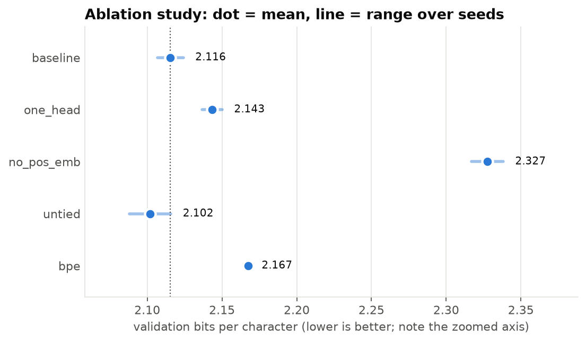

# Ablation study

Every variant starts from `configs/ablation.yaml` and changes exactly one thing. Each run: 3000 steps, seed(s) 1337, 1338. Generated by `python scripts/run_ablations.py`.

**How to read it.** *Val loss / token* is the usual cross-entropy in nats. It is **not comparable across tokenizers**, because a BPE token covers several characters. *Bits / char* divides the loss by the average characters per token (and converts nats to bits), so it is comparable for every row. Lower is better.

| Variant | What changed | Params | Val loss / token | Bits / char | vs baseline |
|---|---|---:|---:|---:|---:|
| `baseline` | Baseline: char tokenizer, 4 heads, positional embeddings, tied weights | 3.20M | 1.466 | 2.116 (2.107-2.124) | - |
| `one_head` | 1 attention head instead of 4 (same total width) | 3.20M | 1.486 | 2.143 (2.137-2.150) | +1.3% |
| `no_pos_emb` | No positional embeddings | 3.16M | 1.613 | 2.327 (2.317-2.338) | +10.0% |
| `untied` | Output layer NOT tied to the token embedding | 3.21M | 1.457 | 2.102 (2.088-2.116) | -0.6% |
| `bpe` | BPE tokenizer (vocab 512) instead of characters | 3.31M | 3.017 | 2.167 (2.166-2.169) | +2.5% |

Notes:

- *Val loss* is the best validation loss seen during the run (the checkpoint that would be kept).
- The range in parentheses is the lowest and highest value over the seeds. Two variants whose ranges overlap cannot be told apart by this experiment.
